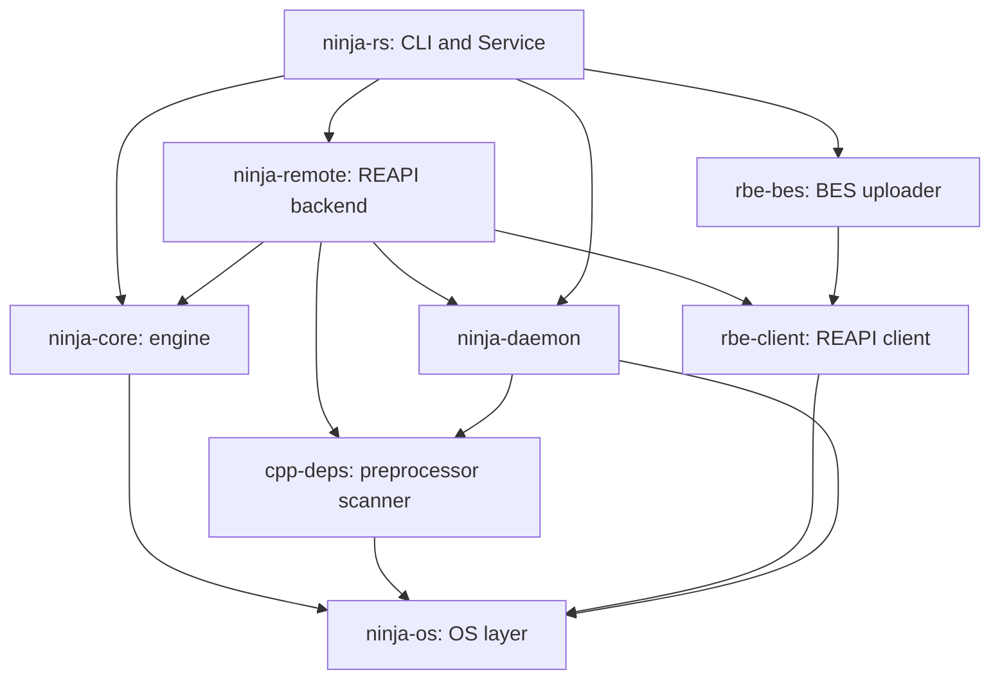
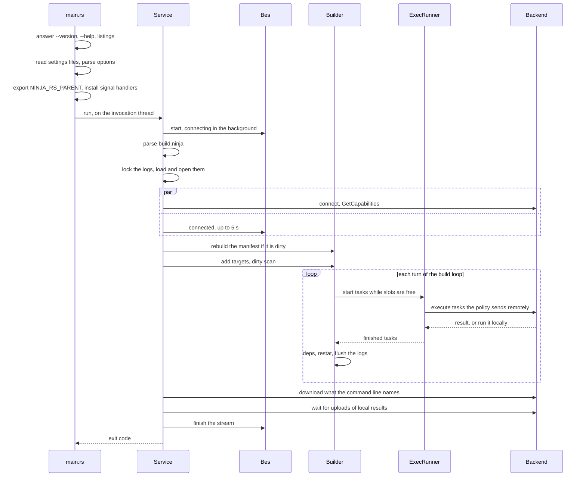
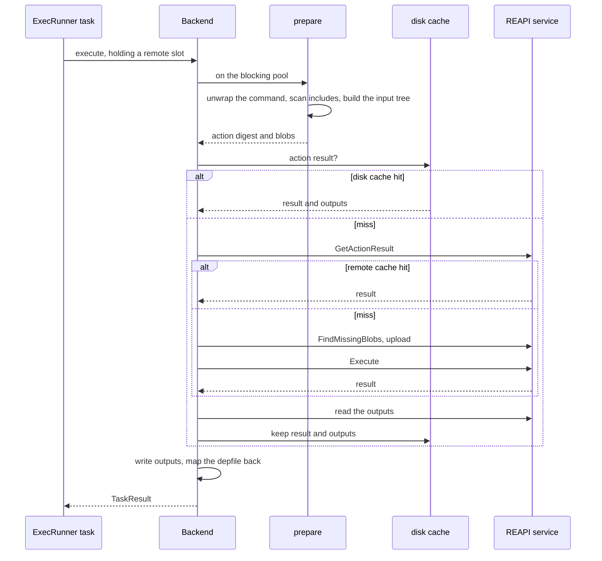
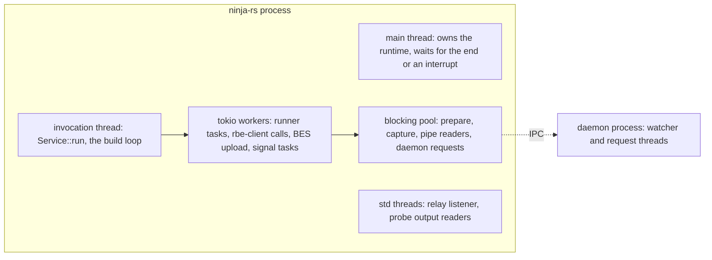

# Architecture

This page is the map for contributors: what the crates are, how one invocation flows through
them from the command line to the last download, which threads run what, where state lives
between builds, and the principles the design follows. Each crate has a page of its own:
[engine.md](engine.md) (ninja-core), [cli.md](cli.md) (the ninja-rs crate), [os.md](os.md)
(ninja-os), [remote.md](remote.md) (ninja-remote), [transport.md](transport.md) (rbe-client and
rbe-bes), [include-scanning.md](include-scanning.md) (cpp-deps and the scanner chain),
[daemon.md](daemon.md) (ninja-daemon) and [testing.md](testing.md).

## Use case

ninja-rs replaces ninja under CMake (or any generator writing ninja files). For a plain
`build.ninja` it behaves like ninja 1.13. For a manifest written with the generator-neutral RBE
interface ([rbe-interface.md](../rbe-interface.md): `rbe_version = 1` and per-edge `rbe_*`
bindings, which the CMake fork writes with `-DCMAKE_NINJA_RBE=ON`), it also runs actions through
the Remote Execution API v2, with a disk cache, a remote cache, Build Event Protocol uploads,
exact include scanning, a per-user daemon and nested invocations.

## Problems

The hard part is not any one feature but holding them together without breaking ninja's
contract:

- **ninja's semantics are the spec.** CMake, IDEs and scripts parse ninja's output, exit codes,
  `-t` tools and `--version`. A difference in a dirty check or a message is a bug report.
- **Remote execution must never change what a build produces.** An action's key must cover
  everything it reads, or a cache serves a wrong object to every machine sharing it. Most of
  the complexity of [remote.md](remote.md) and [include-scanning.md](include-scanning.md)
  comes from this.
- **Builds start builds.** CMake's `try_compile`, a generator's `-t restat`, ExternalProject and
  LLVM's `NATIVE` tools all run ninja-rs from inside a ninja-rs command, sometimes in the same
  build directory. They share logs, settings, credentials, build events and a lock (see
  [Nested invocations](cli.md#nested-invocations)).
- **Failure modes multiply.** A remote service can be unreachable, slow, half-broken behind a
  proxy, or refuse a certificate; a disk can fill; a process can be killed mid-write; a user
  presses Ctrl-C at any moment. Each must end in a correct build, a clean local fallback, or a
  clear error, never a wrong output.
- **Windows is a first-class host.** Long paths, `cmd.exe`, jobs instead of process groups,
  ACLs instead of mode bits, `cl.exe` and its traditional preprocessor.

## Solution

### Crates

The workspace has six product crates, two vendored ones and two for tests. The diagram shows
the dependencies between them (most crates also use ninja-os directly; only the edges that
matter for layering are drawn).

| Crate | Path | Role |
|---|---|---|
| ninja-core | `crates/ninja-core` | ninja's manifest language, graph, dirty scan, plan, build loop, build and deps logs, local subprocesses, status printer. No global state: files go through `disk::Disk`, commands through `runner::CommandRunner`. |
| ninja-remote | `crates/ninja-remote` | `RemoteBackend` implementation: policy, command unwrapping, path mapping, toolchain trees, the conservative scanner, action construction, upload, `Execute`, download, disk cache, `.ninja_remote`. |
| cpp-deps | `crates/cpp-deps` | The exact preprocessor scanner: evaluates directives as GCC, Clang or `cl` would, skips text. |
| ninja-daemon | `crates/ninja-daemon` | A per-user, per-binary daemon keeping lexed headers, profiles, digests and toolchain trees, watching their files. |
| ninja-os | `crates/ninja-os` | File stamps and identities, digests, locks, process identity, process trees, Windows security. |
| ninja-rs | `crates/ninja-rs` | The binary: options, settings files, nested invocations, `ExecRunner`, build events, certificate checks, the daemon client, `-t` tools. |
| rbe-client | `third_party/cargo-rbe/rbe-client` | REAPI v2 client (tonic, own TLS connector), retries, fault classification, Merkle trees, ByteStream, chunking. |
| rbe-bes | `third_party/cargo-rbe/rbe-bes` | Build Event Service uploader: ordered stream with acks, lifecycle events. |
| fake-reapi | `crates/fake-reapi` | In-process REAPI and BES server for tests, with failure injection. |
| test-dirs | `crates/test-dirs` | Per-test directories under Bazel's `TEST_TMPDIR`, runfiles lookup. |

The layering rule: ninja-core knows nothing of REAPI, CMake or the daemon. It sees a
`CommandRunner` that runs `Task`s and an optional `RemoteBackend` behind it (see
`crates/ninja-core/src/runner.rs`). Everything remote lives in ninja-remote and the vendored
crates; the ninja-rs crate wires them together.

### The life of one invocation

The sequence below follows `ninja-rs -C build` on a manifest with `rbe_version = 1` and
`--remote_executor` set, from `main` to the exit code. Tools, dry runs and the many error paths
are left out.

In code, the steps are:

1. `crates/ninja-rs/src/main.rs`: `options::answer` answers `--version`, `--help`, `-d list`,
   `-w list`, `-t list` and an unknown tool from the command line alone, as ninja does, before
   any settings file is read (CMake runs `--version`; a broken `.ninjars` must not change it).
   Then `nested::parent` reads what an outer invocation passed down, `rc::RcFiles::discover`
   and `rc::expand` read the settings files, and `options::parse_invocation` parses everything
   as one command line (see [cli.md](cli.md)).
2. `nested::export` sets `NINJA_RS_PARENT` before any thread starts (`set_var` isn't safe
   later), and binds the build event relay when this is the outermost invocation.
3. A multi-threaded tokio runtime starts, `Interrupt::install_handlers` takes SIGINT, SIGTERM
   and SIGHUP (Ctrl-C and Ctrl-Break on Windows), and `Service::run` runs on a thread of its
   own (see [Threads and async runtimes](#threads-and-async-runtimes)).
4. `Service::run_invocation` (`crates/ninja-rs/src/lib.rs`) loads the TLS files when the BES
   backend uses TLS, checking their dates before anything connects, then `Bes::start` opens the
   event file and starts connecting to the backend in the background.
5. `run_build_invocation` loops at most 100 times (manifest regenerations): it parses the
   manifest, takes the build directory's lock (`lock_logs`), loads `.ninja_rs_log` and
   `.ninja_rs_deps`, opens them for writing (an exclusive writer recompacts and cuts torn
   lines), and loads `.ninja_remote`.
6. `remote_backend` and `Bes::connected` run concurrently (`tokio::join!`): the REAPI
   connection is made and `GetCapabilities` answered while the build events' connection
   proves itself. A certificate refused on either ends the invocation here, before any
   command runs. An unreachable service, with `--remote_local_fallback` (the default), makes
   the build local with a warning.
7. `rebuild_manifest` builds `build.ninja` first if it is dirty, through the same runner and
   backend; a regenerated manifest starts the loop over.
8. `run_build` sets up the jobserver, makes the runner (`make_runner`: an `ExecRunner`, wrapped
   in `daemon::Telling` when the daemon is in use), adds the targets to the `Builder`, posts
   the plan to build events and runs `Builder::build` (see [engine.md](engine.md)).
9. After the build: what the command line names is downloaded (minimal downloads), records
   and digests are saved, uploads of local results to the remote cache are waited for
   (`finish_uploads`), summaries are printed, the disk cache is evicted down to 90% of its
   limit, and `Bes::finish` ends the stream. A certificate refused during the build turns a
   successful exit code into 1.

### The life of one remote action

Inside step 8, each task the policy sends remotely goes through `Backend::execute`
(`crates/ninja-remote/src/backend.rs`). The diagram is simplified: racing, steps on the host,
fallbacks and action rewinding are left out; [remote.md](remote.md) has them.

### Threads and async runtimes

ninja-rs is one process with one multi-threaded tokio runtime, a few named threads, and
optionally the daemon process. The diagram shows who runs what.

- **main thread.** `main.rs` builds the runtime and blocks on a `select!` of three futures: the
  invocation finishing, `Interrupt::unhandled` (an interrupt nothing acts on: the invocation
  ends with `128 + signal` once its build events end, within 2 s), and a third interrupt (exit
  at once, 130). It calls `std::process::exit`, so destructors don't run; the runtime isn't
  shut down, because background processes may hold pipes it would wait for.
- **invocation thread.** `Service::run` runs on a `std::thread` with an 8 MiB stack, under
  `Handle::block_on`. It is separate from the main thread so that an interrupt ends the
  invocation even while it doesn't yield: parsing a large manifest, a tool, waiting for a lock.
- **build loop.** `Builder::build` is an `async fn` on the invocation thread. It never blocks on
  a command: `ExecRunner` spawns each task into a `JoinSet` on the workers, and the loop awaits
  `wait_for_command`, then polls once more for results already finished (see
  [The build loop](engine.md#the-build-loop)).
- **blocking work.** Anything that reads many files or calls blocking APIs runs on tokio's
  blocking pool: `prepare` (scanning, hashing, Merkle trees), the capture of local results
  into caches, the reader of a command's output pipe, daemon requests. `remote_fetch` uses
  `block_in_place` so that the engine's synchronous `Disk` can download a dyndep file only the
  remote has.
- **plain threads.** The BES relay listener (`Bes::serve_relay`) and one thread per nested
  connection; `ninja_os::process::output` reads a probe's stdout and stderr on threads of its
  own, so a time limit can be enforced without async.
- **the daemon.** A separate process (`ninja-rs -t daemon run`), one per user and binary, with
  its own threads (file system watchers, a thread per connection). Builds talk to it over a
  Unix socket or named pipe (see [daemon.md](daemon.md)).

### Where state lives

| What | Where | Lifetime | Written by |
|---|---|---|---|
| Graph, plan, status | memory, `ninja_core::graph::State`, `Builder` | one manifest load | the invocation thread |
| Remote connection, file digests, scan caches, toolchain trees, uploaded hashes | `Service` and `ninja_remote::Store` | one process (kept across manifest regenerations) | backend tasks |
| Build log | `<builddir>/.ninja_rs_log` | across builds | lock holder; nested builds append |
| Deps log | `<builddir>/.ninja_rs_deps` | across builds | lock holder; nested builds append |
| Logs lock | `<builddir>/.ninja_rs_lock` (OS lock, holder line) | one invocation | the holder |
| Command start time | `<builddir>/.ninja_lock` (ninja's) | one build | the builder, removed at the end |
| Outputs left remote | `<builddir>/.ninja_remote` (journal) | across builds | lock holder; nested builds append |
| File digests | `<builddir>/.ninja_rs_digests` | across builds | after remote builds and builds with events |
| Rewritten response files | `<builddir>/.ninja_rs_rsp/` | swept when old | local runs of prepared actions |
| Disk cache | `--disk_cache` directory (`ac/`, `cas/`, `chunked/`, `tmp/`, `gc/`, `cpp-deps/` profiles) | across builds, size-bounded | backends, any process |
| Daemon | `$XDG_RUNTIME_DIR/ninja-rs`, else `ninja-rs-<uid>` in the temporary directory; `%LOCALAPPDATA%\ninja-rs\daemon` on Windows; `NINJA_RS_DAEMON_DIR` when set | until idle (3 h) | the daemon |
| Secret flags, relay socket | the daemon's directory (`flags-<pid>.json`, `relay-<pid>`) | one invocation | the outermost invocation |
| Context for nested invocations | environment: `NINJA_RS_PARENT`, `NINJA_RS_LOGS_LOCK`, and others | the commands of one invocation | `nested::export`, `make_runner` |

[../reference/files.md](../reference/files.md) documents each file's format, and
[../reference/environment.md](../reference/environment.md) each variable.

The `Service` holds what outlives one build, and the CLI runs one invocation per process (it
sets `skip_teardown`, leaking the graph and logs at exit as ninja does). Nothing else is global,
with two deliberate exceptions: the queue of messages printed around the status line
(`ninja_core::status::message`, fed by code the build loop doesn't see) and the process groups
the exit hook kills (`ninja_os::process`). The daemon is how state survives processes: what the
`Store` learns in memory, the daemon keeps and keeps valid by watching files.

### Design principles

These decide most trade-offs; reviews hold changes to them.

1. **ninja parity first.** Algorithms are ported from ninja (graph.cc, build.cc, the lexer, the
   depfile and `/showIncludes` parsers), with ninja's tests ported as unit tests. Messages keep
   ninja's `ninja: error:`, `ninja: warning:` and `FAILED: [code=N]` forms, exit codes follow
   ninja 1.13, and differences are listed and deliberate (see
   [engine.md](engine.md#parity-with-ninja)).
2. **Generic over generators.** ninja-rs reads the RBE interface, not CMake. What runs locally
   comes from `local` tool declarations and `rbe_local = 1`, platform properties from the
   toolchain file, never from recognizing a CMake rule name.
3. **Never a wrong output.** When an action's inputs can't be known exactly, the scanners send
   more (the conservative scanner) or the action runs locally. Results are checked before they
   are written (`check_result`), inputs that changed during the build are noticed, caches key on
   file stamps that tools can't fake, and a deps log that can't be read is rewritten rather
   than trusted.
4. **Fall back rather than fail, where that is safe.** An unreachable service, a command that
   can't be unwrapped, a scanner that can't be exact, a daemon that doesn't answer: the build
   goes on locally or without the cache, and says so (summaries, `--remote_verbose`).
   `--remote_strict`, `--remote_max_fallbacks` and `--remote_max_fallback_ratio` turn fallbacks
   into failures for those who want to know.
5. **Fail rather than fall back for certificate errors.** An expired, not yet valid or refused
   certificate, the server's or the client's, aborts the invocation (REAPI and BES alike, no
   retries, no local fallback). A certificate expiring within 14 days gives a warning, once per
   invocation tree. A silent local fallback would hide a security misconfiguration behind a
   slower build (see [cli.md](cli.md#certificates)).

## Alternatives rejected

- **Building on n2.** n2 lacked dyndep (which CMake needs for C++20 modules and Fortran),
  `console` pool semantics and most tools, and its single-threaded loop and on-disk database
  weren't made to be embedded behind an async runner. ninja-core ports ninja directly instead
  (see [engine.md](engine.md#why-an-own-engine)).
- **Running the build in the daemon.** The daemon keeps caches only; builds still run in the
  `ninja-rs` process that CMake and IDEs start, with its terminal, signals and exit code. A
  daemon crash then costs speed, never a build.
- **A thread per command.** Builds with `-j` in the hundreds plus `--remote_jobs` in the
  hundreds would mean hundreds of threads mostly waiting on the network; tasks on a tokio
  runtime wait for free.

## Limits

- The CLI runs one invocation per process: the `Service` could keep its caches for longer, but
  only the daemon does today.
- Two copies of process-tree code remain: ninja-core's for build commands and ninja-os's for
  probes, with different kill-on-close policies (see [os.md](os.md#process-trees-and-windows-jobs)).
- `crates/ninja-rs/src/lib.rs` (`run_build_invocation`) and
  `third_party/cargo-rbe/rbe-client/src/lib.rs` are long; splitting them is pending.

## Tests

- `crates/ninja-rs/tests/cli_e2e.rs` and `crates/ninja-rs/tests/remote_e2e.rs` run the real
  binary end to end, the latter against `fake-reapi` (see [testing.md](testing.md)).
- `tests/nativelink/run.sh` builds hermetic-llvm-cmake's sample against a local NativeLink in two
  checkouts and checks that every output is byte-identical.
