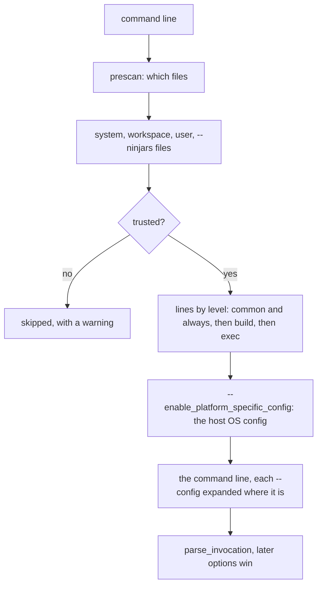
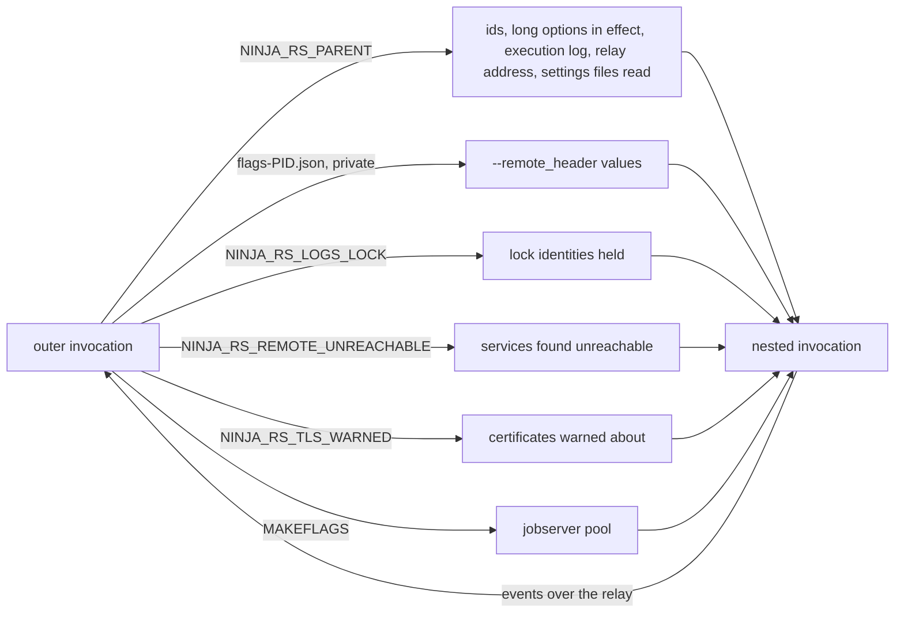
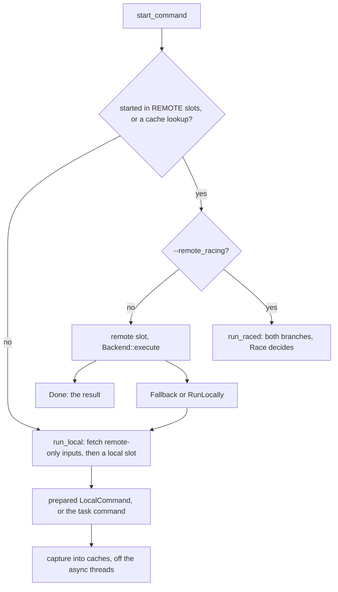
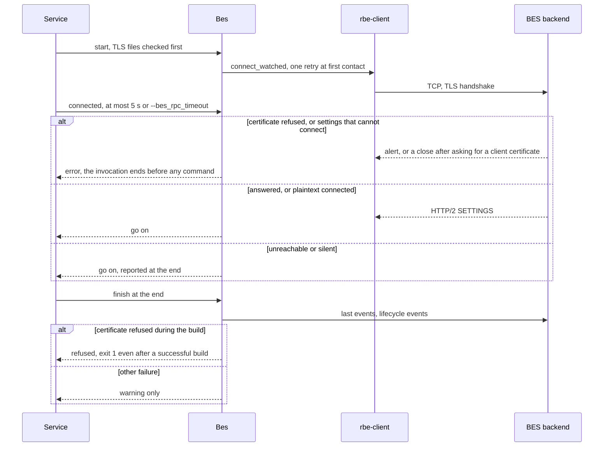
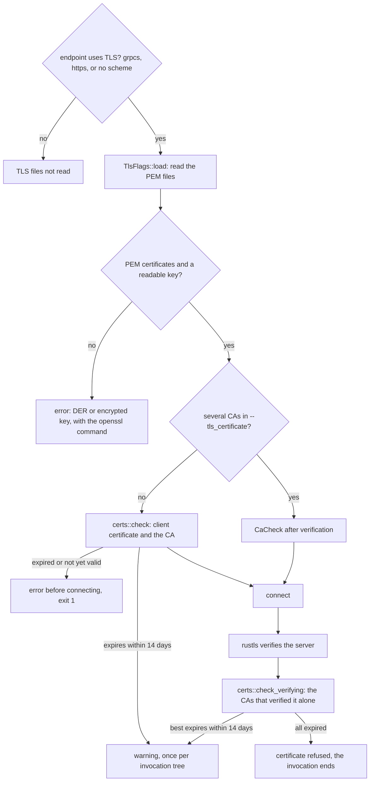

# The command line (ninja-rs crate)

`crates/ninja-rs` is the binary and the glue: it parses options and settings files, passes context
to nested invocations, runs commands locally or through the remote backend (`ExecRunner`), reports
build events, checks certificates, talks to the daemon, and implements the `-t` tools.
[architecture.md](architecture.md) shows the life of an invocation through it; this page explains
each part. User-facing behaviour is in [../user/settings.md](../user/settings.md),
[../user/nested-builds.md](../user/nested-builds.md),
[../user/certificates.md](../user/certificates.md) and
[../reference/options.md](../reference/options.md).

| File | Part |
|---|---|
| `src/main.rs` | process setup: answers, settings, runtime, signals, exit |
| `src/lib.rs` | `Service`: one invocation (see [architecture.md](architecture.md)) |
| `src/options.rs` | option parsing, conflicts, TLS flags and hints |
| `src/rc.rs` | `.ninjars` settings files and their trust |
| `src/nested.rs` | nested invocations: environment, secret flags, the build event relay |
| `src/exec_runner.rs` | the `CommandRunner` used by builds: local and remote slots, racing |
| `src/bes.rs` | build events (BEP) and the BES upload |
| `src/certs.rs` | X.509 dates, read from DER |
| `src/daemon.rs` | the daemon client, `Telling`, `-t daemon` |
| `src/jobserver.rs` | GNU make jobserver client and pool (see [engine.md](engine.md#the-jobserver)) |
| `src/tools.rs` | `-t` tools |

## Option parsing

**Use case.** One parser for ninja's options (`-C`, `-f`, `-j`, `-k`, `-n`, `-v`, `-d`, `-w`, `-t`)
and Bazel-named long options (`--remote_executor`, `--disk_cache`, `--bes_backend`...), from the
command line, from settings files, and from the invocation running this one.

**Problems.**

- ninja's options follow getopt (`-j8`, `-j 8`, `-nv`; `-t` ends the options), and tools parse
  its messages, so errors must read as ninja's: getopt's text with the usage, `did you mean`
  suggestions, exit 1.
- Bazel's long options have their own forms (`--name`, `--noname`, `--name=false`, durations
  with units, an empty value unsetting), and a `.bazelrc` shared with Bazel must mean the same.
- `--version` and the listings must not depend on settings files: CMake runs `--version` to
  find the generator, and a broken `.ninjars` must not change or fail it.
- Options conflict (`--remote_racing` runs actions locally, `--remote_strict` forbids it), and
  where they come from matters: a settings file sets one, the command line the other.
- Overrides must not leak into nested invocations: when a typed option once overrode a
  settings file's, the conflicting option was still passed to nested invocations as if given,
  and every nested ninja-rs failed on the conflict, CMake's `-t restat` at regeneration
  included.

**Solution.** `options::parse_unchecked` walks the arguments once: long options through
`bool_option` (Bazel's boolean forms) and a `match` on the name, short ones getopt style. Each
option given is kept as a `GivenOption` (`combined_form`, `name`, `value`, `index`, `explicit`,
`left_out`) for build events and nested invocations. Path values are made absolute where
ninja-rs started (not after `-C`), `~` expanded as Bazel does; headers are validated as gRPC
metadata (`rbe_client::header`); durations take `ms`, `s`, `m`, `h`, `d` or the flag's old unit.

- `options::answer` runs first in `main`, before any file is read: `--version`, `--help`,
  `-d list`, `-w list`, `-t list` and an unknown tool are answered from the command line alone,
  on the stream and with the exit code ninja uses (`-d list` and `-w list` on stdout with exit
  1, `--help` on stderr with exit 1).
- `options::error_text` gives ninja's forms: getopt's message plus the usage, `ninja: error:`
  for an unknown `-d` or `-w` mode with a suggestion (`did_you_mean`, ninja's edit distance),
  `ninja: fatal:` for the rest.
- `parse_invocation` marks which arguments were typed (`explicit`), then `validate` applies the
  conflict rules: a typed option wins over one from a settings file or the parent invocation,
  with a warning, and the loser is marked `left_out`; two typed ones are an error.
  `--remote_cache` naming another service than `--remote_executor` is left out with a warning
  (the executor's cache is used, as Bazel does). `--tls_client_certificate` and
  `--tls_client_key` go together.
- Left-out options aren't exported to nested invocations (`nested::exported_flags`) and aren't
  in the build events' canonical command line, which shows the options in effect; the original
  command line keeps them.

**Tests.** `options.rs` unit tests (`typed_options_win_conflicts`, `ninja_messages`,
`command_line_answers`, `remote_cache_flags`, `tls_files_hold_pem`, `tls_hints`,
`headers_are_checked`); `cli_e2e.rs` `answers_without_settings`, `nested_after_an_override`,
`exit_codes`; `bes.rs` `options_left_out_arent_canonical`.

## Settings files

**Use case.** A project keeps its executor, BES, disk cache and mnemonics in `.ninjars` files
(Bazel's `.bazelrc` format), so that `cmake --build` and IDEs build with them, and can share
one file with Bazel (`import %workspace%/.bazelrc`).

**Problems.**

- Bazel's grammar: `COMMAND[:CONFIG]` lines, imports, configs that nest, shell-like words,
  options Bazel has and ninja-rs doesn't, short options that are Bazel's (`-c opt`), and values
  that look like options (`--copt -fPIC`).
- Which files are read must be decided before any is read, from the command line alone.
- **Trust.** A `.ninjars` names an executor, headers and action environment: a file planted by
  another local user would send builds (and their tokens) to a server of theirs. The workspace
  file is found by searching up from the build directory, so a shared directory (`/tmp`, a drive
  root on Windows, a Windows drive under WSL) is a planting ground. Each case needs care: WSL
  drives, where every file looks like the user's, and data drives, where another user can
  create `E:\Users\<you>`, were both holes once; a user private group's `g+w` is harmless and
  must not be refused; and a group's member list leaves out the accounts whose primary group it
  is.

**Solution.** `rc::prescan` reads `-C`, `-t`, `--ninjars`, `--[no]system_rc`, `--[no]workspace_rc`,
`--[no]home_rc` and `--ignore_all_rc_files` from the command line. `RcFiles::discover` reads, in
order: the system's (`/etc/ninjars`, `%ProgramData%\ninjars`), the workspace's (the first
`.ninjars` from the build directory up to a repository root, short of the home directory and of
the file system's root), the user's (`~/.ninjars`), then the `--ninjars` files (`/dev/null` ends
them). `rc::expand` turns them into one argument list, as the diagram shows; it is parsed as one
command line (see [Option parsing](#option-parsing)).

- Levels go from least to most specific: `common` and `always`, then `build` (builds and tools),
  then `exec` (`-t exec`); within a level, lines in the order read across files and imports.
  `--config=NAME` adds its lines where it is given, least specific command first; cycles and
  undefined configs are errors.
- `common` lines, and every line of Bazel's own files (named `*bazelrc`, and what they import),
  are shared with Bazel: options ninja-rs doesn't have are skipped (`--announce_rc` lists them),
  values only Bazel takes are skipped with a note, short options are Bazel's, and a separate
  value is read as Bazel reads it (`bazel_option_len`). `--action_env` options of Bazel's files
  apply, and `--announce_rc` lists them; `--action_env=PATH` (the host's value) gets a note: it
  puts this machine's `PATH` in every action's key.
- Options that choose files, `-C` and `-t` only go on the command line (`check_rc_option`).

Trust (`system_file`, `workspace_file_below`, `trusted_file`, `writable_by_others`) skips the
system's and the workspace's files, with a warning naming the file and a remedy, unless only the
user and the administrators could have written them:

| System | A file is trusted when | A directory on the way up stops the search when |
|---|---|---|
| Unix | owned by the user or root, not writable by others, nor by its group unless it is the user's private group (named after them, their primary group, no other member, and no other account's primary group) | writable by all (`/tmp`, a `chmod -R 777` tree) |
| WSL, Windows drive mounted without `metadata` | in the user's profile on the drive Windows is on (`/mnt/c/Users/<user>`) | outside that profile |
| Windows | owned by the user, Administrators, SYSTEM or TrustedInstaller, and no allow entry of its DACL gives anyone else write, append, delete, delete-child, `WRITE_DAC`, `WRITE_OWNER` or a generic right including them (the entry and what it links to) | the same test fails (below a drive's root, Authenticated Users may modify) |

The Windows check reads the security descriptor through `ninja_os::windows::file_security` (see
[os.md](os.md#windows-security)); a descriptor that can't be read counts as untrusted. WSL drives
are told by their file system (`drvfs`, or `9p` with `aname=drvfs`, from
`/proc/self/mountinfo`), not by their permissions, which a `chmod -R 777` tree shares; the
system drive comes from `SystemDrive` when `WSLENV` passes it, else from the Windows directory on
`PATH`, else `C`. `~/.ninjars` and `--ninjars` files aren't checked: the user named them.

A nested invocation doesn't read the files again for their options (its parent passed them as
flags); it re-reads the files its parent read only to expand its own `--config`s
(`RcFiles::reread`, `expand` with `outermost` false).

**Limits.** Accounts that the system's databases don't list (LDAP without enumeration) can't
be seen by the private-group check, which then trusts a group it can't fully inspect.

**Tests.** `rc.rs` (`order_and_configs`, `shared_with_bazel`, `shared_lines_have_bazel_syntax`,
`bazel_imports`, `workspace_search_stops_at_home`, `writable_files_are_skipped`,
`private_groups`, `windows_drives_under_wsl`, `workspace_permissions` and
`system_file_permissions` on Windows with `icacls`, `exec_takes_build_lines`); `cli_e2e.rs`
`ninjars`.

## Nested invocations

**Use case.** Builds start builds: CMake's `try_compile` during a configure run by the build,
a generator's `-t restat`, ExternalProject, LLVM's `NATIVE` tools. They should be one invocation:
the same settings, the same remote service, one stream of build events, one execution log.

**Problems.**

- Settings: the nested invocation runs in another directory, maybe without the workspace's
  `.ninjars`, and its own options must still win.
- Credentials: `--remote_header` values are often tokens; the environment every build command
  sees ends up in crash dumps and CI logs.
- Build events: a nested build must not open its own BES stream (a second invocation in the
  UI), and its targets must not collide with the outer ones (LLVM builds `llvm-tblgen` in both).
- Shared state: the logs lock (see [engine.md](engine.md#the-lock)), a remote service found
  unreachable (each nested build would wait for it again), certificate warnings (said once per
  invocation tree), a jobserver pool.
- Processes killed or crashed leave files behind.

**Solution.** The diagram shows what an invocation passes to the invocations its commands run.

- `nested::export` (called before any thread starts) sets `NINJA_RS_PARENT` for builds and
  `-t exec` only (not for other tools: `-t daemon start` would hand the daemon the secrets). It
  holds the invocation and build request ids, the long options in effect (`exported_flags`:
  not left-out ones, not per-invocation ones such as build events, ids, `--execution_log_file`,
  verbosity, `--config`; paths absolute), the execution log, the relay address, and the
  settings files read with their workspace.
- `--remote_header` and `--bes_header` values go in `flags-<pid>.json` in the daemon's private
  directory, created private (`ipc::create_private_file`: mode 0600, or a protected DACL for the
  user and SYSTEM), which `NINJA_RS_PARENT` names and the invocation removes when it ends;
  writing one sweeps those of processes that are gone.
- `nested::adopt` gives the nested invocation the parent's ids (every remote request carries
  the outer `tool_invocation_id`), the relay unless it has its own BES flags, and the execution
  log, appended to. `main` puts the parent's flags before its own arguments, as not typed, so
  its own win and conflicts resolve as in [Option parsing](#option-parsing).
- `Service::make_runner` adds the per-build context to the commands' environment:
  `NINJA_RS_LOGS_LOCK`, `NINJA_RS_REMOTE_UNREACHABLE` (a nested invocation does without those
  services at once, under the same `--remote_local_fallback` rules), `NINJA_RS_TLS_WARNED`,
  `NINJA_RS_BAZEL_DISK_CACHES` (a disk cache noted as Bazel's isn't noted again), and `MAKEFLAGS`
  for a jobserver pool.
- **The relay.** With a BES backend or an event file, the outermost invocation listens on
  `relay-<pid>` (a Unix socket or a named pipe of `ninja_daemon::ipc`). A nested invocation
  connects, sends its build directory, then its events as length-prefixed `BuildEvent`s
  (`nested::write_frame`), and ends with an empty frame the outer one acknowledges once merged.
  `Bes::relayed` re-posts them: progress as its own, configurations and targets under a
  configuration of their own (`<id>-<dir tag>`, the mnemonic suffixed with the nested build
  directory), output paths prefixed with it, metrics added. A nested build without
  `rbe_version` (a `try_compile`) leaves the relay: it has nothing to add.

### `-t exec`

`-t exec [--] COMMAND [ARGS...]` makes any command the outermost invocation: a configure that
builds external projects, a script running several builds. It exports the same context, owns
the build events (`BuildStarted` with the command `exec`), waits for the BES connection to prove
itself (a certificate refused ends it before the command runs), starts the execution log, runs
the command and exits with its code (127 if it can't start, `128 + signal` if it died of one).
`.ninjars` `exec` lines apply, and the `build` ones.

It holds an interrupt `Handling` guard, so an interrupt is the command's to act on. On Windows,
Ctrl-C and Ctrl-Break reach every process of the console already. On Unix the command shares
the terminal: SIGTERM is always passed on (a terminal never sends it), SIGINT and SIGHUP only
when the terminal didn't already send them to the foreground group holding the command: when a
process sent them (`Interrupt::last_sent_by_process`, Linux) or ninja-rs isn't in the
foreground. A second interrupt kills the command.

**Limits.** `kill -INT -<pgid>` aimed at the whole group reaches the command twice (from the
group, and forwarded, since it was sent by a process).

**Tests.** `nested.rs` `secret_flags_stay_out_of_the_environment`,
`secret_flags_of_processes_gone_are_swept`, `options_left_out_arent_passed_on`,
`only_builds_export`; `cli_e2e.rs` `nested_after_an_override`, `cross_nested_builds`,
`exec_forwards_signals`, `exec_forwards_sigint_from_processes`; `remote_e2e.rs`
`nested_invocation`, `exec`, `unreachable_nested`.

## The exec runner

**Use case.** `ExecRunner` (`src/exec_runner.rs`) is the `CommandRunner` builds use: it runs each
task on the host, or through the `RemoteBackend` when the backend's policy wants it, within the
slots the engine counts (see [engine.md](engine.md#the-plan-the-ready-queue-and-slot-kinds)).

**Problems.**

- A task sent remotely can come back as "run it locally" (`RemoteOutcome::Fallback`), or "run it
  locally, then give me the result" (`RunLocally` with a capture, for caches), and then needs a
  local slot it wasn't started with.
- A local run of a prepared action must write the bytes remote execution would: the remote
  action's argv, paths relative to the build directory, rewritten response files. Otherwise
  cached results and the keys of later actions depend on the checkout.
- Inputs that only exist remotely (outputs left in the remote cache with minimal downloads)
  must be downloaded before a local command reads them, but not while holding a slot.
- Racing: the local and remote branches must never both write the outputs, and a speculative
  local run must not take a slot a local task is waiting for.
- On interrupt or failure, every local command must have exited before the engine deletes their
  outputs; remote work can simply be dropped.

**Solution.** The diagram shows a task's path.

- `run_local` asks the backend to materialize the task's remote-only inputs first, then moves
  the task's count to LOCAL (`Counted::local`) and waits for a slot: a `-j` semaphore, or a
  jobserver token (`LocalSlots`). A prepared `LocalCommand` runs through `subprocess::run_argv`
  after its response files are written atomically (`write_files`); its depfile and
  `/showIncludes` lines are mapped back to local paths (`map_back`).
- The remote path holds a `--remote_jobs` permit while `Backend::execute` runs, under
  `with_host_stop`, so that steps the backend runs on the host are stopped with the runner's
  commands.
- `run_raced` runs `execute_raced` and `race_local` together. The local branch waits
  `--remote_racing_delay` (250 ms by default: most remote cache hits finish first) and for the
  action to be prepared (it runs the remote command), fetches inputs, then takes a local slot
  only if one is free (`try_acquire`, `try_acquire_in_turn` for a jobserver), so it never queues
  ahead of local tasks; once the remote branch gives up (`Race::need_local`) it queues like any
  local task. `ninja_core::runner::Race` decides who writes: the remote branch claims the outputs
  before restoring a hit or downloading, which stops a running local command (its whole process
  tree) and waits until it exited; a local command that finished first claims its result, and
  the remote branch stops without writing.
- `RunLocally` captures (`LocalCapture::capture`) run on the blocking pool: storing outputs reads
  files.
- `abort` stops local commands and waits for them (`Stop::stop`), then aborts the remaining
  tasks: remote executions and tasks waiting for a slot are dropped.
- `wants_inputs` is true only with a backend: without one, the engine doesn't gather inputs.

**Limits.** The slot accounting gaps: cache lookups bounded by `-j`, fallbacks piling up in the
runner, raced runs taking local slots unseen (see
[engine.md](engine.md#the-plan-the-ready-queue-and-slot-kinds)). An interrupt while a finished
task's capture runs reports it interrupted, and its output is deleted.

**Tests.** `exec_runner.rs` (`abort_stops_host_steps`, `abort_waits_for_every_local_process`,
`tasks_take_slots_of_their_kind`, `raced_runs_only_take_free_slots`,
`raced_runs_fetch_inputs_before_taking_a_slot`, `caches_alone_take_local_slots`);
`runner.rs` `race_tests`; `remote_e2e.rs` `racing`, `racing_evicted_hit`,
`racing_output_changed_before_claim`, `fallback_guards`.

## Build events

**Use case.** A build shows up in a BES UI (EngFlow, BuildBuddy and the like) like a Bazel
invocation: targets, configurations, failed actions, console output, metrics
(see [../user/build-events.md](../user/build-events.md)).

**Problems.**

- The build must not wait for a slow or unreachable backend, and events must not be lost
  while the connection is made.
- Yet a certificate refused must end the invocation before any command runs (the certificate
  rule), and with TLS 1.3 a server refuses a client certificate only after the handshake: the
  client learns it from the server's first frames, or a closed connection.
- Hashing artifacts for `file://` references must not slow the build loop, nor hold up an
  interrupted build.
- Nested invocations' events must merge into one stream (see [The relay](#nested-invocations)).

**Solution.** `Bes::start` opens the event file and starts the uploader with
`rbe_client::connect_watched` in the background (`BesUploader::connecting_watched`); events queue
meanwhile. The sequence shows how connecting is judged.

- `Bes::announce` sends the invocation's first events once the manifest is loaded (before any
  regeneration): `BuildStarted`, the structured command lines (`original` with every option
  given, headers redacted; `canonical` without left-out ones) and the pattern, from the targets
  named or the manifest's defaults, labelled by the `rbe_targets` file.
- `Bes::plan` runs once the targets are in the plan: the edges they need give the targets
  (`rbe_target`, `rbe_config`) and their artifacts; targets with nothing to run complete at once.
  `ReportingStatus` feeds both the status printer and the events; a target completes when its
  last edge finishes or leaves the plan (restat).
- Artifacts are hashed off the build loop by `report_targets`, four targets at once
  (`HASHERS`), through the file digest cache; `settle` waits for them before the cache is saved;
  after an interrupt targets are reported without them.
- `Bes::finish` aborts the targets that never completed (`USER_INTERRUPTED`, `SKIPPED` after a
  failure), posts `BuildFinished` (`INTERRUPTED` only when the invocation was interrupted, not
  for a command exiting 130), `BuildMetrics` and `BuildToolLogs`, waits up to `--bes_timeout`
  for the upload, and returns whether a certificate was refused.
- Every other failure is a warning: build events never fail a build otherwise.

**Limits.** The BES connection gets one retry at first contact (about 0.1 s), so a load
balancer restarting as the build starts loses the invocation's events; REAPI gets five. A
silent TLS backend holds the start for up to 5 s.

**Tests.** `bes.rs` (`the_build_doesnt_wait_for_the_backend`, `broken_tunnels_dont_hold_the_build`,
`artifacts_are_hashed_off_the_build_loop`, `interrupted_builds_dont_wait_for_hashing`,
`interruptions_are_told_apart_from_exit_codes`, `events_after_the_end_go_nowhere`);
`remote_e2e.rs` `build_events`, `build_events_faults`, `build_events_untrusted_server`,
`build_events_refused_client_certificate`; `cli_e2e.rs` `build_event_digests`.

## Certificates

**Use case.** `grpcs://` endpoints (REAPI and BES) use TLS with Bazel's flags:
`--tls_certificate` (CAs trusted instead of the public roots), `--tls_client_certificate` and
`--tls_client_key` (mTLS), `--tls_authority_override`. The certificate rule applies (see
[architecture.md](architecture.md#design-principles)).

**Problems.**

- A server refusing an expired client certificate may say nothing but close the connection:
  without a check before connecting, the user sees "connection reset" and a local fallback.
- A `--tls_certificate` bundle (a system CA file) holds dozens of CAs, some expired, which never
  matter: only the one that verifies the server does.
- Nested invocations would repeat the same expiry warning dozens of times.
- DER files, encrypted keys and mismatched keys must give a clear error, not an empty trust
  store.

**Solution.** The decision chain:

- `certs.rs` reads PEM sections, decodes the DER and the TBSCertificate's validity (UTCTime with
  RFC 5280's 50/49 century rule, GeneralizedTime strictly), without any other parsing: signatures
  are TLS's business. `check` names the certificate (`the client certificate
  (--tls_client_certificate=...)`, `CA certificate 2 of 3 (...)`) and the date (`2026-10-01 12:00
  UTC`); a certificate not yet valid asks whether the clock is right.
- `TlsFlags::load` (`options.rs`) runs only for an endpoint that uses TLS (`uses_tls`): a
  `grpc://` endpoint never reads the files. `Service::load_tls` warns about expiring files once,
  skipping those in `NINJA_RS_TLS_WARNED`; `warn_ca` reports bundle CAs found expiring by
  connections during the build.
- REAPI: `remote_backend` loads TLS before `connect_checked`; a certificate fault is the build's
  error, never "unreachable", and during the build `Backend::execute` fails the action rather
  than fall back (`certificate_refused`). BES: see [Build events](#build-events).
- `options::tls_hint` explains a failed TLS connection: whose certificate was refused (from the
  server's alert, or from a close after it asked for one: `fault::ClientCertificateRefused`),
  what was sent or checked, and what to try. `plaintext_hint` covers `grpc://` to a server that
  speaks TLS. The judgement of refusals itself is in rbe-client (see
  [transport.md](transport.md)).

**Limits.**

- **False refusals.** A server that accepted the client certificate and answered, but whose
  answer the client never read (a draining mTLS server sending SETTINGS and GOAWAY, then
  closing), can be judged to have refused the certificate: the build fails, with a message
  sending the user after their certificates.
- That message can include a debug dump of the transport error.
- `--tls_authority_override` changes the TLS name and SNI, not the `:authority` header (Bazel
  sets both).

**Tests.** `certs.rs` (`utc_and_generalized_times`, `utc_time_years_from_1950_to_2049`,
`malformed_certificates`, `pem_sections`, `checks_dates`, `checks_the_cas_that_verified`);
`options.rs` (`tls_certificate_dates`, `tls_files_hold_pem`, `bundles_check_the_ca_that_verified`,
`tls_hints`); `remote_e2e.rs` `expired_certificate_before_connecting`,
`certificate_expiring_soon`, `certificate_refused_during_build`, `ca_bundles`, `mtls`.

## The daemon client

**Use case.** With `--daemon` (or `NINJA_RS_DAEMON=1`), builds ask the daemon for lexed headers,
profiles, digests and toolchain trees (see [daemon.md](daemon.md)). `src/daemon.rs` finds or
starts it, tells it what builds do, and implements `-t daemon`.

**Problems.** The daemon must be this binary's (a rebuilt ninja-rs gets its own), must never
receive a build's secrets or lock, must not block builds when it fails, and must learn when a
command on the host wrote files it didn't name (a generator's tree), or it answers from stale
state.

**Solution.**

- `connect` finds the daemon by the binary's identity (`Location::for_exe`: volume and file id,
  size, mtime) and starts one when none answers (`Client::connect_or_start`), detached, with
  `-t daemon run --id <id>`, without `NINJA_RS_PARENT` and `NINJA_RS_LOGS_LOCK` in its
  environment, and with `NINJA_RS_DAEMON_EXE` naming the binary (on Windows it runs a copy in its
  directory, so that ninja-rs can be rebuilt while it runs). A daemon that failed to start, or
  doesn't say hello within 5 s, is not tried again for 5 minutes (its `.failed` file); builds go
  on without it, with a warning. `-t daemon start` clears that.
- `Service::remote_backend` begins a session (`Begin`: build directory, environment, profile
  directory, digests file, volatile directories) on the blocking pool; a failure is a warning.
- `Telling` wraps the runner: each task that ran on the host (`ExecKind::Local`) calls
  `Client::ran_locally`, so the daemon's next answer first fences its watchers (see
  [daemon.md](daemon.md)). It forwards the slot methods, so the engine sees the inner runner's
  kinds.
- `-t daemon [status|start|stop|run]` prints what it keeps and watches, starts or stops it, or
  runs it in the foreground (`NINJA_RS_DAEMON_IDLE` sets its idle exit, 3 hours by default).

**Limits.** Host steps of remote and cache-hit actions, and raced local runs that lost, aren't
`ExecKind::Local`, so they don't fence the next requests on Windows. A daemon that says hello
but never answers `Begin` costs every build 120 s, without back-off.

**Tests.** `daemon.rs` `local_commands_told`; `cli_e2e.rs` `daemon_pipes`; `remote_e2e.rs`
`daemon`.

## Tools

**Use case.** ninja's `-t` tools, plus `exec` and `daemon` (see
[../reference/tools.md](../reference/tools.md)).

**Solution.** `tools::TOOLS` lists each with when it runs: `AfterFlags` (`daemon`, `exec`,
`restat`, `wincodepage`: before the manifest, as ninja's `restat` does), `AfterLoad` (`clean`,
`compdb`, `compdb-targets`, `commands`, `inputs`, `rules`, `targets`) or `AfterLogs`
(`cleandead`, `deps`, `missingdeps`, `query`, `recompact`). The file shadows `print!`,
`println!` and `eprintln!` with macros over `print_out` and `print_err`, so tools never panic on
a closed pipe; on Unix they die of SIGPIPE instead, as ninja's (141). Behaviours specific to
ninja-rs:

- `-t clean` and `-t cleandead` remove outputs through `RemoteDisk`, so only the records of the
  outputs they removed leave `.ninja_remote`.
- `-t recompact` takes the lock; run under an inherited lock (a generator), it does nothing.
- `-t restat` takes the lock, waits (saying so on stderr, which CMake doesn't discard), or
  inherits it and appends only the records that changed.

**Tests.** `cli_e2e.rs` `rules`, `inputs`, `compdb`, `missingdeps`, `targets_depth`,
`wincodepage`, `clean_keeps_other_remote_records`, `restat_waits_on_stderr`.

## Limits

Beyond the per-section limits above:

- `run_build_invocation` (`src/lib.rs`) is long, and setting up an invocation is spread between
  `main.rs` and `Service`; a split is pending.
- An interrupt outside the build loop ends build events within 2 s, then exits: lifecycle events
  of a slow backend may be cut.
