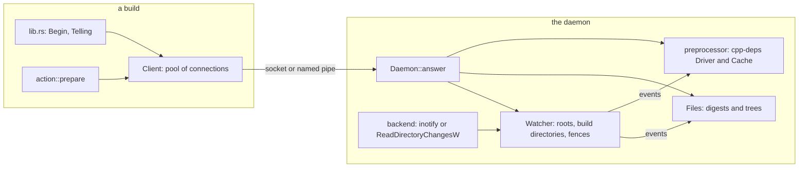
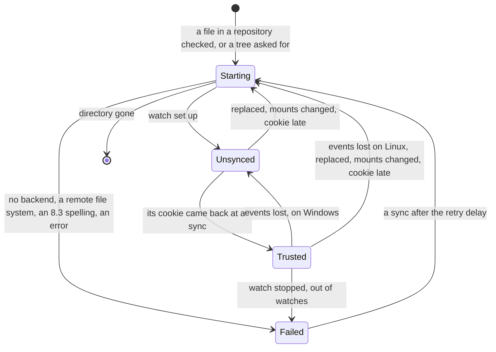
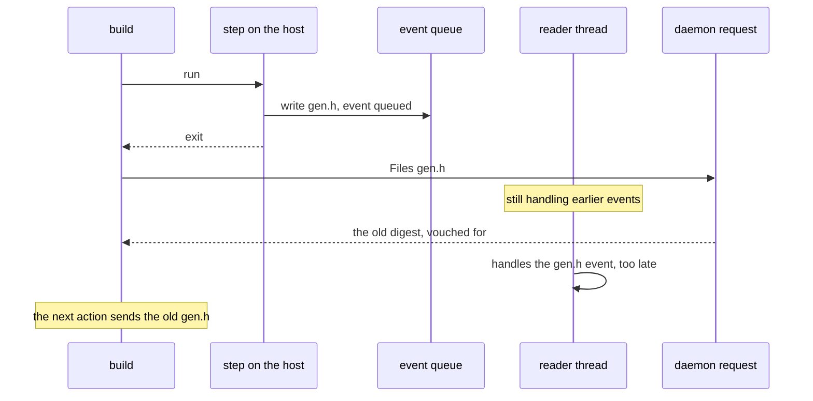
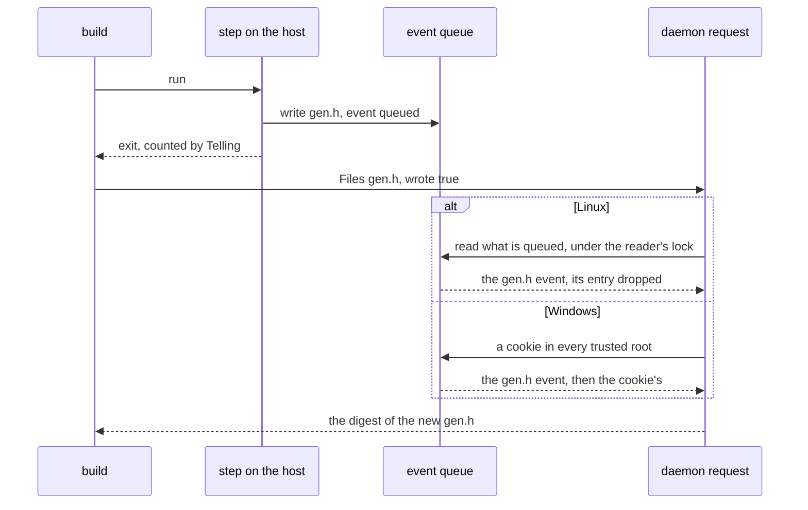
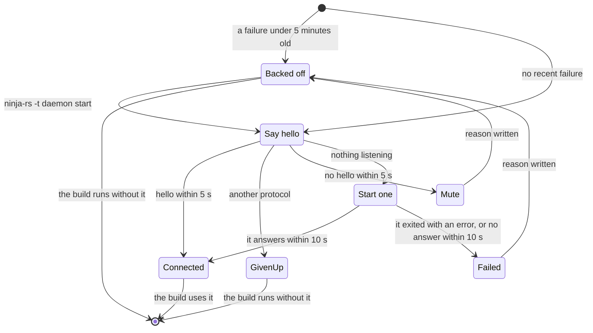

# The daemon

This page is for contributors and reviewers. It explains `crates/ninja-daemon`: a per-user
process that keeps what builds learn (lexed headers, compiler profiles, file digests, toolchain
trees) between builds, and watches the files it comes from so that a build checks again only what
changed. For using it, see [The daemon](../user/daemon.md); the scanner whose caches it keeps is
in [include-scanning.md](include-scanning.md).

## Code map

| Where | What |
|---|---|
| `crates/ninja-daemon/src/server.rs` | `Daemon`: requests, sessions, `serve`, the log, panics |
| `crates/ninja-daemon/src/client.rs` | `Client`: the connection pool, `connect_or_start`, the `wrote` hint |
| `crates/ninja-daemon/src/proto.rs` | messages, framing, `PROTOCOL` |
| `crates/ninja-daemon/src/ipc.rs` | `Location`, sockets and named pipes, `spawn_detached`, `remove_others` |
| `crates/ninja-daemon/src/files.rs` | `Files`: digests and toolchain trees |
| `crates/ninja-daemon/src/watch/mod.rs` | `Watcher`: roots, sync, cookies, fences, `BuildDirs`, vouching |
| `crates/ninja-daemon/src/watch/linux.rs` | inotify |
| `crates/ninja-daemon/src/watch/windows.rs` | `ReadDirectoryChangesW` |
| `crates/cpp-deps/src/path_map.rs` | `PathMap`, `PathKey`: the maps every cache uses |
| `crates/cpp-deps/src/scan.rs` | `Cache`, `Watch`, `fold_case`: the preprocessor's side |
| `crates/ninja-rs/src/daemon.rs` | `connect`, `Telling`, `-t daemon` |

## Use case

`--daemon` (or `NINJA_RS_DAEMON=1`) is for developers' builds, which run again and again in the
same checkouts. It matters only for builds with a remote service or a disk cache: it serves the
remote backend's scans, digests and toolchain trees. One daemon serves every build of a user and
a ninja-rs binary. The first build that wants it starts it; it exits after `NINJA_RS_DAEMON_IDLE`
seconds without requests (3 hours by default), when its binary is rebuilt or removed, or when
asked to.

Callers:

- `ninja-rs`'s `lib.rs` connects (`daemon::connect`), begins the build (`Request::Begin`: the
  build directory, the environment, the profile directory, the digests file, the directories the
  build writes to) and wraps the command runner in `daemon::Telling`.
- `ninja_remote::action::prepare`, through `Shared::daemon`: `Client::scan` for the preprocessor
  scanner, `Client::files` for an action's input digests, `Client::tree` for a toolchain
  directory's listing. On any error the build stops using the daemon and does the work itself
  (`Shared::daemon_failed`), and says so once at the end.
- `-t daemon status|start|stop|run` (`crates/ninja-rs/src/daemon.rs`).

The build still does everything else: the manifest, dirty checking, execution, uploads.

## Problems

### Why a daemon

A ninja-rs process lives for one build, and its caches die with it. Without a daemon, every build
lexes again every header its compiles read, checks the stamp of every input, walks every
toolchain directory, and lists the same directories again. Profiles and digests persist on disk
(the disk cache's `cpp-deps/`, the build's `.ninja_rs_digests`), but each entry still costs a
stat per build to be trusted.

File system calls are expensive where developers build. On Windows, a stat opens a handle, through
whatever filters the volume has, and a build checks thousands of headers and toolchain files
before anything runs. A watcher makes most of these calls unnecessary: a file that didn't change
since the daemon last looked needs no call at all, and the daemon vouches for it. Where nothing
can be watched (WSL's view of Windows drives through 9p, slower still, or network file systems,
which may not report every change), the daemon still saves lexing, probing and hashing: each file
costs one stat per build.

### Vouching is the hard part

A vouched entry is served without looking at the file. Every gap between a change and the daemon
knowing about it gives a stale digest (an action with old inputs, whose wrong output is cached
under a key that looks valid) or a stale scan (a header missing remotely). The gaps:

- Events come after the change: queues, reader threads, and on Windows reads that complete some
  time after. Meanwhile the build itself writes files the next action reads (outputs no edge
  declares, generators writing into the source tree).
- Events get lost (a queue overflow), and watches break without a word (a directory replaced by a
  fresh clone, a file system mounted over it or unmounted).
- Events name paths as the watcher spells them; lookups may spell them otherwise: case, symbolic
  links, junctions, `subst` drives, 8.3 names, hard links.
- Some file systems don't report every change: NFS, SMB, FUSE, 9p, network drives.
- The daemon runs for days and serves every build: removing what's under a directory (a branch
  switch removes thousands) must cost what was removed, and lookups mustn't slow down with size.
- It's a security boundary: its answers go into action keys and uploads. Another user must not be
  able to answer in its place.
- It must never make a build fail, nor cost it more than seconds: a daemon that can't start,
  hangs or panics is given up on, and the build does the work itself.

### What went wrong before

- Removing what was under a directory took seconds to minutes with thousands of directories; the
  first fix, ordered `PathBuf` maps, made every lookup 2 to 3 times slower.
- Two concurrent set-ups of a root left a Windows reader holding the checkout directory for the
  daemon's life.
- A daemon dying at start-up cost every build 10 s and logged nothing; one accepting connections
  without answering cost every build 2 to 4 minutes.
- A file rewritten during a build was served with its old digest until the reader thread handled
  its event: up to half of the answers right after a rewrite were stale on Windows.
- Windows keys folded case with Rust's Unicode lowercase, merging names NTFS keeps apart.
- One panicking request poisoned a lock, and every later request failed until the daemon exited.

## Model

The daemon has three caches fed by one watcher. The diagram shows who talks to what.



Each `Begin` starts a session. An entry checked in a session is valid for that session; one the
watcher vouched for (`WATCHED`) stays valid across sessions until an event concerns it.

| Kept | Where | Valid until |
|---|---|---|
| lexed files, directory listings | the daemon's `cpp_deps::Cache` | an event if vouched, else the session |
| compiler profiles, query answers | the daemon's `cpp_deps::Driver` (and the disk cache) | profiles a day after probing; query answers while the compiler is unchanged |
| file digests | `Files::files` by path; `Files::hashes` by real path and stamp | an event if vouched, else the session |
| toolchain trees, every file with its digest | `Files::trees` | an event under it if vouched, else the session |
| builds' environments | `Daemon::sessions`, the 64 used last | evicted; a scan of an evicted build gets `UnknownBuild` and begins again |
| what directories are | `Watcher::repos`, `real_dirs`, `watched`, `known_dirs` | events under them, syncs |

Digests are kept for a version of a file (its `FileStamp`), and links to a file share its digest
(`hashes` is keyed by real path). A digest taken within a clock tick of the file's change isn't
kept across builds (`FileStamp::is_racy`): changed again in the same tick, the file could keep its
stamp. A digest a build saved (its `.ninja_rs_digests`, which the daemon reads once) is used for
a file whose stamp still matches, unless the daemon hashed it or saw it change.

## Roots, syncs and trust

### Roots

A root is a directory the daemon watches. There are two kinds:

- The repository of a file checked: the nearest directory with `.git`, `.hg`, `.jj`, `.sl` or
  `.svn` (`Watcher::repository`, cached per directory). The first check of a file there makes the
  repository a root; its files are vouched for from a later build.
- A directory asked for whole (`Request::Tree`, a toolchain): watched with everything under it
  (`Watcher::watch_tree`), as a root of its own or, inside a repository, as a whole directory of
  it.

Files elsewhere (system headers, an SDK outside any repository) aren't watched: they're checked
once per build, as without the daemon. A root found around others (a checkout whose toolchain was
listed first) takes them over. A root whose directory is gone is forgotten, with everything kept
under it. Repositories' own directories (`.git`...) are never vouched for and their events are
ignored: git writes there all the time.

### Syncs and cookies

`Watcher::sync` runs at every `Begin`. It sets the backend up again if that failed, restarts the
roots that failed a while ago, restarts those whose directory isn't the one watched any more (its
identity changed: a fresh clone in its place, a mount over it; no event says so on Windows), then
brings every watched root in sync with a cookie: the daemon creates a file in the root and waits
for its event, which comes after every change made before (Watchman's technique). A root whose
cookie came back is `Trusted` as of that sync.

Cookies (`.ninja-rs-cookie-<pid>-<n>`) go in the repository's own directory when there is one.
Otherwise, with inotify, they go in a directory of the daemon's (`<id>.cookies`), watched alone:
one inotify queue carries every watch's events in order. Otherwise (on Windows, a root without a
repository directory: a toolchain, a worktree whose `.git` is a file) they go at the root's top
for a moment, as only the root's own handle carries its events; every tree walk skips them, the
daemon's and the builds' (`walk_skips`). A root the daemon can't write to is trusted without a
cookie: system directories change rarely. A cookie that can't be made otherwise, or doesn't come
back within 2 s, restarts the root.

The diagram shows a root's states (`RootState`) and what moves it between them.



A root that failed is retried at the next sync: at once when its watch stopped or there was no
backend, after 60 s when it couldn't be watched (a remote file system, a short-name spelling, an
error), after 10 minutes when out of inotify watches. Set-ups run in the background, one at a
time per root (`Watcher::setups`), and are numbered (`Root::start`): a set-up superseded by a
later one (a sync and an event both restarting the root) changes nothing, and a root removed
during its set-up leaves no watch behind.

### Vouching without a gap

`Watcher::vouch` gives a token, the value of `Watcher::seq`, which every event that matters and
every loss increments. A check takes the token before looking at the file, and records its entry
as vouched only if `seq` hasn't moved when it inserts it, under the map's lock (`Files::checked`,
`Cache::checked`). Otherwise an event between the look and the insert would have dropped nothing,
and the entry would stay stale. The rule is coarse: any event anywhere makes that one entry valid
for the session only.

A path is vouched for only when all of this holds: its root is `Trusted`; with inotify, the
directories from the root down to the file's are watched since before the root's last sync
(`Watcher::lazily_watched`); the path is spelled as events name it (see
[Links, short names and hard links](#links-short-names-and-hard-links)); it isn't in a directory
builds write to; its file system reports every change.

## Watching on Linux

`watch/linux.rs` uses one inotify instance, non-blocking, with a watch per directory:

- Lazily: a repository's root (and its cookie directory) is watched alone at first, then the
  directory of each file checked and each directory listed, with those above it up to the root
  (renaming them moves the files). A directory is vouched for once a sync followed its watch.
  Directories asked for whole are watched with everything under them, and directories created
  there are watched as they appear (`Inotify::add_tree` on a directory's `IN_CREATE`).
- The mask has creations, deletions, modifications, closes after writing, attribute changes,
  moves and the directory's own deletion or move; not `IN_OPEN` or `IN_ACCESS`, so compilers
  reading headers aren't events.
- Build directories aren't watched at all: compiles writing objects would flood the queue.
- A reader thread polls the descriptor and handles events holding `Inotify::events`; a request
  drains the queue holding the same lock (see [the fence](#answers-as-of-the-request-the-fence)).
- `IN_Q_OVERFLOW`: every root is watched again from scratch (a directory replaced meanwhile took
  its watch with it, unseen) and vouched for after the next sync. A directory's watch that went
  with nothing reported above it (`IN_IGNORED`, `IN_UNMOUNT`: its file system was unmounted)
  drops what's under it, and it's watched again when needed. A root moved or deleted fails, and
  is tried again at the next sync.
- Out of watches (`ENOSPC`): the root gives back all of its watches (other programs, IDEs, need
  them too), fails for 10 minutes, and its files are checked once per build; the log suggests
  raising `fs.inotify.max_user_watches`. Out of instances: there's no backend, tried again at the
  next sync; the message names `fs.inotify.max_user_instances`. The daemon raises its open file
  limit to the hard limit, at most 65,536.
- File systems: roots on a file system that may not report every change aren't watched. An
  allow-list by `statfs` type decides (ext2 to ext4, XFS, Btrfs, tmpfs, F2FS, ZFS, bcachefs,
  overlayfs, ReiserFS, JFS, NILFS): not NFS, SMB, FUSE nor WSL's 9p. A thread polls
  `/proc/self/mountinfo`; a file system mounted or unmounted inside a root restarts it, and paths
  on a mount of another kind inside a root aren't vouched (`Root::remote`).
- Directories with case folding (`chattr +F`) aren't vouched: events give names as on disk,
  lookups may not.

## Watching on Windows

`watch/windows.rs` reads `ReadDirectoryChangesW` on each root, recursively, in a thread per root:

- One handle covers a whole tree, so roots are watched whole. The reader issues overlapped reads
  into a 1 MiB buffer and waits for the read or for its stop event. The first read is issued
  before `watch` returns; from then on the system keeps events between reads.
- A zero-length result or `ERROR_NOTIFY_ENUM_DIR` means the buffer overflowed: the root goes back
  to `Unsynced`, and everything under it is checked again.
- Events in build directories are dropped before anything else, without a stat
  (`Watcher::wanted`): a burst of them would overflow the buffer. A directory's own "modified"
  events, which follow its files' events, are ignored.
- Events may carry short (8.3) names, expanded with `GetLongPathNameW`. A short name that can't be
  expanded (the file is gone) drops everything under the deepest directory that can be.
- Roots on network drives aren't watched.
- A reader displaced by another set-up of its root is stopped: it would hold the directory open,
  so that the checkout's parents couldn't be renamed.

## Answers as of the request: the fence

A build runs a step on the host that writes a file no edge declares as its output (a generator's
tree, a copy into the source tree), and the next action reads it. The daemon vouched for that file
earlier. The diagram shows the interleaving that used to serve the old digest.



`Watcher::fence` runs before every `Scan`, `Files` and `Tree` answer, and makes the answer as of
the request. The diagram shows how it closes the race on each system.



- Linux: inotify queues an event when the write's system call completes, so before the step
  exits, before the build sends its request. Reading the queue before answering
  (`Backend::drain`), under the lock the reader handles events with, handles every change made
  before the request. It's cheap (microseconds when nothing is queued), so every request does it.
- Windows: a read completes some time after the change, and nothing can be read early. A cookie's
  round trip is the only proof, and it costs 0.6 to 3 ms per root. So the client says when it's
  needed: `daemon::Telling` wraps the build's command runner and calls `Client::ran_locally` for
  each command run on the host; the next requests carry `wrote: true` until one saying so is
  answered (`Client::wrote` and `seen`). The daemon then makes a cookie in every trusted root and
  waits for it (`Watcher::round_trip`); a root's events come in order, so its cookie's event comes
  after the file's. Requests waiting meanwhile share one round trip: a request waits for a fence
  that started after it arrived (`Fences`).
- The build's declared outputs need no fence: they're in directories builds write to, never
  vouched for.

## Directories builds write to

`Begin` names the build directory and the others the build writes to (`Begin::volatile`): the
build directory's real spelling, and the directories of outputs outside it (`volatile_dirs` in
`ninja-rs`'s `lib.rs`). `Watcher::ignore` and `ignore_outputs` sort them:

- Whole: the build directory under any spelling, and an output directory inside a repository
  that holds no root. Nothing there is watched or vouched for, events there are ignored, and roots
  inside it go.
- Its own files only: an output directory that is a repository's root, isn't in any repository,
  or holds a root (`compile_commands.json` copied to a repository's root, a directory above
  checkouts). Its own files and names are checked every time. Files below it are checked every
  time too, unless a trusted root watches them (`Volatile::UnlessWatched`), as a build writes
  outputs it doesn't name there.

These files are checked on every request, also within a build: a generator can rewrite a header
between two actions. A directory no build named for a day is forgotten (CMake's `try_compile`
makes hundreds a day), and what it took from the watcher is given back. What a directory is to
builds takes a lookup per ancestor; the verdict is kept per directory until the set changes
(`BuildDirs::verdict`, with a generation), so a check costs one or two lookups however deep the
file. `-t daemon status` lists these directories.

## The path map and its keys

Every cache is a map by path. Lookups happen for every file of every request; removals take
everything under a directory (an event on it, a root lost, a branch switch removing thousands of
directories). A hash map can't remove a subtree without going through all its keys. An ordered
map of `PathBuf` compares by components, and std's comparison of prefixed Windows paths is slow.
std's `Path` also hashes some equal paths apart (`\\?\C:\x` and `\\?\C:/x`).

`cpp_deps::path_map::PathMap` encodes a key once into bytes (`PathKey`). A hash map gives
lookups, and an ordered set of the same keys (one shared allocation) gives subtrees. Each
component is a tag, its bytes and a NUL, which no component has. A path's descendants start with
its bytes and, NUL sorting first, come right after it: what's under a directory is one range, and
`PathMap::remove_under` costs what it removes. Prefixes are encoded as `Path` compares them (`C:`
is `c:`; `\\?\C:` isn't `C:`). The block shows a key and the order it sorts in.

```text
path         C:\Src\Foo.h
key          c:\src\foo.h               ASCII letters folded (Windows and macOS)
components   Prefix(C:)  RootDir  Normal(src)  Normal(foo.h)
bytes        d C 00      / 00     n s r c 00   n f o o . h 00

tags: d disk, u UNC, v w x verbatim, e device, / root, . current, ^ parent, n name;
01 between a prefix's parts

the ordered index: what is under C:\src is one range
  d C 00 / 00 n s r c 00
  d C 00 / 00 n s r c 00 n f o o . h 00
  d C 00 / 00 n s r c 00 n s u b 00 n b a r . h 00
  d C 00 / 00 n s r c - x 00 ...           C:\src-x: '-' sorts after 00
  d C 00 / 00 n s r c x 00 ...             C:\srcx
```

An event encodes its path once (`PathKey::new`) for every map and every ancestor it looks up.
200,000 keys take about 35 MB.

## Case folding: ASCII only

On Windows and macOS, names compare ignoring case, so keys must make two spellings of a file one
key, and two files two keys. NTFS compares names with its volume's upcase table: Unicode's simple
uppercase mappings, of the version the volume was formatted with. Rust's Unicode `to_lowercase`,
which the keys used before, merges names NTFS keeps apart: `K` (U+212A, KELVIN SIGN) lowercases
to `k`, yet `K.h` and `k.h` are two files on NTFS; so are `ẞ` and `ß`, and some Cherokee and
Georgian letters (in one experiment, 205 of 63,412 names built from each character of Unicode's
Basic Multilingual Plane collided). Two files sharing a key get each other's digests.

Keys fold ASCII letters only (`cpp_deps::scan::fold_case`). A name with other letters then has a
key per spelling, and is vouched for only when it is spelled as on disk (`Watcher::real` compares
it with its canonical path), as events name it so. The preprocessor's `Cache::exists` asks the
file system for a name with other letters that a listing doesn't hold. Linux keys are exact.

Directories that compare names exactly on a case-insensitive system (Windows' per-directory case
sensitivity, WSL's `case=dir`, case-sensitive APFS volumes) aren't handled: `Foo.h` and `foo.h`
share a key there, and get each other's digests.

## Links, short names and hard links

- A root is watched as it's spelled: through a symbolic link above it, a junction, a `subst`
  drive or a `\\?\` spelling, events name its files as the root is spelled (on Linux the root's
  link is followed). Below the root, events name paths as on disk. So a path is vouched for only
  when its directory's real path is the root's real path with the same components below it
  (`Watcher::real`, cached per directory in `real_dirs`): through a link below the root, a file's
  events would come under another path.
- A root spelled with short (8.3) names isn't watched ("spelled with short (8.3) names, which
  events don't use: its long path is ..."), as events give long names.
- A change through another name of a file (a hard link) isn't reported for this one, so a file
  with several names isn't vouched for alone (on Windows the count comes from the same handle).
  A tree is, when its walk saw every name of its multi-name files inside it (GCC's `gcc` and
  `<target>-gcc`, Git's commands): their stamps and link counts are kept with the tree and
  checked once per session, so that a name linked later from outside is noticed. Symbolic
  links whose targets are inside the tree are fine; one leading out makes the tree valid for the
  session only.
- A hard link made to a vouched file, and a change through it, go unseen: no event names the
  vouched path. Package managers replace files rather than link to them.

## IPC and protocol

`Location` (`ipc.rs`) names a daemon: a directory and an id. The directory is
`NINJA_RS_DAEMON_DIR`, else `%LOCALAPPDATA%\ninja-rs\daemon` on Windows, else
`$XDG_RUNTIME_DIR/ninja-rs`, else `/tmp/ninja-rs-<uid>`. The id is a hash of the binary's
identity (volume and file ID, or device and inode), size and modification time
(`Location::for_exe`): any spelling of a binary's path is one daemon, and a rebuilt binary gets
another.

The daemon's answers go into action keys and uploads, and its names are predictable, so both ends
check each other:

- Unix: a socket `<id>.sock` in the directory (or `/tmp/ninja-rs-<uid>/<hash>-<id>.sock` when the
  path is too long for a socket). The directory must be the user's with no access for others
  (`check_private`): another user could have made it first. Each end checks the other's user
  (`SO_PEERCRED`, `getpeereid`).
- Windows: a named pipe `\\.\pipe\ninja-rs-<hash of the directory>-<id>` whose DACL lets in the
  user and the system only, remote clients rejected, created as the first instance (it fails if
  another process has the name). The client checks that the pipe's server runs as the user
  (`GetNamedPipeServerProcessId`). The directory's DACL is checked as the Unix mode is. A client
  retries a busy pipe for 2 s.

Messages (`proto.rs`) are a little-endian `u32` length, then JSON; larger than 1 GiB is refused. A
connection carries one request at a time; the client keeps a pool, so concurrent actions ask in
parallel, and drops a connection that answered late. `PROTOCOL` is 4; the first message is
`Hello`, and a daemon speaking another protocol is given up on at once (another can't start: it
holds the lock). Requests: `Hello`, `Begin`, `Scan`, `Files`, `Tree`, `Status`, `Stop`. A scan
naming a build the daemon no longer keeps gets `UnknownBuild`, and the client begins again, once.
Answers may take 120 s (a large toolchain listed the first time, a compiler probed); `Hello` 5 s.

## Start-up and back-off

`Client::connect_or_start` connects, starting the daemon when none answers. A daemon that can't
start, or doesn't answer, mustn't cost every build its wait. The diagram shows the client's
states.



- A failure is written to `<id>.failed` with its reason; for a daemon that exited, the reason
  holds its last "not started:" log line (its lock, socket or pipe). For 5 minutes
  (`START_FAILED_FOR`) builds fail to connect at once, saying why and since when, and pointing to
  the log and to `ninja-rs -t daemon start`, which clears the file and tries again. A client that
  reaches the daemon it started removes the file. `-t daemon status` shows a recent failure.
- A daemon that exits successfully at start found another one running (it couldn't take the
  lock): the client keeps waiting for that one.
- A mute daemon (deadlocked, suspended, another process in its place) holds the lock: no other
  can start, so none is spawned. `status` and `stop` say "running, but it doesn't answer".

On the daemon's side, `server::serve` creates its directory and its log first, then takes the
lock (`<id>.lock`; held: another runs, exit successfully), installs a panic hook writing to the
log, raises its file limit (Unix), removes other daemons' files (Unix), binds, and logs that it
started. Every failure before that is logged as "not started: ..." with its reason, since its
standard streams go nowhere. A thread checks every 5 s whether it has been idle long enough
(between requests only: one in progress, a long toolchain walk, isn't cut), or whether its binary
was rebuilt or removed (then it exits after 10 s without requests).

`ipc::spawn_detached` starts it out of the build's reach: on Unix in its own process group, with
no standard streams and every inherited descriptor marked close-on-exec (`close_range`); on
Windows with `CreateProcessW`, inheriting no handle, detached from the console, in a new process
group and out of the build's job when allowed. A pipe the build's output goes to would otherwise
stay open for hours, and its reader (an IDE, `| tee`) wait. The nested-build variables are removed
from its environment. On Windows the daemon runs a copy of the binary (`<id>.exe`), so that
ninja-rs can be rebuilt while it runs; `NINJA_RS_DAEMON_EXE` tells it which binary it comes from.

## Panics and poisoned locks

`Daemon::answer` catches a panicking request (a bug) and answers it with an error. Before, the
lock it held stayed poisoned and every later request failed. Now:

- The daemon's locks are taken poisoned or not (`Locked`, `RwLocked` in `lib.rs`): what they guard
  is whole between two uses.
- What the panic may have left half done (an event's entries dropped by some listeners, not
  others) goes with everything vouched for: `Watcher::distrust` puts every root out of sync until
  the next sync.
- The preprocessor is replaced by a new one: cpp-deps's own locks aren't poison-tolerant, and a
  compiler's queries are asked holding one.
- The panic hook writes every panic, any thread's, to the log.

## The daemon's files and clean-up

In the daemon's directory, per id: `<id>.lock`, `<id>.log` (moved to `<id>.log.1` at 1 MiB, as it
may run for days), `<id>.failed`, `<id>.cookies/`, `<id>.sock` (Unix), `<id>.exe` and copies in
progress `<id>.<pid>.tmp` (Windows). See [files.md](../reference/files.md).

Every rebuilt binary gets a new id, so old daemons' files pile up (on Unix in a tmpfs, logs of up
to 2 MiB each). `Location::remove_others` removes the files of other ids whose lock isn't held,
holding those locks meanwhile (one starting would otherwise find its log gone), and copies left
half made over 10 minutes ago. A daemon does it as it starts on Unix; on Windows a build does it
when it copies the binary.

## Alternatives rejected

- **The `notify` crate**: it watched opens on Linux (every header a compiler reads would be an
  event) and misread overflowed buffers on Windows in its 8.x versions. Own backends instead.
- **Watchman**: another service to install and run; its cookie technique is used instead.
- **A stat of every vouched file per request**, the in-process way: it costs what the daemon saves.
  The fences close the race at the cost of a queue read, or a round trip only after a host
  command on Windows.
- **Unicode case folding, or keys by file identity on Windows**: the first merges distinct NTFS
  names; the second needs a handle per lookup, the cost the daemon avoids.
- **Maps keyed by `PathBuf`**: hashed, removing a subtree goes through every key; ordered, every
  lookup compares components.
- **Batching removals**: removals already cost what they remove, and a batch would need flushing
  before every cookie.
- **Builds run inside the daemon**: it would keep the manifest, logs and connections too, but
  needs per-build working directories, environments and terminals for local commands. Not built.

## Measurements

Measured at or near `43f29d9`, on a shared, busy machine:

| What | Windows | Linux |
|---|---|---|
| stale answers right after a rewrite, 300 rounds at 0, 100, 1000 µs, before the fence | 150, 10, 0 | 11 to 16, 0, 0 |
| the same with the fence (Windows with the hint) | 0, 0, 0 | 0, 0, 0 |
| a request when nothing changed | 1.6 to 6 µs | 0.9 to 2.5 µs |
| a request with `wrote`, per root | 0.6 to 3.2 ms | (no round trip) |
| a vouched digest in a no-op build, per file | 3.5 to 4.8 µs | 0.8 to 1.0 µs |
| 200,000 keys in a `PathMap` | 37.5 MB | 34.4 MB |
| removing 15,000 watched directories | about 2.7 s, as `rm` itself | about 0.3 s |

Against a mute daemon, the first build now takes 7 s and the next 2 s; they took 243 s and 121 s
before the hello's own timeout and the back-off.

An older end-to-end measurement (256 compiles of 36 standard headers each, from the disk cache,
32 threads, before the fences and the path map): a clean rebuild took 2.7 s without the daemon and
1.3 s with it on Windows (`clang-cl`, MSVC STL), 0.99 s and 0.87 s on Linux (Clang, libc++); a
no-op build took the same time either way. Windows gains most: its file system calls are
expensive, and the build then neither scans nor stats the headers.

## Limits

Known at `43f29d9`:

- In directories that compare names exactly on a case-insensitive system (see
  [Case folding](#case-folding-ascii-only)), `Foo.h` and `foo.h` share a key and get each other's
  digests, within and across builds.
- A file asked for by its 8.3 name under a long-named root is vouched for under the short key,
  while its events name the long one: it stays stale across builds.
- A panic in an event reader thread kills the reader (recovery covers request threads only): on
  Linux every build then waits 2 s for a cookie that never comes and nothing is vouched for until
  the daemon exits; on Windows the root's changes go unseen by requests without the `wrote` hint
  until the next sync.
- Host steps of remote or cached actions (steps before and after the remote part, `POST_BUILD`
  copies) and local runs that lost a race aren't counted as local commands, so `Telling` doesn't
  hint them: on Windows, the requests after them aren't fenced.
- A daemon that says hello but never answers `Begin` costs every build 120 s, without back-off.
- A Windows daemon whose accept thread stopped looks absent (its pipe busy for 2 s): the client
  starts another, waits 10 s, and reports the wrong reason. On Unix, connecting has no timeout.
- On Linux every request reads the whole event queue under the reader's lock; under floods of
  events (several writers at once), requests stall, for seconds at worst.
- Any panicking request replaces the whole preprocessor and distrusts every root, also for a
  deterministic bug on one header, in every build that scans it.
- `remove_others` can race with another binary's daemon starting: that one may exit as if another
  ran, or lose its lock or socket file.
- A daemon started by hand during a back-off is ignored until the back-off ends.
- Windows roots without a repository directory get cookies at their top, once per host command
  now, which show for a moment in `git status` and globs.
- No test catches a wrong offset in reading the reason a daemon failed to start from its log.
- By design: entries the watcher doesn't vouch for (outside roots, in untrusted roots) are reused
  for the session without a stat; macOS has no backend (entries are checked once per build, which
  still saves lexing, probing and hashing); network and 9p file systems aren't watched.

## Tests

- `server.rs`: `answers_after_changes` (the fence, with a stalled reader), `panics_answered`,
  `volatile_dirs_unwatched`, `unnamed_outputs`, `sessions_by_last_use`, `digests_read_once`,
  `start_up_errors_logged`, `log_trimmed`, `idle_between_requests`, `versions_set`,
  `others_removed_at_start` (Unix).
- `client.rs`: `begins_again`, `begins_again_once`, `other_protocols`, `failed_starts`,
  `mute_daemons`, `stuck_daemons`.
- `ipc.rs`: `early_closes`, `others_removed`, `one_daemon_per_binary`, `private_directories`,
  `private_files_are_new`, `spawned_without_descriptors` (Unix), `command_lines` (Windows).
- `watch/mod.rs`: `watches_repositories`, `watches_lazily`, `watches_listed_directories`,
  `rewatches_after_lost_events`, `cookie_dirs_and_nested_roots`, `cookie_errors`,
  `expires_build_dirs`, `outputs_beside_roots`, `build_dirs_unwatched`, `repositories_own_files`,
  `roots_gone`, `replaced_roots`, `concurrent_syncs`, `replaced_once`, `superseded_set_ups`,
  `dropped_during_set_up`, `lookups_kept`, `linked_roots`, `short_named_roots`,
  `names_spelled_as_on_disk`, `hard_links`, `event_cost`, `removal_cost`, `case_folding_dirs`
  (Linux, skipped without a case-folding file system).
- `watch/linux.rs`: `watches_gone`, `removed_directories`, `unwatchable_trees`, `set_up_again`,
  `mount_tables`, `mounts_in_roots`. `watch/windows.rs`: `long_names`, `stopped_readers_let_go`,
  `concurrent_watches_let_go`.
- `files.rs`: `digests_and_trees`, `events_drop_digests`, `changed_while_hashed`, `hashed_once`,
  `trees_walked_once`, `transient_tree_failures`, `tree_failures_kept`, `linked_trees`,
  `many_build_dirs`, `roots_gone_forgotten`, `case_folded_keys`, `windows_stamps`.
- `cpp-deps` `path_map.rs`: `subtrees`, `as_starts_with`, `as_paths_compare`,
  `keys_and_ancestors`; `scan.rs`: `names_found_as_on_disk`.
- `ninja-rs`: `daemon::tests::local_commands_told`; end to end, `cli_e2e.rs`'s
  `test_daemon_pipes` (no build pipe held by the daemon) and `remote_e2e.rs`'s `test_daemon`.

New tests were checked by mutation (each fails with its fix reverted). See
[testing.md](testing.md).
