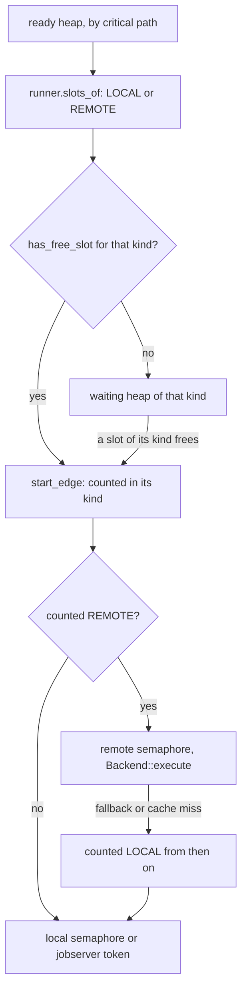
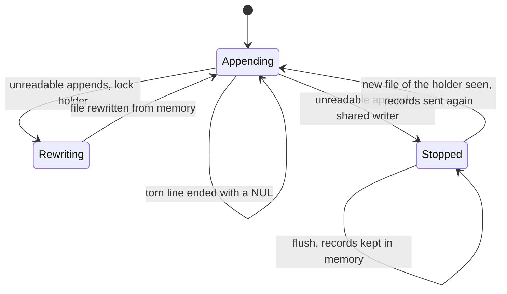
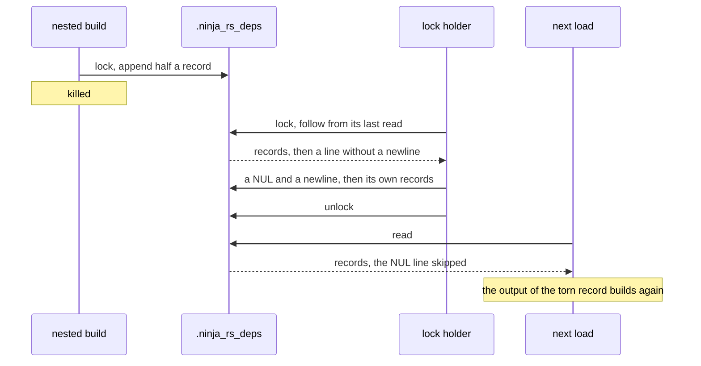
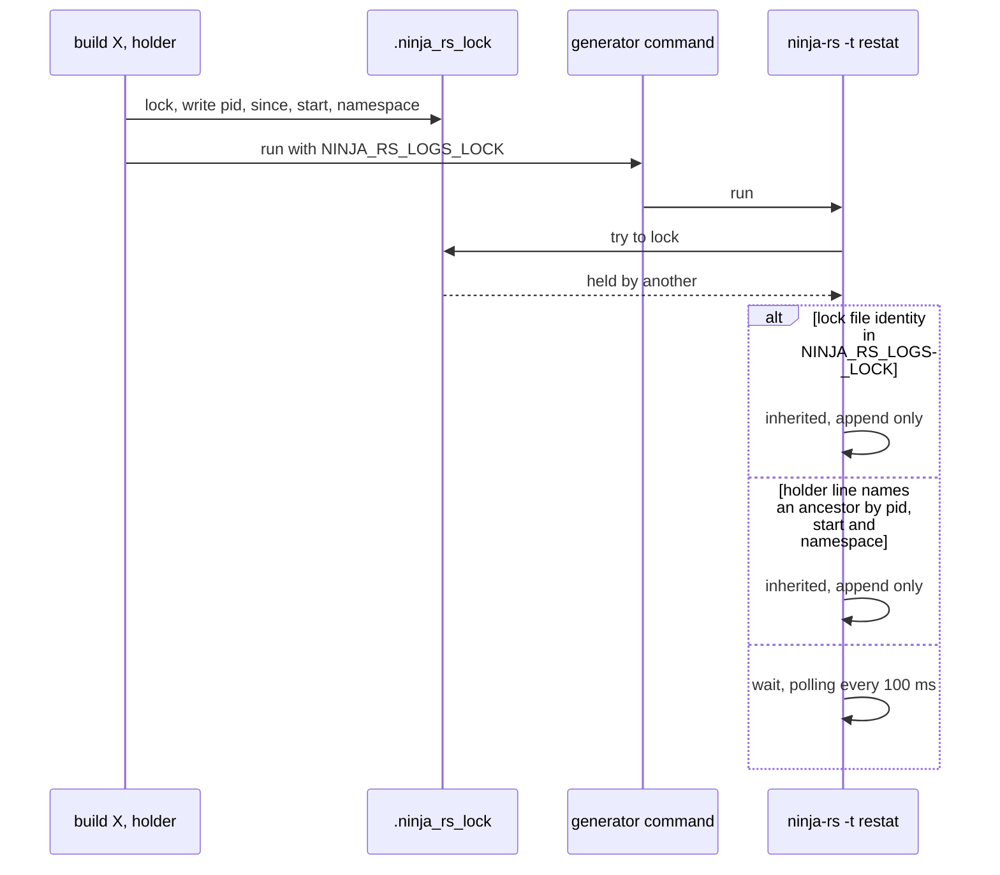
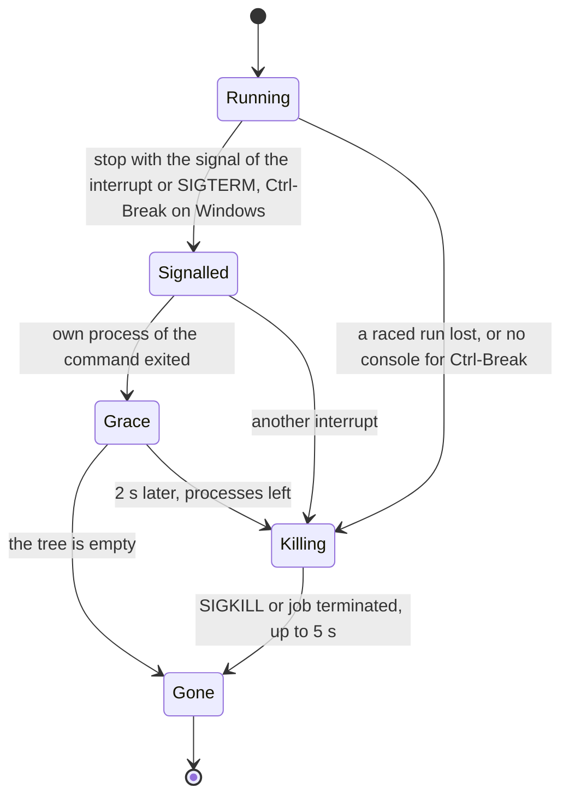

# The engine (ninja-core)

`crates/ninja-core` is ninja's build engine in Rust: the manifest language, the graph, the dirty
scan, the plan, the build loop, the build and deps logs, local subprocesses and the status
printer. It is embedded by the ninja-rs crate (see [cli.md](cli.md)), which gives it a
`CommandRunner` that runs tasks locally or through a remote backend (see
[remote.md](remote.md)). [architecture.md](architecture.md) shows where it sits.

## Why an own engine

**Use case.** ninja-rs must build whatever ninja builds, the way ninja builds it, and run some
of the commands elsewhere.

**Problems.** [n2](https://github.com/evmar/n2), by ninja's author, was the obvious starting
point and was rejected: it had no dyndep (CMake needs it for C++20 modules and Fortran), no
`console` pool semantics, partial `subninja`, no `-n`, few tools, incomplete Windows path
handling, and its single-threaded work loop and on-disk database were made for a standalone
binary, not for an engine behind an async runner.

**Solution.** ninja-core ports ninja's own algorithms: the re2c lexer (`lexer.rs`), the manifest
parser and `BindingEnv`/`EdgeEnv` lookups with their quirks (`parser.rs`, `eval.rs`), path
canonicalization with Windows slash bits (`canon.rs`), `DependencyScan::RecomputeDirty`,
`Plan` (wanted edges, pools, critical-path priority, `CleanNode` for restat, dyndep loading)
and `Builder` (`StartEdge`, `FinishCommand`, deps extraction, cleanup) in `build.rs`, the
depfile parser (`depfile.rs`), the `/showIncludes` parser (`clparser.rs`) and the dyndep
loader (`dyndep.rs`). ninja's tests were ported where they apply: `build_test.rs`,
`parser_test.rs` and the tests of `depfile.rs`, `dyndep.rs`, `lexer.rs`, `canon.rs` and
`clparser.rs`.

Two rules keep it embeddable: no global state (but the message queue, see
[Status printing](#status-printing)), and all I/O through traits: `disk::Disk` for files (the
remote crate wraps it to see outputs left in a remote cache) and `runner::CommandRunner` for
commands. The engine never shares its graph with a runner: for each edge it evaluates a
self-contained `runner::Task` (command, response file, depfile, deps type, outputs, inputs,
the `rbe_*` bindings) and gets a `runner::TaskResult` back.

## Parity with ninja

**Use case.** CMake, IDEs and scripts read ninja's output and exit codes; ninja-rs is a drop-in.

**Solution.** The level implemented is ninja 1.13: `--version` prints `1.13.1`
(`parser::NINJA_VERSION`), which satisfies CMake's feature checks; `-v --version` adds
`ninja-rs <version>+<commit>` on a second line. Exit codes, `FAILED: [code=N] out1 out2 `
lines (`status::failed_line`, trailing space included), `-n` output, `NINJA_STATUS`
placeholders and smart-terminal behaviour were checked byte for byte against ninja 1.13.2 in
reviews (33 exit-code cases, random manifests and incremental steps).

Deliberate differences:

| Area | ninja | ninja-rs | Why |
|---|---|---|---|
| State files | `.ninja_log`, `.ninja_deps` | `.ninja_rs_log` (v2), `.ninja_rs_deps` (v3), own text formats, and `.ninja_rs_lock`; ninja's files are never read nor written | ninja and ninja-rs can share a build directory; the first ninja-rs build in a ninja tree rebuilds everything ("command line not found in log"). Command hashes are ninja's rapidhash, so equal to ninja 1.13's. |
| Concurrent builds | none prevented | a lock on the logs; a second build waits | two builds appending to the deps log give new paths the same ids (see [The lock](#the-lock)) |
| Stopping commands | waits for each command's first process | also waits for what it left behind, kills it 2 s later; a second interrupt kills, a third exits at once | outputs written after cleanup would survive as stale |
| Failed commands | `FAILED:` blocks scroll away under `-j` | before `build stopped`, `ninja: N commands failed:` naming their outputs (at most 10, then `and N more`), unless the only failure is still the last thing printed | ninja issue 2378 |
| POSIX commands | always `/bin/sh -c` | a command without shell syntax runs directly (`subprocess::simple_argv`) | a shell per command (ninja issue 2665) |
| Dyndep outputs met as sources | edge left clean until the next build | edges that read them are scanned again | ninja issues 2653 and 2743 (C++20 modules) |
| Deps of a dirty edge | not loaded (1.14) | not in the graph, but given to the runner as hints | remote actions send them, local ones download them first |
| `-t wincodepage` | the ANSI code page | `Build file encoding: UTF-8` | ninja-rs reads UTF-8 and passes UTF-16 to Windows |
| Tool output on Windows | `\r\n` | `\n` | |
| From ninja's 1.14 development | | `--status FMT` with `$`-variables, `--jobserver-pool`, `NO_COLOR`/`FORCE_COLOR`, `$^` without `ninja_required_version = 1.14` | |
| ninja-rs additions | | `$remote`, `$remote_cache_hits`, `$disk_cache_hits` (`%R`, `%H`, `%D`) | |
| Not implemented | | `-l` (accepted, ignored), `-t browse`, `graph`, `msvc`, `multi-inputs`, `urtle` | |

Known parity gaps are listed under [Limits](#limits).

## The plan, the ready queue and slot kinds

**Use case.** The plan decides which edge starts next; the runner decides where it runs. With
remote execution there are two kinds of capacity: `-j` local slots (or a jobserver's tokens)
and `--remote_jobs` remote ones (50 by default).

**Problems.** A single queue serving both kinds wastes one of them. The first design let every
task start and wait for its slot inside its own tokio task: up to `-j + --remote_jobs` tasks
counted as started, the status line could say 42 running while 2 ran, a task's time included its
wait, and the plan's critical-path priority was lost once tasks queued in the runner. Fixing
that is subtle because a task's kind can change after it started:

- a task sent remotely can fall back (a command that can't be unwrapped, a remote failure
  with `--remote_local_fallback`) and then needs a local slot;
- a raced task (`--remote_racing`) runs remotely and, when a local slot is free, locally too;
- without remote execution (a disk cache or `--remote_cache` alone), a task is a cache lookup
  that may turn into a local run.

**Solution.** The runner tells the engine about its kinds (`CommandRunner::slot_kinds`,
`slots_of`, `has_free_slot` in `runner.rs`), and ready edges whose kind is full wait in the
plan, in a heap per kind, by priority (`Plan::waiting`, `Builder::find_work` in `build.rs`). The
diagram shows how `find_work` and `ExecRunner` (`crates/ninja-rs/src/exec_runner.rs`) share the
decision.



- `slots_of` is asked once per edge, from a preview of its task (rule, bindings, console: its
  inputs aren't gathered yet); the started task carries it as `Task::slots`.
- `ExecRunner` counts tasks per kind (`Counted`). A task sent remotely counts as REMOTE; when it
  falls back, `Counted::local` moves it to LOCAL from the moment it waits for a local slot, so
  the engine doesn't start more local tasks meanwhile.
- Without remote execution (`RemoteBackend::executes` false: a disk cache alone, a remote cache
  alone, or an unreachable executor with a disk cache) there is one kind: every task takes a
  local slot, and the cache lookup happens in it.
- `can_run_more` bounds tasks in flight at `-j`, plus `--remote_jobs` with remote execution.
- When nothing runs (`force`), the best waiting edge starts even if its kind is full, so a
  runner that misjudges its slots can't stall the build.

**Alternatives rejected.** Handing a fallback back to the plan as a new LOCAL edge was proposed
(it would keep plan priority and close the first two limits below) but needs the prepared command to
travel with the edge; it is open.

**Limits.**

- **Cache lookups are bounded by `-j`.** Without remote execution, cache lookups happen inside
  `-j` local slots, so at most `-j` lookups are in flight: a fully cached build behind a remote
  cache with a 15 ms round trip took 8.35 s at `-j2` against 0.51 s for the same service used as
  an executor. The capture of a local result (hashing, storing in the disk cache) also runs
  while the task still counts as LOCAL. Workaround: a higher `-j`.
- **Fallbacks pile up in the runner.** A REMOTE task that falls back frees its REMOTE count, so
  the engine starts the next remote-wanted task, which may fall back too: up to
  `--remote_jobs` tasks wait for `-j` slots in the runner, counted as running.
- **Raced runs take local slots unseen.** A raced task's local branch takes a local slot while
  counted REMOTE, so the engine starts a local task that then waits behind the speculative run.
- `find_work` evaluates an edge's bindings for its preview, and `start_edge` again.

**Tests.** `build_test.rs` `tasks_wait_in_the_plan_for_their_kind_of_slots`;
`exec_runner.rs` `tasks_take_slots_of_their_kind`, `tasks_run_locally_after_all_count_as_local`,
`caches_alone_take_local_slots`, `raced_runs_only_take_free_slots`,
`raced_runs_fetch_inputs_before_taking_a_slot`.

## The build loop

**Use case.** `Builder::build` (`build.rs`) runs the plan: start what it can, reap what
finished, record it, repeat.

**Problems.** Each reaped command writes log records; a naive loop writes them one by one, with a
lock and a check per record, which measured at 2 to 3 times ninja's cost on Windows. Records must
also be on disk before a command that reads them starts (a nested build in the same directory).
Futures returned by the runner may be dropped while pending.

**Solution.** One turn of `Builder::run` starts tasks while `can_run_more` allows, then awaits
one result, then takes the results already finished without waiting (`ready_now` polls the
next `wait_for_command` future once with a no-op waker), then flushes both logs once
(`flush_logs`) before starting more commands. `CommandRunner::wait_for_command` documents that
its future must not lose a result when dropped pending; `ExecRunner` uses
`JoinSet::join_next_with_id`, which is cancel safe. A dry run reaps one command per turn, as
ninja does, so its status lines match. However the loop ends, `build` flushes the logs and
removes `.ninja_lock` (the file whose mtime gives commands their start time, as in ninja).

`finish_command` follows ninja's `FinishCommand`: deps extraction first (it filters
`/showIncludes` lines from the output even on failure), then status, then restat of
`restat` and `generator` outputs (an unchanged output cleans its dependents through
`clean_node`, which takes them out of the plan), then the log records. Lost inputs reported by
the runner rewind the edge instead (`Builder::rewind`, at most `MAX_REWINDS` = 3 times per
edge): the edges producing them run again, then this one (see [remote.md](remote.md)).

**Tests.** `build_test.rs` `records_are_written_before_more_commands_start`,
`lock_file_removed_whatever_the_outcome`, `rewinds_lost_inputs`, and ninja's ported build tests.

## The build log and the deps log

**Use case.** The build log (`build_log.rs`) records, per output, the command hash and the
mtime it was built at; the deps log (`deps_log.rs`) records the headers a `deps = gcc` or
`deps = msvc` edge read. Both must survive crashes and be shared by a build and the builds it
runs in the same directory.

### Formats

[../reference/files.md](../reference/files.md) documents every field; in short:

```text
.ninja_rs_log                                .ninja_rs_deps
# ninja-rs log v2                            # ninja-rs deps v3
<start ms> TAB <end ms> TAB <mtime ns>       p TAB <id> TAB <path>
    TAB <output> TAB <command hash, hex>     d TAB <output id> TAB <mtime ns> TAB <id> <id> ...
```

The build log's hash is ninja's rapidhash (v1 used FNV-1a and is discarded on load). The deps
log stores each path once and records refer to ids, as ninja's binary log does; a path record
carries its id (v2 had them positional), as ninja writes a checksum: two processes appending
at once would otherwise give their new paths the same ids, and a reader would give outputs each
other's headers. Reading stops at the first record that doesn't fit (an id that doesn't follow,
a path seen twice, a malformed line), as ninja's does, with ninja's warning
`premature end of file; recovering`.

Recompaction rewrites a log through `<log>.recompact` (a fixed name, as ninja's) when dead lines
dominate (more than 100 records and 3 times the live ones for the build log; 1,000 and 3 times
for the deps log). Records stay when their output is an output of the manifest or exists
(`is_live` in `crates/ninja-rs/src/lib.rs`, ninja's `IsPathDead`): another manifest sharing the
directory (CMake's Ninja Multi-Config) keeps its records, in the deps log too, which goes
beyond ninja.

### Problems

- **Torn lines.** A crash, a kill or a full disk leaves a last line cut short. Cut inside an id
  it still parses, as another record; the next append would extend it into garbage.
- **Concurrent writers.** A build's command may run ninja-rs in the same directory: CMake runs
  `-t restat` while regenerating, a custom command builds another configuration. ninja just
  lets them corrupt each other's logs. Before the shared access below, a nested build's
  recompaction or cut undid the records its parent appended meanwhile; later versions
  overwrote a nested writer's newer record with the holder's older one after a rewrite, and let
  a torn line stop every writer for the rest of the build.
- **Cost.** A lock, a check and a write per record cost 2 to 3 times ninja's per record.
- **Replaced files.** A generator (an older ninja-rs's `-t restat`) or a process without the
  lock may rename a new log over the one a build has open; appends to the old file are lost.

### Solution

- **Batched flushes.** Records are pending in memory until `flush`, once per loop turn: one
  write for the build log, one lock and one write for the deps log. Whether the file was
  replaced (`ninja_os::replaced`) is checked at most once a second
  (`REPLACED_CHECK_INTERVAL`), after a generator edge (`recheck`) and at the end; a replaced
  file gets every record made since the log was opened (`recorded`).
- **Exclusive and shared access.** The build holding the directory's lock writes with
  `Access::Exclusive`: it may recompact and cut a torn line (only if the file is still the one
  it read: `cut_torn_line` compares lengths). A build that inherited the lock (see
  [The lock](#the-lock)) writes with `Access::Shared`: it only appends. A shared build log
  writer ends a torn line with a newline first, which leaves a malformed line or a record with
  a hash cut short: as good as none, a rebuild at worst.
- **Taking turns on the deps log.** Each deps log flush holds a lock on the file itself
  (`with_lock`, unlocked explicitly: see [os.md](os.md#locks)), reads what others appended
  since its last read (`follow`), maps its own ids to the file's (`file_ids`, `from_file`: a
  log's ids are stable while it is loaded), and appends its paths and records after theirs.
- **Torn lines end with a NUL.** When `follow` finds a torn last line, the writer ends it with
  `\0\n` before its own records. No path or number holds a NUL, and readers skip any line
  ending with one (`read_records`), with the record it held, whose output builds again. Nobody
  stops for a torn line.
- **The holder's rewrite.** When the file goes on with what can't be read at all (a process
  appending without taking turns: an older ninja-rs, a file system without locks), the lock
  holder rewrites the file from what it read and recorded (`cant_follow`, `rewrite`; at most
  `MAX_REWRITES` = 10 times), saying so once. A shared writer may not rewrite: it stops writing
  to the file, keeps its records in memory, and sends them all once it sees the holder's new
  file (`ensure_open` checks at each flush while stopped).
- **Pending wins.** A record read from the file never replaces one of this log's still waiting
  to be written (`is_pending`): after the holder's rewrite, the file has the holder's older
  view of an output a nested build just rebuilt.

The state diagram shows a deps log writer.



The sequence shows a torn line: a nested build is killed while it appends, and the holder's
next flush ends the line so that readers skip it.



### Alternatives rejected

- **Stop at a torn line** (ninja's rule, and ninja-rs's at first): with a nested build sharing
  the log, every later record was lost until the holder happened to rewrite.
- **A terminator field per record**: equivalent, but changes the format of every line; the
  NUL marks only the rare torn one.
- **One lock per record**: correct but measured at 2 to 3 times ninja's cost per record.

### Limits

- At one record per loop turn the deps log still costs about twice ninja's per record (a lock,
  a seek and a write); at four or more per turn it is near parity.
- A writer that appends without taking turns (an older ninja-rs, a file system without locks)
  still costs the holder a full rewrite each time it is seen, up to 10 per build.

### Tests

`deps_log.rs`: `two_writers_never_mix_their_paths`, `writers_sharing_a_log_take_turns`,
`a_shared_writer_neither_recompacts_nor_cuts`, `the_holder_rewrites_a_log_it_cant_read`,
`a_shared_writer_waits_for_the_rewrite`,
`a_shared_writer_keeps_its_newer_records_after_the_rewrite`, `a_torn_line_stops_no_writer`,
`writers_in_processes_take_turns` and `writers_in_processes_survive_a_torn_line` (the test
binary run as several processes appending at once), `torn_path_does_not_merge_with_the_next_append`.
`build_log.rs`: `torn_entry_is_ignored_and_cut`, `a_shared_writer_neither_recompacts_nor_cuts`,
`a_replaced_log_is_opened_again`, `records_are_written_at_each_flush`,
`restat_appends_when_shared`, `recompaction_reuses_its_temporary_file`.
`cli_e2e.rs`: `nested_build_appends_only`, `recompaction_keeps_other_manifests_records`.

## The lock

**Use case.** One build at a time writes a build directory's logs; ninja has no such lock. Users
start two builds in one directory by mistake (an IDE's and a terminal's), and the second
should find the work done rather than corrupt the logs.

**Problems.**

- The build holding the lock runs commands that write the logs too: CMake's `-t restat` at
  regeneration, a build of another configuration, and that one's commands (X runs Y, which
  runs X again). They must not wait for their own ancestor: that is a deadlock.
- A wrapper may scrub the environment that tells a command it runs for the holder.
- A lock file names its holder by pid, and pids are reused; in two containers sharing a
  workspace, an unrelated build's pid can equal an ancestor's pid in another pid namespace:
  matching the pid alone once let a second build run at once beside the first.
- Some file systems have no locks.

**Solution.** `LogLock` (`build_log.rs`) is an exclusive OS lock (`ninja_os::lock`: `flock` on
Unix, a byte far past the data on Windows) on `<builddir>/.ninja_rs_lock`, held for the whole
invocation by builds, `-t recompact` and `-t restat`. The holder writes
`<pid> <since ms> <start> <pid namespace>` into the file (`ninja_os::process_info`) and clears
it when it lets go. Another build waits, polling every 100 ms, with
`waiting for the build running in this directory (pid N, started 5 s ago) to finish...`; an
interrupt meanwhile ends it.

The holder's commands get `NINJA_RS_LOGS_LOCK`: the identities (volume and file id, in hex) of
the lock files held by this invocation and those it runs for, comma separated. Identities come
from the open handle, so another spelling of the path (a symlink, case, an 8.3 name) doesn't
matter, and the list grows down the tree so that X, Y, X again all work.
`try_lock_logs` (`crates/ninja-rs/src/lib.rs`) decides, as the diagram shows.



The ancestor walk (`nested::runs_this`) follows parent ids with `ninja_os::process_info` and
inherits only on a full match of pid, start time and pid namespace: a stale lock file whose
pid was reused, or a build in another container, doesn't match. On Windows a process keeps its
parent's id after the parent exits, so a parent that started after its child ends the walk. A
file system without locks gets a warning, and the invocation still exports the lock file's
identity, so its nested builds know the logs are their parent's.

**Limits.**

- **An orphaned nested build goes on.** A nested build that inherited the lock keeps building after
  its holder dies; a new build then takes the lock and runs beside it on the same outputs.
- **Mixed versions.** A lock file written by an older ninja-rs (`<pid> <since>` only) is never
  inherited through the ancestor walk: a nested build of a newer binary that lost
  `NINJA_RS_LOGS_LOCK` waits forever.
- macOS's ancestor walk (`proc_pidinfo`) is written but untested.

**Tests.** `build_log.rs` `the_lock_names_its_holder`, `a_read_only_lock_file_locks`;
`nested.rs` `holders_are_ancestors_by_identity`; `cli_e2e.rs` `concurrent_builds`,
`cross_nested_builds`, `generator_under_the_lock`, `generator_without_the_lock_variable`,
`holder_with_an_ancestors_id`, `holder_in_another_pid_namespace` (Linux, `unshare`),
`interrupt_while_waiting_for_the_lock`, `restat_waits_on_stderr`.

## Subprocesses

**Use case.** `subprocess.rs` runs commands locally, as ninja's `Subprocess`: `/bin/sh -c` on
POSIX (or directly, without shell syntax), the command line verbatim to `CreateProcess` on
Windows, stdout and stderr on one pipe so their interleaving is kept, `console` pool commands on
the terminal.

**Problems.**

- Ctrl-C from the terminal reaches the whole foreground process group. If commands are in it,
  they die before ninja-rs decides anything, and outputs half written survive.
- Stopping a command must reach every process it started: `gcc` leaves `cc1`, a script its
  children, a test runner a server. Windows has no process groups that signals reach.
- A command is done when its output ends, not when its first process exits: a background
  process holding the pipe is still the command's (ninja waits for it too).
- A process started on Windows may create children before ninja-rs puts it in a job.
- Some processes must leave: a compiler server started by a wrapper asks to break away from
  its job; refusing makes its creation fail where ninja, which has no jobs, works.
- As PID 1 in a container or a subreaper, orphans become ninja-rs's children; unreaped, they
  stay zombies and a process group never empties.

**Solution.** `ProcessTree` puts every non-console command in a process group of its own on
POSIX (`process_group(0)`) and, on Windows, starts it suspended in a new console process group
(`CREATE_SUSPENDED | CREATE_NEW_PROCESS_GROUP`), puts it in a job that allows breakaway
(`JOB_OBJECT_LIMIT_BREAKAWAY_OK`), then resumes it (`ninja_os::process::resume`). A command that
can't join its job fails with `putting the command in a job: ...` rather than run unstoppable.
The terminal's Ctrl-C then reaches ninja-rs only, as in ninja.

`Stop` stops every command a runner started and tells when all have exited. The state diagram
shows one command's tree.



- On POSIX the group gets the signal the interrupt was (SIGTERM when the build stops on an error
  of its own); on Windows Ctrl-Break goes to the command's process group, as ninja sends, and
  without a console the job is terminated.
- The command's own process is waited for, as ninja does; what it left in its tree gets
  `STOP_GRACE` (2 s), then is killed, and killed processes get `KILL_WAIT` (5 s) to be gone
  (Windows terminates a job's processes asynchronously).
- A second interrupt kills everything still running. `console` commands get the terminal's
  signals themselves and are waited for, unless killing.
- As PID 1 or a subreaper (`reaps_orphans`), the process groups of finished commands are
  remembered and their orphans reaped whenever a command ends.
- `Interrupt` (same file) counts interrupts. Code that acts on them holds a `Handling` guard
  (the build loop, `-t exec`, waiting for uploads); an interrupt that comes while nothing does ends
  the invocation (`unhandled`, see [Interruption and exit codes](#interruption-and-exit-codes)). On
  Linux a `SA_SIGINFO` handler installed before tokio's notes whether SIGINT or SIGHUP came from the
  terminal or from `kill(2)` (`si_code`), which `-t exec` needs (see [cli.md](cli.md#-t-exec)); it
  is installed when the signal is ignored too (a background job).

**Alternatives rejected.** Waiting only for the command's first process (ninja's behaviour)
left processes writing outputs after the build deleted them. Killing at once on the first
interrupt would deny tools their cleanup.

**Limits.**

- **Exit code 130.** A command exiting with code 130 is a failure (`FAILED: [code=130]`, and `-k 0`
  goes on); ninja 1.13 treats it as an interruption. A command killed by SIGINT, SIGTERM or
  SIGHUP, or exiting with `STATUS_CONTROL_C_EXIT` on Windows, is an interruption in both.
- Windows: ninja-rs exiting between creating a command and putting it in its job leaves one
  suspended process (creating a process inside a job needs `PROC_THREAD_ATTRIBUTE_JOB_LIST`,
  which std doesn't offer).
- A ninja-rs killed outright (SIGKILL, `TerminateProcess`) leaves its commands running, as ninja
  does: their process groups are their own, and their jobs have no kill-on-close.
- The process-tree code exists twice, here and in `ninja_os::process` (see [os.md](os.md)).

**Tests.** `subprocess.rs`: `cancelling_stops_every_process`, `stopping_waits_for_every_process`,
`another_interrupt_kills`, `interrupts_nothing_handles`,
`stopping_reaches_processes_holding_the_output`, `stopping_sends_ctrl_break_then_escalates`
(Windows, own console), `stopping_as_a_reaper_of_orphans`, `orphans_are_reaped_as_commands_end`,
`direct_commands_fall_back_to_the_shell`;
`job::tests::suspended_command_joins_a_job_that_allows_breakaway`. `cli_e2e.rs`:
`interrupt_signals`, `interrupt_ctrl_break`, `hangup_during_build`, `command_exiting_130`.

## The jobserver

**Use case.** Under `make -j8` (or cargo, or another ninja), ninja-rs takes a token for each
local command; with `--jobserver-pool` (or `enable_jobserver_pool = 1` in the manifest) it
offers a pool of `-j` slots to its own commands, so nested builds share them.

**Problems.** Three protocols: GNU make 4.4's named FIFO, make 4.3's inherited pipe (which
upstream ninja dropped; Kitware's fork has it) and Windows named semaphores. Tokens released
by other processes aren't signalled. A make pipe set to non-blocking affects every process
sharing it.

**Solution.** `crates/ninja-rs/src/jobserver.rs` parses `MAKEFLAGS` as ninja's
`ParseMakeFlagsValue` (the last argument wins; `make -n` disables it), and sets up the pool and
the client with ninja's messages (`setup`). The client owns one implicit slot; others are
tokens, given back byte for byte. Waiters take turns in the order the engine started their
tasks (`turn`), polling up to every 10 ms; a raced local run only takes a token if nobody waits
(`try_acquire_in_turn`). make's pipe is never made non-blocking: on Linux it is reopened
through `/proc/self/fd/N`, elsewhere read with `recv(MSG_DONTWAIT)` for sockets or poll then
read for pipes. Remote actions take no token; local fallbacks do. Without `-j`, an external
pool limits local commands (as ninja 1.13); with `-j`, it is ignored unless `--jobserver-pool`.

**Limits.** On a pipe outside Linux, poll then read can block until the next token if another
process takes the one polled (documented race).

**Tests.** `jobserver.rs` unit tests (`pipe_pool_stays_blocking`, `acquire_waits_for_release`);
`cli_e2e.rs` `jobserver_pool`, `jobserver_pool_from_manifest`, `jobserver_client`,
`jobserver_pipe` (an inherited pipe, as GNU make 4.3 passes it).

## Restat and dyndep

**Use case.** `restat = 1` edges may leave outputs unchanged, which cleans what depends on them;
dyndep files add inputs and outputs discovered by a scan step (C++20 modules, Fortran).

**Problems.** A dyndep file loaded during the dirty scan gives producers to outputs that edges
scanned earlier took for sources (ninja issues 2653 and 2743): ninja builds those edges against
the old module interface and fixes it only on the next build.

**Solution.** Restat follows ninja's `CleanNode` (`Builder::clean_node`): edges cleaned leave the
plan and the status total (`Status::edge_removed_from_plan`, which build events use to complete
targets). Dyndep loading follows ninja (`dyndep.rs`, `load_dyndeps_for`,
`refresh_dyndep_dependents`). When the scan loads a dyndep file, `invalidate_consumers` sends the
edges that read its new outputs, and those downstream, back to unvisited; edges still on the
scan's stack visit their inputs again, and when targets scanned earlier on the same command
line are affected, `rescan_targets` scans them again and adds what became dirty to the plan.

**Limits.** As in ninja, a dyndep output named directly on the command line (`ninja-rs g.h`)
whose dyndep file the scan never reaches is taken for a source.

**Tests.** `build_test.rs` `dyndep_*` (ninja's), `dyndep_output_consumed_by_edge_scanned_earlier`,
`dyndep_output_to_dyndep_input_in_any_order`, `restat_*`.

## Status printing

**Use case.** `status.rs` prints ninja's `[3/10] description` lines, `NINJA_STATUS`, smart
terminal line overwriting, and `FAILED:` blocks, and gives build events the same events
(`Status` trait; `crates/ninja-rs/src/bes.rs` `ReportingStatus` feeds both).

**Problems.** Tools parse this output, and ninja's details matter: when a terminal is "smart",
how it elides, which width it reads, what `%o` says before anything finished. Messages also
come from code the build loop doesn't see (the remote backend, scanners, build events), and
must not land on the status line or inside a console command's output. `print!` panics on a
closed pipe or a terminal gone, which would end a build without saving its logs.

**Solution.** `LinePrinter` and `StatusPrinter` port ninja's: smart terminal when stdout is a
terminal and `TERM` is set and not `dumb` (Windows: a console unless `TERM=dumb`), width from
`TIOCGWINSZ` or the console screen buffer (ninja never reads `COLUMNS`), ANSI-aware middle
elision, the same rate and ETA predictions. `status::message` queues lines while a printer
exists and prints them at its next update, on their own lines, on stderr, with the `ninja:`
prefix; while a `console` command runs, output and errors wait (`set_console_locked`).
`print_out` and `print_err` ignore write errors, and `clippy.toml` forbids `print!`,
`println!`, `eprint!` and `eprintln!` outside tests (see [testing.md](testing.md#clippy-rules)).
Tools restore SIGPIPE's default on Unix (`die_on_broken_pipe`), so `-t targets | head` exits
141 as ninja's does.

**Limits.** `status::message` prints after releasing its lock, so a message can still land on a
status line. `-d explain` prints every explanation during the scan; ninja 1.12 and later print
an edge's just before it starts, skipping restat-pruned ones.

**Tests.** `status.rs` (ninja's `StatusTest` and `ElideMiddle` cases, predictions, `--status`
variables, `failed_lines`, `errors_wait_for_the_console`); `cli_e2e.rs` `status_format`,
`ninja_status`, `terminal_status` (pty), `console_status` (Windows), `failure_summary`,
`write_errors`, `messages_to_a_closed_stderr`.

## Interruption and exit codes

**Use case.** Ctrl-C, SIGTERM and SIGHUP (Ctrl-C and Ctrl-Break on Windows) stop a build
cleanly; exit codes tell scripts what happened.

**Solution.**

| Situation | Exit code | Message |
|---|---|---|
| Success, or nothing to do | 0 | `ninja: no work to do.` when nothing ran |
| A command failed | the last failed command's code, 1 if that would read as success (0, or a multiple of 256 on Unix) | `ninja: build stopped: subcommand failed.` |
| Interrupted during the build loop | 130 | `ninja: build stopped: interrupted by user.` |
| Interrupted elsewhere (loading, connecting, waiting for the lock, a tool) | 128 + signal (130 on Windows) | build events end first, within 2 s |
| Third interrupt | 130, at once | |
| Fatal error, bad option, unknown tool | 1 | `ninja: fatal:` or `ninja: error:` |
| Interrupted while waiting for uploads to the remote cache | 130 | `interrupted: N local results not stored in the remote cache.` |

Inside the loop, the first interrupt makes `wait_for_command` return `Interrupted`; the builder's
`cleanup` aborts the runner (local commands stopped and waited for, then remote work dropped)
and removes the outputs of commands that were running, as ninja's `Cleanup` does (an output
whose mtime didn't change stays, unless the rule has a depfile). A command that dies of SIGINT,
SIGTERM or SIGHUP is an interruption too. Build events end with `USER_INTERRUPTED`, told apart
from a command exiting 130 (`Bes::finish` takes an `interrupted` flag).

**Limits.** An interrupt while a finished task's result is being captured (hashing,
storing a large output in the disk cache) reports the edge interrupted, and its finished output
is deleted: a wider window than ninja's.

**Tests.** `build_test.rs` `interrupt_cleanup`, `exit_code_of_the_last_failure`;
`cli_e2e.rs` `exit_codes`, `interrupt_outside_the_build`; `remote_e2e.rs`
`interrupted_as_the_build_ends`, `upload_wait_interrupted`.

## Limits

Known parity gaps:

- A command exiting 130 is a failure, not an interruption.
- `-d explain` explains eagerly, including edges that never run.
- `-t multi-inputs` (ninja 1.13) is missing; so is `-t browse`, which is acceptable.
- `build a: phony || a` is a dependency cycle error; ninja warns and builds.
- `-t compdb` writes one entry per input (ninja's development branch); ninja 1.13.2
  writes one per edge.

The limits of slot kinds, of the lock, of subprocesses and of status printing are listed in
their sections above.
