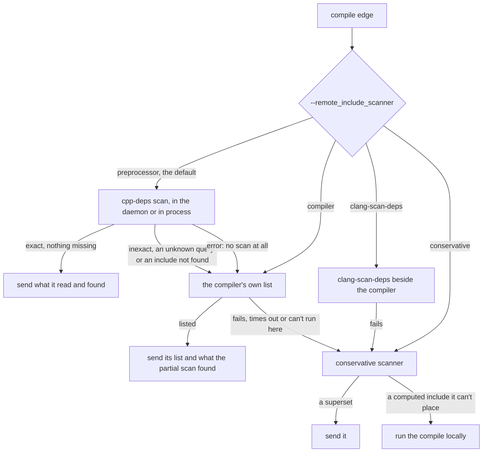
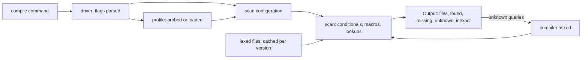
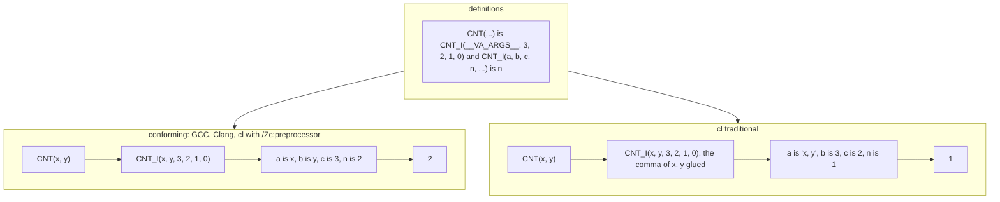
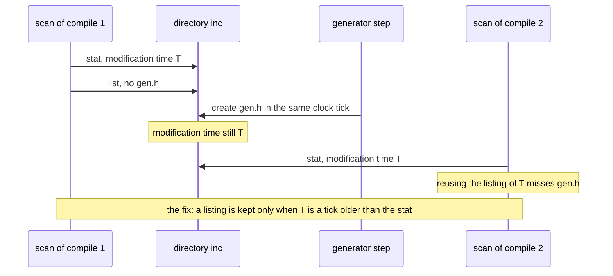
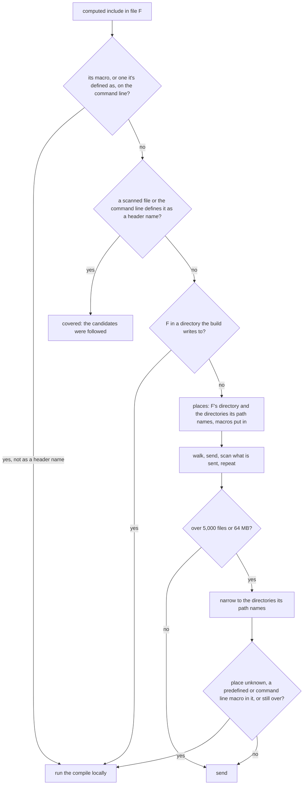

# Include scanning

This page is for contributors and reviewers. It explains how ninja-rs finds the files a C or C++
compile reads, so that a remote worker gets them: the exact preprocessor scanner
(`crates/cpp-deps`), the compiler's own list, the conservative scanner
(`crates/ninja-remote/src/scanner.rs`), and the chain that ties them together. For using the
scanners, see [Include scanning](../user/include-scanning.md); the daemon that keeps the
scanner's caches between builds is described in [The daemon](daemon.md).

## Code map

| Where | What |
|---|---|
| `crates/cpp-deps/src/lex.rs` | a file reduced to its directives, its text's names and its hash (`FileDirectives`) |
| `crates/cpp-deps/src/macros.rs` | definitions, the standard expander, cl's traditional model, what macros do through pragmas |
| `crates/cpp-deps/src/expr.rs` | `#if` arithmetic with unknown values, by `Dialect` |
| `crates/cpp-deps/src/scan.rs` | a translation unit: conditionals, lookups, `#pragma once`, `Cache`, `Output` |
| `crates/cpp-deps/src/probe.rs` | running the compiler: predefined macros, dialect, comma rules, query answers |
| `crates/cpp-deps/src/driver.rs` | command lines to an `Invocation`, `Profile`, `Driver::scan_in` |
| `crates/cpp-deps/src/external.rs` | the compiler's own list (`compiler_deps`), `clang_scan_deps` |
| `crates/cpp-deps/src/{hmap,vfs,path_map,intern}.rs` | header maps, VFS overlays, path-keyed maps, interned names |
| `crates/ninja-remote/src/scanner.rs` | the conservative scanner, `parse_compile`, `ScanCache`, `WrittenDirs` |
| `crates/ninja-remote/src/store.rs` | `walk` and the caps of computed includes |
| `crates/ninja-remote/src/action.rs` | `prepare`: the chain, `CompilerScans` |
| `crates/cpp-deps/examples/compare.rs`, `crates/ninja-remote/examples/scanbench.rs` | measuring against the compiler |

## Use case

`ninja_remote::action::prepare` turns an edge into a REAPI action. When the command is a single
compile (GCC, Clang, `cl` or `clang-cl`, as `scanner::compiler_style` tells), the action's input
root must hold every file the compiler reads: the source, every header, the forced includes, what
`#embed` reads, and the files whose existence the preprocessor tests. A remote worker has nothing
else. The dependencies ninja records come from the compile itself, so they describe the previous
build at best (they're sent too, with the edge's declared inputs). Toolchain directories are
declared and sent whole (see [remote.md](remote.md)); sysroots and SDK headers aren't, by design:
they are scanned, so that a compile sends the few hundred headers it reads rather than tens of
thousands.

Callers:

- `action::prepare`, once per compile edge per build, from many threads at once.
- The daemon (`ninja_daemon::server::Daemon::handle`, `Request::Scan`), with its caches kept
  between builds and vouched for by a file watcher.
- The measurement tools: `compare.rs` (a compilation database against the compiler's own list)
  and `scanbench.rs` (every scanner over a database, cold and warm, on N threads).

## Problems

### The list must be exact

The input root is part of the action's key, and remote results are cached and shared. Each kind
of mistake costs differently:

| The list sent | Remote result | Cost |
|---|---|---|
| misses a file an `#include` reads | "file not found" | a wasted round trip, then a local run if fallback is allowed |
| misses a file only `__has_include` tests | compiles, takes the other branch | a wrong object under a valid key: cached, shared, never rebuilt |
| has another file at a path the compiler reads | compiles with it | a wrong object |
| has extra files | correct | bigger uploads; the key changes when a file the compile doesn't read changes |

The silent rows drive most of the design. A missing file is often silent because of
`__has_include`:

```c
#if __has_include("site_options.h")
#define HAVE_SITE_OPTIONS 1
#endif
```

No `#include` names `site_options.h`, GCC's `-M` and cl's `/showIncludes` don't list it, and a
remote worker without it compiles a different program without a diagnostic. So every file a
`__has_include` or `__has_embed` finds is an input, and "the scan couldn't find an include" is
never taken lightly: the lookup may be wrong, and the same mistake behind a `__has_include` would
be silent.

### The preprocessor isn't one language

- Three families look files up differently: GCC and Clang's quote and angle chains (with their
  own rules for duplicate directories and `#include_next`), and MSVC's lookup in the directory
  of every includer, which `cl`, `clang-cl` and Clang for the MSVC ABI do.
- `cl` expands macros with its traditional preprocessor unless `/Zc:preprocessor` (or a C
  standard flag) says otherwise. Boost and the Windows SDK are written against it.
- Predefined macros and the answers to `__has_builtin`, `__has_cpp_attribute` and the like depend
  on the compiler's version, its target, `-std`, `-m...`, configuration files and environment
  variables (`INCLUDE`, `CPATH`, `SDKROOT`).
- Text isn't preprocessed by a scanner that only evaluates directives, yet text can run pragmas
  through macros (`_Pragma`, `__pragma`) that change macros (`push_macro`) or inclusion (`once`).
- `#pragma once` depends on the file system: two paths to one file, or two files with the same
  contents, may be included once or twice.
- Computed includes (`#include MACRO`, `#include BOOST_PP_ITERATE()`) name files only after
  expansion.

### Speed

Every compile a build runs is scanned: the file list decides the action key, so a cache hit needs
the scan too. The compiler's own preprocessing takes from 0.2 s to over 5 s per compile on
real projects (see [Measurements](#measurements-on-real-projects)). A scanner must take
milliseconds when warm, share lexed files across thousands of compiles and threads, and not wait
on locks.

### What went wrong before

- `_Pragma` operands built by macros (libc++'s `_LIBCPP_PUSH_MACROS`) weren't seen: no libc++
  compile on Windows was exact.
- Text calling a macro whose pragma comes from its arguments (`DO_PRAGMA(once)`) was missed.
- A copy of a `#pragma once` header was taken as the same file; then comparing contents read both
  files on every scan, up to 4 s per scan.
- The model of `cl`'s traditional preprocessor claimed exact results on random programs it
  expanded differently from `cl`, which led to the rule that it fails closed (see
  [cl's traditional preprocessor](#cls-traditional-preprocessor)).
- The conservative scanner missed headers behind `__has_include` in several computed-include
  cases; some remain (see [Limits](#limits)).

## The chain

The scanners are tried in order, each when the one before can't tell: the preprocessor scanner by
default, then the compiler's own list, then the conservative scanner. The diagram shows the order
`action::prepare` follows, from the scanner chosen with `--remote_include_scanner`.



The user's rule behind it: the preprocessor scanner is the default; when it can't be exact, the
compiler's list is used, with the files the partial scan found through `__has_include`,
`__has_embed` or `#pragma GCC dependency` (which the compilers don't list); the conservative
scanner only when the compiler can't run. The conservative scanner may be slow but must never
produce a wrong object.

`CompilerScans` (in `action.rs`) counts the compiles left to the compiler by reason. Each reason
is told once ("warning: Preprocessor include scanner: not exact (...); asking the compiler"), every
time with `--remote_verbose`, and the end of the build sums them up: "N compiles' includes were the
compiler's, the preprocessor's scan being unable to tell (...)". Reasons drop what belongs to one
compile (file names, operands), so that one header used everywhere makes one line, and the summary
names the four most frequent. Compiles left to the conservative scanner are counted the same way
by `ScanCache::fell_back` and `fallback_summary` ("N compiles were scanned conservatively").

## The exact scanner (cpp-deps)

The scanner is a preprocessor that evaluates directives exactly and skips text. The diagram shows
how a command becomes a result.



`Output::exact()` holds when nothing made the scan inexact and every query has an answer.
`files` are what the preprocessor reads (the main file first), `found` what `__has_include`,
`__has_embed` and `#pragma GCC dependency` found, `missing` the includes not found.

### Command lines and flags

`driver::parse_in` turns a command into an `Invocation`. Every flag gets one of four effects
(`Effect` in `driver.rs`): taken by the scan (directories, macros, forced includes, the language,
the source), given to the probe (`Effect::Probe`: what may change predefined macros, built-in
directories or query answers), dropped (`Effect::Drop`: outputs, dependency files, diagnostics,
debug information, per-object flags; neither the probe nor the profile key sees them), or
unsupported. A flag no list names is unsupported, and so are those changing preprocessing in ways
the scan doesn't model: `-traditional-cpp`, other input charsets, modules and header units,
offloading, `-iprefix`, `-I-`, `-march=native` (the probe and a remote worker could resolve it
differently), `/clr`, `/ZW`, `/source-charset:` other than UTF-8, `-fno-ms-compatibility`. An
unsupported flag makes `scan_in` return an error, and the chain goes on.

`cl` and `clang-cl` also take flags from `CL` (before the command's) and `_CL_` (after). The probe
runs in the build's environment and sees them; the scan reads only the command line, so `CL` or
`_CL_` holding a flag the scan reads (`/I`, `/D`, `/FI`...) is an error. Flags choosing the
preprocessor are the exception (see [/Zc:preprocessor](#zcpreprocessor-explicit-and-implied)).

Paths are made absolute. A `..` after a symbolic link that leads elsewhere is an error on the
command line and makes the scan inexact in an include (`scan::dotdot_after_link`): compilers
resolve it at the link's target, a remote worker (whose inputs are plain directories) lexically.
Windows applies `..` before following links, so this never applies there.

### Lexing and text names

`lex::lex` reduces a file to its directive lines, tokenized, `#define`s parsed and the include
guard detected (`FileDirectives::guard`: the whole file inside one `#ifndef`). Text is skipped,
but exactly about what hides a `#`: block and line comments, string and character literals, raw
string literals across lines, digit separators (`1'000` isn't a character literal) and line
splices. Lines end at a newline, a carriage return and newline, or a lone carriage return (as GCC
and Clang read them). The lexer also records:

- `hash`: a hash of the bytes, which finds files with the same contents without reading them
  again (`#pragma once` by contents).
- `names`: the hashes of every name in the text, sorted. Text isn't expanded, but a scan must
  know whether text may call a macro whose pragma comes from its arguments (see
  [_Pragma](#_pragma-and-pragma-macros)). Checking the hashes is cheap; the text's tokens are read
  again (`FileDirectives::text`) only for such a call.
- `_Pragma("...")` operators in text become `Pragma` directives, with markers for lines that may
  run a pragma through a macro.
- `utf16`, `lone_cr`, `trigraphs`, `asm_include` (an assembler's `.include` in a `.S` file): what
  makes a scan of that file inexact under the compilers that read it otherwise.

Lexed files live in `scan::Cache`, keyed by path and checked by `FileStamp` (size, modification
time, change time, identity: see [os.md](os.md)). A file is lexed once per version; concurrent
scans wait for the one lexing (`Cache::lexing`). Within a session (a build) a file is checked
once; across sessions it is checked again unless a watcher vouches for it (see
[daemon.md](daemon.md)). Directories in the build tree, and the other directories the build
writes to, are volatile: checked every time, as a generator may rewrite a header between two
compiles.

### Macros: the standard expander

`macros::Expander::expand_standard` follows the standard algorithm with hide sets (Prosser's): a
token remembers the macros it came from and isn't expanded by them again. Arguments are expanded
before substitution except next to `#` and `##`; `##` pastes after substitution, with
placemarkers for empty arguments; `__VA_OPT__` keeps its contents only with variadic arguments.
Expansion runs only on `#if` and `#elif` expressions and `#include` operands; there `defined`,
`__has_include` and the compiler's query operators are evaluated as they appear, before their
operands could be expanded.

The comma before an empty `__VA_ARGS__` differs between compilers, and Boost-style argument
counting depends on it. GCC's `, ## __VA_ARGS__` drops it when the variadic arguments are left
out; GCC's strict modes and Clang's C keep it when the macro has no other parameter; Clang's MSVC
compatibility drops it without `##` too. Rather than guess, the probe asks the compiler
(`probe::va_comma` preprocesses two marked macros) and the profile keeps the answer as `VaComma`.
Compared with `cl /Zc:preprocessor`, the standard expander gave the same results on 3,000 random
text programs and 984 random `#if` programs.

### Conditionals and queries

`expr::eval` computes `#if` with C's 64-bit arithmetic and the usual conversions, `true`, `false`
and the alternative operators by dialect (C++; for `cl`, only with `/permissive-`, which C++20
implies; the probe tells), and MSVC's integer suffixes for `cl` and Clang with Microsoft
extensions. A value
may be unknown: an unanswered query, `__COUNTER__`, `__LINE__` or `__FILE__` after `#line`,
`__FILE__` with relative paths on the command line. `&&`, `||` and `?:` still decide when the
known side is enough. Otherwise every branch that can't be ruled out is processed, and the result
is inexact (likely a superset, but no guarantee).

Queries (`__has_builtin(x)`, `__has_cpp_attribute(x)`...) go to the profile. Unknown ones are
collected; `Driver::scan_in` asks the compiler (`probe::answer`), saves the answers with the
profile and scans again, up to four times. The compiler is asked in batches, as text
(`NINJA_RS_QUERY i op(arg)` lines it expands). Those it doesn't expand in text (`cl`, some GCC
operators) are asked through `#if`, one bit at a time, because
`__has_cpp_attribute(nodiscard) >= 201907L` needs the value, not its truth. A batch the compiler
rejects is split in halves, so one bad query doesn't take the others with it. A run that times out
ends the asking at once (each half would hang again). When asking fails, the profile isn't asked
again in that session (`Profile::gave_up`): its scans stay inexact rather than each wait a
minute; a later session asks again. One scan asks at a time (`Profile::asking`); others find the
answers and scan again. A query naming a macro the source defined is unknown, as compilers may
expand it.

### Include lookups per compiler

`State::resolve_from` in `scan.rs` follows the compiler family the predefined macros show
(`Family`: `__clang__`, `_MSC_VER` alone, else GCC):

- `#include "x"` searches the current file's directory, then the `-iquote` directories, then the
  angle chain; `#include <x>` the angle chain: `-I`, `-isystem`, built-in directories,
  `-idirafter`, in order. Frameworks (`-F`, `Foo/Bar.h` in `Foo.framework/Headers` or
  `PrivateHeaders`) and header maps (an `-I` that is a `.hmap` file, a relative destination
  looked up again) are entries of the chain. VFS overlays (`-ivfsoverlay`, case-insensitive views
  by default on Windows) map every candidate path to the real file (`State::locate`).
- `#include_next` goes on after the directory the current file was found in. From a file found
  next to its includer, GCC starts at the head of the chain and Clang searches as `#include` does.
- With MSVC's lookup (`Config::msvc_lookup`: `cl`, `clang-cl`, and Clang whose predefined macros
  have both `__clang__` and `_MSC_VER`), `#include "x"` searches the directory of every file on
  the include stack, innermost first, then the main file's directory for forced includes and what
  they include. Clang then gives a file found next to an outer includer one of two places in the
  chain for its `#include_next`, depending on `-Wmicrosoft-include`; when the two places find
  different files, the scan is inexact.
- Search lists are merged as each compiler merges them (`driver::search_lists`): GCC drops an
  `-I` or `-iquote` directory that is also a system one, and the last `-iquote` one when it is the
  first of the chain it joins; Clang drops only such `-I` directories; `cl` drops an `/I` that is
  also an `/external:I` (`INCLUDE`'s don't count). Directories compare by real path, taken once
  per session.
- Forced includes: GCC and Clang look in the working directory, then along the quote chain, and
  process every `-imacros` first, then the files every compile reads (GCC's `stdc-predef.h`, from
  the probe), then `-include`s. `cl`'s `/FI` is an `#include "..."` in the source; `clang-cl`'s is
  Clang's `-include`.
- A `=` prefix on a directory is the header sysroot (the last `-isysroot`, else `--sysroot`).

### Probes and profiles

What a compiler predefines and searches depends on its flags, so `Driver` keeps a `Profile` per
compiler and set of probed flags, probed once with the build's environment, saved in the disk
cache (`<disk cache>/cpp-deps/*.profile`, see [files.md](../reference/files.md)), and loaded by
later processes. The table lists what the probe asks (`probe::probe`, `probe::builtin_dirs`).

| What | GCC, Clang | `clang-cl` | `cl` |
|---|---|---|---|
| predefined macros | `-dM -E` on stdin | `/clang:-dM /E` | `/EP /Zc:preprocessor /PD` (cl prints them only with the conforming preprocessor) |
| query operators, trigraphs | `#ifdef` marks in the same run | the same | `#ifdef` marks through `/EP` |
| which preprocessor | | always conforming | `_MSVC_TRADITIONAL` through `/EP`, with the command's flags, `CL` and `_CL_` |
| files every compile reads | `-E -M` on an empty source | | |
| built-in directories | `-E -v` | `-v /E` | `INCLUDE` (none with `/X`) |
| `#if` dialect | two `-E -P` runs (`true`, `and`) | two `/EP` runs | two `/EP` runs |
| comma before an empty `__VA_ARGS__` | one run | one run | one run |
| version banner | `--version` | `--version` | the banner of a bare run |

A run may take 60 s (`probe::TIMEOUT`); then the whole process tree is killed
(`ninja_os::process::output`). The banner is taken once per compiler per session
(`Driver::fingerprint`): a wrapper (ccache's masquerade directory, an `xcrun` shim) keeps its own
file when the compiler behind it changes.

The profile key (`Driver::profile_key`) holds the compiler's path, size and modification time, a
hash of its banner, the style and language, the probe's flags (paths in them made absolute), the
conforming mode the flags choose, `/X`, the variables that change answers (`INCLUDE`, `CL`,
`_CL_`, `CPATH` and the like, `SDKROOT`, the Darwin deployment targets, `DEVELOPER_DIR`,
`CLANG_NO_DEFAULT_CONFIG`, the MSVC variables `clang-cl` reads), and a digest of the configuration
files the driver reads (Clang's `*.cfg` beside it, `--config`, GCC's `-specs=`). The working
directory is in the key only when it can change answers: relative `INCLUDE` or `CPATH` entries, a
relative `-specs=`, or a compiler that reported relative directories (then one profile per working
directory).

The file format is line-based, signed `cpp-deps profile 5`, with the whole key checked on load
(the file name is two hashes of it). Version 5 added the comma rules; a profile of another version
is probed again. A profile is probed again after a day however often it's used
(`PROFILE_LIFETIME`), so what the key can't see (an SDK installed behind a shim) is stale for a
day at most. Profiles unused for 30 days are removed, looked for once a day (the `cleaned` file's
time). `Driver::prune` drops in-memory profiles older than a day and per-session data from
earlier sessions: the daemon's driver lives for days.

### cl's traditional preprocessor

Without `/Zc:preprocessor` (or, for C, `/std:c11` and later), `cl` preprocesses with its
traditional preprocessor (`_MSVC_TRADITIONAL` is 1). Its expansion differs from the standard, and
real headers rely on it: Boost's MSVC configuration is written for it, and every MSVC STL and
Windows SDK header must scan exactly under it. `Profile::traditional` selects
`Expander::expand_traditional`, a model of what `cl /E` does, built from experiments against `cl`
19.51 and checked against it by gated tests:

- Every argument is expanded once, in order, before substitution, whether it is used, pasted,
  stringized or not used at all: `SECOND2(__COUNTER__, y) __COUNTER__` gives 1.
- A macro's replacement is expanded by itself, its arguments substituted, before what follows it
  is seen. A function-like macro's name followed there by anything but `(` is rejected for good;
  one ending the replacement is called by a `(` that follows.
- The commas of an argument substituted into a replacement, outside its parentheses, separate no
  arguments of the calls there (they are "glued"), nor do its unpaired parentheses delimit them.
  An argument collected again by another call is split normally: this is how Boost's
  `BOOST_PP_EXPAND` takes them apart.
- The tokens of an argument next to `##` that aren't pasted themselves are frozen: in a call that
  isn't at the top, they are expanded only in the replacement of the top-level call, with its hide
  set (`ID(PAST(ID(c) NIL,))` gives `ID(c)`). A frozen name is called by a `(` that isn't frozen.
- `__VA_ARGS__` next to `##` is substituted expanded; named parameters there stay as given.
- An invalid paste keeps both tokens, as Boost's `BOOST_PP_TUPLE_ELEM_II` relies on
  (`m ## (args)`).
- At the top (the `#if` line or `#include` operand), a replacement's expansion is scanned again
  with what follows, rejected names included.
- A comma before an empty `__VA_ARGS__` (with `##` or not) goes at the end of that macro's
  expansion, unless a call inside took it as an argument. `()` is no argument; `#x` of a missing
  argument is nothing; `__VA_OPT__` is no operator.

The full rule list is the comment on `expand_traditional`.

The diagram expands one argument-counting macro both ways. Both results are valid programs, and
`cl` accepts both without a warning; only the preprocessor mode differs.



Wrapping the call in an expanding macro (`ECHO(CNT_I(__VA_ARGS__, 3, 2, 1, 0))`) gives 2 under
the traditional preprocessor too: the arguments are collected again, and the glued comma
separates them. Boost does exactly this. These cases and about 40 more are the
`TRADITIONAL_CASES` table in `macros.rs`.

The model must never claim exact where `cl` expands differently: an exact scan sends only its
list, so a difference is a remote failure, or a silent wrong object when the expansion feeds
`__has_include`. So the model fails closed: the scan is inexact, and the compiler's list is used.
It fails where `cl` warns, on a wrong argument count (C4002, C4003), and past 200 nested
expansions. It also fails on every construct it can't follow exactly, even where `cl` accepts the
code without a warning, because `cl`'s result there depends on details the model doesn't
reproduce:

- a `(` or `)` from a substituted argument that would be a call's `(`, sit inside a call's
  arguments, or be the operand of `defined` or `__has_include` (`H(1 RP + LP 0)` gives
  `[1 ) + ( 0]`, but `H8(RP) 2)` closes the call);
- a function-like macro's name ending a call's expansion inside an argument and followed by
  anything but `(` (`ECHO(GF(1) + 1)` gives `1`, `TWO(ID(F1) + 1, 2)` gives `F1 F1`);
- an invalid paste whose left token is `(`, `)` or `,`, or whose right one is `)` or `,`;
- the whitespace an empty expansion leaves, pasted (`CAT(x, EMPTYF() 1)` gives `x 1`);
- a macro's own name later in its argument, followed by `(` (`cl` doesn't paint it there);
- a comma before a `__VA_ARGS__` that expands to nothing, in the forms the model can't place;
- `F()` for a one-parameter `F` inside an argument (`cl` warns C4003 and may abandon the
  enclosing call; at the top it is accepted, which `BOOST_PP_TUPLE_REM()` needs);
- a frozen name that is hidden when thawed, or frozen `#if` operators.

These constructs were found by random macro programs compared with `cl`: about 10,000 programs in
text, `#if` and `#include` forms, from 150 expanded differently and claimed exact down to none.
Where a construct can be modelled and proven against `cl` instead, it is modelled (frozen tokens,
kept invalid pastes, expanded `__VA_ARGS__` next to `##`), so that real code stays exact: failing
closed on Boost or the MSVC STL would send every such compile to the compiler. RandoBlazer's 321
compiles stay exact, each listing what `cl /showIncludes` lists.

Outside the traditional model, an invalid paste fails the scan in every mode (GCC and Clang reject
those, so valid code never has one; GNU's `, ## __VA_ARGS__` is no paste), and an expansion error
in a computed `#include`'s operand makes the scan inexact.

### /Zc:preprocessor explicit and implied

Which preprocessor `cl` uses is decided as `cl` decides it. The flags choose it in
`driver::parse_cl` (`Invocation::conforming`), from `CL`, the command line and `_CL_`, in that
order, the last saying wins:

- Explicit: `/Zc:preprocessor` or `/Zc:preprocessor-`, also inside a `/Zc:` list
  (`/Zc:__cplusplus,preprocessor`), and the older `/experimental:preprocessor[-]`. An explicit
  flag either way beats an implied one.
- Implied: a C source (`.c`, `/Tc`, `/TC`) with `/std:c11`, `/std:c17` or `/std:clatest`.
  `cl` 19.51 was checked for other implied cases (`/permissive-`, `/std:c++latest`, `/Za`,
  `/experimental:module`): there are none.
- `clang-cl` is always conforming.

The authority is `cl` itself: the profile reads `_MSVC_TRADITIONAL` from a run with the command's
flags and the build's `CL` and `_CL_`. The flags' decision is part of the profile key, and the
gated test `real_cl_preprocessor_mode` checks that the two agree.

### #pragma once

The scan keeps the files that ran `#pragma once` (and those `#import`ed) by path, by identity
(volume and file ID, or device and inode) and by size and contents' hash. A file reached again by
its path is skipped. One reached by another path to the same file, or with the same contents
(which GCC takes for the same file when the times match too), is skipped as well, but remote
copies may differ: links aren't kept, and identical files may be linked or not. So
`State::once_elsewhere` makes the scan inexact unless including the file again would change
nothing (its guard is defined, or it holds nothing but `#pragma once`, conditionals and directives
that change nothing). Contents are compared by the hash taken at lexing, never by reading the
files again (reading them cost up to 4 s per scan on Windows).

### _Pragma and pragma macros

Pragmas that change macros (`push_macro`, `pop_macro`) or inclusion (`once`, `include_alias`)
matter to the scan; others (`message`, `warning`, `diagnostic`) don't. Directives are easy. The
hard part is text, which the scan doesn't expand:

- `_Pragma("...")` written in text is made a directive by the lexer. An operand macros make
  (`_Pragma(STR(once))`) is expanded with the macros defined there.
- A macro whose body runs a pragma is classified when it's defined (`Macro::pragmas`,
  `State::classify`): nothing that matters; pushes and pops of named macros (`Pragmas::Macros`:
  libc++'s `_LIBCPP_PUSH_MACROS` and `_LIBCPP_POP_MACROS`); or something else (`Pragmas::Other`),
  which makes the scan inexact. Pushes and pops change nothing unless the macros they name change
  meanwhile, which makes the scan inexact (`State::changing`). A body whose `_Pragma` operand
  macros make is classified with the macros defined then, and again when one of those changes
  (libc++ defines `_LIBCPP_VERSION` later).
- A macro whose pragma comes from its arguments (`#define DO_PRAGMA(x) _Pragma(#x)`) can't be
  classified alone. Text calling it with `once` or `push_macro(...)` is found through the text's
  names: when a file names such a macro, or a macro that pastes names and could form one, its text
  is tokenized and the calls checked (`text_may_run_pragma`, `text_runs_pragma`).

This keeps libc++ (pushes and pops on every header) and the MSVC STL exact, while code that runs
`once` through a macro in text is caught.

### #pragma GCC dependency

`#pragma GCC dependency "file"` makes GCC and Clang look `file` up as an `#include`'s (an error
when missing) and compare its time with the current file's. No dependency list names it, yet the
compile needs it: the scan adds it to `found`, like a `__has_include`'s. So does
`_Pragma("GCC dependency \"file\"")` in text, its operand made by macros or not. In a macro's
body, the file is found where the macro is defined and the scan is inexact, as where text uses the
macro the file may be another; so is a call through a macro in text
(`DO_PRAGMA(GCC dependency "file")`). `cl` has no such pragma.

### What makes a scan inexact

An inexact scan isn't wrong for sure: it can't prove it's right. The chain then asks the
compiler. The causes, with where they're decided:

| Cause | Where |
|---|---|
| a query without an answer (`Output::unknown`) | `scan.rs` `query` |
| an `#if` that can't be evaluated: malformed, an expansion error | `scan.rs` `condition` |
| `__COUNTER__`; `__LINE__` or `__FILE__` after `#line`; `__FILE__` with relative paths on the command line | `scan.rs` `dynamic` |
| a UTF-16 file; trigraphs when the compiler replaces them; a lone carriage return under `cl`; an assembler's `.include` | `scan.rs` `include_file` |
| includes nested over 200 deep; a macro expansion too large | `scan.rs`, `macros.rs` |
| `#import` of a type library (`cl`); `#pragma include_alias`; a malformed `#include`; an unsupported `#embed` | `scan.rs` |
| a pragma run through a macro in text, a macro that may run one, text calling a macro whose pragma its arguments make | `scan.rs` `pragma`, `classify` |
| a macro changing while text may push or pop it | `scan.rs` `changing` |
| a copy of a `#pragma once` file whose re-inclusion would change something | `scan.rs` `once_elsewhere` |
| `#include_next` from a header Clang may place two ways | `scan.rs` `resolve_checked` |
| a `..` after a symbolic link | `scan.rs` `join` |
| a traditional-preprocessor call `cl` warns about, or one the model can't follow exactly | `macros.rs` `expand_traditional` |
| an invalid `##` paste (GCC, Clang, conforming `cl`); an expansion error in a computed `#include` operand | `macros.rs` `paste`, `scan.rs` `include` |

The chain also leaves to the compiler a scan with `missing` includes. A scan returns an error
(no partial result) for an unsupported flag, `CL` or `_CL_` with a flag the scan reads, a
compiler that can't be probed, more than one input, an unknown language, or MSVC compatibility
flags the predefined macros contradict.

## The compiler's list and clang-scan-deps

`external::compiler_deps` runs the compile's own command without its outputs:

- GCC and Clang: `-E -MD -MF - -o /dev/null` (`NUL` on Windows), dependency flags removed (also
  inside `-Wp,`). Not `-M`, with which GCC expands no macros in text, so `__COUNTER__` counts
  differently. An empty list is an error: a compile reads its source at least, so the compiler
  didn't run as asked.
- `cl` and `clang-cl`: `/E /showIncludes`, the text discarded, the notes read from stderr with
  the build's `msvc_deps_prefix` (localized compilers print another prefix). Outputs (`/Fo`,
  `/Fd`...), `clang-cl`'s `/clang:-MD -MF` and `/sourceDependencies` are removed.

The compiler is exact by construction but costs a full preprocess per compile (often over a
second), and GCC and `cl` don't list what `__has_include` found, so the chain adds the partial
scan's `found`. The run is killed after 60 s.

`external::clang_scan_deps` runs the `clang-scan-deps` next to the compiler (`-format=make`).
It's Clang only and a process per compile; it's an option, not part of the default chain.

## The conservative scanner

`crates/ninja-remote/src/scanner.rs` finds a superset without evaluating anything, like reclient's
and Siso's scanners. It runs when the compiler can't tell (it can't run on this host, fails or
times out), when chosen, and it's the only scanner for toolchains the host can't run. Its rule:
it may send too much, and run a compile locally when unsure, but never send too little.

### Following every include

Files are lexed with `cpp_deps::lex` (a `#include` in a comment or a string isn't one), and every
directive is followed whatever the conditionals: `#include`, `#include_next`, `#import`, `#embed`,
the operands of `__has_include` and `__has_embed` in conditions and in `#define` bodies, and
`#pragma GCC dependency` (also in `_Pragma` operands). Every directory of the search path that
holds a candidate contributes it, which covers `#include_next`. Header-like strings in `#define`
lines are candidates too (`header_like`: `.h`, `.hpp`, `.inc`, `.ipp` and the like), so a
computed include whose macro a scanned file defines as a header name is covered. With MSVC's
lookup, every quoted name is also looked for in the directory of every file reached (a superset of
each file's includers); `Lookup` tries each name in each directory once, to a fixpoint.

`parse_compile` reads the command line; built-in directories come from `-v` (cached per compiler,
flags and language), or `INCLUDE` for `cl`. Whether the compiler uses MSVC's lookup comes from the
flags or from the macros the same `-v -dM` run printed (`Scanner::msvc_lookup`): searching more
directories only sends more files. `cl`'s predefined macros are a fixed list (`CL_MACROS`), used
to refuse paths built from them.

### Listings by directory stamp

Looking a name up in a directory uses the directory's listing, and what a file's includes
resolved to is kept, so that thousands of compiles don't list the same directories again. Both
are kept for the directories' stamps: each directory is stat'ed once per compile (`Seen`); a
listing whose directory has the same stamp is reused, and a file's resolution
(`ScanCache::resolutions`, by file version and search path) holds while every directory it looked
in has the same stamp (`Resolved::deps`). A header that appears later (a step installing it, a
generated one) changes its directory's stamp and is found by the next scan.

A stamp only shows a change made after the clock ticked. The diagram shows the race this leaves.



`Listed::trusted` is set only when the stamp's time is a clock tick older than when the stamp was
taken (`FileStamp::is_racy`: 100 ms, or 2 s for whole-second times). A listing within the tick is
used by its own compile and read again by the next one. The same rule applies to resolutions
(`Track::trusted`) and to computed includes' walks (`Walk::trusted`).

### Computed includes

An `#include` whose operand isn't a header name names its file only after expansion, which this
scanner doesn't do. The diagram shows how one is placed.



The pieces:

- Header macros: a macro defined as a header name, or as such a macro's name
  (`Macros::close`), covers `#include MACRO`. Definitions on the command line count:
  `-DMBEDTLS_CONFIG_FILE="my_config.h"` makes `my_config.h` a candidate, also looked up in the
  directory of each file with a computed include, where `#include MACRO` looks first
  (`CompileInfo::macros`, `Scanner::scan_compile`). A computed include of a command-line macro
  defined otherwise (not as a header name nor as another macro's name) is unknown to the scan: the
  compile runs locally.
- Paths: the directories an include's tokens spell out (`path_prefixes`: in
  `BOOST_PP_STRINGIZE(boost/mpl/list/AUX778076_LIST_HEADER)`, `boost/mpl/list/`), or its macro's
  definitions spell out. Names in a path that are macros are put in (`Macros::expansions`: every
  plain or slash-path definition, nested up to 8 deep, at most 64 alternatives, the literal name
  kept for `#x`). The directories are looked for under the file's directory and under every
  search-path directory (with MSVC's lookup, those of the files reached too: `Bases`).
- Walks: `store::walk` sends the files under each place, 16 levels deep, skipping other build
  directories (one holding `CMakeCache.txt` or `.ninja_log`) and repositories' own directories;
  from the directories the build writes to, only header-like files. Walks are kept by directory
  and depth while the directories walked keep their stamps.
- Scanning what's sent: the files walked are scanned like the others, to a fixpoint: their
  includes are followed, their computed includes placed, their macros known.
- The cap: 5,000 files or 64 MB (`DIR_FILES_MAX`, `DIR_BYTES_MAX`). Over it, the places are
  narrowed to the directories the paths name; the file's own directory stays only when the include
  may be a plain name (`BOOST_PP_ITERATE()`'s, whose headers are named elsewhere). Narrowing gives
  up, and the compile runs locally, when a place can't be read (`../x`, a stray slash, a macro
  defined otherwise than as names), when a name in the path is a predefined or command-line macro,
  or when it's still over the cap.

The warning "computed #include in F: sending the files under D" says what was sent; the reason
for a local run goes to the fallback summary.

### Written directories

`WrittenDirs` holds the directories build edges write to: their outputs' directories, and the
build directory itself, by both spellings when it's reached through a link (computed in
`ninja-rs`'s `lib.rs`, `written_dirs`). Files there may appear or change during the build. A
computed include in one runs locally (its header may not be generated yet), and walks send only
header-like files from them (not objects or logs). The rest of the build directory isn't written
by edges: sources CMake's FetchContent or CPM put in `_deps` are sent like any other.

## Alternatives rejected

- **The compiler for every compile** (`-M`, `/showIncludes`): exact by construction, but 10 to 50
  times slower than a warm scan, and GCC and `cl` miss `__has_include` files. Kept as the second
  step of the chain.
- **`clang-scan-deps` as the default**: Clang only, a process per compile; in one batch it was
  faster on one thread but scaled worse than processes on 32 threads in earlier measurements.
  Kept as an option.
- **The conservative scanner as the default** (reclient's and Siso's approach): it sent 1.4 to 4
  times the files in earlier measurements, every unread header becomes part of the key, and
  computed includes either send whole subtrees or run locally. It's the last resort.
- **Modelling `cl`'s traditional preprocessor completely**: no specification exists; the model
  follows `cl /E` on the constructs real code uses and fails closed elsewhere.
- **Sending computed includes' directories flat, or running them locally**: flat listings missed
  headers in subdirectories (Boost.MPL's `preprocessed/plain/`); running them locally ran 262 of
  RandoBlazer's 324 compiles locally. Subtrees with a cap, narrowing and scanning what's sent
  replaced both.
- **Trusting listings for a build without stamps**: a header generated by one step and included
  by the next was missed.

## Measurements on real projects

Measured at or near `43f29d9` with the compilation databases of real projects, each exact scan
compared with the compiler's own list. Times are means per compile on a shared, busy machine; the
compiler's list was timed on a sample of up to 20 compiles.

| Project | Compiles | Exact | Left to the compiler | Equal to the compiler | Scan cold / warm | Compiler's list |
|---|---|---|---|---|---|---|
| RandoBlazer, `cl` 19.51, Boost under the traditional preprocessor | 321 (and 3 MASM) | 321 | 0 | 321 of 321 | 65 / 58 ms | 1.18 s |
| a libc++ project, Clang on Windows | 118 | 111 | 7 | 111 of 111 | 38 / 31 ms | 0.44 s |
| Dolphin, Linux (WSL) | 734 | 734 | 0 | 60 of 60 checked | 81 / 65 ms | 5.5 s |
| the hermetic toolchain's `hello` test, every preset | 5 | 5 | 0 | 5 of 5 | | |

The libc++ project's 7: six units including `<windows.h>`, whose `min` and `max` change while
libc++ pushes them (a known limit), and one command with a module map response file the
measurement read as a second input. 34 more units were checked (Boost.MPL and Fusion with
preprocessed headers off, Spirit, Hana, every MSVC STL header, Windows SDK, ATL and WRL headers,
in C and C++) against `cl` and `clang-cl` in every accepted mode: no exact scan was wrong.

The conservative scanner on the same projects: RandoBlazer sends 307 compiles and runs 17
locally (computed includes over the cap even narrowed); it sends 6,144 distinct files (77 MB)
where `cl` reads 40 MB, and placing computed includes takes a median of about 180 ms per compile.
On the libc++ project, 30 compiles take 14 to 16 s warm.

## Limits

Known at `43f29d9`. The exact scanner and the chain:

- The traditional model is empirical: `cl`'s traditional preprocessor has many interacting quirks,
  several rules are fail-closed approximations, and no expansion differing from `cl`'s on the
  random programs tried doesn't prove there is none. The random comparison ignores whitespace in
  text. One divergence `cl` warns about remains (`CALL(LP XSTR, , )`, C4002).
- A computed `#include` name may be formed differently from `cl`'s: under the traditional
  preprocessor, a `<` coming from a macro makes `cl` read the rest of the line as it is; under the
  conforming one, `cl` doesn't expand `<...>` inside a macro's arguments on an `#include` line.
- `cl` takes `X.C` (upper case) as C; the scan takes it as C++.
- The check of pragmas run through macros in text uses the macros defined at the end of the file,
  not those at the call's line: a macro undefined or redefined after the call is seen wrong.
- When the scan returns an error (no partial scan), the compiler's list goes without the files
  found through `__has_include`, `__has_embed` and `#pragma GCC dependency`; so does
  `--remote_include_scanner=compiler`. A file only `__has_include` tests is then missing
  remotely, silently.
- A `cl`-style list with no notes counts as success: a localized `cl` without the build's
  `msvc_deps_prefix` sends only the source.
- Every Windows libc++ unit including `<windows.h>` without `NOMINMAX` is inexact (libc++ pushes
  `min` and `max` in text, and `<windows.h>` changes them): each costs a full preprocess.
- The compiler's lists aren't cached: every build preprocesses its inexact compiles again.
- A compiler failure's reason may be a `/showIncludes` note line rather than the error; `cl` runs
  five times per profile where fewer would do.

The conservative scanner:

- Below the cap, a computed include whose place can't be read (a macro in its path defined
  otherwise than as names, a `../` or absolute path) sends only its file's subtree.
- Plain-name computed includes (`#include XSTR(CONF)` with `-DCONF=x.h`, a function-like header
  macro) are looked for only under the includer's directory, never along the search path.
- A computed include counts as covered once one definition of its macro is a header name,
  whatever its other definitions.
- Places are computed before the macros of files reached only through walks are known: a path
  macro defined in such a file is taken literally.
- Off Windows, listings compare names exactly, also on case-insensitive file systems (WSL's view
  of Windows drives, macOS): `#include <Foo.h>` with `foo.h` on disk isn't found, and another
  `Foo.h` further along the search path may be sent instead.
- Listings drop dangling symbolic links: a link to a header generated later stays missing.
- Angled header names spelled as tokens in a `#define` (`#define CFG <PLAT/config.h>`) are looked
  up literally, and `#pragma include_alias` is ignored.
- A computed include of a macro defined nowhere still sends its file's subtree.
- Under minimal downloads, a header a remote action made isn't on disk for the scanners.

The first four give a remote failure, or a silent wrong object when the missing header is behind
`__has_include`. The conservative scanner runs only when the compiler can't, which limits the
exposure.

## Tests

Tests against real compilers are gated by variables naming them (`build.rs`):
`CPP_DEPS_TEST_CXX` (GCC or Clang), `CPP_DEPS_TEST_CL` (`cl` with `INCLUDE` set),
`CPP_DEPS_TEST_CLANG_CL`, and the libraries `CPP_DEPS_TEST_LIBCXX`, `CPP_DEPS_TEST_BOOST`,
`CPP_DEPS_TEST_GLIB`. Without them they are reported ignored, not passed. Bazel gives the cfgs and
the hermetic toolchain's compilers. See [testing.md](testing.md).

- `macros.rs`: `traditional_preprocessor` (the `TRADITIONAL_CASES` table of modelled expansions,
  the `TRADITIONAL_UNMODELLED` table of programs with `cl`'s output that the model must refuse,
  `#if` forms, invalid pastes in standard mode),
  `standard_example_3`, `standard_example_4`, `standard_example_5_and_7` (C17's examples),
  `va_comma_rules`, `destringized`, `pragmas_of_bodies`, `recursion_is_blocked`.
- `lex.rs`: `finds_directives_only`, `hidden_hashes`, `literals`, `line_endings`,
  `pragmas_in_text`, `text_names`, `guards`.
- `scan.rs`: `pragmas_the_scan_cant_see`, `pragma_dependency`, `pragma_dependency_operators`,
  `pragma_once_by_file`, `once_contents_by_hash`, `same_size_and_time`, `dotdot_after_links`,
  `include_next_rules`, `clang_msvc_lookup_places`, `names_found_as_on_disk`,
  `traditional_repros` (files the model must scan inexact: parentheses, a swallowed tail, a
  `__has_include` chosen silently, `#include` forms).
- `driver.rs`: `search_list_rules`, `flag_policy`, `cl_flag_policy`, `cl_preprocessor_flags`,
  `profiles_round_trip`, `profiles_cleaned_daily`, `profiles_expire_in_memory`,
  `profiles_decide_lookups`, `asking_gives_up`, `fingerprints_taken_once`,
  `config_files_in_profile_keys`, `profiles_of_relative_dirs`; gated: `real_cl_traditional` (also
  checks that `cl` gives each unmodelled program's output without a warning),
  `real_cl_traditional_repros` (exact scans compared with `cl`'s list, then `cl /EP` over only the
  scanned files), `real_cl_traditional_random` (random text, `#if` and `#include` programs with
  fixed seeds against `cl`, about 90 s; it fails on any exact scan expanding differently),
  `real_cl_preprocessor_mode`, `real_cl_boost_preprocessor`, `real_cl_boost_iteration`,
  `real_library_headers`, `dropped_flags_keep_predefines`, and `real_differential`,
  `real_cl_differential`, `real_clang_cl_differential` (scans against the compiler's list, the
  `va_comma*` cases among them).
- `probe.rs`: `hung_compiler` (one run for a batch that times out), `real_compiler`, `real_cl`.
- `external.rs`: `nothing_listed`.
- `ninja-remote` `action.rs`: `scanner_fallbacks` (the chain with fake compilers),
  `command_line_header_macros`, `forced_includes_where_the_compiler_says`.
- `ninja-remote` `scanner.rs`: `listings_by_stamp`, `headers_made_after_a_scan`,
  `computed_include_directories`, `computed_include_paths`, `computed_include_macro_paths`,
  `narrowing_keeps_plain_names_subdirectories`, `narrowing_failures`, `sent_files_are_scanned`,
  `computed_include_over_generated_headers`, `msvc_lookup_rounds`, `msvc_lookup_from_the_compiler`,
  `msvc_predefined_macros`, `pragma_dependency`, `fallbacks_by_reason`, `fallback_reasons_capped`.

New tests were checked by mutation: each fails with its fix reverted. Gaps: four
conservative-scanner mechanisms can be removed without a test failing (the walk memo's trust, the
memo's check of other build directories, MSVC's reached directories for paths, the lookup of
quoted definitions next to computed includes), and the chain's scan-error branch, a compiler
timeout and a `cl`-style empty list have no test.
