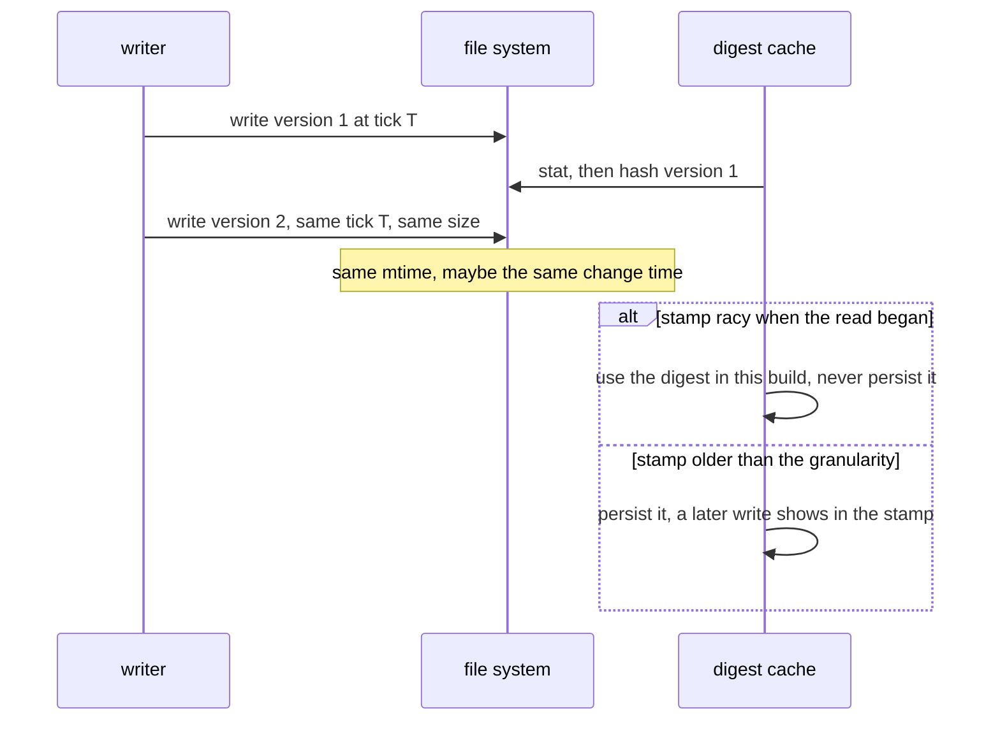
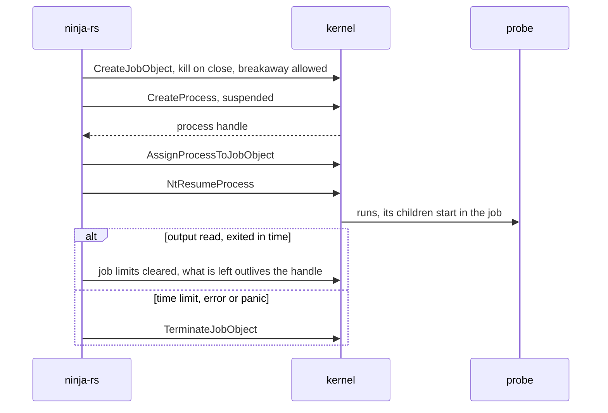
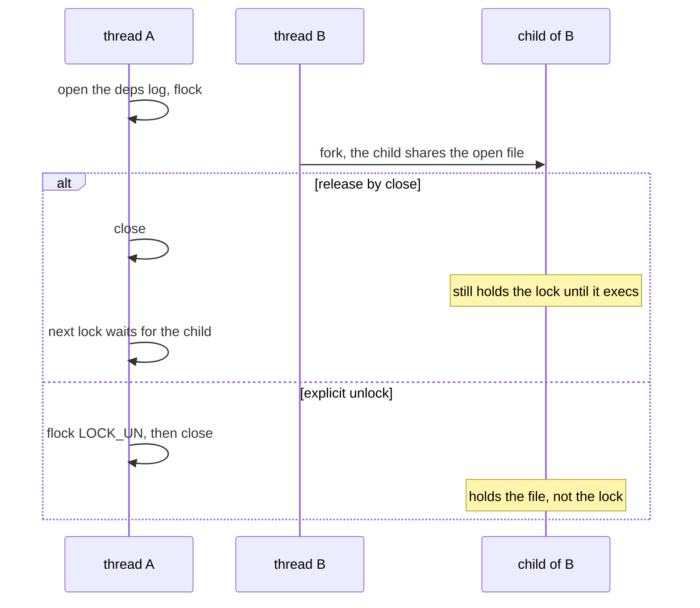

# The OS layer (ninja-os)

`crates/ninja-os` holds what the other crates need from the operating system and must agree on:
file stamps and digests, file identities, locks, process identities and parents, programs run
with a time limit, and Windows security. It depends only on `sha2`, `hex`, and `libc` or
`windows-sys`. The product crates and rbe-client use it (see [architecture.md](architecture.md)).

| File | Part |
|---|---|
| `src/lib.rs` | `FileStamp`, `stat`, `identity`, `replaced`, `lock`, `unlock`, `ProcessIdentity`, `process_info`, `process_running`, `hash_file`, `is_executable`, `random_u64` |
| `src/process.rs` | `output`: a program run for its output, with a time limit, as a process tree |
| `src/windows.rs` | handles, file ids and times, byte-range locks, process parents and times, owners and DACLs |

## File stamps and identities

**Use case.** Digest caches (the file digests REAPI needs, kept in `.ninja_rs_digests` across
builds and in the daemon), the conservative scanner's directory listings, and cpp-deps' lexed
files all need to know whether a file is still what it was when they read it, without reading
it again: a toolchain is hundreds of MB.

**Problems.**

- **mtime and size are not enough.** Tools set modification times: an archive extracted in
  place with normalized times gives a header new contents, the same size and an old mtime. A
  cache keyed on (path, size, mtime) then sends the old digest, and the remote action compiles
  against a file that isn't the one on disk: a wrong object, shared through the cache.
- **Files are created again under their names.** Unix may reuse the inode; NTFS gives a file
  created under a name deleted less than 15 s ago the old file's creation time ("tunneling").
- **Windows hides the useful fields.** `std::fs::Metadata` has no change time and no file id;
  opening a file to read them may conflict with a writer's sharing mode, or with a directory in
  use. FAT has no change time and no 128-bit file ids.
- **Racy stamps.** A file system stamps files with a clock that ticks every few milliseconds,
  or every second, or every 2 s (FAT). A file written, hashed, then written again within the
  same tick keeps its stamp: the cache would vouch for the first contents forever (git's "racy"
  index entries). A large file takes a while to hash, so whether its stamp was racy must be
  judged as of when the read began, not when it ended.

**Solution.** `FileStamp` is what a digest is valid for: `len`, `mtime_ns`, `change` (Unix
`ctime`, Windows `ChangeTime`), `created` (Windows), `volume` (Windows volume serial) and `id`
(inode, or the 128-bit file id). No tool sets a change time back, and a new file gets a new
identity. `stat` fills it: on Unix from `stat(2)`; on Windows through a handle opened for
attributes only (`windows::open_attributes`: `FILE_READ_ATTRIBUTES` with
`FILE_FLAG_BACKUP_SEMANTICS`, which conflicts with no writer and opens directories), then
`GetFileInformationByHandleEx` for `FileBasicInfo` and `FileIdInfo`, falling back to the 64-bit
index (`file_index`) on FAT, zeros for missing times.

`FileStamp::is_racy(now)` says whether the file was modified within its file system's
granularity of `now`: 2 s when the mtime is a whole second (FAT counts in 2 s, ext3 and HFS+ in
seconds), 100 ms otherwise. The sequence shows the race it closes.

Callers apply it: `rbe_client::tree::MemDigestCache` keeps a racy flag per entry, judged at
`put_read_at` with the time the read began, and `entries` (what `.ninja_rs_digests` saves) leaves
racy ones out; the conservative scanner lists a racy directory again rather than trusting its
listing; the daemon doesn't keep racy stamps (see [daemon.md](daemon.md)).

`identity(&File)` is a file's identity from an open handle: device and inode on Unix, volume
serial and file id on Windows. The logs lock is passed to nested builds by identity (see
[engine.md](engine.md#the-lock)), so no path spelling (a symlink, case, an 8.3 name, `subst`)
matters, and the deps log notices the file it follows is another one. `replaced(&File, path)`
tells a log writer that the file it has open isn't at its path any more: Unix compares
identities; Windows asks the handle whether its file is delete-pending or has no links left,
which is what a rename over a file open elsewhere does (std opens with `FILE_SHARE_DELETE`).

The engine itself keeps ninja's semantics: its dirty checks compare mtimes (`disk::Disk::stat`),
as ninja's. Stamps are for caches keyed by content.

**Alternatives rejected.** Hashing every input every build: correct, and seconds per build for
a toolchain (minutes in debug builds). Keying on (size, mtime): measured wrong (the archive
case). Persisting racy digests with a "re-check later" flag: the next process can't tell later
from now.

**Limits.**

- Two more system calls per stat on Windows.
- A file system whose change time can't be trusted (some network file systems) weakens the
  stamp to what it reports.
- Keys are ASCII case-folded in the daemon and the scanner on case-insensitive systems; a
  case-sensitive directory on Windows or macOS can confuse `Foo.h` and `foo.h` (see
  [daemon.md](daemon.md)).

**Tests.** `lib.rs` `rewrites_change_the_stamp` (same size and mtime restored, created again),
`replaced_files`, `digests`, `locks`; `windows.rs` `identities`, `own_files`;
`rbe-client` `tree.rs` `digests_are_judged_racy_as_of_their_read`; `ninja-remote` `store.rs`
`digests_round_trip`.

## Process identity

**Use case.** The logs lock names its holder; a build whose environment lost
`NINJA_RS_LOGS_LOCK` recognizes the build running it by walking its ancestors (see
[engine.md](engine.md#the-lock)). Swept files (`flags-<pid>.json`) and tests ask whether a
process still runs.

**Problems.**

- Pids are reused: a stale lock file can name a pid that is now an unrelated process.
- Pid namespaces: in two containers sharing a workspace, the same pid names different
  processes: matching the pid alone once let a second build run beside the first, unwaited.
- On Windows, a process keeps its parent's id after the parent exits, and that id may be
  reused: the "parent" may be younger than the child.
- Walking ancestors with a Toolhelp snapshot of every process cost 22 to 39 ms per poll with
  700 processes: polling every 100 ms while waiting for a lock took a quarter of a core.
- `kill(pid, 0)` succeeds on a zombie, and fails with `EPERM` on another user's process.

**Solution.** `ProcessIdentity { start, namespace }` tells a running process from others with its
id; `process_info(pid)` gives it with the parent's id:

| System | Start | Namespace | Parent |
|---|---|---|---|
| Linux, Android | `starttime`, field 22 of `/proc/<pid>/stat` (clock ticks since boot) | inode of `/proc/<pid>/ns/pid` | field 4 of `stat` |
| macOS | `pbi_start` from `proc_pidinfo(PROC_PIDTBSDINFO)` (µs since the epoch) | 0 | `pbi_ppid` |
| Windows | `GetProcessTimes` creation time (100 ns since 1601) | 0 | `NtQueryInformationProcess(ProcessBasicInformation)` |

The holder of the logs lock writes `<pid> <since ms> <start> <namespace>`; a build inherits only
on a match of all three (`nested::runs_this` in the ninja-rs crate), and on Windows stops its
walk at a parent that started after its child. The `/proc/<pid>/stat` name field is skipped
from its last `)`, since a process name may hold spaces and parentheses.

`process_running(pid)` is `Some(true)`, `Some(false)` or `None` (can't tell): on Unix,
`kill(pid, 0)`, with a zombie (state `Z` in `/proc`) not running and `EPERM` meaning another
user's process, which runs unless a zombie; on Windows, `OpenProcess(SYNCHRONIZE)` and a zero
wait, `ERROR_INVALID_PARAMETER` meaning no such process.

**Limits.** macOS's `process_info` is written but untested. Process identity on other systems
is unknown (`None`): no inheritance through ancestors there.

**Tests.** `lib.rs` `processes_and_their_parents`, `running_processes`; `cli_e2e.rs`
`holder_with_an_ancestors_id`, `holder_in_another_pid_namespace`.

## Process trees and Windows jobs

**Use case.** `process::output` runs a program for its output with a time limit: compiler
probes (`cc -E -v`, `cl` dialect probes), the scanners' compiler fallback, `-###` dry runs.
Build commands use the engine's own tree code (see
[engine.md](engine.md#subprocesses)), which shares `process::resume`.

**Problems.**

- `gcc` leaves `cc1` running, a script its commands: killing the first process on a time limit
  leaves the rest, which may hold the output pipes, so reading never ends.
- ninja-rs exits with `std::process::exit` (no thread unwinds) when interrupted: a probe started
  a moment before must not outlive it.
- On POSIX, the process group must be known to the exit hook from the moment the process exists:
  registering it after `spawn` returned left a window in which an exit left the probe's tree
  running.
- On Windows, a process must join its job before it runs, or what it starts at once escapes.
  std doesn't create processes in a job, and keeps the main thread's handle, so resuming a
  suspended process needs its thread found among the system's (a Toolhelp snapshot, a third of a
  second on a busy machine).
- Some programs start servers that must outlive them (a compiler server asking to break away
  from its job): forbidding it makes their creation fail.

**Solution.** The diagram shows a Windows start.

- `Tree::spawn` on POSIX makes the program lead a process group (`process_group(0)`) and adds the
  group to `groups::GROUPS` while holding its lock across the spawn; an `atexit` hook,
  `kill_all`, sends SIGKILL to every group, waiting up to 10 s for a thread starting or ending a
  run to release the lock, then holds it until the process ends.
- `Tree::spawn` on Windows creates a job with `JOB_OBJECT_LIMIT_KILL_ON_JOB_CLOSE` and
  `JOB_OBJECT_LIMIT_BREAKAWAY_OK`, starts the program suspended (adding `CREATE_SUSPENDED` to the
  caller's flags), assigns it, and resumes it with `NtResumeProcess` (`resume`; an ntdll export,
  long stable if undocumented, which PsSuspend and debuggers use). Should ninja-rs exit, the
  job's last handle closes and its processes die.
- `output` reads stdout and stderr on threads of their own until both end, then waits for the
  exit, all within the time limit; when it passes, the `Running` guard drops and kills the tree
  (also on an error or a panic). A finished run releases the tree (`release`): what it left
  running outside the pipes, a server, stays, as it would without a group or a job.
- Jobs nest (Windows 8 and later): ninja-rs run inside a CI's or an IDE's job still puts its
  commands in jobs of their own.

**Alternatives rejected.** Toolhelp to find the main thread: too slow under load.
`PROC_THREAD_ATTRIBUTE_JOB_LIST` would create the process in its job directly, closing the
window below, but needs a `CreateProcessW` of our own instead of std's.

**Limits.**

- Windows: ninja-rs exiting between `CreateProcess` and `AssignProcessToJobObject` leaves one
  suspended process, which never runs. A probe that may not join a job runs without one (build
  commands fail instead, see [engine.md](engine.md#subprocesses)).
- Two implementations of process trees remain: this one and `ninja_core::subprocess`'s
  `ProcessTree` for build commands, with different policies (build commands' jobs have no
  kill-on-close). Merging them is pending.
- The link driver's dry run (`-###`, `crates/ninja-remote/src/link.rs`) uses plain
  `Command::output`: no time limit, no tree kill.

**Tests.** `process.rs` `output_and_input`, `timeouts_kill_the_tree`,
`unfinished_runs_kill_the_tree`, `exiting_kills_the_tree` (the test binary run again, exiting
between a spawn and the adding of its group through a test hook), `job_kills_on_close`
(Windows).

## Locks

**Use case.** `lock(&File, wait)` and `unlock(&File)` give an exclusive, advisory lock per open
handle: the build directory's logs lock (`<builddir>/.ninja_rs_lock`), the deps log's per-flush
lock (see [engine.md](engine.md#the-build-log-and-the-deps-log)), and, through std, the disk
cache's collection lock.

**Problems.**

- **flock and fork.** On Unix a `flock` belongs to the open file description, which `fork`
  duplicates. std opens files close-on-exec, but between a fork and the exec another thread's
  child holds the description, and with it the lock. Releasing a lock by closing the file then
  doesn't release it: the lock lives on in a child that is about to run a compiler. A build
  forks constantly.
- **Windows locks are mandatory on the range.** `LockFileEx` over the file's data makes other
  handles' reads and writes of that range fail, which would stop nested builds reading the log.
- **NFS** implements `flock` with POSIX locks, which need a file open for writing; another
  user's lock file in a group-shared build directory may be read-only.
- Older ninja-rs versions locked the whole file with std's `File::lock`.

**Solution.** On Unix, `lock` is std's `File::lock`/`try_lock` (`flock`), and `unlock` an explicit
`File::unlock`: whoever must release a lock while the process goes on releases it explicitly,
which releases it for the description however many children share it. The sequence shows the
difference.

On Windows, `lock` locks one byte at offset 2^62 (`LOCKED_BYTE`), past any data a log will hold:
it excludes other handles' locks, including a whole-file lock of an older version, and leaves
reads and writes alone. `LogLock::open` opens the lock file for reading and writing, falling back
to read-only on Unix only when the user may not write it.

The users differ in how they release: the deps log's `with_lock` and the disk cache's collection
unlock explicitly; `LogLock` is held for a whole invocation and released by its handle closing at
the end, where a child forked at that moment delays the next build by at most one 100 ms poll.

**Limits.** A file system without locks (some network file systems) makes `lock` fail: the
logs lock is then a warning (`can't lock the logs`), and the deps log's writers append without
taking turns, which its id checks catch (see
[engine.md](engine.md#the-build-log-and-the-deps-log)).

**Tests.** `lib.rs` `locks` (handles of one process exclude each other; reads and writes go on);
`build_log.rs` `the_lock_names_its_holder`, `a_read_only_lock_file_locks`; `deps_log.rs`
`writers_in_processes_take_turns`.

## Windows security

**Use case.** Settings files are read only when no one but the user and the administrators could
have written them (see [cli.md](cli.md#settings-files)); the daemon's directory, secret flags
file and pipe must be the user's alone (see [daemon.md](daemon.md)).

**Problems.** Windows has no mode bits: who may write is a DACL of allow and deny entries,
inherited or explicit, generic or specific rights, and SIDs that stand for "the owner". Below a
drive's root, Authenticated Users may modify by default. A link's own security and its target's
both matter. A wrong reading in the trusting direction lets another user plant settings.

**Solution.** `file_security(path, follow, wanted)` opens the path (or, with `follow` false, the
link itself) for `READ_CONTROL`, reads the owner and the DACL (`GetSecurityInfo`), and returns
the owner's SID and the SIDs of the allow entries whose access mask `wanted` accepts. It reads
conservatively:

- no DACL means everyone has every right;
- inherit-only entries are skipped (they are for what a directory will hold);
- deny entries are ignored: they only take rights away, so ignoring them can only make a file
  look less private;
- object entries, whose SID isn't read, count as everyone.

`process_user` and `current_user` give the user SID of a process token: the daemon client checks
that the process serving its named pipe is the user's. `rc.rs` decides with the `WRITE` mask
(write data, append data, delete child, delete, `WRITE_DAC`, `WRITE_OWNER`, and the generic
rights including them) which SIDs may change a file, and trusts the user, SYSTEM,
Administrators, TrustedInstaller, CREATOR OWNER and OWNER RIGHTS.

**Limits.** Deny entries are never credited, so a file whose DACL allows Users write and denies
it to everyone but the user is still refused: safe, and rare.

**Tests.** `windows.rs` `own_files`; `rc.rs` `workspace_permissions`, `system_file_permissions`,
`trusted_principals` (with `icacls`).
