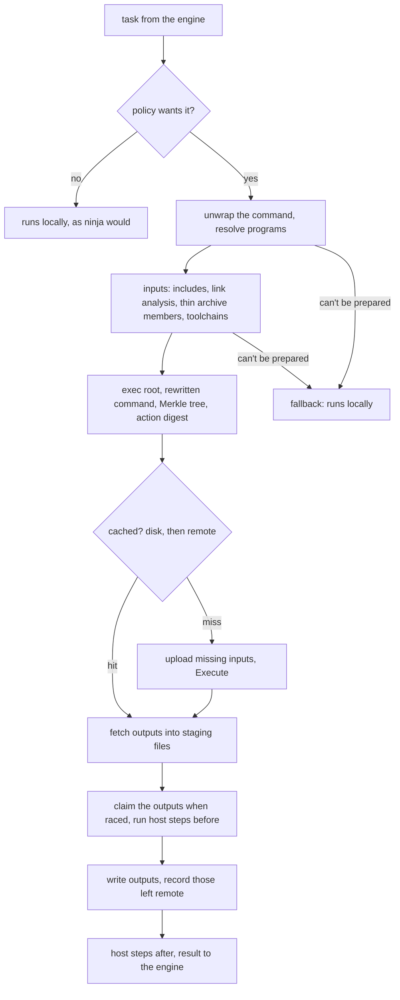
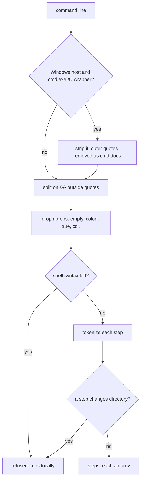
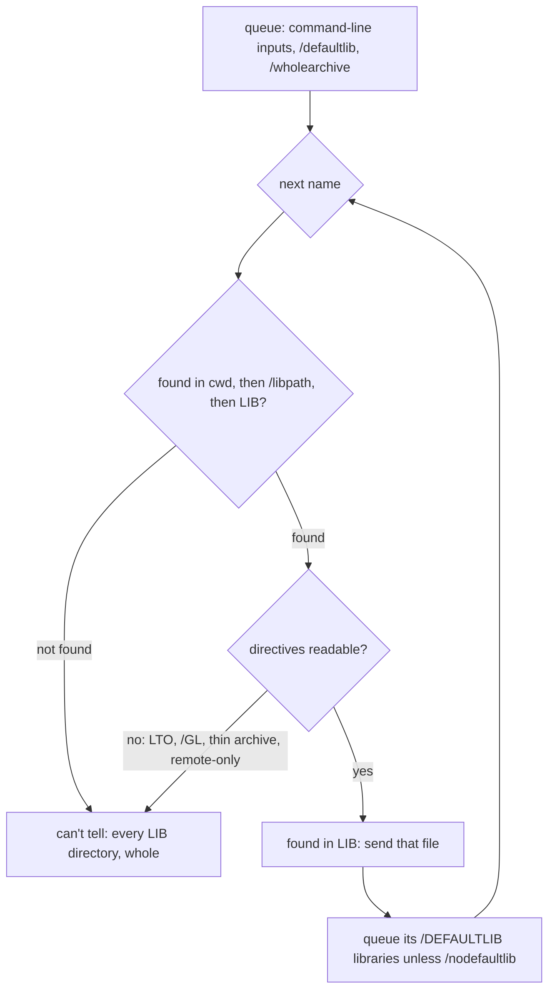
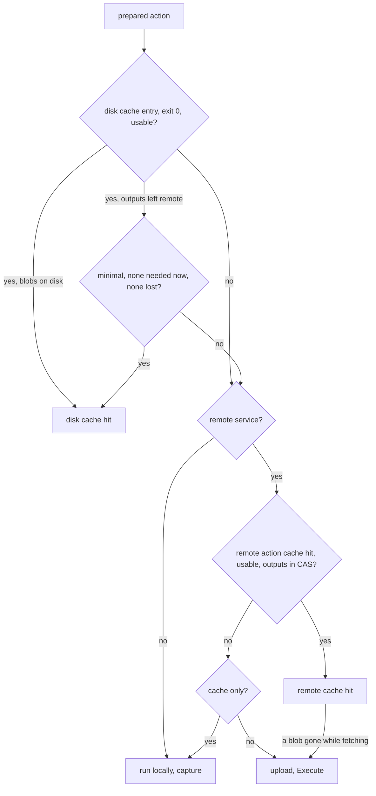
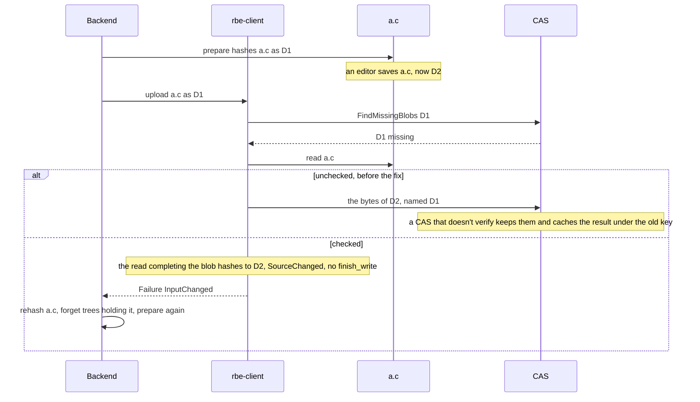
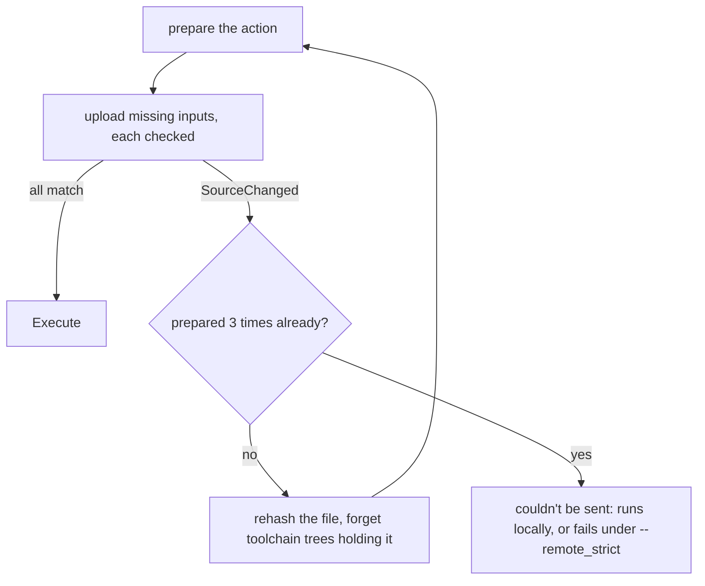
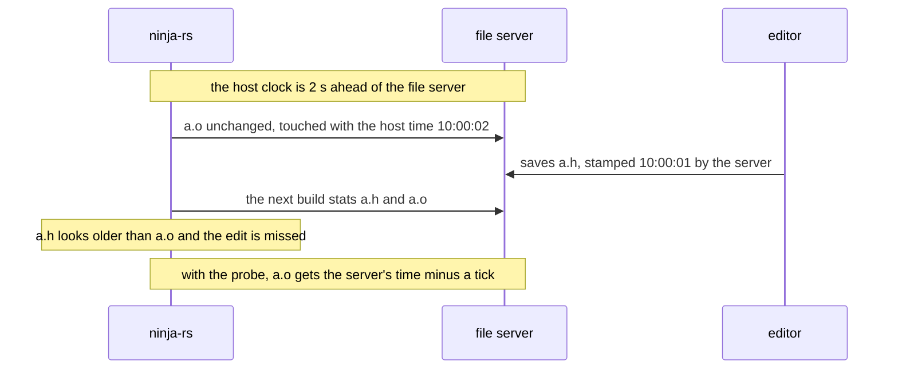
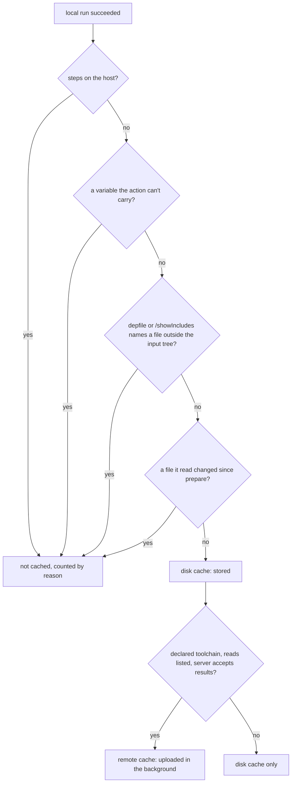
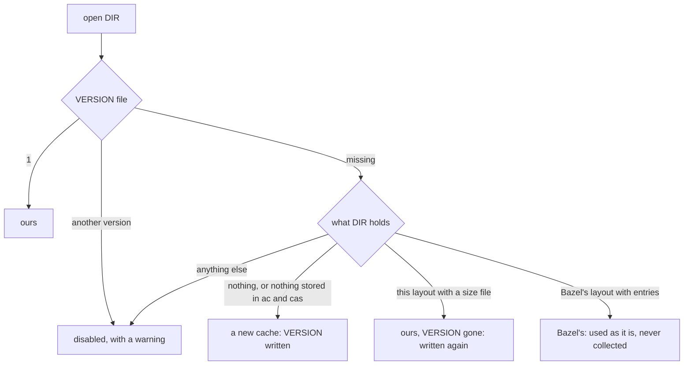
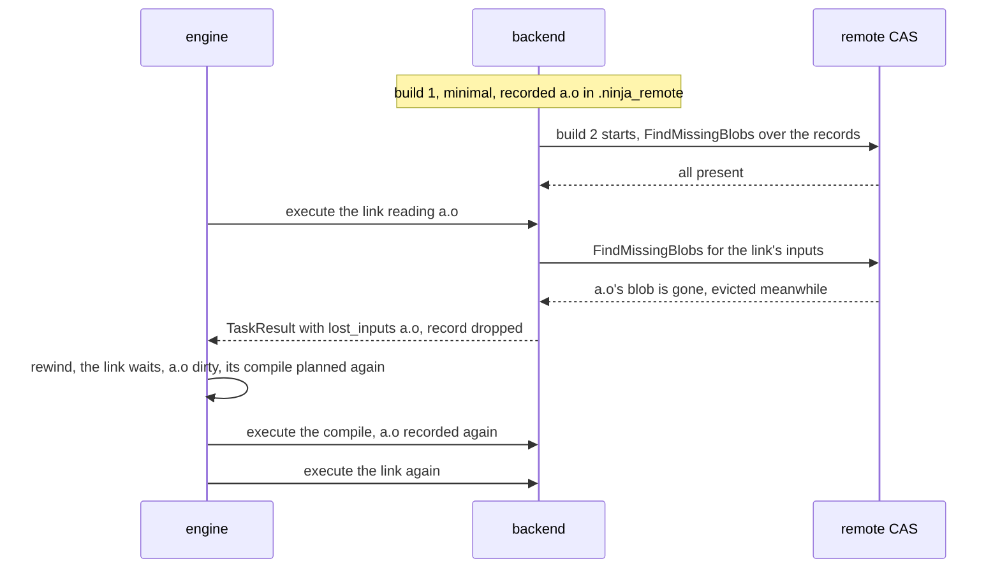

# ninja-remote: the remote execution backend

`crates/ninja-remote` turns ninja edges into REAPI v2 actions and gets their results: from the
disk cache, from a remote action cache, or by executing them remotely. It also stores the
results of commands run locally on a cache miss, keeps the outputs a build left in the remote
CAS (`.ninja_remote`), and finds what a compile reads (the include scanners, documented in
[include-scanning.md](include-scanning.md)). The transport underneath (connections, retries,
TLS, ByteStream, chunking) is `rbe-client`'s: see [transport.md](transport.md). How local
paths become paths of the remote input root is in [paths.md](../paths.md).

The engine knows the backend only through the `RemoteBackend` trait
(`crates/ninja-core/src/runner.rs`). `ExecRunner` (`crates/ninja-rs/src/exec_runner.rs`) calls
it for each task the policy wants, in a remote slot (`--remote_jobs`) when the backend executes,
in a local slot when it is a cache alone. The CLI creates the backend once per build pass
(`Service::remote_backend` in `crates/ninja-rs/src/lib.rs`), and only for a manifest with
`rbe_version = 1` and a remote endpoint or a `--disk_cache`.

## Module map

| File | Role |
|---|---|
| `backend.rs` | `Backend`: policy, cache lookups, upload, Execute, staging and writing outputs, fallbacks, local runs of prepared actions |
| `backend/download.rs` | fetching blobs into staging files (disk cache, remote, chunks), atomic output writes, the file-system clock |
| `backend/capture.rs` | storing the result of a local run on a cache miss |
| `action.rs` | `prepare`: from a `Task` to a `Prepared` action (inputs, exec root, Merkle tree, `Command`, `Action`) |
| `cmdline.rs` | unwrapping `cmd.exe /C`, `&&` chains, shell no-ops; tokenizing; response files |
| `toolchains.rs` | the `rbe_toolchains` file; resolving programs |
| `env.rs` | the environment variables each tool reads, and what an action carries |
| `link.rs`, `directives.rs` | what a link reads: the driver's dry run, `LIB`, `.drectve` directives |
| `archive.rs` | thin archives and their members |
| `compile_outputs.rs` | the files a compile writes besides its object |
| `paths.rs` | exec root and path mapping (see [paths.md](../paths.md)) |
| `scanner.rs` | the conservative include scanner (see [include-scanning.md](include-scanning.md)) |
| `store.rs` | `Store`: digests, toolchain trees, thin archive members, directives, uploaded hashes |
| `disk_cache.rs` | `DiskCache`: the local action cache and CAS |
| `remote_outputs.rs` | `.ninja_remote` and the `RemoteDisk` overlay |
| `targets.rs` | the `rbe_targets` file: labels and configurations for request metadata |

## An action's life

The diagram shows what happens to one task the policy sends remotely; the sections below follow
it.



`Inner::execute` drives it. `prepare` runs on a blocking thread (it reads and hashes files);
`Inner::try_execute` does the rest. The answer to the engine is a `RemoteOutcome`:

- `Done(TaskResult)`: outputs written, from a cache or an execution, or a failure;
- `Fallback(reason, command)`: run locally, with the prepared command when there is one;
- `RunLocally(capture, command)`: a cache miss without remote execution, run locally, then
  hand the result to the capture (see [Capture](#capture-of-local-results));
- `Lost`: racing, the local branch claimed the outputs first.

## Policy: what is sent

**Use case.** Decide per edge whether the backend handles it, and account for the edges that
end up running locally anyway.

**Problems.** A broken remote setup must not quietly turn every build local: fallbacks have to
be visible and bounded. Some edges can never be sent by design (multi-step commands on Windows
hosts), and those must not trip the limits meant for service failures.

**Solution.** `policy_wants` (`backend.rs`) sends an edge when it isn't in the console pool,
isn't a generator edge (`generator = 1`), isn't marked `rbe_local = 1`, and its `rbe_mnemonic`
ends with one of `--remote_mnemonics` (default `Compile`). An edge without a mnemonic stays
local. Remote is the default per edge: generators opt edges out, not in.

Every action the policy sends counts as started (`Fallbacks::started`). A preparation that
fails (`Failure::Prepare`) is an action that couldn't be sent: it is counted by reason
(`Reasons`, keyed by the text before the first `": "`, so that file names and quoted command
lines don't split the count) and runs locally, or fails under `--remote_strict`
(`ninja: the action can't run remotely (--remote_strict): ...`). A remote failure
(`Failure::Infra`) falls back only with `--remote_local_fallback` (default on), without
`--remote_strict`, and within `--remote_max_fallbacks` and `--remote_max_fallback_ratio`
(checked from `FALLBACK_RATIO_MIN_ACTIONS` = 20 actions on: `fallback_limit`). Past a limit,
remote failures fail their action. A certificate refused is never a fallback (see
[transport.md](transport.md#the-refusal-judgement)). The end of the build prints
`fallback_summary`: `N of M remote actions ran locally: ...`, a warning when some did after
remote failures.

**Limits.** With a cache alone (`--remote_cache` or `--disk_cache` without an executor), cache
lookups run in local slots, so a fully cached build behind a remote cache is bounded by `-j`
lookups in flight (see [engine.md](engine.md)). A task falling back
frees its remote slot and waits for a local one, counted as running meanwhile.

**Tests.** `backend::tests::policy`, `fallback_limits`, `unsent_by_reason`; e2e
`fallback_guards`, `no_rbe_version_runs_locally`, `without_executor_runs_locally`.

## Command unwrapping

**Use case.** A REAPI `Command` is one argv. Generators write shell command lines: CMake wraps
Windows commands in `cmd.exe /C "..."`, chains steps with `&&`, and pads empty pre- and
post-steps with `:` or `cd .`.

**Problems.** Splitting a command line into argv is only right when nothing else of the shell's
syntax is used: a pipe, a redirection or a variable split into arguments would be passed
literally. cmd.exe's rules differ from a POSIX shell's: it expands `%NAME%` only when `NAME`
is set (hermetic-llvm-cmake's links pass `/pdbaltpath:%_PDB%`, which lld-link expands itself;
refusing every `%...%` made every Windows link unsendable). Several
steps can't be one argv. Some steps (CMake's `cmake -E rm -f` before `ar`) must run on the
host: deleting a file in the remote's empty input root does nothing.

**Solution.** `cmdline::unwrap_command` (with `unwrap_command_with` for tests):



- On Windows, `|`, `<` and `>` outside quotes are refused; under `cmd.exe /C`, so are `&`, `^`
  and parentheses outside quotes (`cmd_syntax`), and a variable cmd.exe would expand
  (`cmd_variable`): `%NAME%` or `%NAME:...%` whose `NAME` is set in ninja-rs's environment
  (case-insensitively) or is one of cmd's own (`CD`, `DATE`, `RANDOM`, `ERRORLEVEL`, ...).
  An unset one stays literal, and the scan goes on from its closing `%`, as cmd does. Steps
  are tokenized with `CommandLineToArgvW` rules (`split_windows`).
- On POSIX hosts, `split_posix` takes shell words; anything needing a shell fails it
  (`command needs a shell: ...`).
- A `cd` step is refused: the steps after it would run elsewhere.

`action::prepare` then resolves each step's program (`toolchains::resolve_program`: relative to
the build directory or through `PATH`, `.exe` added on Windows; `long_path` expands 8.3 short
names only, so that a toolchain reached through a link keeps its spelling) and looks each up in
the toolchains file. A program declared `"local": true` runs on the host. Leading local steps
become `Prepared::local_before`, trailing ones `local_after`; a local step between remote ones,
or a command made of local steps only, is refused.

Several remote steps run as `/bin/sh -c 'a && b'` (`join_posix_chain`, each argument quoted
with `quote_posix`): the action is one argv, and only a shell runs a chain. This needs a POSIX
worker, which a POSIX host's toolchain implies. On Windows hosts a multi-step remote command is
refused (`the command runs N steps remotely`): cmd.exe's quoting doesn't survive a worker's own
argument quoting. Generators should write single-step commands (`llvm-ar qc` writes the index
itself: no `ranlib` step).

Host steps run in the build directory through `ninja_core::subprocess::run_argv`, under the
runner's stop (`host_stop`: an interrupt stops them and waits for them, as for local commands).
The steps before the remote one run only once the result is fetched and the outputs claimed:
a remote failure or a disk cache entry that proves unreadable has run nothing on the host, and
the local run that follows runs them once. Outputs that can't be written after those
steps ran fail the edge (`... (not run locally: its steps on the host ran)`) instead of falling
back, which would run them twice. A command with host steps isn't raced, and every output of
one with steps after it is downloaded (they may read them). The cached result of such a command
is the remote step's alone: a hit runs the host steps again. A local run of it isn't cached
(`the command runs steps on the host`): its outputs went through the steps.

**Alternatives rejected.** Recognising CMake's own steps by name: ninja-rs stays generic, local
steps come from `local` tool declarations in the toolchains file.

**Limits.** Multi-step remote actions need `/bin/sh` on the worker. On Windows hosts they run
locally.

**Tests.** `cmdline::tests::unwrap_*`, `cmd_variables`, `posix_chain`, `rsp_split`; e2e
`local_tool_steps`, `host_steps_once_on_disk_miss`, `disk_hit_with_host_steps`,
`host_steps_once_after_remote_failure`, `host_steps_once_when_outputs_cant_be_written`,
`host_step_reads_remote_output`.

## Toolchains and toolchain trees

**Use case.** A remote worker needs the compiler and everything it reads that the scanner
doesn't name: its binaries, its resource directory, the linker it runs. The toolchains file
(`rbe_toolchains`, see [rbe-interface.md](../rbe-interface.md)) declares, per tool, the input
directories sent whole and the REAPI platform properties.

**Problems.** A toolchain is hundreds of MB and thousands of files; hashing it per action, or
per build in a debug binary, takes seconds to minutes. Concurrent actions need the same tree at
once. A file of it can be locked for a moment (an indexer, a virus scanner on Windows) or gone
for good. A toolchain can change while the build runs.

**Solution.** A toolchain is identified by its executable path (`Toolchains::find`: lexically
normalized, case-insensitive on Windows, `.exe` optional), as reclient does; no binding names
it. Its `inputs` that are directories become grafted subtrees of the input root
(`InputTree::add_subtree`), files are plain inputs, its `platform` becomes the action's.
Without a declaration only the executable is sent. Sysroots and SDK headers are scanned, not
sent whole: a declaration names what the compiler needs regardless of the source.

`Store::toolchain_tree` builds each directory's tree once per process: one cell per directory,
locked while it is built, so that concurrent actions wait for the first. The tree comes from
the daemon's listing when there is one (`ninja_daemon::Client::tree`, digests kept between
builds), else from a walk hashing through the digest cache (`InputTree::add_dir_cached`,
persisted in `.ninja_rs_digests`). Walks skip the daemon's sync files and repositories' own
directories (`ninja_daemon::watch::walk_skips`), so a tree is the same with or without the
daemon. A failure is kept: for good when walking again would fail the same way (`lasting`: not
found, permission denied, a bad tree), for `TRANSIENT_KEPT` (5 s) otherwise. A tree is
forgotten when an upload finds one of its files changed (`forget_toolchain_trees_holding`, see
[Upload](#upload-digest-checks-and-re-preparation)).

**Limits.** A tree is built once per process and not checked again: a toolchain updated in
place mid-build, whose files the upload doesn't read (already in the CAS), gives local runs the
new files under keys of the old ones. The 5 s keep turns one transient failure (a
sharing violation, too many open files) into a failure of every action needing the tree for
5 s, each then counted as unsent, or failed under `--remote_strict`.

**Tests.** `store::tests::toolchain_tree_is_built_once`, `toolchain_tree_errors`,
`lasting_tree_failures`, `locked_toolchain_file` (Windows), `toolchain_trees_skip_repositories`;
`toolchains::tests::*`.

## Tool environments and the action key

**Use case.** A command run locally inherits the build's environment; a remote action has only
the variables its `Command` lists. Variables tools read (`CPATH`, `INCLUDE`, `CL`, `LIB`,
`SDKROOT`, `SOURCE_DATE_EPOCH`...) change what they write, so the action must carry them, and
its key (the digest of `Command` and the input root) must describe them.

**Problems.** Two lessons shaped this:

- *The host environment.* Early versions put only `INCLUDE` in the command, while local runs of
  prepared actions inherited everything. A machine with `CL=/DFOO` or `CPATH` set stored its
  results under a clean machine's key, and remote runs never saw the variable: a poisoned
  cache. Carrying every variable instead would put `PATH` and the user's whole session in every
  key.
- *The developer prompt.* Picking variables by program name alone gave a Visual Studio prompt
  and a plain shell different keys for hermetic toolchains that ignore those variables
  (clang-cl with `/vctoolsdir`, lld-link with `/lldignoreenv`), and `LIB` named hundreds of MB
  of libraries the action didn't send.

A third lesson is open: `-march=native` (`-mcpu=`, `-mtune=`) makes the output depend on the
CPU of the machine that ran the compile, which no key describes. The preprocessor scanner
treats the flag as one it can't model (its probe and the worker may differ) and asks the
compiler for the includes, but the action is still sent and cached as any other.

**Solution.** `env::Tool::of_step` gives each step's tool a kind (`ClCompile`, `GnuCompile`,
`MsvcLink`, `GnuLink`, `Ar`, `Lib`, `Other`) from its name, the scanner's compiler style and its
command line, and the variables it reads given that command line:

| Tool | Variables carried | Left out when |
|---|---|---|
| cl, clang-cl compiling | `CL`, `_CL_`, `INCLUDE`, `EXTERNAL_INCLUDE`, `/external:env:` names; cl's `/clr`: `LIBPATH`; clang-cl: `VCToolsInstallDir`, `VCINSTALLDIR`, Clang's own | `/X`, `-nostdinc`, `-nostdlibinc`; clang-cl `/vctoolsdir` or `/winsysroot` |
| GCC, Clang compiling | `CPATH` family, `GCC_EXEC_PREFIX`, `COMPILER_PATH`, `CCC_OVERRIDE_OPTIONS`, `SOURCE_DATE_EPOCH`, `SDKROOT`, `DEVELOPER_DIR`, `RC_DEBUG_OPTIONS`, Apple deployment targets; Clang for MSVC targets: `INCLUDE`, VS locations | Clang's MSVC variables unless it targets `*-windows-msvc` (the host's default on Windows) |
| MSVC linkers, cl-style drivers linking | `LIB`, `LINK`, `_LINK_`; drivers: `CL`, `_CL_`; lld-link and clang-cl: VS locations | lld-link `/lldignoreenv` (`LINK` only when on its own command line, not in a response file); `LIB` under `/winsysroot` |
| GNU links | `LIBRARY_PATH`, `GCC_EXEC_PREFIX`, `COMPILER_PATH`, `SDKROOT`, `DEVELOPER_DIR`, `ZERO_AR_DATE`, `LD_RUN_PATH`, deployment targets | |
| archivers | `ZERO_AR_DATE` | |
| lib.exe, llvm-lib | `LIB` | when every input is found from the working directory or a `/LIBPATH:` |

Clang drivers also carry `CLANG_NO_DEFAULT_CONFIG` and the `CC_PRINT_*`/`CC_LOG_DIAGNOSTICS`
switches. The Windows SDK is never found from the environment (`WindowsSdkDir`, `UCRTVersion`).
A driver's link is judged by the linker its dry run named (`runs_lld_link`): link.exe, Clang's
default, ignores `/lldignoreenv` and reads everything.

`env::action_env` puts the values that are set into the command, paths rewritten as in the
arguments (relative to the working directory under the exec root, see [paths.md](../paths.md));
`CL` and `LINK` are split and rewritten as command lines (`Value::Options`). `--action_env`
values go as given, last, and a variable it names is never refused. Variables a tool would use
to write files the action doesn't return (`DEPENDENCIES_OUTPUT`, `SUNPRO_DEPENDENCIES`,
`CC_PRINT_*_FILE`), or values that aren't UTF-8, can't be carried: they set
`Prepared::env_refused`, which keeps local results out of the caches (with a warning once per
build), while the action itself may still run remotely without them.

`env::env_options` adds what `CL` and `LINK` put on the command line (before and after it) to
the command line the scanner, the link analysis and the definitions check see
(`prepare`'s `effective`): the tool reads them as options.

The rest of the key: the rewritten argv, `output_paths` (and the legacy `output_files`), the
working directory, the platform, and the input root's digest. `Action::salt` is empty and
`do_not_cache` false.

**Alternatives rejected.** recc copies a fixed list of variables per compiler; that's the same
idea without the flags that make tools ignore them, which is what makes a developer prompt and
CI share keys. Carrying the whole environment: every key would differ between machines.

**Limits.** `-march=native` and friends are sent and cached (see above): don't use them with a
shared cache, or name the CPU. Variables the tables don't know (a tool's own) are neither
carried nor refused: `--action_env` carries them.

**Tests.** `env::tests::tools`, `environments`, `clang_output_variables`, `values_not_utf8`,
`msvc_environments`, `ignored_variables`, `lld_link_ignoring_the_environment`,
`driver_links_by_their_linker`, `librarian_lib`, `options_from_the_environment`; e2e
`action_environment`.

## Link analysis

**Use case.** A link reads more than its declared inputs: the libraries a driver adds, those
directives inside objects ask for, linker scripts and `.def` files named by flags. It writes more
than its declared outputs: the PDB, the import library, a map.

**Problems.** A compiler driver doesn't say which linker it runs nor which directories it
searches. An MSVC link pulls libraries in through `/DEFAULTLIB:` directives inside objects
(`/MD` asks for `msvcrt.lib` and `oldnames.lib`; `#pragma comment(lib, ...)` for others),
transitively, from `LIB`'s directories, which a developer prompt fills with 500+ libraries and
hundreds of MB. Sending `LIB`'s directories whole put 760 MB and 650 files in every link tree,
and widened the exec root to `C:/`. MSVC's runtime libraries hold objects for any machine
(`IMAGE_FILE_MACHINE_UNKNOWN`), which a reader rejecting them can't follow. LTO bitcode,
`/GL` objects and thin archives have no readable directives.

**Solution.** `link::analyze` (called from `prepare` for a single step that is a driver linking,
`driver_compiles` false, or a known linker by name, `linker_flavor`):

- A driver runs its dry run (`-###`, first on its command line: clang-cl passes what follows
  `/link` to the linker), and its last job line is the linker's command line
  (`driver_link_job`, `split_quoted`). The linker is an input. A driver without a dry run sends
  its declared inputs only (a warning in `--remote_verbose`).
- An MSVC driver's linker gets `LINK` and `_LINK_` around its arguments; a linker run directly
  has them in `effective` already. lld-link ignores them under `/lldignoreenv`.
- `parse_linker_args` reads files (`/def:`, `/vfsoverlay:`, `/manifestinput:`, `/natvis:`,
  `/wholearchive:`, `/order:@`, `-T`, `--version-script`, `--dynamic-list`, inputs), library
  directories (`/libpath:`, `-L`), and side outputs (`/pdb:`, `/implib:`, `/map:`, `-Map`,
  `--out-implib`).
- For an MSVC link reading `LIB`, `env_files_read` resolves what the link reads there, as the
  linker searches:



`directives::read` reads `.drectve` sections of COFF objects (regular and `/bigobj`, any
machine including 0) and of archive members (import objects and `.res` files have none), and
`Store::link_directives` caches them per `FileStamp`. Directives' own `/nodefaultlib` is ignored:
more is sent, never less. When anything can't be told, every `LIB` directory goes whole, as
grafted trees. With the files resolved, a `/MD` link in a VS 18 prompt sends 7 files (9 MB)
instead of 5 directories.

Library directories outside the build directory (once links are resolved: the toolchain's) are
sent whole as grafted trees; the build's own libraries are declared inputs. Side outputs inside
the build directory are requested as optional outputs (`Prepared::side_outputs`, in
`output_paths`) and recorded with their action's first output (see
[Minimal downloads](#minimal-downloads-and-rewinding)).

**Compiles write more files too.** `compile_outputs::side_outputs` names what a compile writes
besides its object and depfile, as the compiler names it: `-gsplit-dwarf`'s `.dwo`,
`--coverage`'s `.gcno` (or `-fprofile-note=`), `-ftime-trace`'s JSON, `-MJ`,
`--serialize-diagnostics`, `-fstack-usage`, optimization records, a second depfile, clang-cl's
`/sourceDependencies`, through `/clang:` too. Flags writing files that can't be named that way
make the compile run locally: `-save-temps`, `-fdump-*`, cl's listings and `/P`,
`-ftime-trace=` naming a directory, `-dumpdir` and `-dumpbase` renaming a file it would return,
and cl.exe's `/Zi` (a PDB shared by several compiles; clang-cl puts the debug information in the
object).

**Thin archives.** A thin archive (`llvm-ar --thin`, `ar T`, `llvm-lib /llvmlibthin`) names its
members instead of holding them: an action reading one reads them too. `archive::expand` adds
the members of thin archives among the inputs (and of thin archives among those), read once per
version of the file (`Store::thin_members`) or taken from the `.ninja_remote` record of an
archive left remote (`+ name` lines). Compiles read no archives and skip this. A member named by
an absolute path, or resolving outside the build directory (also through a link), is refused
(`Outside::Refuse`): an archive from a server's result would otherwise make an action send any
file the user can read. For local commands the same expansion downloads remote-only members
and skips the others (`Outside::Skip`). An archive left remote has its member list read with two
ranged ByteStream reads that skip the symbol table (`Inner::remote_thin_members`,
`archive::symbols_end`, `members_from`), or whole up to 64 KiB, or from the disk cache.

**Alternatives rejected.** Refusing links when `LIB` points outside declared toolchains: a
developer prompt is how many people build. Sending `LIB`'s directories whole: the cost above.

**Limits.**

- Objects built with `cl /fsanitize=address` carry `/InferAsanLibs` in their directives:
  link.exe then adds `clang_rt.asan_dynamic-*.lib` from `LIB`, which `env_files_read` doesn't
  follow, so the remote link fails with LNK1104. Workaround: `rbe_local = 1` on
  ASan links, or keep links local (the default mnemonics).
- Libraries that directives name and that are found in the working directory or by an absolute
  path aren't sent (only `LIB` finds are).
- The dry run is a plain `std::process::Command::output`: no time limit, no process-tree kill.
- `restat` and thin archives don't mix: a member changing without changing its size or symbols
  leaves the archive's bytes alone.

**Tests.** `link::tests::flavors`, `dry_run_lines`, `msvc_arguments`, `msvc_environment`,
`libraries_read_from_lib`, `gnu_arguments`; `directives::tests::objects_and_libraries`;
`archive::tests::*`; `compile_outputs::tests::*`; `action::tests::linker_response_files`; e2e
`thin_archives`, `thin_archive_member_outside`, `compile_side_outputs`,
`local_run_drops_side_output_records`.

## Building the action

**Use case.** `action::prepare` turns a task into a `Prepared`: the action digest, the blobs to
upload, the path mapper and tree index for mapping paths back, the outputs, the command a local
run uses, and what the capture needs to check a local result.

**Problems.** Inputs come from many places and overlap: scanned headers, declared inputs, deps
an earlier build recorded, link files, thin archive members, toolchain files, response files,
outputs that only exist remotely. A file named twice with different case on Windows must be one
tree entry. A macro definition keeps its absolute path (see [paths.md](../paths.md)); one naming
an input sends a path the worker doesn't have.

**Solution.** In order:

1. The compile's inputs from the chosen scanner (see [include-scanning.md](include-scanning.md)),
   the link's from `link::analyze`, declared inputs (`task.inputs`, phony inputs already
   replaced by what they depend on), thin archive members, toolchain inputs, and the programs
   themselves. A file that only exists as a recorded remote output (a precompiled header the
   scanner found) goes in by digest (`InputTree::add_remote_file`).
2. The exec root (`--exec_root`, or the deepest common ancestor of the build directory and every
   input) and the `PathMapper` (see [paths.md](../paths.md)).
3. The tree: toolchain directories grafted first (nested ones covered by their parent), whole
   directories walked, files deduplicated by a case-folded key on Windows, response files added
   with rewritten contents (`add_bytes`), the working directory ensured. Directory messages list
   children in byte order (`build_dir` over a `BTreeMap`), as REAPI requires.
4. A definition naming an input by its absolute path refuses the action
   (`paths::defined_paths`: `a definition names the input ... by its absolute path`).
5. Digests: the daemon's (`Client::files`), else through the digest cache with the `FileStamp`
   taken once (`digest_for`), which `Prepared::local_inputs` keeps for the capture's check.
6. The command line, rewritten (`PathMapper::rewrite_args`), argv[0] the program's relative path
   (`program_arg`), relative input paths with forward slashes on Windows hosts (an archive's
   member names then don't depend on the host), several remote steps through `/bin/sh -c`.
7. The environment (see above), the outputs relative to the working directory (`output_rel`:
   one outside the build directory refuses the action), side outputs, the platform from the
   toolchain.
8. `Command`, its digest, the input root's digest, `Action`, its digest. With
   `--execution_log_file`, every input's digest (`InputTree::digests`).
9. When the tree spans volumes, `Prepared::local`: the command as a local run needs it (see
   [paths.md](../paths.md#several-volumes)).

**Tests.** `action::tests::*` (scanner fallbacks, command-line header macros, forced includes,
linker response files); e2e `remote_build_and_cache`, `response_files`,
`definition_naming_an_input`, `remote_only_scanned_input`, `build_dir_on_another_volume`.

## Where a result comes from

**Use case.** Use a result already computed, by this machine or another, before executing.

**Problems.** A cached result can be unusable: it names outputs the action didn't ask for (a
server, or whoever writes to a shared cache, would write anywhere), lacks one, has malformed
digests that would name other files, or points at blobs evicted since. With minimal downloads,
a disk cache entry may reference outputs that only exist in the remote CAS, which may be gone.

**Solution.** `try_execute` looks up, in order:



- `check_result` applies to every result, cached or executed: outputs must be among those
  requested and named once, every digest well formed (`rbe_client::valid_digest`: 64 lowercase
  hex digits, a size of at least 0), no symlinks, and a successful result must hold every
  declared output (unless steps after it may write them). A disk cache entry failing it is
  removed; a remote one is a miss, and Execute then skips the cache.
- A disk cache entry whose outputs stayed remote (`get_action_result_and_absent`) is trusted
  without asking the remote, as Bazel does with action rewinding, when this build downloads none
  of them and none is in `Inner::lost` (hashes found gone during this build). Otherwise it is a
  miss (and removed when stale).
- With minimal downloads a remote hit whose outputs left the CAS (`outputs_in_cas`, one
  `FindMissingBlobs`) is a miss: they wouldn't be downloaded now, and rewinding would only find
  the same result again. Execute's own cached results get the same check.
- A hit whose blob proves gone while fetching (NOT_FOUND) is executed once more, skipping the
  cache; with a cache alone it runs locally.

**Tests.** e2e `untrusted_results`, `disk_cache_alone`, `disk_cache_with_remote`,
`remote_cache_only`, `evicted_remote_hit`, `unreadable_disk_hit`, `disk_cache_minimal`.

## Upload: digest checks and re-preparation

**Use case.** Send the inputs the CAS lacks, then Execute.

**Problems.** Inputs are hashed at preparation and read again when uploaded, possibly seconds
later: an editor saving a source meanwhile sends new bytes under the old digest. A server that
verifies digests rejects it, which looked like a remote failure. One that doesn't (NativeLink's
filesystem store as `tests/nativelink/run.sh` configures it) stores the new bytes under the old
digest, runs them, and caches the result under the old key: every client building the old
content then gets the wrong output.



**Solution.** `execute_remotely` uploads `prepared_blobs` minus those this session knows the
CAS has (`Store::filter_unknown`, `mark_uploaded`). `rbe_client::Client::upload_blobs` checks
every file it sends against the digest it was hashed as: batched blobs once loaded
(`BlobSource::load_checked`), streamed ones as they're read (the `Checked` reader fails the read
that would complete a wrong blob, so the ByteStream write never finishes), spliced ones while
chunked and again per chunk (see [transport.md](transport.md#upload-verification)). A mismatch
is `rbe_client::SourceChanged`, which `upload_failure` turns into `Failure::InputChanged`.

`Inner::execute` then prepares the action again:



`input_changed` hashes the file again into the digest cache (`action::rehash`: its stamp may
not show the change within the file system's time granularity) and drops the toolchain trees
holding it. After `PREPARES` (3) preparations, a file changing all the time (something else
writes it as the build goes) makes the action one that couldn't be sent (`input changed during
the build: ...`), never a remote failure.

Blobs that only exist remotely (`BlobSource::Remote`, outputs never downloaded) and are missing
make `upload_blobs` fail with `MissingRemoteBlobs`: those inputs are lost, and the build rewinds
(see [Minimal downloads](#minimal-downloads-and-rewinding)).

**Limits.** A resumed ByteStream write hashes the file's current prefix, not what the broken
attempt sent: change, break, change back could let a non-verifying server commit a mixed blob.
fake-reapi always verifies, so no e2e test shows that the client never commits a changed
blob to a lax server.

**Tests.** `rbe_client` `tree::tests::changed_sources`; e2e `input_changed_before_upload`
(batched and streamed), `input_changed_during_local_run`, `shared_uploads`, `parallel_uploads`.

## Execute

`client.execute(digest, skip_cache)` runs on the client's execution connections and follows the
operation to its end (see [transport.md](transport.md#connections-and-call-permits)).
`FAILED_PRECONDITION` (inputs missing) comes back as the response's status: with remote-only
inputs, `lost_inputs` asks which are gone (`FindMissingBlobs`) and returns them for rewinding;
otherwise blobs believed uploaded were evicted, so the upload runs again without the session's
knowledge (`forget_uploaded`) and Execute is retried once. Another non-zero status is a remote
failure. A cached result from Execute that the action can't use, or whose outputs left the CAS
in minimal mode, executes again skipping the cache.

## Download, claims and writing

**Use case.** Put a result's outputs on disk, as a local run would have: atomically, with
times that keep ninja's up-to-date checks right, and never two writers on one file.

**Problems.**

- A large output must never be whole in memory, and downloads together must stay bounded.
- Racing: the local branch may be writing the same outputs; the remote branch must stop it
  before writing, and a local run stopped halfway may have rewritten an output in place that
  the result has the same contents for.
- An output already identical isn't rewritten (`restat` relies on it), but must still look
  newer than its inputs, or it's dirty forever.
- The time given to such an output, or to a record of an output left remote, must be the file
  system's: a network file system's clock may differ from the host's. Probing it with a file
  per output cost 1.5 to 5.7 ms each and a daemon event.
- Steps on the host before the remote one (deleting an archive) must run after the result is
  fetched, not before (a miss would have run them for nothing), and before anything is written.

**Solution.** `fetch_outputs` stages, `write_staged` writes:

1. stdout and stderr (inline, or by digest); the outputs' local paths come from the action's
   request (`requested_outputs`), never from the result's names; output directories through
   `fetch_tree` and `rbe_client::tree::tree_files` (capped, see
   [transport.md](transport.md#output-trees-and-their-caps)).
2. Outputs already holding the result's contents (`same_content`, through the digest cache) are
   skipped, unless host steps run first (they may delete them); the depfile is always fetched
   (it is rewritten to local paths). Outputs this build leaves remote are skipped, and a thin
   archive among them gets its member list.
3. `Inner::fetch_blobs`: each blob into a temporary file next to its output
   (`temp_next_to`, marked `.ninja-rs-tmp-`): from the disk cache a chunk at a time
   (`read_blob_into`), else from the remote. Blobs over 4 MiB, or chunked in the disk cache,
   come one stream each (`fetch_into_file`: as the server's chunks when it splits blobs and
   there is a disk cache, `fetch_chunks`; else `read_blob_to_file`); small ones in groups of
   4 MiB, 4 groups at once per download. All downloads together hold at most
   `DOWNLOAD_BUDGET_KIB` (64 MiB) in memory (a semaphore of KiB). Without a remote, a blob the
   disk cache lacks is a `DiskMiss`: the entry is removed and the action runs as a miss.
4. Raced: `claim` (`Race::claim_remote`, which stops a running local command and waits for its
   processes), then `fetch_changed` fetches outputs a stopped local run changed since step 2.
5. Host steps before the remote one.
6. `write_outputs`: per output, sweep the directory's stale temporary files (once per directory
   and build, older than an hour); an identical file is left, its time set to the file system's
   now unless `restat`; one left remote is recorded (a stale local copy removed, so local
   commands can't read it); others are written: inline contents verified, the depfile mapped to
   local paths, fetched files renamed into place (`Fetched::write`, copying for a second output
   with the same blob). Writes go through a temporary file of their own and a rename
   (`write_output_with`; when the rename fails, as on Windows for a file opened without
   `FILE_SHARE_DELETE`, the old file is removed first): two writers each rename a whole file.
7. With a disk cache and exit code 0, the result and its blobs are stored (`disk_store`: a failed
   write warns once and the build goes on).
8. `/showIncludes` lines mapped to local paths, host steps after the remote one.

The file system's clock (`FsClock`) is probed once per volume (the Windows volume serial number,
the Unix device) by creating a file and reading its time (`fs_now`), kept as an offset from the
host's clock, minus one `FS_TICK` (20 ms):



Never ahead of the file system's clock, behind it by a tick at most: an error costs an extra
rebuild, never a missed one.

Downloads for local commands (`materialize_paths`, the inputs of local edges, fallbacks, raced
runs; a file the build reads itself, a dyndep file, through `RemoteDisk::read_file`) go through
`fetch_claimed`: one task downloads each path, the others wait; should it fail, a waiter claims
what's still missing. Never two tasks writing one file (on Windows the second rename fails while
a command has the file open).

**Tests.** `download::tests::concurrent_output_writes`, `sweeps_old_temporary_files`,
`file_system_clock`, `file_system_time`, `download_groups`;
`backend::tests::waiters_claim_after_a_failure`; e2e `large_outputs`,
`parallel_materialization`, `materialize_memory`, `racing`, `racing_evicted_hit`,
`racing_output_changed_before_claim`, `restat_unchanged_output`,
`chunks_with_unwritable_disk_cache`.

## Local runs of a prepared action

**Use case.** A disk cache miss, a cache-only miss, a fallback after a remote failure and a raced
local run all run the action locally.

**Problems.** Run as the build file has it, the command writes the checkout's absolute paths
into its outputs (debug information): the stored result, and the keys of the actions reading it,
would depend on the checkout. A checked-in `@flags.rsp` the action reads must not be rewritten
in place, nor read half written by a concurrent command.

**Solution.** `local_command` gives the remote action's command as a `LocalCommand`: its argv
(paths relative to the working directory, which locally is the build directory), its
environment, and its response files: the task's own (`rspfile`) rewritten in place, any other a
private copy in `.ninja_rs_rsp/` named by its contents' hash, which the command then names
(`local_rsp_files`). Copies unused for 24 hours are swept when a backend is created
(`sweep_rsp_copies`). `ExecRunner` writes them through a rename (`write_files`). After a
successful run, `LocalMapBack` maps the depfile and `/showIncludes` lines back as for a download
(`PathMapper::map_back_local`: absolute paths are already the host's). When the tree spans
volumes, the command is `Prepared::local`'s (see [paths.md](../paths.md#several-volumes)). A
command with host steps has no `LocalCommand`: it runs as the build file has it.

**Limits.** From a deep build directory, relative paths to files outside it (`..\..\..`) can
exceed `MAX_PATH` for tools without long-path support: link.exe then fails with LNK1181 on a
library in `LIB` (found during the fourth round of fixes; local runs use host paths only for
other volumes). Workaround: a shorter build directory path.

**Tests.** `backend::tests::sweeps_old_rsp_copies`; e2e `response_files`,
`input_edited_back_during_local_run`.

## Capture of local results

**Use case.** After a local run on a cache miss, store the result in the disk cache and, with
`--remote_cache` and `--remote_upload_local_results` (default on) and a server that accepts
results (`update_enabled`), in the remote cache, as a remote execution would have given it.

**Problems.** A result stored under the action's key must be what a remote execution of that
action gives, or every reader of the cache inherits the difference: a variable the action
doesn't carry, a header the scan missed, an input edited while the command ran (even edited
back: the result is of the intermediate contents), steps on the host that post-process the
outputs. Outputs can be rewritten in place after the capture (signing, stripping), so uploads
mustn't read them later from the file. Copies made to protect them cost three passes over
large outputs on the build's critical path.

**Solution.** `Capture::store` (on a blocking thread, from `ExecRunner`) refuses what the key
doesn't describe:



- The reads are the compile's sources plus what its depfile or `/showIncludes` lines list
  (`changed_input` compares `FileStamp`s from preparation: one metadata call each, an edit undone
  meanwhile is a change); without a list, every local input.
- The remote cache, which other machines read, only gets results of tools the toolchains file
  declares, whose reads a depfile or `/showIncludes` lists. Others stay in the disk cache; with no
  disk cache they aren't stored.
- Each output is read once, on the build's path. Up to 1 MiB (within a 64 MiB budget for all
  pending uploads), into memory, stored and later sent from those bytes. Larger, into the disk
  cache as it's hashed (`DiskCache::put_file_hashed`), and sent from the cache's own file
  (`blob_as_file`, chunks put together in `tmp/` when the remote lacks the blob). Without a disk
  cache, sent from the output file through the `Checked` reader: one changed since is given up.
- Stored as remote execution gives it: the depfile and `/showIncludes` lines in remote form
  (`rewrite_arg`), absolute paths into the tree in diagnostics made relative
  (`PathMapper::rewrite_text`), stdout over 64 KiB as a blob, the `Action` and `Command` uploaded
  too (tools inspecting the cache show what produced a result), the outputs before the action
  cache entry pointing at them.
- Uploads go on in the background (`Inner::uploads`). The build waits for them at its end
  (`Backend::finish_uploads`), after `.ninja_remote` and the digests are saved, saying
  `waiting for N upload(s) to the remote cache.` after a second. An interrupt gives the rest up
  (`interrupted: N local result(s) not stored in the remote cache.`, exit 130); a regeneration
  pass waits too.
- The end of the build says how many results weren't cached and why (`uncached_summary`);
  `--remote_verbose` says it of each.

**Limits.**

- Uploads given up in the background (an output changed since hashed, a blob gone from the disk
  cache, server errors) are reported only with `--remote_verbose`, not in the summary.
- With a disk cache, each large result is put together whole in `<disk_cache>/tmp` before its
  upload permit is taken, outside the size estimate.
- Some reasons put a path before `": "` and are counted per file.
- An interrupt while a capture hashes a large output can delete the finished output.
- Comment drift: `capture.rs`'s `IN_MEMORY_MAX` says larger outputs are "copied".

**Tests.** `capture` paths through e2e `capture_guards`, `unchecked_results_stay_local`,
`input_changed_during_local_run`, `input_edited_back_during_local_run`,
`upload_of_an_output_changed_later`, `upload_wait_interrupted`, `interrupted_as_the_build_ends`,
`regeneration_uploads`, `action_environment`.

## The disk cache

**Use case.** `--disk_cache=DIR` (`disk_cache.rs`): a local action cache and CAS with REAPI's
keys and entries in remote form, interchangeable with a remote cache's, shared by builds and
checkouts on one machine. User-level behaviour is in [caching.md](../user/caching.md).

**Problems.** Several processes (nested builds, containers with the same PIDs) write at once. A
crash leaves torn files. Eviction must not walk the whole cache after every build. Large outputs
that differ by a few edits (two links of one executable) waste space stored whole. A shared
`.bazelrc` may point `--disk_cache` at Bazel's cache, and a mistyped path at a directory of the
user's.

**Solution.** The layout:

```text
VERSION              format version ("1")
cas/<hh>/<hash>      blobs and chunks
chunked/<hh>/<hash>  layouts of chunked blobs: SplitBlobResponse messages
ac/<hh>/<hash>       ActionResult messages, by action digest
tmp/                 files being written, renamed into place
size                 the size estimate of cas/, chunked/ and ac/
gc/lock              held while collecting garbage
cpp-deps/            the preprocessor's compiler profiles
```

- Every write goes through a `tmp/` file named by PID, counter and random part, opened only if
  new, then renamed (`write_atomic`); a rename losing to another writer of the same blob is fine.
  A malformed hash names no file (`shard`).
- Reads verify: a blob that isn't its digest is removed (a miss); chunked blobs are checked whole
  as they're put together, and a layout whose chunks don't make up its blob is dropped.
- A blob larger than `CHUNK_MAX` (2 MiB) is stored as its FastCDC 2020 chunks with REAPI's
  recommended parameters (512 KiB average) plus a layout, so chunks match a server chunking the
  same way. A blob downloaded from a server that splits blobs keeps the server's chunks and its
  `SplitBlobResponse` as the layout (`put_chunk_bytes`, `put_split`). A blob is present when
  stored whole, or when its layout and all its chunks are.
- Eviction is least recently used, as in Bazel's disk cache: reads and hits touch files' times,
  using a chunked blob touches its layout and chunks. `collect_garbage` (after a build that
  wrote) adds this process's writes to the `size` estimate and walks the cache only once the
  estimate passes `--disk_cache_max_size` (default 10 GiB), down to 90%, rewriting the estimate
  with the real size. Files used during the walk are kept; of files of one age, results go first,
  then layouts, then blobs. `gc/lock` lets one process collect at a time (the others skip, their
  writes counted next time). The lock is released explicitly, not by closing the file: a command
  forked meanwhile holds the descriptor until it execs, and with it the lock. `tmp/` files older
  than an hour are removed.
- Who owns the directory decides how it's used (`layout`, `DiskCache::open`):



Bazel's cache is noted once per invocation tree (`NINJA_RS_BAZEL_DISK_CACHES`, which nested
builds and CMake's `try_compile`s inherit). A directory that isn't empty and isn't a cache
(`isn't empty, and isn't a disk cache`) disables the disk cache for the build, with a warning.

**Alternatives rejected.** An index file: Bazel's design shows file times are enough, and an
index is one more thing to tear. Treating any directory without `VERSION` as another tool's: a
cleaner of old files removing `VERSION` made the cache grow forever.

**Tests.** `disk_cache::tests::blobs_and_action_results`, `evicts_least_recently_used`,
`walks_only_when_the_estimate_passes_the_limit`, `one_collector_at_a_time`,
`large_blobs_share_chunks`, `files_split_like_bytes`, `wrong_layouts`,
`files_with_known_digests`, `evicts_chunks_no_longer_used`, `concurrent_writers`,
`another_tools_cache`, `bazel_cache_noted_once`, `version_mismatch`, `sizes`; e2e
`disk_cache_alone`, `disk_cache_write_errors`, `chunks_with_unwritable_disk_cache`.

## Minimal downloads and rewinding

**Use case.** `--remote_download_outputs=minimal` (or `toplevel`, the same here) leaves outputs
of remote actions in the remote CAS, except deliverables (`rbe_deliverable = 1`), what the
command line names (through phony targets: `requested_paths` in `crates/ninja-rs/src/lib.rs`),
depfiles, and outputs of commands with steps after the remote one (`Inner::must_download`).

**Problems.** ninja's up-to-date checks stat files: an output that isn't there is dirty. Local
commands need their inputs on disk. Records of remote-only outputs must not outlive the files
they stand for (a local run replaced them, `-t clean` removed them) nor the blobs (evicted from
the CAS). A nested build in the same directory changes them at the same time. A blob can be
evicted between the build that recorded it and the one reading it.

**Solution.** `RemoteOutputs` keeps the records in `.ninja_remote` in the build directory: a
version line, then a journal, appended as changes are made:

```text
# ninja-rs remote outputs v3
<mtime ns> <hash> <size> <x|-> <path>     a record (replaces an earlier one of the path)
+ <member>                               a thin archive's member, as stored
= <owner>                                a side output's action output
- <path>                                 a record dropped
```

A nested build sharing the lock appends to the same file, so neither undoes the other's changes;
the build holding the lock rewrites it without dropped records when they outnumber live ones
(`load_compacting`). A change cut short leaves a torn last line, which readers skip; the next
writer ends it with `\0\n`, which readers skip too. So a record cut inside its path never stands
for another path, and a torn `+` or `=` line drops the record it describes (its members or owner
would be wrong). Records with malformed digests are dropped.

`RemoteDisk` wraps the build's `Disk`: a missing file with a record stats with its recorded time,
so the build log, the deps log and dirty checks work unchanged; `write_file`, `remove_file` and
`outputs_written` (a local run wrote the outputs) drop records, side outputs' with their
owner's; `read_file` of a recorded file (a dyndep file) downloads it. A build without a remote
service deletes `.ninja_remote` (when it holds the lock): its outputs are built again locally.

At the start of a build, `forget_evicted_outputs` asks the CAS about every recorded digest
(`FindMissingBlobs`, 10,000 digests a call) and drops the records of those gone, so the build
runs their actions again. Blobs lost during the build are rewound:



The backend notices lost inputs when an upload finds a remote-only input missing
(`MissingRemoteBlobs`), when Execute fails with `FAILED_PRECONDITION` and a remote-only input is
gone, or when a download for a local command fails and the blob is missing
(`MaterializeError::lost`). `Builder::rewind` (`crates/ninja-core/src/build.rs`) puts the edge
back to waiting, marks the lost nodes dirty and plans their producing edges; a lost input with no
producer, or a fourth rewind of one edge (`MAX_REWINDS` = 3), fails it. Hashes found lost go in
`Inner::lost`, which makes disk cache entries referencing them stale, so a rewound action doesn't
find the same result again (Bazel's "bust caches for rewound actions").

**Limits.** The default stays `all`. A thin archive whose members change without changing its
size or symbols keeps its bytes (see [Link analysis](#link-analysis)).

**Tests.** `remote_outputs::tests::*` (journal, torn lines, side outputs, `RemoteDisk`);
`ninja_core` `build_test::rewinds_lost_inputs`, `rewinding_needs_a_producer_and_stops`; e2e
`minimal_downloads`, `local_run_drops_records`, `action_rewinding`, `disk_cache_minimal`,
`disk_only_build_drops_records`, `regeneration_keeps_records`,
`unreachable_after_minimal_downloads`.

## The execution log

`--execution_log_file=FILE` appends one JSON line per remote action (`log_action`): outputs,
mnemonic, target label, action digest, arguments, working directory, environment, platform,
input root digest, and every input with its digest. Comparing two builds' logs shows why their
keys differ (the checkout's path in an argument, a variable, an input). The file is truncated
by the outermost invocation and appended to by nested ones (`execution_log_append`), one write
per line.

## Store and daemon

`Store` (`store.rs`) holds what outlives an action, owned by the CLI's `Service` and shared by
the build's actions: file digests (`MemDigestCache`, keyed by the symlink-resolved path and a
`FileStamp`, saved to `.ninja_rs_digests` without entries hashed while their file could still
change unseen), toolchain trees, thin archive members and link directives per `FileStamp`, the
hashes known to be in the CAS, the preprocessor's caches. With `--daemon`, scans, digests and
toolchain listings come from the daemon, which keeps them between builds (see
[daemon.md](daemon.md)); a daemon failing mid-build is dropped and the build does the work
itself (`Shared::daemon_failed`).

## Tests overview

Unit tests live next to each module (`cargo test -p ninja-remote`). The end-to-end tests in
`crates/ninja-rs/tests/remote_e2e.rs` run ninja-rs against fake-reapi
(`crates/fake-reapi`), which serves CAS, action cache, capabilities, ByteStream, chunking and
Execution (as local subprocesses), and injects faults: `fail_next`, `break_next_executions`,
`evict_on_next_execute`, `set_read_gate`, `set_write_gate`, `set_find_missing_gate`,
`set_refuse_splices`, `set_chunking`, `set_compression`. `tests/nativelink/run.sh` runs a real
NativeLink. See [testing.md](testing.md).
