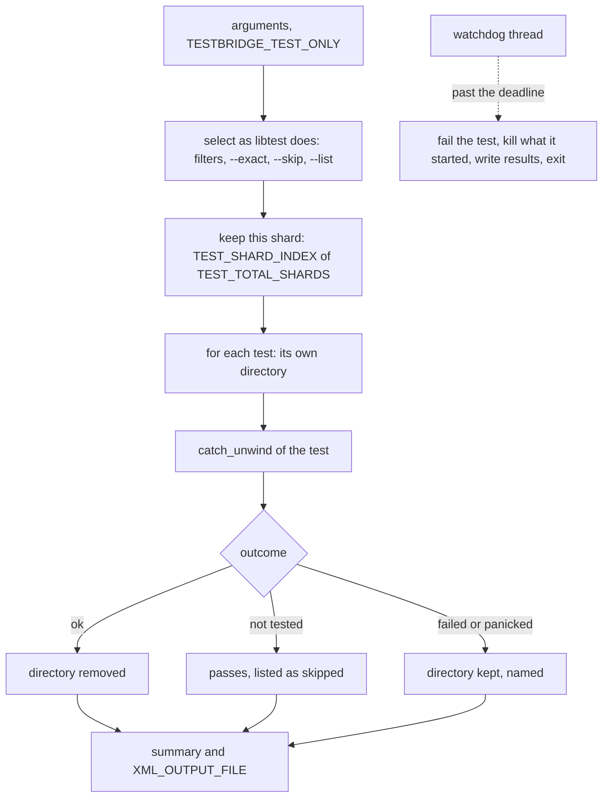
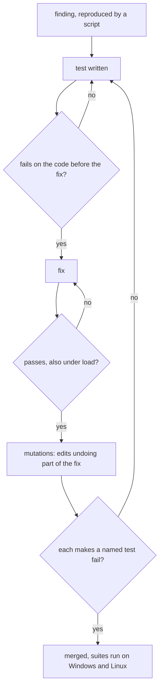

# Testing

How ninja-rs is tested, and why the tests are built the way they are: unit tests per crate, the
end-to-end harness, the fake REAPI server, the Bazel targets, the lint rules, measurements on
real projects, mutation checks of fixes, and the review process around them. Building and
running Bazel is in [../build-notes.md](../build-notes.md).

## Use case

ninja-rs's promises are about edges: a build interrupted at the wrong moment, a server that
answers half, a file changed while it is hashed, two processes appending to one log. Tests have
to reach those edges deterministically, on Windows and Linux, on a machine that is often busy,
and fail for the right reason.

## Problems

- **Timing.** A test that decides by elapsed time passes on an idle machine and fails under
  load, or the reverse. Once, six tests failed by name on a busy Windows machine, two of them
  from product bugs the flakiness had hidden.
- **Processes.** e2e tests start ninja-rs, which starts commands, which start processes. A test
  that hangs or fails early leaves them running into the next tests, or after the test binary
  exits.
- **Hermeticity.** The developer's `~/.ninjars`, `MAKEFLAGS`, `NINJA_STATUS`, an outer
  invocation's `NINJA_RS_*` variables or a running daemon change what a build does.
- **Remote services misbehave in ways real servers rarely do on demand:** a stream breaking
  after the operation is named, a blob evicted between two calls, a proxy answering HTML, a TLS
  terminator whose backend is down.
- **Windows and Bazel.** Bazel's `TEST_TMPDIR` has forward slashes on Windows, it makes no
  runfiles tree there, and a test binary run by hand has no Cargo variables.
- **Tests that pass without testing.** A test of a fix must fail without the fix; a test that
  passes either way protects nothing.

## Unit tests

Every crate has unit tests next to its code (`#[cfg(test)] mod tests`). ninja-core carries
ninja's tests, ported: the manifest parser (`parser_test.rs`, error messages included), the
build and plan tests (`build_test.rs`), depfile, dyndep, lexer, canonicalization and
`/showIncludes` tests. Conventions:

- **Directories.** Tests create their directories with `test_dirs::TestDir`
  (`crates/test-dirs`): under Bazel's `TEST_TMPDIR` when set (spelled natively on Windows),
  named after the test, the process and a counter, removed when dropped, kept when the test
  panicked. `std::env::temp_dir` is forbidden by clippy (see [Clippy rules](#clippy-rules)).
- **Patience, not timing.** Tests wait for markers, counters and the order of events, with
  bounds far above what a healthy run takes (`PATIENCE` = 60 s in several modules): only a
  broken run reaches them.
- **Processes from the test binary.** Tests needing several processes run their own binary
  again with an environment variable naming the role: `deps_log.rs`
  `writers_in_processes_take_turns` (several processes appending to one deps log, one holding
  the lock), `ninja_os` `exiting_kills_the_tree`, `job_kills_on_close`, the subprocess tests'
  sleeper and Ctrl-Break helpers.
- **Real compilers, gated.** cpp-deps' differential tests run only when variables name the
  compilers (`CPP_DEPS_TEST_CXX`, `CPP_DEPS_TEST_CL`, `CPP_DEPS_TEST_CLANG_CL`, and
  `CPP_DEPS_TEST_LIBCXX`, `CPP_DEPS_TEST_BOOST`, `CPP_DEPS_TEST_GLIB` for libraries);
  `crates/cpp-deps/build.rs` turns them into cfgs, so the tests show as ignored rather than
  passing without testing. Bazel on Linux runs them with the hermetic toolchain's `clang++` and
  `clang-cl`. With `cl`, `real_cl_traditional_random` compares random macro programs (text,
  `#if` and `#include` forms, fixed seeds) with `cl`'s own expansion and takes about 90 s; it is
  how the traditional-preprocessor model is kept from claiming exact where it differs.

```sh
cargo test -p ninja-core
cargo test -p cpp-deps -- real          # gated tests are ignored without the variables
bazelisk test //crates/ninja-core:ninja-core_test
```

## The end-to-end harness

**Use case.** `crates/ninja-rs/tests/cli_e2e.rs` (the command line: tools, status, jobserver,
locks, interrupts, exit codes) and `crates/ninja-rs/tests/remote_e2e.rs` (remote execution,
caches, build events, TLS, against `fake-reapi`) run the real `ninja-rs` binary on fixtures.
Their compilers and tools are the test binary itself, run under another name through a hard
link (`harness::link_self`): `fake-clang` follows `#include "..."`, writes a depfile, answers
`-E -v` and `-###`; `fake-cmake`, `fake-ar`, `fake-job` and others play their parts. Nothing
depends on the host's toolchain.

**Solution.** Both run without libtest (`harness = false` in Cargo, `use_libtest_harness = False`
in Bazel) and use a harness of their own, `crates/ninja-rs/tests/harness/mod.rs`. The diagram
shows one run.



- **A directory per test**, under one `TestDir` for the suite; kept and printed when the test
  fails.
- **The watchdog** fails a test still running after `TEST_TIMEOUT` (300 s), or before Bazel's own
  timeout (Bazel's `TEST_TIMEOUT` less 5%, at least 5 s), names it, writes the results so far,
  and stops what the test started before exiting.
- **Launches go through the harness.** `harness::spawn`, `output` and `status` start a test's
  processes in a process group of their own (POSIX) or a job of their own (Windows) and track
  them; the watchdog sends SIGTERM to each group (a ninja-rs stops its commands as when
  interrupted), waits up to 10 s, then SIGKILLs what is left, or terminates the job. Clippy
  can't forbid `Command::spawn` in tests only, so `launches_through_the_harness`, a test in each
  suite, scans the suite's source for `.spawn()`, `.output()` and `.status()` outside the
  harness.
- **Results.** A test can say it couldn't test what it is for (`harness::not_tested`, a
  missing `unshare`, no symlink rights): it passes, the summary lists it, and Bazel's JUnit XML
  marks it skipped. Each test is a test case in `XML_OUTPUT_FILE`.
- **Files and binaries.** `harness::ninja_exe` finds the binary from `CARGO_BIN_EXE_ninja-rs` or
  as a Bazel runfile; `harness::source_file` and `test_dirs::workspace_file` find source files
  as runfiles (reading `RUNFILES_MANIFEST_FILE` on Windows, where Bazel makes no tree) or under
  `NINJA_RS_SOURCE_DIR`, which `crates/ninja-rs/build.rs` bakes in for Cargo builds, so a test
  binary run in a debugger or an IDE finds them too.
- **Hermetic runs.** `harness::hermetic` removes `MAKEFLAGS`, `NINJA_STATUS` and every
  `NINJA_RS_` variable from a launched ninja-rs's environment, and the suites pass
  `--ignore_all_rc_files`.

```sh
cargo test -p ninja-rs --test cli_e2e -- interrupt      # tests whose names contain "interrupt"
cargo test -p ninja-rs --test remote_e2e -- --exact racing
bazelisk test //crates/ninja-rs:remote_e2e --test_filter=racing
```

**Limits.**

- On Unix the watchdog signals only the groups of processes the test started;
  commands a hung ninja-rs put in groups of their own survive, and so do processes started by
  library code (fake-reapi's executions, in-process builds' commands).
- `hermetic` cleans launched processes only: builds run in process (`large_outputs`,
  `upload_wait_interrupted`, `interrupted_as_the_build_ends`) read the test process's
  environment, so `NINJA_RS_DAEMON=1` set by the developer makes them start the test binary as a
  daemon.
- At each test's end the harness forgets what it started; a test failing early leaves
  its commands running into the next.
- `interrupted_as_the_build_ends` is racy (and so is the product window it shows, see
  [engine.md](engine.md#interruption-and-exit-codes)).
- `parallel_uploads` and `shared_uploads` rely on delays rather than gates.

## The fake REAPI server

**Use case.** `crates/fake-reapi` is an in-process REAPI v2 server (CAS, Action Cache,
Capabilities, ByteStream, Execution) and Build Event Service, for the e2e tests and the
rbe-client tests. `fake-reapi-server` runs it standalone for manual tests (with `--tls-cert`,
`--tls-key`, `--tls-client-ca`).

**Solution.**

- **Execution** runs actions as local subprocesses in exec roots, as a single local worker would,
  with a cleared environment (what the action sets, and what the OS needs to start a process),
  so that an action missing a variable fails as it would remotely. Input blobs are written once,
  read-only, to `<work>/blobs/` and hard-linked into exec roots (rewriting a toolchain for every
  action made the tests slow under load).
- **Failure injection** on `State`: `fail_next(method, times)` for any method (an unknown name
  panics, so a typo can't make a test pass), `break_next_executions` (an `Execute` stream broken
  after the operation is named), `break_next_bes_streams`, `evict_on_next_execute`,
  `corrupt_blob`, `set_tamper` (rewrite an `ActionResult`), `set_refuse_splices`,
  `set_fail_executions`, `clear_cas`, `clear_action_cache`.
- **Gates and delays** let a test hold the server at a precise point and decide by order rather
  than time: `set_execute_gate`, `set_read_gate`, `set_find_missing_gate`, `set_write_gate`
  (a `Gate` is a function the server polls until it says go), and `set_execute_delay`,
  `set_read_delay`, `set_write_delay`.
- **Protocol features** off by default and switched on per test: split and spliced blobs
  (`set_chunking`, REAPI v2.12 or v2.13 messages, FastCDC 2020) and zstd compression
  (`set_compression`, `set_batch_compression`).
- **Misbehaving servers** (`misbehaving.rs`) stand for what sits in front of a server:
  `Closing { reset }` (a tunnel whose far end is down), `Page(status)` (a proxy answering
  HTML), `GoAway` (a server draining), `Restarting { upstream, bad }` (a load balancer
  restarting), and `closing_tls` (a TLS terminator whose backend is down, optionally asking for
  a client certificate).
- **Certificates** (`certs.rs`, `testdata/tls`): test CAs, server and client certificates (valid
  until 2126), and certificates made up with any validity (`with_validity`, `made_up`) for the
  expiry rules.
- **Counters** (`Stats`): executions, cache hits and updates, bytes, ranged reads, splits,
  splices, compressed transfers, injected failures. Tests assert on them, not on time.

**Limits.** The server always verifies digests, so no e2e test shows that the client never
commits a blob that changed. It has no output directories.

## Bazel targets and sharding

`bazelisk test //...` runs 13 targets:

| Target | Size | Notes |
|---|---|---|
| `//crates/ninja-core:ninja-core_test` | small | |
| `//crates/ninja-os:ninja-os_test` | small | |
| `//crates/ninja-daemon:ninja-daemon_test` | small | |
| `//crates/ninja-remote:ninja-remote_test` | small | |
| `//crates/cpp-deps:cpp-deps_test` | medium | real compilers on Linux (hermetic `clang++`, `clang-cl`, `clang-scan-deps` as data) |
| `//crates/fake-reapi:fake-reapi_test` | small | |
| `//crates/test-dirs:test-dirs_test` | small | |
| `//crates/ninja-rs:ninja_rs_lib_test` | small | reads `Cargo.toml` and `MODULE.bazel` (one version everywhere) |
| `//crates/ninja-rs:cli_e2e` | medium | own harness |
| `//crates/ninja-rs:remote_e2e` | medium, 4 shards | own harness, data: the binary, test certificates, `tests/nativelink/run.sh` |
| `//third_party/cargo-rbe/rbe-client:rbe-client_test` | medium | up to 53 s of a small test's 60 under load |
| `//third_party/cargo-rbe/rbe-bes:rbe-bes_test` | small | |
| `//third_party/cargo-rbe/rbe-bes:uploader_test` | small | |

Sizes leave room for a busy machine: reviews run the suites with dozens of busy loops beside
them. The e2e harness honours `TEST_SHARD_INDEX`, `TEST_TOTAL_SHARDS`, `TEST_SHARD_STATUS_FILE`
and `--test_filter` (`TESTBRIDGE_TEST_ONLY`).

## Clippy rules

`clippy.toml` holds two rules; `--config=clippy` (see [../build-notes.md](../build-notes.md))
runs clippy with it on every Rust target, warnings as errors, on Windows and on Linux (each lints
only the code its own system builds).

| Rule | Why | Instead |
|---|---|---|
| `disallowed-macros`: `print!`, `println!`, `eprint!`, `eprintln!` | they panic on a closed pipe or a terminal gone: a build would end without saving its logs, releasing its lock or ending its build events | `ninja_core::status::print_out`, `print_err`, or `status::message` during a build |
| `disallowed-methods`: `std::env::temp_dir` | tests' files belong under Bazel's `TEST_TMPDIR`, removed when done | `test_dirs::TestDir` |

Every exception is an `#[allow(...)]` with a reason: build scripts (Cargo reads stdout), test
files and fake tools that print, the daemon's own directory. A pre-commit hook in `.githooks`
refuses unformatted Rust files (`git config core.hooksPath .githooks` enables it).

## Measurements on real projects

**Use case.** Unit and e2e tests use small fixtures; correctness and cost on real code are
measured on real projects before and after changes to the scanners, the daemon and the remote
backend, and in reviews.

| Project | Toolchain | Size | What is measured |
|---|---|---|---|
| hermetic-llvm-cmake's sample (`tests/hello`) | hermetic Clang, a few presets (Linux; Windows with MSVC's STL or libc++) | 5 compiles | exact scans, unwrapping, the NativeLink run |
| CMakeLibCxx (libc++ built from LLVM's sources through FetchContent) | `clang++` targeting MSVC | 118 compiles | exact scans against the compiler, written directories, scan time |
| RandoBlazer | `cl` (MSVC 14.51) with Boost 1.67 (Preprocessor, MPL, Fusion) | 324 compiles | exact scans against `cl /showIncludes`, cl's traditional preprocessor, the conservative scanner's sent sets |
| Dolphin (the emulator) | GCC 13, in WSL (sources on a 9p mount) | 734 compiles | exact scans against GCC, the cost of stats on slow file systems |

Each compile's scan is compared file for file with what the compiler itself read
(`/showIncludes`, `-MD`): a scan that claims to be exact but lacks a file is a wrong object
waiting to happen. At the time of writing, RandoBlazer was 321 of 324 exact, all 321 equal to
`cl /showIncludes` (the other three are assembler); CMakeLibCxx 111 of 118, all equal to Clang;
Dolphin 734 of 734; the sample 5 of 5 in every preset. The measurement scripts live outside the
repository (they need the projects and local compilers); their results are recorded with each
change.

`tests/nativelink/run.sh` (Linux) is the repository's own real-project test: it builds
hermetic-llvm-cmake's sample with the RBE-mode CMake fork against a local NativeLink, in two
checkouts at different paths, through remote execution, the remote cache alone, racing and
minimal downloads with thin archives, and checks that every output is byte-identical between
the checkouts. `remote_e2e`'s `nativelink_script_patterns` checks that the lines the script
counts are lines ninja-rs prints.

## How fixes are checked

A fix comes with tests that fail without it, and the tests are checked to catch the fix's
mutations. The diagram shows the loop each fix goes through.



- **Before the fix.** The new test runs on the commit before the fix (or with the fix reverted)
  and must fail, for the reason the finding says.
- **Mutations.** A script per fix round applies named source edits that undo part of the fix
  (a condition removed, a lock not taken, a check skipped), runs the tests named for that
  mutation, expects a failure, and restores the file. A mutation that survives means a missing
  test. Rounds report their counts (for example 23 mutations caught for the TLS refusal rules,
  38 for the scanners' first round), and reviews run mutations of their own: surviving ones are
  findings.
- **Under load.** Suites run again with dozens of busy loops on both systems, several times;
  a test that fails only under load is a finding too, and often shows a product race (the
  process-group window of [os.md](os.md#process-trees-and-windows-jobs) was found so).
- **Reviewers' scripts** (stress tests, parity scripts against ninja 1.13.2, fuzzers of
  manifests and incremental builds) are rerun by later reviews to show a fix holds.

## The review and fix process

ninja-rs is reviewed in rounds. Each review splits the code by area (engine and command line,
crosscut, daemon, remote, the two scanners, transport and build events), and each reviewer reports
findings with a severity (major, minor, nit), file and line pointers, a reproduction, and a proposed
fix, plus a verdict per mechanism (keep, keep with changes, rework). A fix round follows, one agent
per area in its own worktree, each fix checked as above; the rounds are merged, the full suites run
on Windows and on WSL, and the next review starts from the merged commit. The developer pages'
"Limits" sections list what the last review left open.

## Limits

- In a dirty tree, any `git status` (the other system's, in a checkout Windows and WSL
  share) rewrites the index and rebuilds the ninja-rs crate under Cargo (the version's
  `.dirty` marker); in a clean tree, `git add` of a new file doesn't mark it dirty.
- Three copies of a retry loop for `ETXTBSY` (running a file just written while
  another thread forks) live in tests; fake-reapi's executions have the same race unguarded.
- `harness::alive` duplicates `ninja_os::process_running`, and the harness has a third
  copy of the Windows job code.
