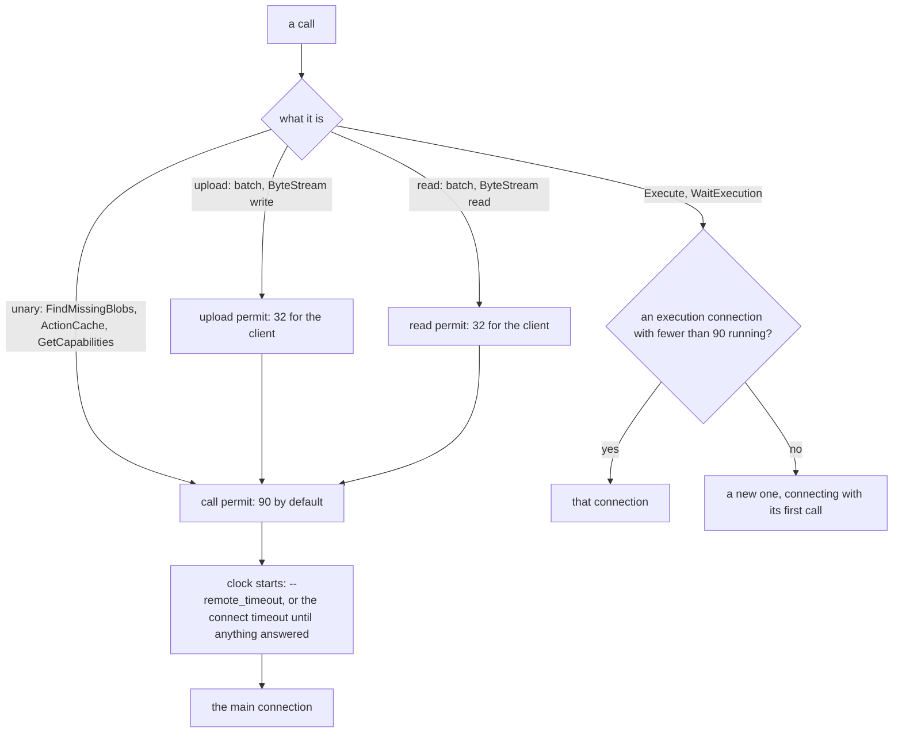
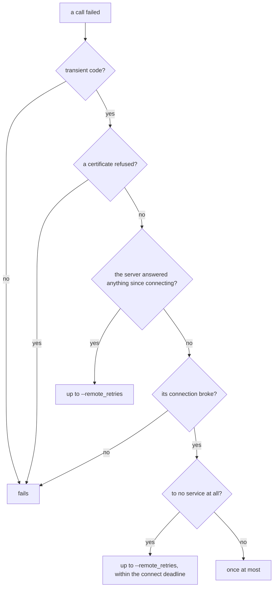
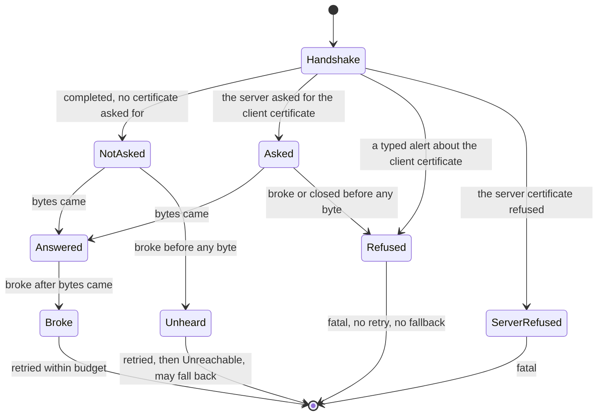
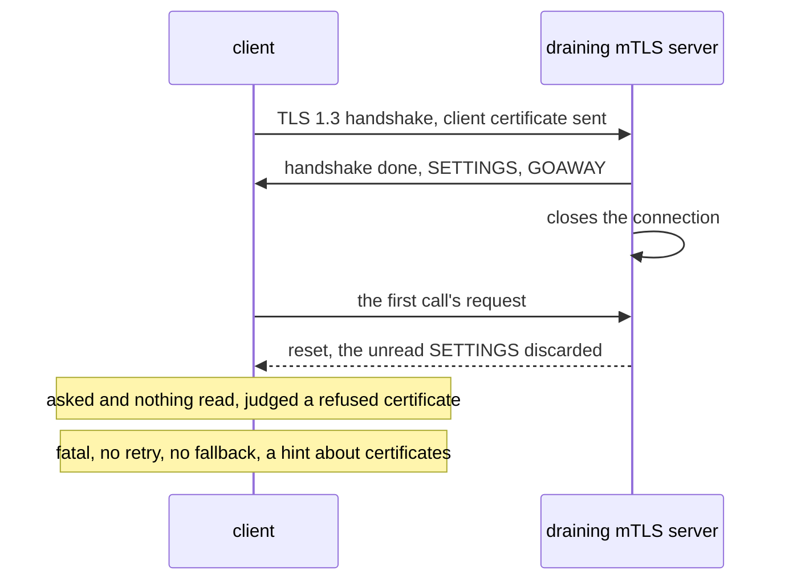
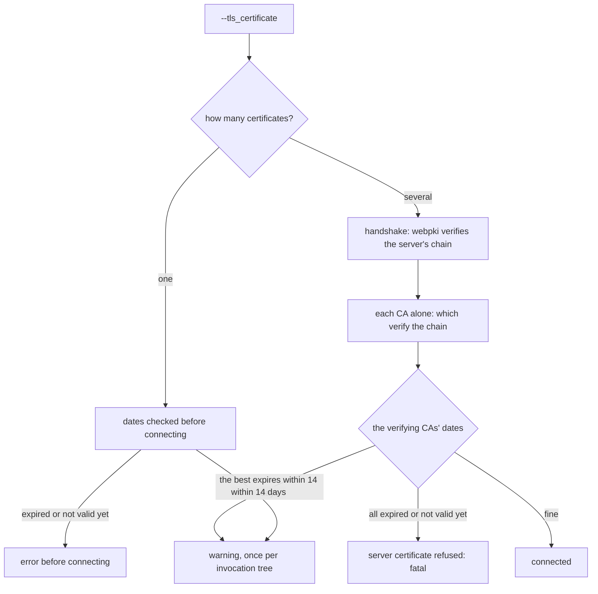
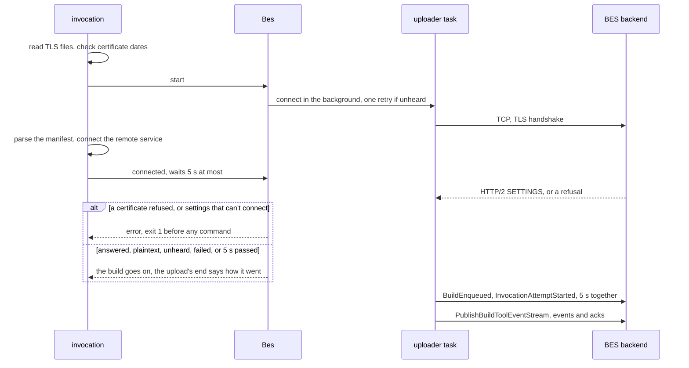

# rbe-client and rbe-bes: the transport

`third_party/cargo-rbe/rbe-client` is ninja-rs's REAPI v2 client: connections, call limits,
retries, TLS, the CAS (batches, ByteStream, chunking), the action cache and Execute.
`third_party/cargo-rbe/rbe-bes` uploads build events to a Build Event Service. Both started as
copies from the user's cargo-rbe project and have changed a lot since (see
`third_party/cargo-rbe/README.md`, whose list of local changes stops at the first rounds).
`crates/ninja-remote` uses the client (see [remote.md](remote.md)); `crates/ninja-rs` connects
it, decides what a failure means for the build (`src/lib.rs`, `src/bes.rs`, `src/certs.rs`,
`src/options.rs`; see [cli.md](cli.md)).

The problem these crates solve is less "speak gRPC" than "tell what went wrong". A build must
fall back to local work when the service isn't there, fail when a certificate is refused (the
user's rule: see [certificates.md](../user/certificates.md)), retry what a retry fixes, and do
all three the same way on Windows and Linux, behind tunnels, load balancers and TLS-terminating
proxies that each fail in their own way.

## Module map

| File | Role |
|---|---|
| `rbe-client/src/lib.rs` | `Client`: connecting, call permits, execution channels, retries, CAS, ByteStream, action cache, Execute |
| `rbe-client/src/transport.rs` | the TCP and TLS connector (`Connector`), what a connection came to (`Contact`, `Link`, `Seen`), CA checks (`Verifier`, `CaCheck`), HTTP errors as gRPC statuses (`HttpErrors`) |
| `rbe-client/src/fault.rs` | the fault classifier (`fault`, `certificate`, `unavailable`, `answered`), error types (`NoAnswer`, `Unreachable`, `Declined`, `ClientCertificateRefused`, `CaRefused`), `describe` |
| `rbe-client/src/tree.rs` | input roots (`InputTree`), blob sources (`BlobSource`, `Checked`, `SourceChanged`), the digest cache, output trees and their caps |
| `rbe-client/src/chunking.rs` | FastCDC 2020 and what a server supports of split and spliced blobs |
| `rbe-bes/src/uploader.rs` | `BesUploader`: lifecycle events and the ordered event stream |
| `rbe-bes/src/events.rs` | building valid BEP streams |

## Connections and call permits

**Use case.** Every REAPI call of a build goes to one service: thousands of lookups, uploads,
reads, and up to `--remote_jobs` (50) executions that each hold a stream open for as long as
their action runs.

**Problems.** gRPC multiplexes calls as HTTP/2 streams on a connection, and a server allows a
limited number at once (100 for most). With everything on one connection, executions took the
streams; other calls waited in h2's queue while their `--remote_timeout` ran, and a
`FindMissingBlobs` the server answered in 0 ms failed with DEADLINE_EXCEEDED after 6 s against a
healthy server. A server allowing fewer streams than assumed
brings the same failure back.

**Solution.** The path of a call:

- `per_connection(streams)` is `streams` minus a tenth (a call's stream is freed a little after
  its permit): 90 for `--remote_max_concurrency_per_connection` (Bazel's flag, default 100).
  `Client::with_max_concurrency` sets the call permits (`Client::calls`) and the executions per
  connection. A call takes its permit before `timed` or `within` starts its clock, so waiting for
  a permit never counts against `--remote_timeout`; a stream holds its permit for its life.
- Upload and read permits (`MAX_UPLOADS`, `MAX_READS`: 32 each, shared by the client's clones)
  are taken before call permits, and no holder of a call permit waits for anything else: no
  deadlock. They bound calls, not bytes: callers bound memory (see
  [remote.md](remote.md#download-claims-and-writing)).
- Executions don't take call permits and aren't bounded by `--remote_timeout` (as in Bazel):
  they run on connections of their own (`Executions`, `execution_channel`): the one with the
  fewest running, or a new lazily connected one (`connect_with_connector_lazy`) when each has as
  many as one may. `ceil(peak / 90)` connections. A client made from a channel (tests) shares it.
- `connect_within` connects the main channel within `CONNECT_TIMEOUT` (20 s: name, TCP, TLS,
  HTTP/2), through `Connector` (TCP with `TCP_NODELAY`, TLS of its own, see below). Endpoints use
  HTTP/2 adaptive flow-control windows (sized to the bandwidth-delay product, as grpc-java does:
  a lone large transfer isn't throttled by 64 KiB windows) and keep-alive pings every 330 s
  while calls are in flight only (servers close connections pinged more often or while idle).
- Until the server answered anything, a call is bounded by the connect timeout rather than
  `--remote_timeout` (`within`): a server accepting connections and saying nothing costs 20 s
  over plaintext, as over TLS, instead of a minute.
- Calls carry `RequestMetadata` (`for_action`: tool, invocation ids, action digest, mnemonic,
  target label, configuration) and `--remote_header` values.

**Limits.** A client made from a channel puts executions on it. A server allowing fewer than
100 streams per connection needs `--remote_max_concurrency_per_connection`.

**Tests.** `calls_on_the_connection_are_bounded`, `calls_dont_wait_behind_executions`,
`executions_open_connections_as_the_server_allows`, `reads_are_bounded_across_calls`,
`uploads_are_bounded_across_calls`, `uploads_wait_for_a_permit_before_filling_another_batch`,
`streamed_chunks_are_read_with_a_permit`, `first_calls_are_bounded_by_the_connect_timeout`
(all in `rbe-client/src/lib.rs`).

## Retries and backoff

**Use case.** Make again the calls a retry fixes: a server restarting, a proxy shedding load, a
connection reset by a load balancer.

**Problems.** Retrying everything multiplies failures' cost: a refused connection costs 2 s on
Windows (it retries the SYN itself), a silent server one timeout per attempt, and an unreachable
service was retried in every nested invocation (6.4 s each on Windows). A certificate
refused is refused again. Retrying too little loses builds to a load balancer restarting (3 s
on common setups). A server ending each `WaitExecution` stream after one update was polled
ten times a second.

**Solution.** `Client::retrying` makes a call again when `retry_after` gives a wait:

- Transient codes are Bazel's `RemoteRetrier` list (`transient`): UNAVAILABLE, UNKNOWN,
  DEADLINE_EXCEEDED, ABORTED, INTERNAL, RESOURCE_EXHAUSTED, CANCELLED, a batch's per-blob
  statuses included. `--remote_retries` defaults to 5; `backoff` is 100 ms doubling to 5 s,
  give or take 10%.
- Until the server answered (`Said::answered`), a call it left unanswered isn't made again, nor
  one there was no connection for.
- What a failure at first contact was is then judged (`judged`): after only "can't serve now"
  answers (UNAVAILABLE, RESOURCE_EXHAUSTED, GOAWAY, REFUSED_STREAM, ENHANCE_YOUR_CALM),
  `Declined`; a connection that broke to no service at all, `Unreachable`. Both let the build go
  on without the service (see [Fallback decisions](#fallback-decisions)).
- Connecting (`connect_attempts`) retries only a connection that broke once made: up to
  `--remote_retries` times when it was to no service at all (a tunnel whose far end is down, a
  load balancer restarting, a TLS terminator without a backend), then `Unreachable`; once when
  something came from it. Never a refused connection, a timeout, or a refused certificate.
- Execute has two budgets of `--remote_retries` (Bazel's `executeBackoff` and
  `waitExecutionBackoff`): new executions, and follow-ups since the operation's last update. A
  broken stream after the operation is named is followed with `WaitExecution`; one that brought
  an update starts the follow-up count over, so a long action whose streams a proxy keeps
  resetting is followed to its end; an operation the server lost (NOT_FOUND, or UNIMPLEMENTED
  for `WaitExecution`) or that failed for a transient reason (but DEADLINE_EXCEEDED: the action
  timed out) executes again. Pauses between follow-ups grow but stay under `FOLLOW_UP_PAUSE`
  (1 s): a server ending streams after each update costs a call a second per running action,
  and a finished action is seen within a second.
- ByteStream transfers resume where they got to (see [ByteStream](#bytestream-reads-and-writes)),
  and getting further starts their retry count over.

**Tests.** `connections_are_made_again_only_when_they_broke`,
`connections_broken_before_anything_answered_are_no_service`,
`restarting_load_balancers_are_waited_for`, `servers_that_never_answered_are_not_called_again`,
`executions_making_progress_are_followed_however_often_streams_break`,
`executions_the_server_keeps_losing_fail`, `follow_up_pauses_are_a_second_at_most`,
`operations_followed_again_and_again_wait_longer_each_time`, `any_answer_counts`; e2e
`transient_failures`, `unreachable_remote`, `unreachable_nested`.

## The fault classifier

**Use case.** One function tells what a failed connection or call says about the service, for
the REAPI client and the BES uploader alike (`fault::fault`).

**Problems.** tonic, hyper, h2, rustls and the OS each wrap errors their own way, and some types
aren't exported: their words are all there is. Matching words anywhere misfired: a host named
`rbe-timeouts.example.com` made a certificate name mismatch read as a timeout, which fell back
silently. The same failure arrives differently on Windows and Linux:

| What happens | Linux sees | Windows sees |
|---|---|---|
| Connection refused | refused at once | refused after ~2 s of its own SYN retries |
| A server closes after sending an alert (a refused client certificate with TLS 1.3, a TLS server hit with plaintext) | the alert | mostly a reset: Windows discards unread data when the closed connection is reset |
| A load balancer resetting connections at accept | a reset inside hyper's connect, `tcp connect error` | a reset once connected; judged by the words, one fell back and the other failed |
| A draining server's SETTINGS and GOAWAY before it closes | sometimes lost | lost more often (6/20 against 2/20) |

**Solution.** Types and I/O error kinds first, whole words only for types the transport doesn't
export, and only past the transport's own error (contexts name endpoints):

| Fault | Means | Comes from | What the build does |
|---|---|---|---|
| `NoConnection` | no connection, or none to a service | `ConnectionRefused`, `HostUnreachable`, `NetworkUnreachable`, `AddrNotAvailable`, hyper's `dns error`, `tcp connect error` over a non-reset kind, `Unreachable` | unreachable: may fall back |
| `NoAnswer` | nothing answered in time | `NoAnswer`, tonic's `TimeoutExpired`, `TimedOut`, `tls handshake timeout.` | unreachable: may fall back |
| `Broke` | the connection broke once made | `ConnectionReset`, `ConnectionAborted`, `BrokenPipe`, `UnexpectedEof`, a transport error saying no more | retried within budget, then judged |
| `Refused` | refused for what it is: a certificate, or a protocol the other end doesn't speak | rustls errors (`InvalidData`), `HTTP/2 was not negotiated.`, h2 errors `detected` here | a certificate: fatal; plaintext to TLS before an answer: unreachable |
| `None` | the server's own answer, or settings that can't connect | a status without a transport source, h2 `received` errors, a bad scheme | per status code |

Two wrappers carry judgements made with more context: `Unreachable` (a connection that broke
before anything answered, to no service at all: reported as `NoConnection`) and `Declined` (one
that broke after the service only said it can't serve now: `unavailable` is true).
`answered` counts as answers what HTTP/2 says the server did short of a gRPC status (`h2_answer`:
GOAWAY, REFUSED_STREAM, ENHANCE_YOUR_CALM); statuses the client makes itself (a decode error, a
stream ended early) don't count. `certificate` tells whose certificate was refused from rustls's
error (reached through `io::Error::get_ref`, which `source` skips), the client's own types, or
their words once h2 kept only those.

`describe` writes an error and its causes for people: a status as its code and message (tonic's
Display adds the Debug form of the causes), no cause repeating what a level above said, no bare
`transport error` below something more precise.

Policies on status codes differ, as in Bazel: REAPI retries an allowlist (`transient`), BES
everything but a denylist (`rbe_bes::uploader::retryable`).

**Tests.** `fault::tests::faults`, `connections_not_made`, `http2_answers`, `errors_described`,
`certificates_refused`; `the_clients_words_arent_the_servers`,
`http_answers_short_of_grpc_are_answers`, `exhausted_services_are_done_without`.

## TLS

**Use case.** `grpcs://` endpoints (and endpoints without a scheme) connect with TLS, checking
the server against the public roots or `--tls_certificate`, with an optional client certificate
(mTLS, EngFlow's usual setup).

**Problems.** tonic's TLS hides what a failing handshake saw: whether the server asked for a
client certificate, whether anything came back. Without that, a client certificate refused as a
reset (Windows, TLS 1.3) couldn't be told from a dead backend, and fell back silently or failed
with the wrong hint.

**Solution.** `transport.rs` makes its own connections: tonic sees a plaintext endpoint and
`Connector` returns TCP streams with TLS done by tokio-rustls (`Tls::handshake`):

- Verification is rustls's `WebPkiServerVerifier` over `--tls_certificate`'s CAs (`ca_pem`, as
  Bazel's: a server pinned to a private CA can't be impersonated with a publicly issued
  certificate) or `webpki-roots`: chain, name (SNI, IP addresses), extended key usage, dates.
  `Verifier` wraps it and only adds checks (see [CA bundles](#ca-bundles-and-certificate-dates)).
- `--tls_authority_override` replaces the name checked and sent as SNI.
- ALPN offers `h2` only; a server not choosing it fails (`HTTP/2 was not negotiated.`,
  `Refused`).
- The client identity (`CertifiedKey::from_der`, which fails for a key that isn't the
  certificate's) is given by a resolver made per connection (`Asked`), which notes that the
  server asked for it.
- Every read and write of the connection goes through `Judged`, which records whether bytes came
  from the server and turns its errors into what they say (`judge`).
- `HttpErrors` wraps every gRPC client (REAPI, execution connections, BES): an HTTP response
  that isn't gRPC's (a proxy's 503 HTML page) becomes the status gRPC's HTTP mapping gives it
  (429, 502, 503, 504: UNAVAILABLE; 401: UNAUTHENTICATED; 403: PERMISSION_DENIED; 404:
  UNIMPLEMENTED), instead of an INTERNAL decoding error retried and then failed.

**Alternatives rejected.** Keeping tonic's TLS: it can't tell whether the server asked for a
client certificate, nor whether bytes came back, and the judgement needs both. Judging from the
words of errors: they differ by platform and by where the error was found.

**Limits.** A resolver per handshake disables session resumption, which the refusal judgement
and the CA check rely on, but nothing says so. TLS 1.2 support depends on tonic's TLS
feature unifying rustls's. `--tls_authority_override` changes the name checked and the
SNI, not the `:authority` header (Bazel sets both).

**Tests.** `tls_trusts_the_certificates_given_only`, `tls_handshakes_are_bounded`,
`tls_handshakes_made_again_are_bounded`, `certificates_refused_arent_tried_again`; e2e `mtls`.

## The refusal judgement

**Use case.** The user's certificate rule: any certificate error aborts the build, for REAPI and
BES alike, without retries or local fallback. A refused client certificate must be told from a
service that isn't there, which may fall back.

**Problems.** A server refusing the client's certificate sends an alert, but may close the
connection right after; Windows then resets it before the client read the alert. With TLS 1.3
the server checks the client's certificate after the client's handshake is over, so the refusal
arrives at the first call, as a broken pipe once h2 lost the error. A TLS-terminating proxy whose
backend is down completes the handshake and closes: no certificate involved.

**Solution.** What tells is what came before the break. Each connection has a `Contact`
(`tls`, `asked`, `answered`, `broke`); `judge` decides when it breaks:

- `Refused` is `fault::ClientCertificateRefused` ("the connection broke once the server had
  asked for the client's certificate, before anything came from it: it refused the
  certificate"), a `Certificate::Client` fault. A typed alert (`CertificateRequired`,
  `UnknownCA`, `CertificateExpired`, `BadCertificate`...) is the same, with its words.
- `Link` holds the last connection's `Contact` for a channel. A call failing with a broken
  connection, without saying why, is that refusal when the last connection broke refused
  (`Link::refused`, `Client::refusal`): on the main connection (`judged`), on execution
  connections (each has its own `Link`), in ByteStream reads and writes.
- `Seen` publishes what the connections came to (`Nothing`, `Unheard`, `Answered`,
  `Refused(words)`), for whoever waits for the first answer: the start of a build waits for the
  BES backend's (see [Build events](#build-events-rbe-bes)).
- `retry_after` gives a certificate refusal no retry, Execute's loop neither, the BES budget is
  0; `ninja-remote` fails the action instead of falling back (`certificate_refused` in
  `backend.rs`); the CLI fails the build at connect, and turns a BES refusal during the build
  into exit code 1.
- Plaintext connections tell nothing: before any answer, a break, or an HTTP/2 protocol error (a
  TLS server's alert read as HTTP/2, which Windows mostly resets before the client reads it),
  is no service at all (`Unreachable`, with a hint that `grpcs://` connects with TLS).

**Limits.** False refusals. "Asked and nothing read" also
catches a server that accepted the certificate and answered, when the client never read the
answer:

Reproduced 6/20 on Windows and 2/20 on Linux against a server answering GOAWAY on every
connection; with TLS 1.2 a completed handshake already proves the certificate accepted. The fix
direction: record the handshake's completion and version, hold the first call until SETTINGS
on connections that asked, and confirm an untyped suspected refusal with one fresh connection.
A draining server without client authentication can fail the build instead of falling back. The
refusal error prints tonic's Debug dump in the commonest mTLS misconfiguration (no
client certificate, TLS 1.3). The `close_notify` refusal branch and the ALPN check have no
test catching their removal. Public `connect_channel` and `BesUploader::connecting` skip
the judgement (tests only).

**Tests.** `client_certificates_refused_without_a_word_are_refused`,
`refused_client_certificates_arent_tried_again`,
`client_certificates_refused_on_reconnection_are_refused`,
`tls_terminators_without_a_backend_are_no_service`, `what_connections_came_to_is_seen`,
`plaintext_to_tls_servers_is_no_service`; rbe-bes
`connections_broken_once_a_certificate_was_refused_are_refusals`; e2e
`certificate_refused_during_build`, `build_events_refused_client_certificate`,
`unreachable_behind_tls_terminators`, `mtls`.

## CA bundles and certificate dates

**Use case.** Report an expired certificate as such before connecting, and warn of one expiring
within 14 days, once per invocation tree (the user's rule).

**Problems.** Once connected, an expired client certificate is just a closed connection. A
`--tls_certificate` bundle (Debian's or Git for Windows' hold 121 CAs) always holds some CA near
or past its date that has nothing to do with the server: failing or warning on those would fail
or nag every build.

**Solution.** `crates/ninja-rs/src/certs.rs` reads the DER validity of the client certificate
and of a single-CA `--tls_certificate` before anything connects (`TlsFlags::load`, `certs::check`):
expired or not yet valid is an error (`... expired on 2026-10-14 11:11 UTC`), within
`EXPIRY_WARNING` (14 days) a warning, once per file per invocation tree (`NINJA_RS_TLS_WARNED`
passes what was said to nested invocations). A file with several CAs is a bundle, checked
after verification:

`Verifier` runs rustls's verification, then checks the server's chain against each CA alone
(`verify_server_cert_signed_by_trust_anchor`) and calls the `CaCheck` with those that verify it
(several when cross-signed). The CLI's check (`LoadedTls::ca_check`, `certs::check_verifying`)
refuses when every verifying CA is out of its dates (`CaRefused`, a `Certificate::Server`
fault) and warns about the best one expiring soon; warnings found by connections made during the
build are said at its end (`Service::warn_ca`). Unused CAs are ignored.

**Tests.** `verifying_cas_are_checked`; ninja-rs `certs::tests::checks_the_cas_that_verified`,
`options::tests::bundles_check_the_ca_that_verified`, `tls_certificate_dates`; e2e
`expired_certificate_before_connecting`, `certificate_expiring_soon`, `ca_bundles`.

## Fallback decisions

The CLI (`Service::remote_backend`, `Service::unreachable` in `crates/ninja-rs/src/lib.rs`) turns
faults into what the build does:

| When | Failure | Result |
|---|---|---|
| connecting | `fault(..).unreachable()`: no connection, no answer, `Unreachable` | with `--remote_local_fallback` and without `--remote_strict`: a warning, the build runs locally (with the disk cache, if any), nested invocations told (`NINJA_RS_REMOTE_UNREACHABLE`); else an error |
| connecting | anything else: a certificate, settings, a break after an answer | an error, with a TLS hint (`options::tls_hint`) |
| `GetCapabilities` | unreachable, or `unavailable`: UNAVAILABLE, RESOURCE_EXHAUSTED, an HTTP/2 "can't serve now", `Declined` | as unreachable |
| `GetCapabilities` | another answer | an error |
| an action | a certificate refused | the action fails |
| an action | another remote failure | a local run within the fallback limits (see [remote.md](remote.md#policy-what-is-sent)) |

Measured on Windows (no-op builds): a refused endpoint costs about 2.1 s, nested invocations
included (it was 6.4 s per invocation); a reset or close at accept, a 503 page, GOAWAY: about
3 s; a silent server 20 s.

## Output trees and their caps

**Use case.** An action's output directories come back as REAPI `Tree` messages, which
`tree_files` expands into paths (`ninja-remote`'s `fetch_outputs`).

**Problems.** A `Tree` lists each directory once, and directories may share children: a small
tree can stand for a huge one (2^40 paths; a 650 KiB tree expanding to 244 MiB of paths, a
2.8 MiB one to 1.8 GiB as the walk held wide levels uncounted). Names can try to leave the output
(`..`, separators, a drive colon).

**Solution.** `tree::walk` counts every path as it's made, before it's held (`Expansion::add`):
at most `MAX_TREE_ENTRIES` (2^20) entries, `MAX_TREE_PATH_BYTES` (128 MiB) of path bytes,
`MAX_TREE_DEPTH` (256) levels. Names must be single components (`valid_name`); symlinks are
refused.

**Limits.** `tree_files` clones each `FileNode`, `node_properties` included: a server's large
properties on a shared tree expand linearly in their size (7 KiB tree, 4 KiB property: 1.5 GiB).
`tree_dirs` has no production caller.

**Tests.** `trees_sharing_children_are_bounded`, `trees_of_long_paths_are_bounded`,
`wide_trees_are_counted_as_they_are_walked`, `deep_trees_are_bounded`,
`tree_directories_are_checked`.

## ByteStream reads and writes

**Use case.** Blobs larger than a batch (3 MiB, or less when the server says) travel through
ByteStream; thin archives' member lists through ranged reads.

**Problems.** Large blobs must never be whole in memory. Long transfers break (proxies,
restarts) and must resume rather than start over. A transfer is bounded by how long it goes
without moving, not by its total time. A server can send more than a digest says, or a
compressed stream that expands without bound.

**Solution.**

- Writes (`write_blob`): one resource name for every attempt
  (`{instance}/uploads/{uuid}/blobs/{hash}/{size}`, or `compressed-blobs/zstd/`), requests of
  1 MiB produced on a blocking thread (`produce_writes`), compressed as they go with the size
  pledged in the zstd frame. A write that broke asks `QueryWriteStatus`: complete is done,
  otherwise it resumes at `committed_size` (uncompressed only; a compressed stream starts over).
  `stalled` fails a write whose transport took no request for `--remote_timeout`.
- Reads: `read_stream` into memory (bounded by the digest's size, or zstd's bound when
  compressed), `read_range` for parts (uncompressed, offsets being the blob's), and
  `read_blob_to_file`, which writes as data arrives on a blocking thread that decompresses,
  hashes and stops past the digest's size (`write_blob_file`). A broken read resumes from what it
  got (uncompressed); getting further starts the retry count over. Every blob read is checked
  against its digest (`verify`), decompression bounded to the size plus one.
- Batches: `BatchReadBlobs` answers are checked to be what was asked; `BatchUpdateBlobs`
  per-blob statuses become the call's; batches hold `max_batch_bytes` with 128 bytes of overhead
  counted per entry. zstd is used when the server lists it (`supported_compressors`, and for
  batch updates `supported_batch_update_compressors`) and `--remote_cache_compression` is on:
  ByteStream writes of 1 KiB or more, batched blobs of 1 KiB or more that it shrinks, every read.
- `upload_blobs` asks `FindMissingBlobs` once (10,000 digests a call), uploads up to 16 batches
  and streams at once per call (`UPLOADS`), and shares uploads between concurrent calls: a blob
  another call is uploading (a toolchain, for every action of a cold build) is waited for
  (`Client::inflight`), and uploaded by the waiter should that upload fail.

**Tests.** `reads_resume_where_they_broke`, `writes_resume_where_the_server_got_to`,
`stopped_reads_leave_no_file`, `huge_sizes_arent_allocated`,
`reads_stop_at_the_size_their_digest_says`, `batches_of_many_small_blobs_stay_within_the_limit`,
`unasked_missing_digests_are_left_out`, `blobs_written_as_they_arrive`,
`compresses_what_shrinks`; e2e `compression`, `large_outputs`.

## Chunking, splitting and splicing

**Use case.** With a server that supports them (`CacheCapabilities::split_blob_support`,
`splice_blob_support`), a large blob that differs from one seen before by a few edits travels as
the content-defined chunks the other side lacks.

**Problems.** Chunks only match when both sides chunk the same way. Splicing one blob at a time
is bound by round trips. A server refusing splices must not cost every blob twice its bytes on
every call. A server can split a blob into chunks too large to hold.

**Solution.** `chunking.rs` uses FastCDC 2020 through the `fastcdc` crate's `v2020` module,
REAPI's reference, with the server's `FastCdc2020Params` or REAPI's recommended ones (512 KiB
average, chunks from a quarter to four times that, normalization level 2, seed 0). RE API v2.13
names the calls `GetChunkMapping` and `RegisterChunkMapping`; for older servers, `SplitBlob` and
`SpliceBlob` (picked from the server's `high_api_version`).

- Upload (`upload_chunks`): blobs over four times the average are chunked on blocking threads,
  four at once (`CHUNKERS`), read through the `Checked` reader; one `FindMissingBlobs` for all
  their chunks; the missing chunks batched, or streamed 16 at a time through ByteStream when the
  server compresses ByteStream writes and not batches (as Bazel's `ChunkedBlobUploader`), the
  permit taken before a chunk is read; then up to 16 splices at once (`SPLICES`). A refused
  splice uploads the blob whole; a refusal that isn't transient nor NOT_FOUND turns splicing off
  for the client (`splice_failed`), and the build says so once at its end.
- Download (`split_blob`, used by `ninja-remote`'s `fetch_chunks` with a disk cache): the chunks
  must add up to the blob and have valid digests; a chunk larger than FastCDC's maximum makes
  the blob fetched whole.

**Limits.** Each process learns again that the server refuses splices, with its first spliced
blob, whose chunks it already sent.

**Tests.** `chunking::tests::*`; `blobs_are_spliced_together`, `refused_splices_turn_splicing_off`,
`blobs_split_in_huge_chunks_are_read_whole`; e2e `splice_compressed`, `splices_refused`.

## Upload verification

**Use case.** Never send under a digest bytes that aren't its blob (see
[remote.md](remote.md#upload-digest-checks-and-re-preparation) for why, and what the backend
does about it).

**Solution.** `BlobSource::File` uploads are checked against their digest wherever they're read:

- `load_checked` for batched blobs (they're in memory anyway);
- `tree::Checked` for streams: a reader hashing as it reads, whose read that would complete the
  blob fails instead when the hash differs, as does a read past the size, or the end before it.
  The ByteStream write then never sends `finish_write`, and a server never commits it. Opened at
  an offset (a resumed write), it hashes the bytes before it first;
- `chunk_offsets` chunks a file to splice through `Checked`, and `read_chunk` verifies each chunk
  read again for sending.

A mismatch is `SourceChanged` (also found through the `io::Error` of a stream), which
`SourceChanged::of` gives the backend. It costs one more SHA-256 per uploaded input file.

**Tests.** `tree::tests::changed_sources`; e2e `input_changed_before_upload`,
`upload_of_an_output_changed_later`.

## Digest caches

`DigestCache` (implemented by `MemDigestCache`) keys digests by path and `ninja_os::FileStamp`
(see [os.md](os.md)). `file_digest` keys a symlink by its target, so LLVM's multi-call links are
hashed once. An entry put while its file could still change unseen (modified within the file
system's time granularity of the read's start, `FileStamp::is_racy`) is used in the build but
not persisted (`entries`); `put_read_at` judges that as of when the read started, not when a
long hash ended.

**Tests.** `digests_are_judged_racy_as_of_their_read`, `digests_put_while_racy_arent_persisted`.

## Build events (rbe-bes)

**Use case.** Stream the build's events (BEP) to `--bes_backend`, as Bazel does, so that
services (EngFlow, BuildBuddy...) show the invocation. The events themselves are
`crates/ninja-rs/src/bes.rs`'s (see [cli.md](cli.md) and
[build-events.md](../user/build-events.md)); this is how they travel.

**Problems.** Build events must never slow the build down, nor hold its start or end for long: a
slow or silent lifecycle service once made every build wait 60 s, a backend behind a proxy
with no healthy upstream 18 s. Yet a refused client certificate must abort before any
command runs (the user's rule), and a TLS 1.3 refusal only shows after the handshake.
Proxies close idle streams during long build steps.

**Solution.** The start:

- `Bes::start` connects with `rbe_client::connect_watched` (`FIRST_CONTACT_RETRIES`, 1, for a
  connection unheard) and hands the connection to `BesUploader::connecting_watched` with its
  `Seen`. `Bes::connected` waits for the first answer (`Seen::Answered`: the service's SETTINGS,
  which come once it took the client's certificate), a refusal, a plaintext connection, or a
  failure, for `LIFECYCLE_TIMEOUT` (5 s) or `--bes_rpc_timeout` if shorter. The CLI joins it with
  the remote backend's creation (`tokio::join!`), so a build pays neither wait twice; `-t exec`
  waits for it before running its command.
- `Upload::run` sends `BuildEnqueued` and `InvocationAttemptStarted` first, together within
  5 s, retried once at most; the stream doesn't require them
  (`check_preceding_lifecycle_events_present` false). `InvocationAttemptFinished` and
  `BuildFinished` go after the stream, only if the opening pair went through, without retries,
  within 5 s too. They never fail the upload: `UploadSummary::lifecycle_error` says what failed,
  and the end of the build warns.
- The stream (`stream_events`) opens with the first event, sends events with consecutive
  sequence numbers, keeps them until acked, and resends the unacked ones in order on a new
  stream after a failure, with a 1 s backoff doubling, retried up to 4 times without an ack in
  between (`max_retries`). Events waiting longer than `--bes_rpc_timeout` (15 s) for an ack end
  the attempt. A stream closed with everything acked (a proxy closing idle streams) isn't a
  failure: the next event opens another.
- What the backend said decides retries (`Said`, `budget`): a certificate refused, none; after
  it served anything, `max_retries`; before, once for a broken connection or a backend that
  only declined (UNAVAILABLE, RESOURCE_EXHAUSTED: a proxy without a healthy backend), none
  otherwise.
- At the end, `Bes::finish` waits at most `--bes_timeout` (60 s; 0 waits as long as it takes).
  A failed upload (`Failed`: after how many attempts, whether the backend ever answered) is a
  warning, but a certificate refused is an error, and a successful build then exits with code 1.
  `NINJA_RS_BES_DEBUG=1` traces the upload.

**Limits.** The connection gives up after one retry (about 0.1 s), so a load balancer restart
or a tunnel blip at the start loses the invocation's events, where REAPI waits its retries. A
silent TLS backend still holds the start up to 5 s. A draining BES server can be judged a
refused certificate (see the refusal judgement above).

**Tests.** `rbe-bes/tests/uploader.rs`: `streams_events_in_order_between_lifecycle_events`,
`resends_unacked_events_after_a_disconnect`, `permanent_errors_are_not_retried`,
`gives_up_after_the_retry_budget`, `backends_only_declining_get_one_more_try`,
`lifecycle_start_events_go_before_the_stream`,
`unanswered_lifecycle_events_hold_the_stream_back_once`,
`lifecycle_events_after_the_stream_arent_retried`,
`lifecycle_events_after_the_stream_need_those_before_it`,
`the_end_of_an_upload_says_what_it_waits_for`, `failing_lifecycle_events_dont_fail_the_upload`,
`streams_closed_while_idle_are_opened_again_with_the_next_event`,
`connections_broken_before_any_answer_are_made_again`, `a_silent_backend_costs_one_deadline`,
`connects_in_the_background`; ninja-rs `bes::tests::the_build_doesnt_wait_for_the_backend`,
`broken_tunnels_dont_hold_the_build`; e2e `build_events`, `build_events_faults`,
`build_events_untrusted_server`, `build_events_refused_client_certificate`.

## Testing the transport

`rbe-client`'s tests start servers misbehaving in ways the fake one doesn't (`tcp_server`,
`closing_server`, `restarting_proxy`, `h2_server`, `tls_server`, `closing_tls_server`,
`switching_proxy`, `resetting_proxy`): closing or resetting at accept or after some bytes,
answering 503 HTML pages, GOAWAY, REFUSED_STREAM, ENHANCE_YOUR_CALM, refusing client
certificates with and without a word. fake-reapi (`crates/fake-reapi`) adds fault injection for
every method (`fail_next`, which panics on a method it doesn't know), gates (`set_read_gate`,
`set_write_gate`, `set_find_missing_gate`), `break_next_executions`, `break_next_bes_streams`,
`set_refuse_splices`, misbehaving servers (`misbehaving.rs`, `closing_tls`), and test
certificates with chosen dates (`certs.rs`). The reviews' harnesses measured the same scenarios
on Windows and Linux; tests count calls and connections rather than elapsed time. See
[testing.md](testing.md).

## Known limits

- False client-certificate refusals: a server that accepted the certificate and answered, then
  closed before the answer was read (a draining server), is judged a refusal.
- A refusal's message prints tonic's Debug form of the error.
- Tree caps don't count the node properties `tree_files` clones.
- A draining plain-TLS server fails the build instead of falling back.
- The `close_notify` refusal branch and the ALPN h2 check have no test catching their removal.
- Build events retry their connection once.
- Session resumption is off only because each handshake installs a new resolver; nothing says so.
- TLS 1.2 support comes through tonic's features, not rbe-client's own.
- A GOAWAY is described as "not a result of an error".
- `--tls_authority_override` doesn't set the `:authority` header (Bazel sets both).
- Public `connect_channel` and `BesUploader::connecting`/`start` skip the refusal judgement
  (only tests use them).
- Splicing refusals are relearned per process.
- `rbe-client/src/lib.rs` is close to 4,000 lines, nearly half of them tests, and would read
  better split into modules; the third-party README's list of local changes is out of date.
