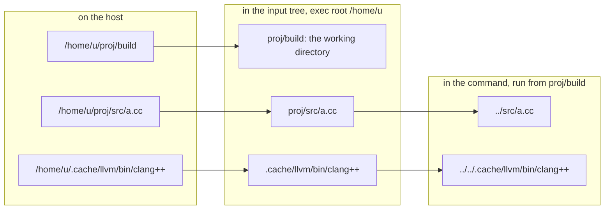
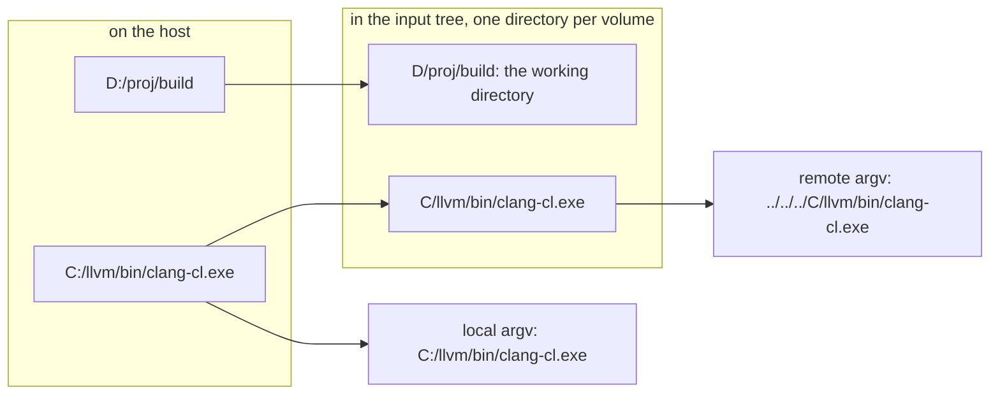
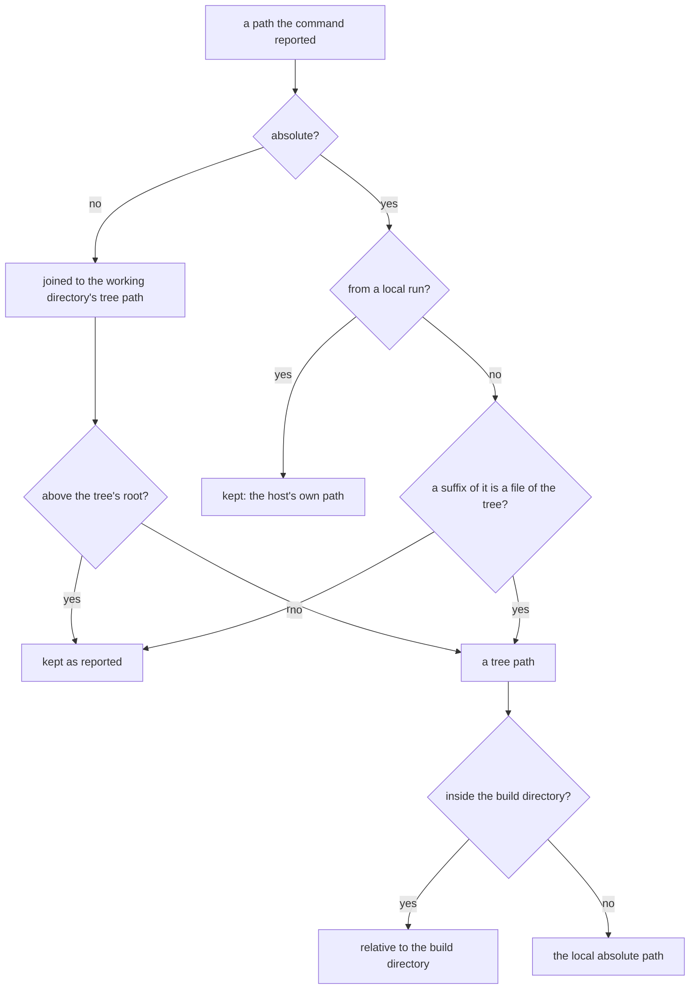

# Exec root and path mapping

Generators write absolute paths: CMake names sources, include directories and compilers by
their absolute paths. A remote action with those paths would only run on a worker that has the
same files at the same places, and its key would differ between two checkouts of the same
project. So ninja-rs maps every local path of an action into the action's input root, rewrites
the command line with paths relative to the working directory, and maps the paths a command
reports (depfiles, `/showIncludes`) back to local ones.

The code is `crates/ninja-remote/src/paths.rs` (`ExecRoot`, `PathMapper`, `TreeIndex`), used by
`action.rs` (preparing actions), `env.rs` (paths in variables), `backend.rs` (results and local
runs) and `backend/capture.rs` (storing local results). How an action is built is in
[dev/remote.md](dev/remote.md).

## Host paths and tree paths

The *exec root* is the local directory that becomes the root of the action's input tree. A
local path under it maps to its *tree path*, relative to it. The remote working directory is the
build directory's tree path, and the command's paths are relative to it. The diagram follows
one compile: build directory `/home/u/proj/build`, source `/home/u/proj/src/a.cc`, toolchain
`/home/u/.cache/llvm`.

The worker lays the tree out under a directory of its own (`/worker/exec/42`, say) and runs the
command in `proj/build` there: the same relative paths reach the same files.

## The exec root

By default the exec root is chosen per action (`ExecRoot::common`): the deepest common ancestor
of the build directory and every input of the action (files, toolchain directories, directories
sent whole, response files, outputs of earlier actions that only exist remotely). On Windows
the comparison is case-insensitive and drive letters are upper-cased.

The deepest one keeps what differs between machines out of the action when everything lives
below it: the home directory, the checkout's location. Two checkouts with the same layout below
their root share every key. hermetic-llvm-cmake's toolchain cache inside the source tree
(`-DHERMETIC_CACHE_DIR=<source>/.hermetic-cpp`) is the setup this is for: the toolchain is in the
checkout, the exec root is the checkout, and checkouts anywhere share their cache entries. A
toolchain outside (`/usr/lib/llvm`) moves the root up to the common ancestor, `/` at worst, and
the checkout's path then shows in every action.

`--exec_root=DIR` fixes the root (made absolute, `~` expanded). An action with an input, or a
build directory, outside it can't be sent: it runs locally (or fails with `--remote_strict`).

UNC paths (`\\server\share\...`) are a volume of their own, `//server/share`. When an action's
files span several volumes (drives, shares) there is no common ancestor: the tree then has one
top-level directory per volume, `C/...`, `D/...`, and `UNC/server/share/...` (see
[Several volumes](#several-volumes)).

## Rewriting command lines

Every argument, every token of a response file (Windows rules on Windows hosts, GNU rules
elsewhere), and every path-valued variable an action carries (see
[dev/remote.md](dev/remote.md#tool-environments-and-the-action-key)) is scanned for embedded
absolute paths (`find_abs_paths`):

- POSIX: a `/` at the start of the argument, after `=`, `,`, `:`, `;`, `@` or a quote, or right
  after flag letters (`-I/x`, `-isystem/x`). On POSIX hosts, clang-cl's options glued to a path
  (`/I/x`, `/vctoolsdir/x`) start the path after the option, unless the whole argument is a file.
- Windows: a drive letter with `:\` or `:/`, or a UNC prefix (`\\server`, `//server`), at the
  start, after a non-alphanumeric character, or after flag letters (`/FoC:\x`, `-IC:/x`,
  `/external:IC:\x`).

A path ends at `;`, `,`, a quote or `=` (and `:` on POSIX).

A path is rewritten relative to the working directory when it lies under the exec root, in the
input tree or not: an include directory no header came from (`-isystem <src>/Utilities` in a
compile reading none of its headers) must not leave the checkout's location in the command, or
two checkouts never share the action. When the exec root is a file system's root (`/`, `C:/`) or
the tree spans volumes, only paths whose first tree component is in the input tree are
rewritten, so that `/dev/null` and unrelated system paths stay. Paths elsewhere stay as they are.
Backslashes stay if the original used them.

Values the program built keeps, rather than files the command opens, are left as they are
(`kept_value`):

- macro definitions: `-D`, and `/D` on a cl-style command line (cl, clang-cl, MSVC linkers,
  lib), followed by a macro name and its end (`=`, `#`, `(`): linker options spelled alike
  (`/DEF:x.def`, `/DEFAULTLIB:x.lib`, `-DELAYLOAD:x.dll`) name files, and are rewritten;
- run-time library paths and the dynamic linker: `-rpath`, `-R`, `-install_name`,
  `--dynamic-linker`, also through `-Wl,` and `-Xlinker`;
- where the program writes profiles and the directory its debug information names:
  `-fprofile-generate=`, `-fprofile-instr-generate=`, `-fcs-profile-generate=`, `-fprofile-dir=`,
  `-fdebug-compilation-dir`, `-fcoverage-compilation-dir=`, `-ffile-compilation-dir=`, through
  clang-cl's `/clang:` too. A profile the compiler reads (`-fprofile-use=`) is rewritten.

Rewritten, `-DDATA_DIR="/home/u/proj/data"` would become `"../data"`: the program would differ
from the one ninja builds, and break when run from elsewhere. An action with such a value names
the checkout, so two checkouts don't share it. A definition naming one of the action's inputs by
its absolute path (a header included through a macro) can't run remotely: the worker doesn't
have that path, so the action runs locally (`a definition names the input ... by its absolute
path, which a remote worker doesn't have`).

Prefix maps (`-ffile-prefix-map=OLD=NEW`, `-fdebug-prefix-map=`, `-fmacro-prefix-map=`,
`-fprofile-prefix-map=`, `-fcoverage-prefix-map=`, `/pathmap:`) get their old side rewritten,
the paths the compiler sees, and keep their new side, what it writes instead.

argv[0] is the relative path of the resolved executable (`./x` when it has no separator, so that
the worker doesn't search `PATH`; backslashes on Windows hosts). On Windows hosts, an argument
naming an input by a relative path is sent with forward slashes, which Windows tools accept: an
archive's member names then don't depend on the host.

Paths keep the spelling the build uses: links and junctions aren't resolved, and on Windows only
8.3 short names are expanded. A toolchain reached through a link inside the checkout stays inside
the exec root. On Windows, tree paths are case-folded: the first spelling seen of each directory
wins, so `C:\Proj\Src` and `c:\proj\src` are one directory of the tree.

Outputs (`output_paths`) and the depfile are relative to the working directory; an output
outside the build directory can't be returned, and the action runs locally (a link's side output
there is just not requested).

`--execution_log_file` records each action's key, command, environment and inputs: two builds'
logs show which path made two keys differ.

## Several volumes

A source tree on `D:`, a toolchain on `C:`, a build directory on a share: the tree has a
top-level directory per volume, and the remote command reaches each through the tree. A local
run of the same action (a disk cache miss, a fallback, a raced run) can't: from `D:\proj\build`,
no relative path reaches `C:` (before host paths, every local run of such actions failed).

When the tree spans volumes (`PathMapper::spans_volumes`), `prepare` also builds the command a
local run uses (`Prepared::local`, an `action::LocalForm`) with `PathMapper::for_host`: paths on
the build directory's volume are rewritten as for the remote action, those on other volumes keep
the host's absolute paths (`on_other_volume`), in arguments, response files, variables and
argv[0]. Outputs are the remote action's.

The keys of such actions hold the volumes' names (`C/...`, `D/...`): only machines with the same
drive layout share them. A local result stored from such a run names other volumes' files by
their host paths in what it wrote; its key already says which layout it is for.

## Mapping paths back

A remote compile reports what it read with the tree's paths: relative ones, and absolute ones
under the worker's own directory (clang's resource directory, found from its own location).
`PathMapper::map_back` turns each into the path ninja's deps log would have from a local build:

- Suffix matching (`TreeIndex::match_suffix`) takes the longest suffix, at a `/`, that is a file
  of the input tree, toolchain directories' files included.
- Depfiles (`deps = gcc`) are rewritten before the engine reads them, `/showIncludes` lines
  (`deps = msvc`) in the command's output. A `/showIncludes` path relative to the build directory
  is made absolute, as a local cl.exe prints them, and ninja's own normalization then makes it
  relative to the build directory as for a local build.
- A local run of the prepared action (see
  [dev/remote.md](dev/remote.md#local-runs-of-a-prepared-action)) writes the tree's relative
  paths too, and its depfile and `/showIncludes` lines are mapped back the same way, but its
  absolute paths are already the host's (`map_back_local`): a system header whose path ends like
  a file of the tree stays what it is.

So the deps log has the same shape whether an edge ran locally, remotely, or came from a cache:
absolute paths for sources and headers outside the build directory, relative ones for generated
headers.

Storing a local result does the opposite (`backend/capture.rs`): its depfile and `/showIncludes`
paths are rewritten to the remote form (`rewrite_arg`), and absolute paths into the tree in its
diagnostics are made relative (`rewrite_text`), as a remote execution prints them: another
checkout replaying a warning gets its own file.

## Known limits

- Compilers embed the working directory in debug information (`DW_AT_comp_dir`): a remote and
  a local compile then differ. `-fdebug-compilation-dir=.` (clang) or `-ffile-prefix-map` makes
  outputs reproducible. cargo-rbe's `rbe-exec` helper (substituting an `@EXECROOT@` token on the
  worker and scrubbing it from outputs) remains the design for tools that insist on absolute
  paths; C and C++ compilers don't need it.
- Windows workers inherit `MAX_PATH` limits: with the exec root at a drive root, a deep build
  directory plus the worker's own prefix can exceed 260 characters. Use short worker roots.
- Local runs of prepared actions use relative paths to files outside the build directory: from a
  deep build directory, tools without long-path support (link.exe, LNK1181) fail. Use a shorter
  build directory path.
- When the tree spans volumes, diagnostics of stored local results aren't rewritten
  (`rewrite_text` needs a single root).
- Symlinked inputs are sent as regular files: the input tree follows links.

**Tests.** `paths::tests::common_root`, `relative_paths`, `find_paths`, `rewrite_args`,
`rewrite_windows_case_folding`, `rewrite_output_text`, `map_back_paths`, `kept_run_time_paths`,
`unc_paths`, `host_paths_across_volumes`; e2e `build_dir_on_another_volume`, `response_files`,
`definition_naming_an_input`.
