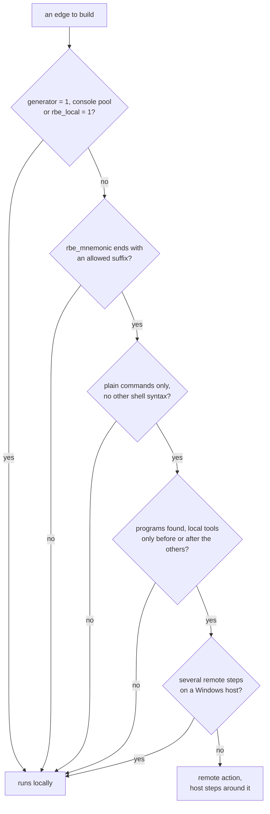

# RBE interface for ninja files (v1)

This is the contract between a build system generator that writes `build.ninja` files and an
executor that runs their edges with remote build execution (REAPI v2) and reports them in
build event streams, such as ninja-rs. It is not specific to one generator: CMake's Ninja
generators write it with `-DCMAKE_NINJA_RBE=ON`, and any other generator (or a hand-written
file) can. The CMake side is the `ninja-rbe` branch of <https://gitlab.kitware.com/Orphis/cmake>
(`CMAKE_NINJA_RBE`, `CMAKE_<LANG>_COMPILER_REMOTE_INPUTS`, `CMAKE_REMOTE_PLATFORM`,
`RBE_DELIVERABLE`). How ninja-rs uses it is in [remote-execution.md](user/remote-execution.md)
and [remote.md](dev/remote.md); its options in [options.md](reference/options.md).

Everything here is plain ninja syntax: stock ninja ignores it and still builds the project
locally. All names start with `rbe_`, so that they don't collide with a generator's own
variables or future ninja bindings. Where this page says what ninja-rs does, other executors may
choose otherwise; the rest is the contract.

## Activation

At file scope:

```ninja
rbe_version = 1
rbe_toolchains = CMakeFiles/rbe_toolchains.json
rbe_targets = CMakeFiles/rbe_targets.json
```

- `rbe_version`: the version of this interface the file follows. **Without it the executor
  runs every edge locally.** An executor that doesn't implement the version runs every edge
  locally too, and says so (ninja-rs: `remote execution disabled: the manifest uses RBE
  interface version 2, this executor supports 1`).
- `rbe_toolchains` (optional): the toolchains file (see below). ninja-rs stops the build on a
  file it can't read or parse, or whose version it doesn't know.
- `rbe_targets` (optional): the targets file (see below). ninja-rs warns about a file it can't
  read, and goes on without it.

Paths are relative to the build directory (the directory the executor runs in). ninja-rs reads
these three variables in the top-level scope of the manifest it loads: set there, or in a file
it `include`s, not in a `subninja`'s scope. CMake writes them in `build.ninja` with its Ninja
generator, and with Ninja Multi-Config in `CMakeFiles/common.ninja`, which each configuration's
file includes.

The disk cache follows the same rule: without `rbe_version = 1`, ninja-rs neither looks
actions up in it nor stores them.

## Edge bindings

All are optional. They are looked up as ninja looks up an edge's variables: on the `build`
statement, then in its enclosing scopes, so a value common to a file's edges (`rbe_config`)
can be set once at file scope. They can't go on `rule` blocks, which ninja rejects for unknown
variables. Dyndep files take no bindings but `restat`: edges they describe keep those of their
`build` statement.

| Binding | Values | Meaning |
|---|---|---|
| `rbe_target` | target name | The target owning the edge (see the targets file). |
| `rbe_mnemonic` | free-form | The action kind, such as `CXXCompile`: REAPI's `action_mnemonic`, build events, and the executor's policy. A mnemonic ending with `Compile` says the edge compiles: ninja-rs doesn't send one whose program it doesn't recognize as a C or C++ compiler, since it couldn't find the headers it reads. (It scans the includes of any compiler it recognizes, whatever the mnemonic.) |
| `rbe_local` | `1` / absent | The edge must run locally as a whole. Unmarked edges may run remotely. |
| `rbe_artifact` | `1` / absent | The edge creates its target's artifact (an executable, a library): the outputs build events report for the target. |
| `rbe_deliverable` | `1` / absent | The edge's outputs are in the minimal set the executor downloads (see Downloads). |
| `rbe_config` | configuration name | The configuration (in the targets file) the edge builds for. Without it, the file's first configuration. |

Edges with `generator = 1` (manifest regeneration) and edges in the `console` pool always run
locally.

ninja-rs's policy is narrower than "may run remotely": by default it sends only edges whose
`rbe_mnemonic` ends with `Compile`, and `--remote_mnemonics` widens that (`Compile,Archive,Link`).
An edge without `rbe_mnemonic` runs locally. A generator should therefore give every edge it
writes a mnemonic, and mark `rbe_local = 1` only the edges that must not leave the host.

Example:

```ninja
build src/foo/CMakeFiles/foo.dir/a.cpp.obj: CXX_COMPILER__foo_Release ../src/foo/a.cpp
  rbe_target = foo
  rbe_mnemonic = CXXCompile
```

## Downloads

Outputs of remote actions stay in the remote CAS unless the executor downloads them. ninja-rs
has two modes (`--remote_download_outputs`):

- **all** (the default): every output.
- **minimal**: the outputs of the `rbe_deliverable` edges the build runs, and the depfiles the
  build reads. The others are recorded as present (in `.ninja_remote`) and downloaded when
  something on the host needs them: the inputs of a command run locally, before it runs, and a
  file the build itself reads (a dyndep file). `toplevel` is the same as `minimal` here.

In both modes, what the command line names is downloaded, whatever it is (a target, a library,
an object file), even when it was up to date: no annotation is needed for that. Outputs of a
command whose steps after the remote one run on the host (see below) are downloaded too, since
those steps may read them.

## Commands and local tools

The executor runs an edge's `command` remotely only if it is a list of plain commands: one
command, or several joined with `&&`, optionally wrapped in `cmd.exe /C "..."` on Windows.
ninja-rs splits the command on `&&` outside quotes and drops shell no-ops (`:`, `true`,
`cd .`, `cd /D .`), which generators put around commands. An edge runs locally when a step
needs a shell otherwise: on Unix, anything but plain words and quotes (pipes, redirections,
variable expansions, `||`, `;`); on Windows, redirections, and in a `cmd.exe /C` command `&`,
`^`, parentheses, or a `%VARIABLE%` that is set or is one of cmd's own (cmd leaves an unset one
as it is); and on both, a step changing directory.

Each step's program is its first word, resolved to an absolute path (relative to the build
directory, or through `PATH`, with `.exe` added on Windows). An edge whose program can't be
found runs locally.

Steps whose program is a **local tool** (declared in the toolchains file) run on the host, in
the build directory; the others form the remote action. Local steps may come before or after
the remote ones, not between them. For example, with `cmake` declared local, CMake's archive
command

```text
: && cmake -E rm -f libfoo.a && ar qc libfoo.a a.o b.o && :
```

deletes the old archive locally (archivers append to existing archives), then creates it
remotely, in an empty directory. An edge whose steps all use local tools runs locally.

The order of events for an edge with local steps:

1. the remote action runs (or is found in a cache), and its result and outputs are fetched,
   not yet written in place (with racing, the outputs are claimed: a local run of the same edge
   stops);
2. the local steps before the remote ones run: files they create aren't inputs of the action;
3. the outputs are written in place;
4. the local steps after the remote ones run, and see the outputs.

A local step that fails fails the edge. Such an edge, when it runs locally after all (a
fallback), runs its command as the manifest writes it; it isn't raced; and its local results
aren't cached, since the action's key doesn't describe what the host steps did.

A remote action with several steps runs through `/bin/sh -c 'a && b'` on the worker; on
Windows hosts such edges run locally (cmd.exe's quoting doesn't survive a worker's own argument
quoting), so prefer single-step commands (`llvm-ar qc`, which also writes the archive's index,
rather than `ar` then `ranlib`).

The diagram sums up which edges ninja-rs sends.



An edge the policy sends that can't be prepared (the cases above after the mnemonic, an
unrecognized compiler on a `Compile` edge, an input outside a fixed exec root) runs locally,
or fails with `--remote_strict`.

### Environment

A remote action doesn't inherit the host's environment. It gets the variables its tools read
that change what they write (`INCLUDE` for cl, `SDKROOT` for Clang...), taken from the
executor's environment, and those the user sets for every action (`--action_env`). A command
that relies on other variables of the host's shell won't see them remotely. See
[environment.md](reference/environment.md#the-builds-environment-and-remote-actions).

## Toolchains file

```json
{
  "version": 1,
  "toolchains": [
    {
      "language": "CXX",
      "tool": "C:/llvm/bin/clang-cl.exe",
      "inputs": ["C:/llvm/bin", "C:/llvm/lib/clang"],
      "platform": { "OSFamily": "Windows", "container-image": "docker://..." }
    },
    { "tool": "C:/Program Files/CMake/bin/cmake.exe", "local": true }
  ]
}
```

- `version`: `1`; ninja-rs refuses another.
- `tool`: absolute, normalized path of an executable.
- `local` (default `false`): the tool only runs on the host (see above).
- `language` (optional, informative).
- `inputs` (default none): absolute files or directories the tool needs remotely: its own
  binaries, runtime libraries and resource directory, sent whole. Sysroots and SDKs are **not**
  listed: the executor's include scanner finds the headers a compile reads, and its link
  analysis the libraries a link reads. The executables the steps run are always sent; an input
  that doesn't exist is a warning.
- `platform`: REAPI platform properties for actions running the tool.

The executor identifies a step's tool from its program, resolved as above, and looks it up by
`tool`: ninja-rs compares the paths lexically normalized, with forward slashes, and on Windows
regardless of case, with or without `.exe` (8.3 short names are expanded first). An
executable with no declaration is sent as an ordinary input.

The platform of an action is its first remote step's tool's; when that tool isn't declared,
another declared tool's of the command; else none. On a real cluster, an action without
platform properties usually finds no worker. Declaring every tool matters for caching too:
ninja-rs stores the result of a command run locally in the remote cache (`--remote_cache`
alone) only when every program it runs is a declared tool, which the generator vouches for;
the others stay in the disk cache.

CMake writes one entry per enabled language (`CMAKE_<LANG>_COMPILER`, with
`CMAKE_<LANG>_COMPILER_REMOTE_INPUTS` and `CMAKE_REMOTE_PLATFORM` from the toolchain file), one
per other tool its build statements run (the archiver, ranlib and a linker run directly:
`CMAKE_AR`, `CMAKE_RANLIB`, `CMAKE_LINKER` and their `CMAKE_<LANG>_COMPILER_*` variants) with
the same platform and no inputs, and declares itself a local tool.

## Targets file

```json
{
  "version": 1,
  "configurations": [
    {
      "name": "Release",
      "mnemonic": "x86_64-linux-clang-Release",
      "platform": "Linux",
      "cpu": "x86_64",
      "variables": { "CMAKE_BUILD_TYPE": "Release", "CMAKE_CXX_COMPILER_ID": "Clang" }
    }
  ],
  "targets": [
    { "name": "foo", "kind": "static_library", "label": "//src/foo:foo" },
    { "name": "app", "kind": "executable", "label": "//:app" }
  ]
}
```

- `version`: `1`; ninja-rs ignores another, with a warning.
- `targets`: the targets named by `rbe_target`, with a free-form `kind` and the `label` build
  events use (default `//:<name>`).
- `configurations`: the build configurations edges name in `rbe_config`. Everything in an
  entry describes the configuration: the executor derives its id from all of it (a digest), so
  configurations that differ in any setting, the toolchain included, never share an id.
  Without any, the executor uses one default configuration.

Build event streams (BES) report the targets the requested ones need (`TargetConfigured`, then
`TargetCompleted` per configuration, with the outputs of their `rbe_artifact` and
`rbe_deliverable` edges) and the configurations. Remote actions carry the edge's mnemonic, its
target's label and its configuration's id in their `RequestMetadata`, with the invocation ids
the build events use, so that a service can tie both together.

CMake writes its targets with their lowercased type (`executable`, `static_library`,
`shared_library`, `module_library`, `object_library`, `utility`), and labels
`//<source dir>:<name>`, the source directory relative to the root of the repository the top
source directory is in (the nearest directory up with `.git`, `.hg`, `.jj`, `.sl` or `.svn`,
short of a build directory), or else to the top source directory; sources from elsewhere (as
FetchContent and ExternalProject put them) get `@<project>//<source dir>:<name>`, relative to
their project's directory. Its configurations are the build types, with the target system and
processor and the compilers' ids and versions in their variables; the multi-config generator
sets `rbe_config` at the top of each configuration's file (`CMakeFiles/impl-<Config>.ninja`).

## CMake specifics

Mnemonics (`<LANG>` is the CMake language name, such as `C`, `CXX`, `RC`, `CUDA`):

| Mnemonic | Edge |
|---|---|
| `<LANG>Compile` | Object compilation (BMI-only compilations of modules too) |
| `<LANG>Scan` | Dependency scanning for C++20 modules or Fortran |
| `<LANG>Dyndep` | Dyndep collation (`rbe_local = 1`) |
| `<LANG>Link` | Executable, shared library or module library link (CUDA's device link too) |
| `<LANG>Archive` | Static library |
| `CustomCommand` | `add_custom_command` and `add_custom_target` edges (`rbe_local = 1`) |
| `CMakeRegenerate` | The `build.ninja` regeneration edge (`rbe_local = 1`) |
| `CMakeHelper` | Other edges running `cmake` itself (copy, symlink, clean...) |

Statements that only exist because of modules (C++20 or Fortran: dependency scanning, dyndep
collation, BMI-only compilations of imported module targets) belong to an implicit target,
`<target>@modules` (kind `modules`), so that a target's own actions compare between builds with
and without modules. Compilations, which also produce BMIs, stay with their target. The BMIs
CMake builds for an imported module target (such as `std`, for `import std`) belong to
`<imported target>@modules.<digest>` (`::` replaced by `__`), the digest being of the settings
they are built with: the name stays the same from one build to the next, and differs for each
variant.

CMake marks `rbe_local = 1` on custom commands, dyndep collation, regeneration and its other
utilities (clean, help), edges running `PRE_LINK` or `POST_BUILD` commands, and compiles
wrapped by a compiler launcher or a code check (clang-tidy...). Steps running `cmake` itself
inside other edges (deleting an archive, `vs_link_exe` wrappers) are left to the local tool
rule. It marks `rbe_artifact = 1` on the link or archive creating each target's artifact, and
`rbe_deliverable = 1` on those of executables, shared libraries and module libraries; the
`RBE_DELIVERABLE` target property changes that per target (off for a code generator only used
during the build, on for a static library the project distributes).

In RBE mode, CMake doesn't use precompiled headers (unless the project sets
`CMAKE_DISABLE_PRECOMPILE_HEADERS`): a precompiled header names the files it was made of by
absolute paths, which differ from one remote worker to the next. ExternalProject passes
`CMAKE_NINJA_RBE`, `CMAKE_MAKE_PROGRAM` and `CMAKE_REMOTE_PLATFORM` to the projects it
configures with the same generator, as cache defaults their own arguments override, so they
build with the same executor, remotely.
