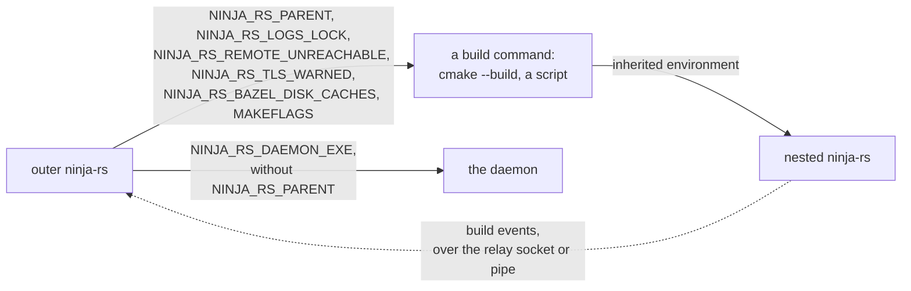

# Environment variables

Every environment variable ninja-rs reads or sets: those you may set, those of the build's
environment that remote actions carry, and those ninja-rs sets for the processes it starts,
most of them internal to nested invocations. Build-time and test variables come last.
Options are in [options.md](options.md), files in [files.md](files.md).

## Variables you may set

### ninja's

| Variable | Effect |
|---|---|
| `NINJA_STATUS` | The status line's prefix, with `%` placeholders; default `[%f/%t] `. See below. Ignored with `--status`, `--quiet` and in tools. |
| `TERM` | Status lines overwrite each other on a terminal: on Unix one with `TERM` set and not `dumb`; on Windows a console, unless `TERM` is `dumb`. |
| `NO_COLOR` | Set (and not `0`): no colors on a terminal. |
| `CLICOLOR_FORCE` | Set (and not `0`): colors where output isn't a terminal too, unless `NO_COLOR` is set. |
| `FORCE_COLOR` | Set (and not `0`): colors, whatever `NO_COLOR` says. |
| `MAKEFLAGS` | A GNU make jobserver to take job slots from: see [`MAKEFLAGS`](#makeflags). |

The `NINJA_STATUS` placeholders are ninja's and three of ninja-rs's:

| Placeholder | Value | Placeholder | Value |
|---|---|---|---|
| `%s` | started edges | `%e` | elapsed seconds (`1.234`) |
| `%t` | total edges to run | `%w` | elapsed time, `[h:]mm:ss` |
| `%r` | running edges | `%E` | estimated seconds left, `?` while unknown |
| `%u` | edges not started yet | `%W` | estimated time left, `[h:]mm:ss` |
| `%f` | finished edges | `%P` | predicted share of the build's time done |
| `%o` | edges finished per second, overall | `%%` | a `%` |
| `%c` | edges finished per second, lately | `%R` | ninja-rs: remote actions (executed or cache hits) |
| `%p` | share of edges finished | `%H` | ninja-rs: remote cache hits |
| | | `%D` | ninja-rs: disk cache hits |

An unknown placeholder is fatal before the build starts (ninja fails at its first status
line).

### `MAKEFLAGS`

Read at each build, as ninja 1.13 reads it: the last `--jobserver-auth=` (or
`--jobserver-fds=`) argument names a GNU make jobserver, and each local command takes a slot
from it (the first one free, then a token). Remote actions take none; a remote action run
locally does.

| Form | Platform |
|---|---|
| `--jobserver-auth=fifo:PATH` | Unix (GNU make 4.4) |
| `--jobserver-auth=R,W`, `--jobserver-fds=R,W` | Unix: inherited pipe descriptors (GNU make 4.3 and older) |
| `--jobserver-auth=NAME` | Windows: a named semaphore |

The jobserver is ignored when `-j` is given (unless `--jobserver-pool`), in a dry run, when the
first word holds make's `n` (`make -n`), or when it names negative descriptors; `-v` says why.
Descriptors that aren't open on a pipe or socket, a `fifo:` path that isn't a FIFO, or a
semaphore that can't be opened is reported as an error, and the build goes on without a
jobserver. With `--jobserver-pool`, ninja-rs sets `MAKEFLAGS` for its commands instead: see
[Variables ninja-rs sets](#variables-ninja-rs-sets).

### ninja-rs's

| Variable | Read by | Effect |
|---|---|---|
| `NINJA_RS_DAEMON` | every invocation | `1` (exactly) turns `--daemon` on by default; the command line and settings files still decide. |
| `NINJA_RS_DAEMON_DIR` | every invocation, the daemon | The daemon's directory, instead of the default (see [files.md](files.md#daemon-directory)). Relay sockets and the private option files of nested invocations go there too. |
| `NINJA_RS_DAEMON_IDLE` | the daemon, as it starts | Seconds without builds after which it exits; default 10800 (3 hours). A daemon a build starts inherits that build's environment. |
| `NINJA_RS_BES_DEBUG` | builds with `--bes_backend` | Not empty: the Build Event Service uploader traces its connection and stream on stderr, as `[bes    1.234s] ...` lines. |

### The system's

| Variable | Read for |
|---|---|
| `HOME`; on Windows `USERPROFILE`, then `HOME` | `~` in path options; the user's settings file `~/.ninjars`; the workspace's settings file is looked for up to the home directory, not in it. |
| `ProgramData` (Windows) | The system's settings file, `%ProgramData%\ninjars`; none when unset. |
| `XDG_RUNTIME_DIR` (Unix) | The daemon's default directory, `$XDG_RUNTIME_DIR/ninja-rs`. |
| `TMPDIR` (Unix), `TMP`, `TEMP` (Windows) | The daemon's directory without `XDG_RUNTIME_DIR` (Unix) or `LOCALAPPDATA` (Windows), through the system's temporary directory; on Unix also where `--jobserver-pool` makes its FIFO (`/tmp` without `TMPDIR`). |
| `LOCALAPPDATA` (Windows) | The daemon's default directory, `%LOCALAPPDATA%\ninja-rs\daemon`. |
| `PATH` | The program of each step of a remote action, when the command names it without a directory (`.exe` added on Windows); only what it resolves to is sent. Under WSL, the Windows directory on `PATH` (`/mnt/c/WINDOWS/system32`) tells which drive Windows is on, for the settings files' trust rules. |
| `SystemDrive`, `USERPROFILE` (under WSL, when `WSLENV` passes them) | The settings files' trust rules on Windows drives mounted without `metadata`: which drive Windows is on, and the name of your Windows profile directory. See [settings.md](../user/settings.md). |
| `HOSTNAME`, else `COMPUTERNAME` (else `/proc/sys/kernel/hostname`) | The host name build events report. |
| `USER`, else `USERNAME` | The user name build events report. |

## The build's environment and remote actions

A command run locally inherits ninja-rs's environment. A remote action has only its own: the
variables its tools read that change what they write, taken from ninja-rs's environment, and
those `--action_env` sets. Which variables a tool reads is known from its name and command
line; variables of other programs are left out, as are those the command line makes the tool
ignore (a toolchain named with `/vctoolsdir` or `/winsysroot`, standard include directories
left out with `/X` or `-nostdinc`, lld-link's `/lldignoreenv`), so that a developer prompt's
values don't change the keys of a hermetic toolchain's actions. They are part of the action's
key.

| The step runs | Variables carried |
|---|---|
| cl.exe or clang-cl, compiling | `CL`, `_CL_`; `INCLUDE`, `EXTERNAL_INCLUDE` (not with `/X`, nor for clang-cl naming its toolchain); each variable named by `/external:env:NAME`; `LIBPATH` with cl's `/clr`; clang-cl also `VCToolsInstallDir`, `VCINSTALLDIR` (unless it names its toolchain) and Clang's own (below) |
| a GCC or Clang driver, compiling | `CPATH`, `C_INCLUDE_PATH`, `CPLUS_INCLUDE_PATH`, `OBJC_INCLUDE_PATH`, `OBJCPLUS_INCLUDE_PATH`, `GCC_EXEC_PREFIX`, `COMPILER_PATH`, `CCC_OVERRIDE_OPTIONS`, `SOURCE_DATE_EPOCH`, `SDKROOT`, `DEVELOPER_DIR`, `RC_DEBUG_OPTIONS`, and the Apple deployment targets (`MACOSX_`, `IPHONEOS_`, `TVOS_`, `WATCHOS_`, `XROS_`, `DRIVERKIT_DEPLOYMENT_TARGET`). Clang targeting MSVC also `INCLUDE`, `EXTERNAL_INCLUDE` (not with `-nostdinc`, `-nostdlibinc`, nor when it names its toolchain with `-Xmicrosoft-visualc-tools-root` or `-Xmicrosoft-windows-sys-root`), `VCToolsInstallDir`, `VCINSTALLDIR`; any Clang its own |
| Clang's own, for any Clang driver | `CLANG_NO_DEFAULT_CONFIG`, `CC_PRINT_OPTIONS`, `CC_PRINT_HEADERS`, `CC_PRINT_HEADERS_FORMAT`, `CC_PRINT_HEADERS_FILTERING`, `CC_LOG_DIAGNOSTICS`, `CC_PRINT_PROC_STAT` |
| link.exe or lld-link, or cl or clang-cl linking | `LIB` (not for lld-link with `/lldignoreenv` or `/winsysroot`); `LINK`, `_LINK_` (not for lld-link with `/lldignoreenv` on its own command line); a cl-style driver also `CL`, `_CL_`; Clang also `VCToolsInstallDir`, `VCINSTALLDIR` (unless the toolchain is named) |
| a GNU-style linker, or a GCC or Clang driver linking | `LIBRARY_PATH`, `GCC_EXEC_PREFIX`, `COMPILER_PATH`, `CCC_OVERRIDE_OPTIONS`, `SDKROOT`, `DEVELOPER_DIR`, `ZERO_AR_DATE`, `LD_RUN_PATH`, the Apple deployment targets. Clang targeting MSVC also `LIB`, `LINK`, `_LINK_` (unless it runs lld-link with `/lldignoreenv`), `VCToolsInstallDir`, `VCINSTALLDIR` (unless the toolchain is named); any Clang its own |
| an archiver (`ar`, `llvm-ar`, `gcc-ar`, `ranlib`, Apple's `libtool`) | `ZERO_AR_DATE` |
| lib.exe or llvm-lib | `LIB`, when an input is found neither from the working directory nor in a `/LIBPATH:` directory |
| any other program | none |

How values are carried:

- Paths (`SDKROOT`, `CPATH`'s entries, `INCLUDE`'s...) are rewritten as the command's
  arguments are: relative to the working directory when under the exec root, else as the host
  names them, for a worker of the same OS (see [paths.md](../paths.md)). `INCLUDE`, `LIB` and
  the like lose their empty entries, as cl drops them.
- Options (`CL`, `_CL_`, `LINK`, `_LINK_`) are split and rewritten like a command line. The
  include scanner and the link analysis read them as part of the command: `CL`'s before the
  command's arguments, `_CL_`'s after.
- `--action_env` values are carried as given, and replace a variable of the same name (case
  aside on Windows).

Some variables can't be carried. When one is set, local runs of the action still work, but
their results aren't cached (a warning says so once):

- `DEPENDENCIES_OUTPUT`, `SUNPRO_DEPENDENCIES` (GCC-style compiles) and Clang's
  `CC_PRINT_OPTIONS_FILE`, `CC_PRINT_HEADERS_FILE`, `CC_LOG_DIAGNOSTICS_FILE`,
  `CC_PRINT_PROC_STAT_FILE`: they make the tool write files the action doesn't return.
  `--action_env=NAME` gives them to the action all the same.
- Any carried variable whose value isn't UTF-8.

The Windows SDK's variables (`WindowsSdkDir`, `UCRTVersion`...) are never carried: Clang and
lld-link find the SDK from the command line or the registry.

Other ways the environment matters:

- A `cmd.exe /C` command using `%NAME%` for a variable set in ninja-rs's environment (or one
  of cmd's own: `%CD%`, `%RANDOM%`...) runs locally: its value can't be known remotely.
- The preprocessor scanner runs compilers (for their predefined macros and search
  directories) with the build's environment and `LC_ALL=C`. Its compiler profiles are keyed by
  the variables that change what compilers predefine or search: `INCLUDE`,
  `EXTERNAL_INCLUDE`, `CL`, `_CL_`, `CPATH`, `C_INCLUDE_PATH`, `CPLUS_INCLUDE_PATH`,
  `OBJC_INCLUDE_PATH`, `OBJCPLUS_INCLUDE_PATH`, `SDKROOT`, the deployment targets,
  `CLANG_NO_DEFAULT_CONFIG`, `GCC_EXEC_PREFIX`, `COMPILER_PATH`, `CCC_OVERRIDE_OPTIONS`,
  `DEVELOPER_DIR`, `VCToolsInstallDir`, `VCINSTALLDIR`, `WindowsSdkDir`, `WindowsSDKVersion`,
  `UniversalCRTSdkDir`, `UCRTVersion`. Changing one probes the compiler again.
- With `--daemon`, a build sends its whole environment to the daemon, which runs the
  compilers with it.
- `--action_env=PATH` in one of Bazel's files that a settings file imports (named `*bazelrc`)
  puts this machine's `PATH` in every remote action's key: ninja-rs notes it, and
  `--announce_rc` lists every `--action_env` such files give.

## Variables ninja-rs sets

ninja-rs passes these to the commands it runs locally (and to local runs of remote actions),
so that ninja-rs invocations among them (CMake's `try_compile`, `cmake --build` in a custom
command, ExternalProject) act as part of the same build. All but `MAKEFLAGS` are internal: their
format may change between versions, and you shouldn't set them.

The diagram shows what an outer invocation hands to the invocations its commands run.



| Variable | Set by | For | Value | Effect |
|---|---|---|---|---|
| `MAKEFLAGS` | a build with `--jobserver-pool` | local commands | ` -jN --jobserver-auth=fifo:$TMPDIR/NinjaFIFO<pid>` (Unix), ` -jN --jobserver-auth=ninja_jobserver_pool_<pid>_<n>` (Windows) | The pool of `-j` job slots (`N - 1` tokens), removed at the end. Without a pool, commands inherit ninja-rs's own `MAKEFLAGS`. |
| `NINJA_RS_PARENT` | builds and `-t exec` (not other tools) | everything ninja-rs starts but the daemon | JSON, see below | Nested invocations take the outer one's options, ids, build event relay and execution log. |
| `NINJA_RS_LOGS_LOCK` | a build holding its directory's lock | local commands | `<volume>:<file id>` of each lock file held, in hex, comma-separated (the outer invocations' too) | An invocation they run that writes the same logs (a generator's `-t restat`, a build of another configuration in the same directory) shares the lock instead of waiting for it, and only appends. |
| `NINJA_RS_REMOTE_UNREACHABLE` | an invocation that found its remote service unreachable | local commands | endpoints, space-separated | Nested invocations do without those services at once, under the same rules (`--remote_local_fallback`), instead of trying again. |
| `NINJA_RS_TLS_WARNED` | an invocation that warned about a certificate expiring soon | local commands, `-t exec`'s command | file paths, separated as in `PATH` | Nested invocations don't warn about them again. |
| `NINJA_RS_BAZEL_DISK_CACHES` | an invocation using Bazel's disk cache | local commands | directories, separated as in `PATH` | Nested invocations don't note again that the cache is Bazel's. |
| `NINJA_RS_DAEMON_EXE` | a build starting the daemon | the daemon | the ninja-rs binary's path | On Windows, where the daemon runs a copy of ninja-rs, the binary it comes from: the daemon exits once it is rebuilt or removed. |

The daemon is started without `NINJA_RS_PARENT` and `NINJA_RS_LOGS_LOCK`: it serves every
build, not the one that started it. Steps of a remote action that run on the host (local
tools) inherit ninja-rs's environment, `NINJA_RS_PARENT` included, but none of the other values
of this table.

### `NINJA_RS_PARENT`

A JSON object, set in ninja-rs's own environment before it starts any thread, so that
everything it runs inherits it:

```json
{
  "invocation_id": "0b5c7e4a-1d2f-4c3b-9a8e-6f7d5c4b3a21",
  "build_request_id": "9f8e7d6c-5b4a-4321-8fed-cba987654321",
  "flags": ["--remote_executor=grpcs://remote.example.com", "--disk_cache=/home/me/.cache/ninja-rs"],
  "execution_log": null,
  "relay": {"dir": "/run/user/1000/ninja-rs", "id": "relay-4242"},
  "rc_files": ["/home/me/src/proj/.ninjars"],
  "rc_workspace": "/home/me/src/proj",
  "secret_flags": "/run/user/1000/ninja-rs/flags-4242.json"
}
```

(Shown indented; the variable holds it on one line.)

| Field | Meaning |
|---|---|
| `invocation_id`, `build_request_id` | The outer invocation's ids: nested ones report under them, in build events and remote requests. |
| `flags` | The long options in effect (see [options.md](options.md#options-nested-invocations-inherit)), paths absolute; a nested invocation parses them before its own arguments, as if a settings file gave them. |
| `execution_log` | The outer `--execution_log_file`, which nested invocations append to. |
| `relay` | Where nested invocations send their build events: the outermost invocation's socket (Unix) or named pipe (Windows), in the daemon's directory. Set when the outermost invocation has `--bes_backend` or `--build_event_binary_file`. |
| `rc_files`, `rc_workspace` | The settings files the outermost invocation read, and its workspace: a nested invocation reads them again for its own `--config` options only. |
| `secret_flags` | A file, readable by you alone, holding the options whose values may be credentials (`--remote_header`): they stay out of the environment, which every command, its crash dumps and CI logs see. Removed when the outer invocation exits. |

A value that doesn't parse is ignored: the invocation runs as an outermost one.

## Build time and tests

None of these matter to a ninja-rs binary once built; no `CARGO_*` variable is read at run
time. See [build-notes.md](../build-notes.md) and [testing.md](../dev/testing.md).

| Variable | Read by | Effect |
|---|---|---|
| `NINJA_RS_COMMIT` | the compiler (`option_env!`) | The commit ninja-rs was built from, in its version (`0.1.0+<commit>[.dirty]`). Cargo builds get it from `crates/ninja-rs/build.rs` (git, in a checkout of ninja-rs); Bazel from `--config=stamp` (`tools/workspace_status`, `STABLE_GIT_COMMIT`). |
| `NINJA_RS_BAZEL` | `crates/ninja-rs/build.rs` | Set by Bazel's build of the script: no git, no `NINJA_RS_SOURCE_DIR`. |
| `NINJA_RS_SOURCE_DIR` | tests (`option_env!`) | The workspace, for tests to find data files however they run. |
| `CARGO_MANIFEST_DIR`, `OUT_DIR`, `CARGO_CFG_TARGET_OS`, `CARGO_CFG_TARGET_ENV`, `CARGO_CFG_TARGET_ARCH` | `crates/ninja-rs/build.rs` | The workspace, and the Windows targets that get the long-path manifest. |
| `CARGO_PKG_VERSION` | the compiler (`env!`) | The version. |
| `CARGO_BIN_EXE_ninja-rs` | tests | The binary under test. |
| `CPP_DEPS_TEST_CXX`, `CPP_DEPS_TEST_CL`, `CPP_DEPS_TEST_CLANG_CL`, `CPP_DEPS_TEST_LIBCXX`, `CPP_DEPS_TEST_BOOST`, `CPP_DEPS_TEST_GLIB` | `crates/cpp-deps/build.rs`, its tests | Compilers and libraries the scanner's tests compare against; each turns on the cfg of its name in lowercase. |
| `TEST_TMPDIR`, `TEST_SRCDIR`, `TEST_WORKSPACE`, `RUNFILES_MANIFEST_FILE`, `TEST_TIMEOUT`, `TEST_TOTAL_SHARDS`, `TEST_SHARD_INDEX`, `TEST_SHARD_STATUS_FILE`, `XML_OUTPUT_FILE`, `TESTBRIDGE_TEST_ONLY` | the test harness, `test-dirs` | Bazel's test environment. |
| `HARNESS_TIMES_OUT` | the harness's own test | Where its watchdog test reports. |
| `NINJA_RS_TEST_SLEEPER`, `NINJA_RS_TEST_LEAVE`, `NINJA_RS_TEST_ON_BREAK`, `NINJA_RS_TEST_DIR`, `NINJA_RS_TEST_REAPER`, `NINJA_OS_JOB_CHILD`, `NINJA_OS_EXITING_CHILD`, `NINJA_CORE_TEST_DEPS_WRITER`, `NINJA_DAEMON_TEST_SET_UP_AGAIN` | unit tests | Set by a test for the copy of the test binary it runs as a helper process. |
| `COMPARE_VERBOSE`, `SCANBENCH_VERBOSE` | `cpp-deps` and `ninja-remote` examples | More output. |
| `NATIVELINK`, `HERMETIC`, `CMAKE`, `HERMETIC_DOWNLOADS`, `TARGET`, `NINJA_RS`, `WORK`, `PORT`, `TLS`, `NINJA_RS_FLAGS` | `tests/nativelink/run.sh` | The NativeLink end-to-end test's inputs: see the script's header. |
| `BAZEL_DO_NOT_DETECT_CPP_TOOLCHAIN` | Bazel (`.bazelrc`) | Set to `1`: the hermetic toolchain only. |
| `BAZEL_MSVC_RUNTIME_VISUAL_STUDIO_EULA`, `BAZEL_WINDOWS_SDK_EULA` | Bazel's `llvm` module | Set in a `user.bazelrc` to accept the Microsoft licenses for Windows MSVC-ABI builds. |

Tests run ninja-rs with `NINJA_RS_*`, `MAKEFLAGS` and `NINJA_STATUS` removed from its
environment, but builds run in the test process itself read it: run the tests without
`NINJA_RS_DAEMON=1` set.
