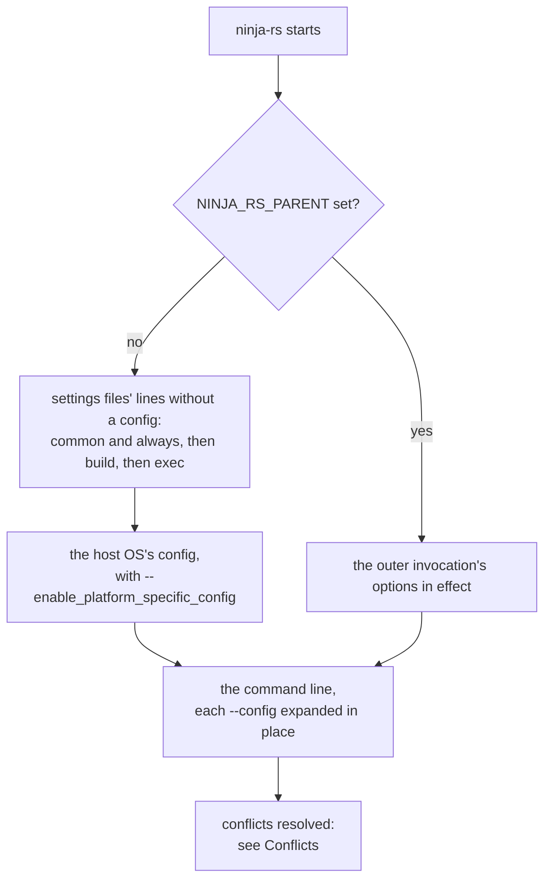

# Command-line options

Every option ninja-rs accepts, grouped as `ninja-rs --help` groups them. For what to do with
them, see the user guides: [remote execution](../user/remote-execution.md),
[caching](../user/caching.md), [certificates](../user/certificates.md),
[build events](../user/build-events.md), [include scanning](../user/include-scanning.md),
[settings files](../user/settings.md), [the daemon](../user/daemon.md) and
[nested builds](../user/nested-builds.md). The tools (`-t`), debug modes (`-d`) and warning
flags (`-w`) are in [tools.md](tools.md); environment variables in
[environment.md](environment.md); the files options name or produce in [files.md](files.md).

The "Equivalent" columns say where an option comes from: **ninja** for ninja's own option,
**Bazel** for a Bazel option of the same name and meaning (differences noted), another name
when the closest equivalent has one, and "—" when there is none.

## Syntax

- **Short options** are parsed as ninja's getopt does: `-j8`, `-j 8`, `-nv`. `-C`, `-d`, `-f`,
  `-j`, `-k`, `-l`, `-t` and `-w` take a value.
- **Long options** take their value as `--name=VALUE` or `--name VALUE`.
- **Booleans** (marked *bool* below) are written as in Bazel: `--name`, `--noname`,
  `--name=true` (or `yes`, `1`), `--name=false` (or `no`, `0`). `--noname=VALUE` is an error.
- **An empty value unsets** an optional value, as in Bazel: `--disk_cache=` turns off a disk
  cache a settings file set.
- **Durations** are a number and a unit, as in Bazel: `d`, `h`, `m`, `s` or `ms` (`30s`, `5m`,
  `500ms`). A number alone is in the option's default unit, given with each option.
- **Sizes** are a number with an optional `K`, `M`, `G` or `T` suffix (either case), in powers
  of 1024: `10G` is 10 GiB.
- **Paths**: `~` alone or followed by `/` (or `\`) is the home directory (`HOME`; on Windows
  `USERPROFILE`, else `HOME`). A relative path is made absolute against the directory
  ninja-rs was started in, not the `-C` directory, wherever the option was given.
- **Headers** (`K=V`): `K` must be a valid gRPC metadata name (it is sent in lowercase), `V`
  printable ASCII. The first `=` separates them: `--remote_header=x-a=b=c` sends `x-a: b=c`.
- **Repeatable** options accumulate; any other option given twice takes its last value.
- `--` ends the options: the words after it are targets. `-t TOOL` ends them too: the words
  after it are the tool's arguments.

Errors read as ninja's: `ninja: unrecognized option '--x'` (or `invalid option -- 'x'`)
followed by the usage, `option '--status' requires an argument`, `ninja: fatal: invalid -j
parameter`, and so on; all exit with 1. `--version`, `--help`, `-t list`, `-d list`, `-w list`
and an unknown tool are answered from the command line alone, before any settings file is
read, as ninja answers them before anything else: a settings file can neither change nor
break them (CMake runs `--version` to recognize the generator's tool).

### Where the arguments come from

An invocation parses one list of arguments, built as the diagram shows; a later occurrence of
an option wins. A nested invocation (a build command running ninja-rs) starts from the
options in effect in the invocation running it, which already include those of its settings
files.

`exec` lines apply to `-t exec` only. See [settings.md](../user/settings.md) for the files, their
order and their trust rules, and [environment.md](environment.md#ninja_rs_parent) for what
`NINJA_RS_PARENT` carries.

## ninja's options

| Option | Value | Default | Meaning | Equivalent |
|---|---|---|---|---|
| `-C DIR` | directory | — | Change to `DIR` before anything else, printing ``ninja: Entering directory `DIR'`` on stdout (not for tools, nor with `--quiet`). Settings files are looked for from `DIR` up. | ninja |
| `-f FILE` | path | `build.ninja` | The manifest to load. | ninja |
| `-j N` | integer ≥ 0 | CPUs + 2 (2 on one CPU, 3 on two) | Local commands run at once; `0` means no limit. Remote actions have their own limit, `--remote_jobs`. Given explicitly, a jobserver named in `MAKEFLAGS` is ignored (unless `--jobserver-pool`). | ninja |
| `-k N` | integer | `1` | Keep going until `N` commands fail; `0` (or less) means no limit. | ninja |
| `-l N` | number | — | Accepted and checked as a number, then ignored: no load-average limit. | ninja (ignored) |
| `-n` | — | off | Dry run: commands are not run and count as successful. No log is written, no lock taken, no remote service, disk cache or daemon used. | ninja |
| `-v`, `--verbose` | — | off | Print every command line. With remote execution, also a line for each action run locally after all, and why. With `--version`, print ninja-rs's own version too. | ninja |
| `--quiet` | — | off | No status line: only the commands' output (and failures). | ninja |
| `--status FMT` | format | — | The status line, from ninja-style variables instead of `NINJA_STATUS` and the description: `$started`, `$total`, `$running`, `$remaining`, `$finished`, `$rate`, `$current_rate`, `$progress`, `$predicted_progress`, `$elapsed`, `$elapsed_seconds`, `$eta`, `$eta_seconds`, `$description`, and ninja-rs's `$remote`, `$remote_cache_hits`, `$disk_cache_hits` (`${total}` works too). An unknown variable is an error. | not in ninja 1.13 |
| `--version` | — | — | Print the manifest language level ninja-rs implements, `1.13.1`, alone on a line, and exit 0. With `-v` or `--verbose` anywhere on the command line, a second line says `ninja-rs <version>`, with `+<commit>` (and `.dirty`) when the build knew it. | ninja |
| `-h`, `--help` | — | — | Print the usage on stderr and exit 1. | ninja |
| `-d MODE` | mode | — | A debug mode; repeatable. See [tools.md](tools.md#debug-modes--d). | ninja |
| `-t TOOL` | tool | — | Run a tool; ends the options. See [tools.md](tools.md). | ninja |
| `-w FLAG` | flag | — | A warning setting; repeatable. See [tools.md](tools.md#warning-flags--w). | ninja |
| `--jobserver-pool` | — | off | Create a GNU make jobserver pool of `-j` slots for the commands, handed to them in `MAKEFLAGS` (also turned on by `enable_jobserver_pool = 1` in the manifest). Skipped with `-j1`, in a dry run, or when `MAKEFLAGS` names a pool already. See [environment.md](environment.md#makeflags). | ninja (not in 1.13) |
| `-q` | — | off | Not in `--help`: no status line, no command output, no `FAILED:` blocks and no end-of-build lines (ninja's internal `QUIET` level, which tests use). | — |

`-j` and the other short options never reach nested invocations: they take their own.

## Remote execution

These options only take effect for manifests that declare `rbe_version = 1` (see
[rbe-interface.md](../rbe-interface.md)); other manifests build locally, as ninja would, and
`--remote_verbose` says why. A manifest declaring another version builds locally with a
warning.

| Option | Value | Default | Meaning | Equivalent |
|---|---|---|---|---|
| `--remote_executor=URL` | endpoint | — | The REAPI service that executes actions (and serves its cache). `grpc://host:port` or `http://` connects without TLS; `grpcs://host:port`, `https://` or no scheme with TLS. | Bazel |
| `--remote_cache=URL` | endpoint | — | A remote cache without remote execution: actions remote execution would run are looked up there and run locally on a miss. Given with a different `--remote_executor`, it is left out with a warning, and the executor's cache is used. | Bazel (which uses both) |
| `--[no]remote_upload_local_results` | bool | on | With `--remote_cache` alone, store the results of actions run locally on a miss, when the server accepts them (a warning says when it doesn't). Results of local runs after remote failures are never uploaded. | Bazel |
| `--remote_instance_name=S` | string | empty | The REAPI instance name. | Bazel |
| `--remote_header=K=V` | header | — | An extra gRPC header on every call; repeatable. Its value is shown as `<redacted>` in build events and `--announce_rc`, and reaches nested invocations through a private file, not the environment. | Bazel |
| `--remote_jobs=N` | integer > 0 | `50` | Remote actions in flight, besides the `-j` local commands. Without remote execution (a remote cache or a disk cache alone), lookups take local slots and this has no effect. | — (Bazel's `--jobs`) |
| `--exec_root=DIR` | path | per action | A fixed exec root for every remote action. By default each action's is the deepest common ancestor of the build directory and its inputs. An action with an input outside a fixed root can't be sent. See [paths.md](../paths.md). | — |
| `--remote_mnemonics=A,B` | list | `Compile` | The mnemonic suffixes allowed to run remotely: an edge goes only if its `rbe_mnemonic` ends with one of them (and it isn't `rbe_local = 1`, `generator = 1` or in the `console` pool). Replaces the list; an empty value allows none. | — (Bazel's `--strategy=MNEMONIC=remote`) |
| `--[no]remote_local_fallback` | bool | on | Run an action locally when its remote execution fails, and build locally when the service can't be reached at the start. Off, those fail the action or the build. Actions that can't be sent (see `--remote_strict`) run locally either way. A certificate refused never falls back. | Bazel |
| `--[no]remote_strict` | bool | off | Actions the policy sends remotely run there or fail: no local run for an action that can't be sent (a shell command, an input outside `--exec_root`...), nor after a remote failure; an unreachable service fails the build. A cache miss with `--remote_cache` alone still runs locally. | — |
| `--remote_max_fallbacks=N` | integer ≥ 0 | no limit | Once `N` actions ran locally after remote failures, later remote failures fail their action. | — |
| `--remote_max_fallback_ratio=R` | 0 to 1 | no limit | Once more than `R` of the remote actions started ran locally after remote failures, later remote failures fail their action; checked from 20 remote actions on. | — |
| `--[no]remote_racing` | bool | off | Actions sent remotely also run locally once a local slot is free and the delay passed; the first to finish wins and the other stops. Commands with steps on the host aren't raced. Needs remote execution. | — (Bazel's dynamic execution) |
| `--remote_racing_delay=DURATION` | duration (ms) | `250ms` | How long a raced action's local run waits before it starts: most remote cache hits come back first. | — (Bazel's `--experimental_local_execution_delay`) |
| `--[no]remote_verbose` | bool | off | On stderr, a line per remote decision: actions executed remotely or found in a cache, why one ran locally, scanner fallbacks each time, uploads not made, disk cache evictions, and the bytes transferred at the end. | — |
| `--remote_retries=N` | integer ≥ 0 | `5` | Calls failing for a transient reason (`UNAVAILABLE`, `RESOURCE_EXHAUSTED`, a broken connection...) are made again up to `N` times. | Bazel |
| `--remote_timeout=DURATION` | duration (s) > 0 | `60s` | How long a call may take, or a transfer go without progress. Executions aren't bounded: a broken one is followed again with `WaitExecution`. | Bazel |
| `--remote_max_concurrency_per_connection=N` | integer > 0 | `100` | The calls the service takes at once on one connection (HTTP/2 streams): calls and executions stay below it, more executions open more connections. | Bazel |
| `--disk_cache=DIR` | path | — | A local action cache and CAS, with or without a remote service. A directory holding Bazel's disk cache is used as it is. See [files.md](files.md#disk-cache). | Bazel |
| `--disk_cache_max_size=SIZE` | size | `10G` | After a build that wrote to the disk cache, if its size estimate passes `SIZE`, the least recently used files are removed down to 90% of it. Bazel's cache is never collected. | — (Bazel's `--experimental_disk_cache_gc_max_size`) |
| `--remote_download_outputs=all\|minimal\|toplevel` | mode | `all` | Which outputs of remote actions are downloaded: all, or (`minimal`) only the `rbe_deliverable` edges' outputs, what the command line names, depfiles, the inputs of commands run locally (fetched when needed) and the outputs of commands with host steps after the remote one. The others stay in the remote CAS, recorded in `.ninja_remote`. `toplevel` is taken as `minimal`. | Bazel (whose `toplevel` downloads top-level targets' outputs) |
| `--remote_download_minimal` | — | — | Same as `--remote_download_outputs=minimal`. | Bazel |
| `--remote_download_toplevel` | — | — | Same as `--remote_download_outputs=toplevel`, that is `minimal`. | Bazel |
| `--remote_download_all` | — | — | Same as `--remote_download_outputs=all`. | Bazel |
| `--execution_log_file=FILE` | path | — | Write a JSON line per action prepared for the remote service or the disk cache: its key, command, environment, platform and inputs. The file is emptied at the start; nested invocations append to it. See [files.md](files.md#execution-log). | — (Bazel's `--execution_log_json_file`, another format) |
| `--remote_include_scanner=NAME` | `preprocessor`, `compiler`, `clang-scan-deps`, `conservative` | `preprocessor` | How a compile's inputs are found: by evaluating the preprocessor exactly (GCC, Clang and cl command lines), asking the compiler when that can't be exact; by asking the compiler (`-M`, `/showIncludes`); by the `clang-scan-deps` next to the compiler; or by following every `#include` whatever the conditionals. The conservative scanner takes over when the chosen one can't tell. See [include-scanning.md](../user/include-scanning.md). | — |
| `--[no]remote_cache_compression` | bool | on | Blobs travel compressed with zstd when the service supports it. `--[no]experimental_remote_cache_compression` is the same option. | Bazel |
| `--[no]daemon` | bool | off (on with `NINJA_RS_DAEMON=1`) | Use the daemon that keeps scanned headers, compiler profiles, file digests and toolchain trees between builds, watching their files. See [daemon.md](../user/daemon.md). | — |
| `--action_env=NAME[=VALUE]` | variable | — | Set `NAME` in the environment of every remote action (and of local runs of them): to `VALUE`, or to its value in ninja-rs's environment (left out when unset). Repeatable; the last one for a name wins. Values are sent as given (paths aren't rewritten) and are part of the actions' keys. | Bazel |

## TLS

For `grpcs://` (and `https://`, and scheme-less) endpoints of the remote service and of the
Build Event Service. The files are only read for such endpoints. Certificates are checked
before connecting: one expired or not valid yet is an error, one expiring within 14 days a
warning, once per invocation tree; any certificate error fails the build, without retries or
local fallback. See [certificates.md](../user/certificates.md).

| Option | Value | Default | Meaning | Equivalent |
|---|---|---|---|---|
| `--tls_certificate=FILE` | path (PEM) | public roots | The CA certificates trusted to sign server certificates, instead of the public (web PKI) roots. A file holding several CAs is a bundle: only the CA that verified the server's certificate is held to the date rules. | Bazel |
| `--tls_client_certificate=FILE` | path (PEM) | — | The client certificate, for mutual TLS. Needs `--tls_client_key`. | Bazel |
| `--tls_client_key=FILE` | path (PEM) | — | The client certificate's private key: PKCS#8, PKCS#1 or SEC1, not encrypted (the error says how to decrypt one). Needs `--tls_client_certificate`. | Bazel |
| `--tls_authority_override=NAME` | host name | the endpoint's host | The name server certificates are checked against, and sent as SNI. Unlike Bazel's, it doesn't change the HTTP/2 `:authority`. | Bazel (partly) |

A DER file is refused with the `openssl` command that converts it.

## Build events

Bazel's Build Event Protocol, streamed to a Build Event Service and/or written to a file. Build
events cover builds and `-t exec`, not the other tools. See
[build-events.md](../user/build-events.md).

| Option | Value | Default | Meaning | Equivalent |
|---|---|---|---|---|
| `--bes_backend=URL` | endpoint | — | The Build Event Service, `grpc://host:port` or `grpcs://host:port`. | Bazel |
| `--bes_instance_name=S` | string | empty | The project or instance name events are sent under. | Bazel |
| `--bes_header=K=V` | header | — | An extra gRPC header on BES calls; repeatable. Redacted as `--remote_header` is. | Bazel |
| `--bes_results_url=URL` | URL | — | Printed with the invocation id appended, as `ninja: streaming build results to: URL<id>`, at the start and at the end. | Bazel |
| `--bes_keywords=A,B` | list | — | Notification keywords; repeatable, accumulating. ninja-rs adds `command_name=build` (or `exec`) and `protocol_name=BEP`. | Bazel |
| `--[no]bes_lifecycle_events` | bool | on | Send the build and invocation lifecycle events. | Bazel |
| `--bes_timeout=DURATION` | duration (s) | `60s` | How long the end of the invocation waits for the upload to finish; `0` waits as long as it takes. | Bazel |
| `--bes_rpc_timeout=DURATION` | duration (s) > 0 | `15s` | How long the service may take to answer a call, or to acknowledge the events sent. | — |
| `--build_event_binary_file=PATH` | path | — | Also write the events to `PATH`, each a varint-length-delimited `BuildEvent` message. | Bazel |
| `--[no]build_event_publish_all_actions` | bool | off | Report every action, not only failed ones. | Bazel |
| `--build_metadata=K=V` | pair | — | Extra build metadata; repeatable. | Bazel |
| `--invocation_id=UUID` | string | random UUID | The invocation id, which remote requests carry too. | Bazel |
| `--build_request_id=UUID` | string | random UUID | Groups invocations; remote requests carry it as the correlated invocations id. | Bazel |

A nested invocation reports under the outer invocation's ids, through it, unless it is given a
`--bes_backend` or `--build_event_binary_file` of its own.

## Settings files

See [settings.md](../user/settings.md).

| Option | Value | Default | Meaning | Equivalent |
|---|---|---|---|---|
| `--config=NAME` | name | — | Add the options of the `NAME` config's lines where `--config` is given (in a file's line too). Repeatable. An undefined config, or a cycle, is an error. | Bazel |
| `--ninjars=FILE` | path | — | Also read `FILE`, after the system's, the workspace's and the user's files. Repeatable; `/dev/null` (or `NUL` on Windows) ends the list. A missing file is an error. Command line only. | Bazel's `--bazelrc` (a startup option) |
| `--[no]system_rc` | bool | on | Read the system's file (`/etc/ninjars`, `%ProgramData%\ninjars`). Command line only. | Bazel (startup) |
| `--[no]workspace_rc` | bool | on | Read the workspace's `.ninjars`. Command line only. | Bazel (startup) |
| `--[no]home_rc` | bool | on | Read `~/.ninjars`. Command line only. | Bazel (startup) |
| `--[no]ignore_all_rc_files` | bool | off | Read no settings file at all. Command line only. | Bazel (startup) |
| `--[no]announce_rc` | bool | off | Print on stderr the options each file gives, the configs expanded, and the options skipped as Bazel's. | Bazel |
| `--[no]enable_platform_specific_config` | bool | off | Add the config named after the host OS (`linux`, `macos`, `windows`, `freebsd`, `openbsd`) when a file defines it, between the files' options and the command line's. | Bazel |

## Conflicts

Options that must agree are checked once all arguments are parsed.

| Options | Outcome |
|---|---|
| `--tls_client_certificate` without `--tls_client_key`, or the reverse | Error: they go together. |
| `--remote_racing` with `--remote_strict` | When one was typed on the command line and the other came from a settings file or the outer invocation, the typed one wins: the other is turned off, with a warning, and not passed on to nested invocations. Both typed, or both from settings, is an error. |
| `--remote_executor` with a different `--remote_cache` | `--remote_cache` is left out, with a warning, and not passed on: the executor's cache is used. The same URL twice is fine. |

Options that only matter with another, and do nothing alone (no warning):

- `--remote_upload_local_results`: with `--remote_cache` alone.
- `--remote_racing`, `--remote_racing_delay`, `--remote_jobs`: with `--remote_executor`.
- `--remote_max_fallbacks`, `--remote_max_fallback_ratio`: with fallbacks on (not
  `--remote_strict`, not `--noremote_local_fallback`).
- `--disk_cache_max_size`: with `--disk_cache`.
- `--bes_*` options: with `--bes_backend`; `--build_event_publish_all_actions`,
  `--build_metadata`: with `--bes_backend` or `--build_event_binary_file`.
- The TLS options: with a TLS endpoint.
- Every remote option: with a manifest declaring `rbe_version = 1`.

## Options in settings files

A `.ninjars` file can give any option above, but these, which only go on the command line
(`'...' only goes on the command line`):

- `-C`, `-t` (and the tool's arguments) and targets;
- `--version`, `-h`, `--help`, `-d list`, `-w list`;
- `--ninjars`, `--[no]system_rc`, `--[no]workspace_rc`, `--[no]home_rc`,
  `--[no]ignore_all_rc_files`, which decide which files are read.

On `build` and `exec` lines, an unknown option is an error. Lines shared with Bazel (`common`
lines, and every line of a file named `*bazelrc` or imported by one) are read as Bazel reads
them: short options there are Bazel's (`-c opt`) and skipped, a separate value belongs to the
option whatever it starts with (`--copt -fPIC`), options ninja-rs doesn't have are skipped
(`--announce_rc` lists them), and those whose value ninja-rs can't take are skipped with a
note. ninja's short options (`-j`, `-k`, `-d`...) therefore go on `build` lines.

## Options nested invocations inherit

An invocation running a build (or `-t exec`) passes the long options in effect to the
ninja-rs invocations its commands run, absolute paths for the path options, but these:

- short options (`-j`, `-k`, `-n`, `-v`, `-d`, `-w`...);
- per-invocation ones: `--bes_*`, `--build_event_*`, `--invocation_id`,
  `--build_request_id`, `--execution_log_file` (nested invocations append to the outer one's
  log instead), `--version`, `--help`;
- terminal ones: `--verbose`, `--quiet`, `--status`, `--jobserver-pool`;
- settings-file ones: `--config` (its options are passed instead), `--announce_rc`,
  `--enable_platform_specific_config` and the file-selection options;
- options left out for a conflict (see [Conflicts](#conflicts)).

A nested invocation's own arguments win over the inherited ones. See
[nested-builds.md](../user/nested-builds.md) and [environment.md](environment.md#ninja_rs_parent).
