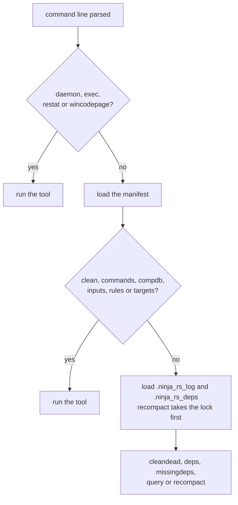

# Tools, debug modes and warning flags

`-t TOOL` runs a tool instead of a build; `-d MODE` turns on a debug mode; `-w FLAG` adjusts a
warning. All three come from ninja; this page says what ninja-rs does with each, and where it
differs from ninja 1.13. Options are in [options.md](options.md).

## Tools (`-t`)

`-t TOOL` ends the options: everything after it is the tool's. ninja's options for the
invocation (`-C`, `-f`, `-n`, `-v`...) go before it: `ninja-rs -C build -n -t clean`.

`ninja-rs -t list` lists the tools on stdout and exits 0; an unknown tool is
`ninja: fatal: unknown tool 'cleen', did you mean 'clean'?`, exit 1. Both are answered from the
command line alone, before settings files are read.

| Tool | Runs | Does |
|---|---|---|
| `clean` | after loading the manifest | removes built files |
| `cleandead` | after loading the logs | removes files the manifest no longer produces |
| `commands` | after loading the manifest | lists the commands that rebuild targets |
| `compdb` | after loading the manifest | prints a JSON compilation database |
| `compdb-targets` | after loading the manifest | the same, for the edges given targets need |
| `daemon` | at once | shows, starts or stops the daemon |
| `deps` | after loading the logs | shows the deps log's records |
| `exec` | at once | runs a command whose ninja-rs builds take this invocation's options |
| `inputs` | after loading the manifest | lists the inputs of targets |
| `missingdeps` | after loading the logs | finds dependencies on generated files without a build path |
| `query` | after loading the logs | shows an edge's inputs and outputs |
| `recompact` | after loading the logs | rewrites the logs without dead records |
| `restat` | at once | updates the build log's recorded times |
| `rules` | after loading the manifest | lists the rules |
| `targets` | after loading the manifest | lists targets |
| `wincodepage` | at once | prints the encoding build files are read in |

The diagram shows when each kind of tool runs in an invocation.



Tools other than `exec` don't report build events, and nested invocations don't inherit
anything from them. Their output to a pipe the reader closed (`-t targets all | head`) is lost
quietly; on Unix they die of `SIGPIPE`, as ninja's do (except `exec` and `daemon`). Tools write
`\n` line endings on Windows too, where ninja writes `\r\n`.

### `clean`

```text
ninja-rs -t clean [-g] [-r] [targets or rules]
```

Removes built files, their depfiles and response files, and says `Cleaning... N files.`:

- with no argument, every output but those of generator edges (`generator = 1`, CMake's
  `build.ninja`), which `-g` includes;
- with targets, those and everything they are built from;
- with `-r`, the outputs of the rules named.

Phony targets are never removed. Dyndep files are loaded first, so that the outputs they add
are removed too. `-n` (before `-t`) lists what would go without removing it; `-v` names each
file. An unknown target or rule is an error (exit 1), the others are still cleaned. The
records of removed outputs in `.ninja_remote` go with them (see [files.md](files.md)).

```sh
ninja-rs -C build -t clean            # all but the generator's outputs
ninja-rs -C build -t clean -r CXX_COMPILER__app_Debug
```

### `cleandead`

```text
ninja-rs -t cleandead
```

Removes the files the build log records that the manifest no longer has as outputs nor
inputs: outputs of edges removed since. Their `.ninja_remote` records go too. `-n` lists them.

### `commands`

```text
ninja-rs -t commands [-s] [targets]
```

Prints the commands that build the targets (the defaults without any), in dependency order,
each once; with `-s`, only the final command of each target.

### `compdb`

```text
ninja-rs -t compdb [-x] [rules]
```

Prints a JSON compilation database of the edges with inputs, all of them or those of the rules
named, in manifest order. Each entry has `directory` (the current directory, after `-C`),
`command`, `file` and `output`. With `-x`, a response file named in the command (`@file`,
`-f file`, `--option-file=file`) is replaced by its content. A rule named twice prints its
edges twice, as in ninja.

Difference: ninja-rs writes one entry per input of an edge, as ninja's development branch
does; ninja 1.13 writes one per edge.

### `compdb-targets`

```text
ninja-rs -t compdb-targets [-x] targets...
```

The same database, for the edges the targets need, requisites before their dependents, phony
edges left out. At least one target is required, and each must be built by an edge.

### `daemon`

```text
ninja-rs -t daemon [status|start|stop|run|help]
```

The daemon of this ninja-rs binary (one per user and binary), which builds given `--daemon`
use. See [daemon.md](../user/daemon.md).

| Command | Does | Exit |
|---|---|---|
| `status` (default) | Says whether it runs: its pid, version and uptime, builds and requests served, file events, what it keeps (lexed headers, directory listings, digests, toolchain trees, watched directories), its roots and their states, the directories builds write to (checked every time), and its log file. When it isn't running, why it last failed to start, if within 5 minutes. | 0; 1 when it runs but doesn't answer |
| `start` | Starts it (even within the 5 minutes after a failed start, during which builds don't try) and prints `ninja-rs daemon running (pid N)`. | 0, or 1 when it can't start |
| `stop` | Stops it: `ninja-rs daemon stopped`, or `ninja-rs daemon not running`. | 0; 1 when it doesn't answer |
| `run` | Runs it in the foreground (builds start it with `run --id ID`). | 0 when it exits idle, or when another one runs already |
| `help` | Prints the usage. | 0 |

The daemon exits after `NINJA_RS_DAEMON_IDLE` seconds without builds (3 hours by default),
and soon after its binary is rebuilt or removed. It watches files on Linux (inotify) and
Windows (`ReadDirectoryChangesW`); elsewhere it runs without watching, so what it keeps is
checked again at each build. Its files are in [files.md](files.md#daemon-directory).

```sh
ninja-rs -t daemon            # status
ninja-rs -t daemon stop
```

Not in ninja.

### `deps`

```text
ninja-rs -t deps [targets]
```

Prints the deps log's record of each target (without arguments, of every output the manifest
builds that has one, sorted):

```text
obj/a.o: #deps 2, deps mtime 1760000000123456789 (VALID)
    ../src/a.c
    ../src/a.h

```

`STALE` instead of `VALID` when the output is missing or newer than the record. Times are in
nanoseconds since the Unix epoch.

### `exec`

```text
ninja-rs [options] -t exec [--] COMMAND [ARGS...]
```

Runs `COMMAND` (found through `PATH`), whose ninja-rs invocations take this invocation's
options, as builds' commands do: a CMake configure building external projects, a script
running several builds. They report their build events under this invocation, and append to
its execution log, which `-t exec` starts afresh. `exec` lines of settings files apply, besides
`common` and `build` ones.

The exit status is the command's; 127 when it can't start; on Unix, 128 + the signal when a
signal killed it. A first interrupt is the command's to act on: ninja-rs passes on SIGTERM,
and SIGINT or SIGHUP when the terminal didn't send them to the command too (on Windows, Ctrl-C
reaches every process of the console already); a second one kills it.

```sh
ninja-rs --config=ci -t exec -- cmake -G Ninja -S . -B build -DCMAKE_NINJA_RBE=ON
```

Not in ninja. See [nested-builds.md](../user/nested-builds.md).

### `inputs`

```text
ninja-rs -t inputs [-0|--print0] [-E|--no-shell-escape] [-d|--dependency-order] [targets]
```

Lists the inputs needed to build the targets (the defaults without any), outputs of phony
edges left out: sorted and shell-escaped (cmd.exe's rules on Windows) by default; `-0` ends
each with a NUL instead of a newline, `-E` doesn't escape, `-d` keeps dependency order. Short
flags combine (`-0E`).

### `missingdeps`

```text
ninja-rs -t missingdeps [targets]
```

Finds outputs whose recorded dependencies (deps log, or depfile) include a file another edge
generates with no build path from that edge to theirs: a race in a clean build. Prints each
`Missing dep: OUT uses FILE (generated by RULE)` and a summary; exits 3 when there are some,
as ninja does.

### `query`

```text
ninja-rs -t query targets...
```

For each target: the edge building it (its rule, its inputs, implicit ones after `| `,
order-only ones after `|| `, its validations), the outputs of the edges it is an input of, and
those it is a validation for. The edge's dyndep file is loaded first.

### `recompact`

```text
ninja-rs -t recompact
```

Rewrites `.ninja_rs_log` and `.ninja_rs_deps`, keeping the records of the manifest's outputs
and of files that exist (another manifest sharing the build directory, as CMake's Ninja
Multi-Config writes, builds the others). It takes the build directory's lock, waiting for a
build running there. CMake runs it at each configure; when that configure is a build's
regeneration step, the build holds the lock and appends to the logs meanwhile, so the tool
does nothing.

### `restat`

```text
ninja-rs -t restat [--builddir=DIR] [outputs]
```

Sets the times the build log records for the outputs given (all without arguments) to their
current ones. It runs before the manifest is loaded, so the log is `.ninja_rs_log` in the
current directory, or in `DIR` with ninja-rs's `--builddir`. Without a log it does nothing. It
waits for a build running in the directory (saying so on stderr: CMake, which runs this tool,
discards its stdout), unless that build runs it, in which case it appends the changed records
rather than rewriting the log.

### `rules`

```text
ninja-rs -t rules [-d]
```

Lists the rules of the top-level scope, sorted, `phony` included (not those of subninjas);
`-d` adds each one's description.

### `targets`

```text
ninja-rs -t targets [depth N | rule [NAME] | all]
```

- `depth N` (the default, with `N` = 1): the root targets, with their inputs to depth `N`
  (`0` for all), indented, `path: rule` for built ones;
- `rule NAME`: the outputs of the rule, sorted; `rule` alone: the inputs that aren't built
  (sources), as each edge names them;
- `all`: every output with its rule, in manifest order.

```sh
ninja-rs -C build -t targets all | grep CXX_COMPILER
```

### `wincodepage`

```text
ninja-rs -t wincodepage
```

Prints `Build file encoding: UTF-8`, on every system: ninja-rs reads build files as UTF-8 and
gives Windows commands and paths as UTF-16, whatever the code page. CMake asks this on Windows
before writing build files; without the answer it writes them in the ANSI code page, and
non-ASCII paths come out mangled. ninja has the tool on Windows only, and answers `ANSI` unless
the process's code page is UTF-8.

### Tools of ninja 1.13 that ninja-rs doesn't have

`browse`, `graph`, `multi-inputs`, `msvc` (Windows) and `urtle`.

## Debug modes (`-d`)

`-d MODE`, repeatable: `-d explain -d stats`.

| Mode | Does |
|---|---|
| `explain` | Says on stderr, as `ninja explain: ...`, why each edge is out of date. |
| `keepdepfile` | Keeps depfiles after reading them into the deps log. |
| `keeprsp` | Keeps response files after their command succeeds. |
| `stats` | At the end, prints a table of operation counts and times (`metric`, `count`, `avg (us)`, `total (ms)`) on stdout. |
| `nostatcache` | Doesn't batch file stats per directory while scanning. |
| `list` | Lists the modes on stdout and exits 1, as ninja does. |

An unknown mode is `ninja: error: unknown debug setting 'explian', did you mean 'explain'?`,
exit 1.

Differences from ninja 1.13:

- `explain` prints every explanation during the scan, for edges that end up not running too
  (pruned by a `restat`, or phony); ninja prints each edge's just before it starts.
- `stats` reports fewer metrics: `.ninja parse`, `.ninja_log load`, `.ninja_deps load` and
  `node stat`.

## Warning flags (`-w`)

| Flag | Does |
|---|---|
| `phonycycle=err` | A phony edge naming itself as an input is an error. |
| `phonycycle=warn` | It is a warning (the default). |
| `dupbuild=err`, `dupbuild=warn` | Accepted, with the warning `deprecated warning 'dupbuild'`, as in ninja. |
| `depfilemulti=err`, `depfilemulti=warn` | Accepted, with the warning `deprecated warning 'depfilemulti'`. |
| `list` | Lists the flags on stdout and exits 1. |

An unknown flag is `ninja: error: unknown warning flag 'phonycycle=er', did you mean
'phonycycle=err'?`, exit 1.

## Known limitations

- A daemon started by hand with `-t daemon run` within 5 minutes of a failed start isn't used
  by builds until those 5 minutes pass. Workaround: `ninja-rs -t daemon start`, which clears
  the back-off.
- `-d explain` explains edges that don't run (see above). Workaround: read the explanations of
  the edges the status line shows.
