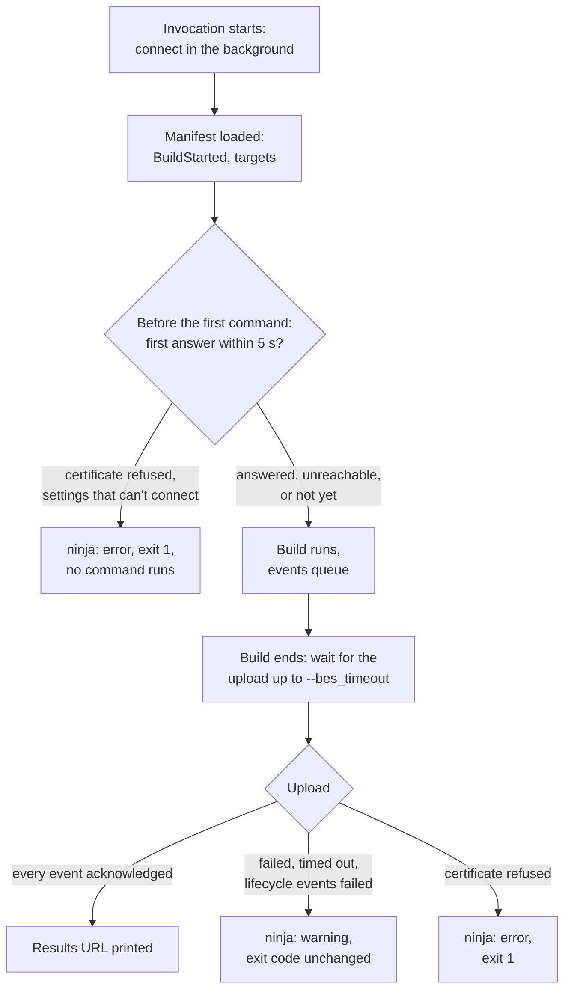

# Build events

ninja-rs can report each build in Bazel's Build Event Protocol (BEP): to a Build Event Service
(BES) such as EngFlow, BuildBuddy, or any other service that takes Bazel's build events, and to a
file. The service then shows the build as an invocation, as it shows Bazel's: the command line,
the targets and their outputs, failed actions with their output, the console, and timings.

## A minimal example

```sh
ninja-rs -C build \
  --bes_backend=grpcs://bes.example.com \
  --bes_results_url=https://bes.example.com/invocations/ \
  --bes_header=x-api-key=YOUR_KEY
```

ninja-rs prints the invocation's page when it starts and again when it ends:

```text
ninja: streaming build results to: https://bes.example.com/invocations/9b1f0c3e-5d2a-4c41-8e6f-0f6d2b7a1c55
[412/412] Linking CXX executable bin/app
ninja: streaming build results to: https://bes.example.com/invocations/9b1f0c3e-5d2a-4c41-8e6f-0f6d2b7a1c55
```

The same settings belong in a [settings file](settings.md), with the key in your own file:

```text
# .ninjars, in the repository
build --bes_backend=grpcs://bes.example.com
build --bes_results_url=https://bes.example.com/invocations/

# ~/.ninjars
build --bes_header=x-api-key=YOUR_KEY
```

Build events work with any manifest. Targets, their labels and their configurations come from
the RBE interface (`rbe_target`, the `rbe_targets` file: see [CMake](cmake.md)); without it,
the events hold the console, the failed actions and the metrics.

## Options

| Option | Default | Meaning |
|---|---|---|
| `--bes_backend=URL` | none | The service: `grpcs://host:port` (TLS) or `grpc://host:port`. |
| `--bes_instance_name=NAME` | empty | The BES project, or instance name. |
| `--bes_header=KEY=VALUE` | none | An extra gRPC header (repeatable): API keys, tokens. |
| `--bes_results_url=URL` | none | With `--bes_backend`: printed with the invocation id appended, at the start and at the end. |
| `--bes_keywords=A,B` | none | Notification keywords (repeatable). |
| `--[no]bes_lifecycle_events` | on | Send the lifecycle events (see below). |
| `--bes_timeout=DURATION` | `60s` | How long the end of the build waits for the upload; `0` waits as long as it takes. |
| `--bes_rpc_timeout=DURATION` | `15s` | How long the service may take to answer a call, or to acknowledge events. |
| `--build_event_binary_file=PATH` | none | Also write the events to `PATH`, length-delimited, as Bazel does. |
| `--build_event_publish_all_actions` | off | Report every action, not only failed ones. |
| `--build_metadata=KEY=VALUE` | none | Extra build metadata (repeatable). |
| `--invocation_id=UUID` | random | The invocation's id. |
| `--build_request_id=UUID` | random | Groups invocations. |

Durations take a unit (`30s`, `5m`, `500ms`); a number alone is in seconds. A TLS service uses
the TLS flags shared with remote execution (see [certificates](certificates.md)). Every option
is in the [option reference](../reference/options.md).

Build events cover builds and `-t exec`. Other tools (`-t clean`, `-t targets`...) send none.

## Invocation and build ids

- The **invocation id** is `--invocation_id`, or a random UUID. The results URL is
  `--bes_results_url` followed by it. Every remote execution request carries it too, as its
  `tool_invocation_id`, so a service can link remote actions to the invocation.
- The **build request id** is `--build_request_id`, or a random UUID. It groups invocations:
  give the builds of one CI job the same one. Remote requests carry it as their
  `correlated_invocations_id`.
- Builds that ninja-rs runs inside a build share both ids with it (see
  [nested invocations](#nested-invocations)).

## What is sent

The events follow Bazel's, so services show them as they show Bazel's:

| Event | What it holds |
|---|---|
| `BuildStarted` | The invocation id, the ninja-rs version, the command (`build`, or `exec` for `-t exec`), the working directory, the host and user. Sent once the manifest is loaded. |
| Command lines | The command line as typed (`original`) and with the options of settings files and of the invocation running this one (`canonical`); header values show as `<redacted>`. |
| `OptionsParsed`, `WorkspaceStatus`, `BuildMetadata` | The options; `BUILD_HOST`, `BUILD_USER`, `BUILD_TIMESTAMP`; `--build_metadata`. |
| `Pattern` | What the build builds: the targets named on the command line, or the manifest's defaults (`all` for CMake), by label when the targets file knows them. Services title the invocation with it. |
| `Configuration` | The configurations of the `rbe_targets` file, or one default configuration. |
| `TargetConfigured`, `TargetCompleted` | Every target the requested ones need, with its kind. A target completes when its last action this build runs finishes, at once when it is up to date, or fails with its first failed action. |
| `NamedSetOfFiles` | A completed target's outputs: those of its `rbe_artifact` and `rbe_deliverable` edges. |
| `ActionExecuted` | A failed action (every action with `--build_event_publish_all_actions`): its mnemonic, exit code, output, command line and times. |
| `Progress` | The console: a status line per finished edge, the commands' output, ninja-rs's messages. |
| `Aborted` | Targets that never completed: after a failure (`SKIPPED`) or an interruption (`USER_INTERRUPTED`). |
| `BuildFinished` | `SUCCESS`, `BUILD_FAILURE` or `INTERRUPTED`. |
| `BuildMetrics`, `BuildToolLogs` | Actions created and executed per mnemonic; counts per runner (`remote`, `remote cache hit`, `disk cache hit`, `local`); wall time. |

More about outputs and actions:

- **Outputs built remotely** are CAS references (`bytestream://host:port/instance/blobs/...`),
  which the service can serve: the remote service's (`--remote_executor` or `--remote_cache`).
  Other outputs are `file://` URIs with their digest. Outputs are hashed off the build loop, a
  few targets at once, and their digests are kept in `.ninja_rs_digests`: a build with nothing
  to do doesn't hash them again.
- **Up-to-date targets are reported too**, as Bazel does: a no-op build lists every target it
  checked, completed with its outputs.
- **There are no test results:** ninja has no tests.
- **Keywords** sent with the stream: `command_name=build` (or `exec`), `protocol_name=BEP`, and
  `--bes_keywords`.

## Nested invocations

When a build runs ninja-rs again (CMake's ExternalProject, LLVM's native tools build, a custom
command running `cmake --build`), the inner build doesn't open a stream of its own. The
outermost invocation listens on a local socket (a named pipe on Windows), and the inner ones send
their events there. The outer invocation merges them into its stream:

- Their targets, actions and outputs appear under a configuration of their own, named after
  their build directory, with paths prefixed by it.
- Their console output is the invocation's console, and their metrics add to its own.
- An inner build whose manifest doesn't use remote execution (CMake's compiler checks) reports
  nothing.
- An inner invocation given its own `--bes_backend` or `--build_event_binary_file` streams its
  own events instead.

`-t exec -- COMMAND` makes any command the outermost invocation: a configure step building
external projects, a script running several builds. See [nested builds](nested-builds.md).

## Start, end and failures

Build events never slow the build down for long, and they only fail it for a certificate. This
chart shows what happens at the start and at the end:



- **At the start** ninja-rs connects in the background while it loads the manifest. Before the
  first command runs, it waits for the service's first answer: at most 5 seconds, or
  `--bes_rpc_timeout` if shorter. Over TLS the first answer comes once the server took the
  client's certificate; without TLS, the connection made is enough.
- **What aborts:** a certificate refused (the server's or the client's), certificate files that
  can't be used (see [certificates](certificates.md)), and settings that can't connect at all
  (an unsupported scheme, a key that doesn't match its certificate). The invocation ends with
  `ninja: error: build events: ...` and exit code 1, before any command runs.
- **What doesn't:** a service that can't be reached, is slow, or answers with errors. The build
  runs; events queue in memory and the outcome is reported at the end.
- **During the build** events go out as they come, on one stream. The service acknowledges
  them; when the stream breaks, a new one resends what wasn't acknowledged. A service that
  answered before gets up to 4 more attempts in a row, waiting 1, 2, 4 then 8 seconds. One that
  never answered anything gets at most one more: a service that isn't there doesn't hold every
  build back. Each call, and each wait for acknowledgements, is bounded by `--bes_rpc_timeout`.
- **At the end** ninja-rs waits for the upload, up to `--bes_timeout`. Failures are warnings
  and leave the exit code alone, but for a certificate refused during the build: that is an
  error, and the invocation exits with 1 even if the build succeeded.
- **Lifecycle events** (`BuildEnqueued`, `InvocationAttemptStarted` before the stream,
  `InvocationAttemptFinished`, `BuildFinished` after it) are sent as Bazel sends them. Those
  before the stream get 5 seconds together (or `--bes_rpc_timeout` if shorter), those after it
  5 seconds without retries, and only if the first ones went through. Their failures are
  warnings; `--nobes_lifecycle_events` stops sending them, for a service that doesn't take them.
- **An interruption** (Ctrl-C) ends the stream with `INTERRUPTED`, the targets not completed
  `USER_INTERRUPTED`. Outside the build's loop (loading the manifest, waiting for another
  build), ninja-rs waits at most 2 seconds for the events before it exits.

The messages:

| Message | Meaning |
|---|---|
| `ninja: error: build events: ...` | Refused at the start (a certificate, or settings): nothing ran. |
| `ninja: warning: build event upload failed after N attempts (the backend never answered): ...` | The service wasn't reached. |
| `ninja: warning: build event upload failed after N attempts: ...` | The stream failed after the service answered. |
| `ninja: error: build event upload failed ...` | A certificate refused during the build: exit code 1. |
| `ninja: warning: build event upload didn't finish within 60s` | `--bes_timeout` passed before every event was acknowledged. |
| `ninja: warning: build events were uploaded, not all their lifecycle events: ...` | The events went through; the lifecycle events didn't. |
| `ninja: warning: can't write build events to PATH: ...` | `--build_event_binary_file` can't be written. |
| `ninja: warning: this build's events won't reach the invocation running it: ...` | A nested build couldn't reach the outer invocation's socket. |

## Debugging

- `NINJA_RS_BES_DEBUG=1` traces the upload on standard error: the stream, the acknowledgements,
  the lifecycle events.
- `--build_event_binary_file=events.bin` writes the events as Bazel writes its own
  (length-delimited `BuildEvent` messages), so Bazel's tools read them.
- A service that refuses the client certificate, or isn't trusted, is explained on the line
  after the error (see [certificates](certificates.md)).

## Known limitations

- **One retry at the start.** A service that breaks the first connection (a load balancer
  restarting, a tunnel coming up) gets one more attempt only, a moment later. If that fails too,
  the invocation's events are lost, with a warning at the end. Run the build again.
- **A silent TLS service holds the start up to 5 seconds.** ninja-rs waits that long for its
  first answer before running commands. `--bes_rpc_timeout` shorter than 5 seconds shortens the
  wait.
- **A nested invocation streaming on its own keeps the outer invocation's id**, unless it is
  given `--invocation_id`: two streams then share one id.
