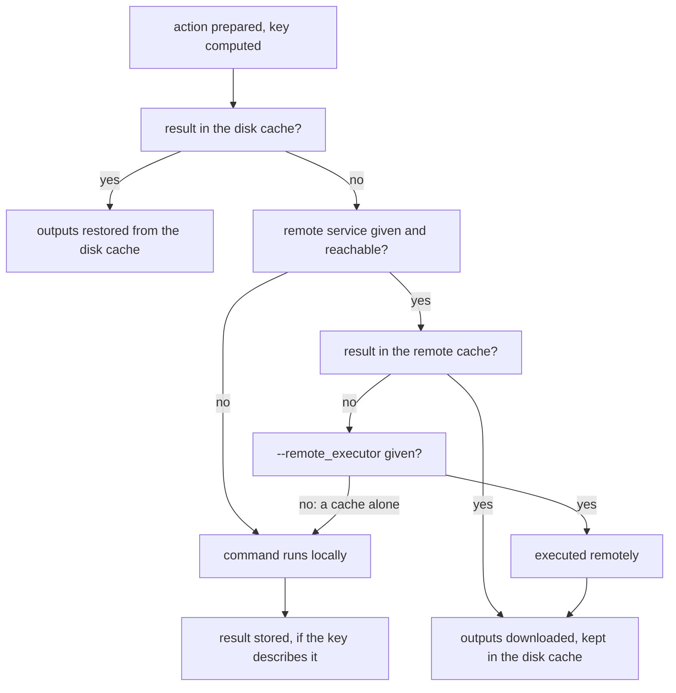

# Caching

ninja-rs can reuse the results of actions instead of running them again: from a disk cache on
this machine, from a remote cache shared with other machines, or both, with or without remote
execution. A cached result is the outputs, depfile and console output of an action, stored
under a key computed from everything the action reads.

This page covers the disk cache, a remote cache alone, what the key covers, how results of local
runs are stored (and why some aren't), and chunked blobs. Remote execution is in
[remote execution](remote-execution.md).

Caching applies to the actions remote execution would run: the build file must carry the RBE
annotations (`rbe_version = 1`, see [CMake](cmake.md)), and only edges the policy sends
remotely are cached (see [which edges run remotely](remote-execution.md#which-edges-run-remotely)).
To cache links and archives too, give `--remote_mnemonics=Compile,Archive,Link`.

## Minimal examples

A disk cache alone, for this machine:

```sh
ninja-rs -C build --disk_cache=~/.cache/ninja-rs/disk --remote_mnemonics=Compile,Archive,Link
```

A remote cache, shared with CI and other developers, with the disk cache in front of it:

```sh
ninja-rs -C build --remote_cache=grpcs://cache.example.com --remote_instance_name=default \
  --disk_cache=~/.cache/ninja-rs/disk --remote_mnemonics=Compile,Archive,Link
```

At the end of the build, ninja-rs says what came from where:

```text
ninja: 80 remote actions (80 remote cache hits).
ninja: 35 disk cache hits.
```

## Where a result comes from

ninja-rs prepares the action first: it finds its inputs and computes its key. Then it asks the
caches, nearest first. The figure shows the order.



- **A hit** restores the outputs as a download does: depfiles and `/showIncludes` lines are
  mapped back to this checkout's paths, and steps on the host around the action run. An output
  already holding the right contents isn't written again, but is made newer than its inputs
  (unless the edge has `restat`).
- **A miss without remote execution** runs the command locally, within `-j`, then stores the
  result in the disk cache and, with a remote cache, uploads it (see
  [storing local results](#storing-local-results)).
- **A result that can't be used** (an output it names that the action didn't ask for, a declared
  output missing, a blob gone from the CAS) is a miss; a disk cache entry of that kind is
  removed.
- **With `--remote_download_minimal` and a disk cache**, a result whose outputs stayed in the
  remote CAS is used without asking the remote cache, as Bazel does with action rewinding: a
  build after `-t clean` then makes no remote lookups. Should an output prove gone, the build
  rewinds the action (see [downloads](remote-execution.md#downloads)).

## The disk cache

`--disk_cache=DIR` is an action cache and a content-addressed store (CAS) in a directory, with
the keys of a REAPI service. Its entries have the remote form (paths relative to the action's
working directory), so they are interchangeable with a remote cache's, and two checkouts of a
project share them.

- **Alone**, it caches the actions of this machine: misses run locally, and their results are
  stored.
- **With a remote service**, it comes first: hits make no remote call, and blobs the disk cache
  has aren't downloaded. Results downloaded or executed remotely are kept there.
- `~` expands in its path; an empty value turns off one a settings file gave
  (`--disk_cache=`).

### Layout

```text
DIR/
  VERSION              format version: 1
  ac/<hh>/<hash>       action results, by action digest (<hh>: the hash's first two digits)
  cas/<hh>/<hash>      blobs, and the chunks of large blobs
  chunked/<hh>/<hash>  layouts of large blobs: the list of their chunks
  tmp/                 files being written, renamed into place when complete
  size                 the estimated size of ac/, cas/ and chunked/
  gc/lock              held by the process collecting garbage
  cpp-deps/            compiler profiles of the include scanner
```

Every write goes through a file of `tmp/` named by the process, a counter and a random part,
then is renamed into place: processes, and containers sharing the directory with the same
process ids, never write one file. A blob read back is checked against its digest; a damaged
one is removed and is a miss.

### Size and eviction

`--disk_cache_max_size=SIZE` (10G by default; a number with `K`, `M`, `G` or `T`, in powers of
1024) bounds the cache. Eviction works as in Bazel's disk cache: using an entry updates its
modification time, and the least recently used files go once the cache is over the limit, down
to 90% of it.

- Finding the oldest files walks the whole cache, so it only runs when needed: after a build
  that wrote to the cache, its `size` estimate grows by what was written, and the walk runs when
  the estimate passes the limit (it then rewrites the estimate with the real size).
- One process collects at a time; the others skip and count their writes the next time. A file
  used while the walk goes on is kept. Files writers left in `tmp/` (a killed process) go after
  an hour.
- `--remote_verbose` reports evictions: `ninja: disk cache: evicted 1200 entries (950 MiB).`
- Compiler profiles in `cpp-deps/` aren't counted; the include scanner removes those unused for a
  month.

### Sharing a disk cache

- **Between checkouts and build directories**: entries are keyed by the action, not by where it
  ran (see [what the key covers](#what-the-key-covers)).
- **Between processes and containers**, at once: writes never collide, and readers check what
  they read.
- **Read-only** (a cache CI fills, mounted read-only): hits work; the first write that fails
  says `ninja: warning: the disk cache can't store results: ...`, and the build goes on.
- **With Bazel.** Bazel's `--disk_cache` has the same layout (`ac/`, `cas/`), and a `.ninjars`
  importing the project's `.bazelrc` gets the same directory (see [settings](settings.md)).
  ninja-rs recognizes a directory Bazel made (entries in `ac/` or `cas/`, no `VERSION` and no
  `size`) and uses it as it is, once per invocation tree saying:

  ```text
  ninja: note: the disk cache /home/me/.cache/bazel-disk is Bazel's (no VERSION): used as it is,
  its old entries left to Bazel to remove. (If it's ninja-rs's, writing 1 to its VERSION file
  makes it so.)
  ```

  ninja-rs then neither writes `VERSION` there nor evicts anything: removing old entries is
  left to Bazel. The two tools' actions usually differ, so they rarely hit each other's
  results; the files they have in common are stored once.

### The "not ours" rule

ninja-rs only writes into a directory it can tell is a disk cache, so that a mistyped path
doesn't fill, or evict from, a directory that holds something else:

| The directory | What ninja-rs does |
|---|---|
| Missing or empty | Creates a cache there. |
| Holds `VERSION` with `1` | Uses it. |
| Holds `VERSION` with another number | Disabled: `disk cache DIR disabled: DIR has format version N, this ninja-rs uses 1`. |
| No `VERSION`, but the `size` file only ninja-rs writes, or nothing stored in `ac/` and `cas/` | Its own (a cleaner of old files removed `VERSION`): writes `VERSION` back and uses it. |
| No `VERSION`, Bazel's layout with entries | Bazel's: used as it is (see above). |
| Anything else | Disabled: `disk cache DIR disabled: DIR isn't empty, and isn't a disk cache`. |

A disabled cache is a warning: the build goes on without it.

## A remote cache alone

`--remote_cache=URL` without `--remote_executor` uses a REAPI service's cache without its
workers: builds still share results across machines and checkouts.

- Lookups go to the disk cache, then the remote cache. A remote hit is downloaded (or recorded,
  with `--remote_download_minimal`); a hit whose outputs left the CAS is a miss.
- A miss runs locally, and its result is uploaded: the outputs first, then the action cache entry
  naming them, in the background while the build goes on.
- `--remote_download_minimal` (or `--remote_download_toplevel`, treated exactly like it today)
  leaves the outputs of hits in the remote CAS, as with remote execution (see
  [downloads](remote-execution.md#downloads)).
- **`--noremote_upload_local_results`** only reads: developer machines can use a cache only CI
  fills. A service that doesn't accept results from clients (`update_enabled = false`) gives
  the same, with a warning: `the remote cache doesn't accept results from clients: local results
  aren't stored`.
- An unreachable service follows `--remote_local_fallback`, as for remote execution (see
  [when the service fails](remote-execution.md#when-the-service-fails)): with it, the build runs
  locally, with the disk cache if any.

### Jobs

Without remote execution, every action may run locally, so there is one kind of slot: `-j`. An
action looks up the caches in its local slot, and a miss runs there. This bounds a fully cached
build behind a remote cache by `-j` lookups at once (see
[known limitations](#known-limitations)).

## What the key covers

The key is the digest of the REAPI action, which names:

- **The command**: its arguments, with paths rewritten relative to the build directory's place in
  the input tree (see [paths](../paths.md)); the environment variables its tools read; the
  outputs it returns; its working directory; the platform.
- **The input tree**: the digest of every file the action reads: the sources and headers the
  include scanner finds (see [include scanning](include-scanning.md)), the edge's declared
  inputs (with deps earlier builds recorded), the toolchain's inputs (whole), the files and
  library directories a link reads, the members of thin archives.
- **The platform**, from the toolchains file (see [CMake](cmake.md#platform)).

Some consequences:

- **Two checkouts share results** when their files sit at the same places relative to each
  other: the exec root is the deepest common ancestor of the build directory and the inputs,
  so a toolchain inside the checkout keeps every path relative. A toolchain elsewhere puts its
  path, relative to the checkout, in the key.
- **The toolchain** is the executable path the command runs, looked up in the toolchains file.
  Its declared inputs are hashed whole: updating the compiler changes every key. A tool that
  isn't declared sends its executable only.
- **Environment variables** are in the key when a tool of the action reads them: for GCC and
  Clang compiles, the `CPATH` family, `SOURCE_DATE_EPOCH`, `SDKROOT`, the Apple deployment
  targets; for cl and clang-cl, `INCLUDE`, `CL` and `_CL_`; for MSVC linkers, `LIB`, `LINK` and
  `_LINK_`; for GNU links, `LIBRARY_PATH`. A variable the command line makes the tool ignore
  (`/X`, `-nostdinc`, `/vctoolsdir`, `/winsysroot`, lld-link's `/lldignoreenv`) is left out, so a
  developer prompt's values don't change the keys of a hermetic toolchain's actions. Path values
  are rewritten like arguments. `--action_env=NAME=VALUE` (or `NAME`, for its value here) sets a
  variable in every action.
- **Not in the key**: the mnemonic, the target and its label, request headers, and anything the
  action reads that ninja-rs didn't find. The instance name isn't either; the service keeps its
  instances apart.

`--execution_log_file=FILE` writes each action's key, command, environment, platform and inputs
as a JSON line (see [remote execution](remote-execution.md#seeing-what-happened)): compare two
builds' logs to find why they don't share a result.

## Storing local results

A command run locally on a cache miss gives a result that is stored in the form a remote
execution would give: outputs, side outputs (a link's PDB), the depfile and `/showIncludes` lines
with paths relative to the working directory, and the console output with paths into the input
tree rewritten. It goes to the disk cache, then to the remote cache (console output larger than
64 KiB as a blob of its own).

Only a result the key describes is stored, one a remote execution would give:

- the command succeeded and wrote its outputs;
- it has no steps on the host (their outputs are post-processed, and the steps would run again on
  a hit);
- no variable its tools read is set that the action can't carry (a variable making a compiler
  write a file the action doesn't return, such as `DEPENDENCIES_OUTPUT` or
  `CC_PRINT_HEADERS_FILE`, or a value that isn't UTF-8): said once,
  `ninja: warning: local results aren't cached: DEPENDENCIES_OUTPUT is set, which their actions
  can't have (--action_env=DEPENDENCIES_OUTPUT gives it them)`;
- every file it read (as its depfile or `/showIncludes` lines list them) is among the action's
  inputs: else the scan missed it, and a remote run wouldn't have it;
- no input it read changed between the key's computation and the command's end (an editor saving
  a file meanwhile, even edited back).

The remote cache, which other machines read, takes less: only results of tools the toolchains
file declares, whose reads a depfile or `/showIncludes` lists. The others stay in the disk cache
(`--remote_verbose` says `in the disk cache only: ...`).

**Uploads** go on in the background. At the end of the build, ninja-rs waits for them, saying so
after a second:

```text
ninja: waiting for 3 uploads to the remote cache.
```

An interrupt gives them up (`ninja: interrupted: 3 local results not stored in the remote
cache.`) and the build exits with 130. Outputs up to 1 MiB are read once into memory (64 MiB for
all pending uploads); larger ones are sent from the disk cache's copy, or without a disk cache
from the file, checked as it is read: an output rewritten in place before its upload ends (a
signing step) isn't uploaded.

### The summary of results not cached

Results that weren't stored are counted by reason, and summed up at the end of the build:

```text
ninja: 4 local results were not cached: 3: a file it read isn't among the action's inputs;
1: an input changed while the command ran.
```

(on one line). `--remote_verbose` names each (`ninja: not cached: ...`). The reasons:

| Reason | What to do |
|---|---|
| `a file it read isn't among the action's inputs` | The include scanner missed a file (`--remote_verbose` names it); see [include scanning](include-scanning.md). |
| `an input changed while the command ran` | An input was edited during the build; the next build stores it. |
| `the command runs steps on the host` | By design: its outputs are post-processed. |
| `... is set, which their actions can't have ...`, `... isn't UTF-8, ...` | Unset the variable, or give it with `--action_env`. |
| `the command runs a tool the toolchains file doesn't declare` | Remote cache only: declare the tool (CMake declares the compilers, archiver and linkers). |
| `what the command read can't be checked ...` | Remote cache only: the action has no depfile or `/showIncludes` (links, archives); kept in the disk cache. |
| `an output wasn't produced` | The command didn't write a declared output. |

## Chunked blobs

- **In the disk cache**, a blob larger than 2 MiB is stored as its content-defined chunks
  (FastCDC 2020 with REAPI's recommended parameters: 512 KiB on average), with a layout listing
  them. Two builds of a large output that differ by a few edits share most chunks, which the
  cache stores once. A blob is present when it is stored whole, or when its layout and all its
  chunks are.
- **With a service that splits blobs** (`SplitBlob`, or `GetChunkMapping` from REAPI 2.13) and a
  disk cache, a large blob missing from the disk cache is fetched as the chunks the disk cache
  lacks.
- **With a service that splices blobs** (`SpliceBlob` or `RegisterChunkMapping`), a large file
  is uploaded as the chunks the service lacks, then put together there. A service refusing a
  splice gets whole blobs from then on, with a warning at the end:
  `ninja: warning: the remote service refused to splice blobs, which are uploaded whole: ...`.
- **Compression.** Blobs travel compressed with zstd when the service supports it;
  `--noremote_cache_compression` turns that off.

## Common problems

- **No hits between two checkouts or machines.** Compare their execution logs (see above). The
  usual causes: a toolchain outside the checkout, a `-D` value holding an absolute path, an
  environment variable set on one machine, different toolchain files.
- **`disk cache ... disabled`.** See [the "not ours" rule](#the-not-ours-rule).
- **Local results aren't cached.** The summary line says why; see the table above.
- **A cached build is slow behind a remote cache.** Lookups are bounded by `-j` (see below).

## Known limitations

- **Cache lookups are bounded by `-j`** without remote execution. A fully cached build behind a
  remote cache takes about `actions × round trip / -j`: with a 15 ms round trip, 200 cached
  compiles took 8 s at `-j2`, 1 s at `-j16`. Raise `-j` when most actions hit (misses then run
  that many local commands), or use `--remote_executor` if the service executes too: lookups
  then take remote slots (`--remote_jobs`).
- **`-march=native`, `-mcpu=native`, `-mtune=native`** make the output depend on the CPU of the
  machine that ran the compile, which the key doesn't capture: every machine shares the result
  of the first. Use an explicit CPU with a shared cache.
- **A toolchain updated in place during a build** can have new outputs stored under the old key:
  ninja-rs hashes a toolchain once per build. Don't update a toolchain while a build runs.
- **A toolchain file that can't be read for a moment** (a sharing violation on Windows, too many
  open files) keeps the actions needing it from being sent or cached for 5 s: they run locally,
  or fail with `--remote_strict`. Raise the open-file limit (`ulimit -n`).
- **Uploads given up in the background** (an output rewritten in place since it was hashed, a
  blob gone from the disk cache, a server error) are only reported with `--remote_verbose`
  (`ninja: not in the remote cache: ...`), and aren't in the summary's count.
- **Large local results take room twice for a while.** With a disk cache, a large output stored
  as chunks is put back together in `DIR/tmp` for its upload, and kept there until the upload
  ends.
- **ASan on Windows.** The key of a link of objects built with cl's `/fsanitize=address` doesn't
  include the ASan runtime libraries the linker adds: a cached link survives an update of the
  runtime in place.
- **Ctrl-C while a large result is being stored** can delete that finished output; the next
  build runs it again.
