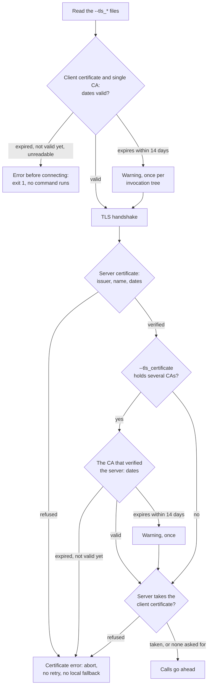

# TLS and authentication

ninja-rs talks to two kinds of services: the remote service (`--remote_executor`, or
`--remote_cache` alone) and the Build Event Service (`--bes_backend`). Both connect over gRPC,
with TLS or without, and take the same TLS flags. The flags have Bazel's names, so the settings
a project already has for Bazel carry over.

This page covers endpoints and schemes, trusting the server, client certificates (mTLS), headers
carrying tokens, the rules ninja-rs applies to certificates, and what a refusal looks like.

## A minimal example

A remote service that wants a client certificate, with build events to the same service:

```sh
ninja-rs -C build \
  --remote_executor=grpcs://remote.example.com:443 \
  --bes_backend=grpcs://remote.example.com:443 \
  --tls_client_certificate=$HOME/.config/rbe/client.pem \
  --tls_client_key=$HOME/.config/rbe/client-key.pem
```

Certificates are personal: keep them in your own settings file rather than in the repository's
(see [settings](settings.md)). In `~/.ninjars`:

```text
build --tls_client_certificate=~/.config/rbe/client.pem
build --tls_client_key=~/.config/rbe/client-key.pem
```

`~` expands in path options, and relative paths are relative to where ninja-rs started (not to
`-C`): write absolute paths, or use `~` or `%workspace%`.

## Endpoints and schemes

The scheme of `--remote_executor`, `--remote_cache` and `--bes_backend` decides whether the
connection uses TLS:

| Endpoint | Connection |
|---|---|
| `grpcs://host:port`, `https://host:port` | TLS |
| `host:port` (no scheme) | TLS |
| `grpc://host:port`, `http://host:port` | Plaintext |
| Any other scheme | Error: `unsupported endpoint scheme` |

The TLS flags are only read for endpoints that use TLS. With plaintext endpoints they are
ignored, and an expired certificate named by them doesn't matter.

## Trusting the server

ninja-rs verifies the server's certificate as browsers do: the issuer, the name and the dates.
TLS 1.2 and TLS 1.3 are supported, and the server must speak HTTP/2 (gRPC does).

- **Public roots.** By default, a server certificate must chain to a public root CA: Mozilla's
  list, built into ninja-rs. The operating system's trust store is not used, so a CA your company
  installed on your machine isn't trusted unless you name it.
- **`--tls_certificate=FILE`** names the CAs to trust instead of the public roots, as in Bazel.
  The file holds PEM certificates: one CA, or several (a bundle). With it, only the CAs in the
  file are trusted. To trust a private CA and the public roots, put them all in one file.
- **`--tls_authority_override=NAME`** checks the server's certificate against `NAME` instead of
  the endpoint's host, and sends `NAME` as the TLS server name. Use it when you connect by IP
  address or through a tunnel (`grpcs://127.0.0.1:8443` to a server whose certificate names
  `remote.example.com`).

## Client certificates

A service using mutual TLS (mTLS) asks for a client certificate:

- `--tls_client_certificate=FILE` and `--tls_client_key=FILE` go together: one without the
  other is an error.
- Both files are PEM. The certificate file may hold the chain (the client certificate first,
  then intermediates). The key may be PKCS#8 (`PRIVATE KEY`), PKCS#1 (`RSA PRIVATE KEY`) or SEC1
  (`EC PRIVATE KEY`), and must not be encrypted.
- A DER file, or an encrypted key, is refused when the files are read, with the command that
  converts it:

```text
ninja: error: --tls_client_key=/home/me/.config/rbe/client-key.pem: the private key is encrypted, which isn't supported (`openssl pkey -in /home/me/.config/rbe/client-key.pem -out key.pem` decrypts it)
ninja: error: --tls_certificate=/home/me/ca.der: no PEM certificate in it (`openssl x509 -inform der` converts a DER one)
```

## Headers and tokens

Services that authenticate with a token or an API key take it as a gRPC header:

- `--remote_header=KEY=VALUE` for the remote service, `--bes_header=KEY=VALUE` for the Build
  Event Service. Both are repeatable. Use the header name your service documents.
- Their values are hidden wherever ninja-rs reports options: build events and `--announce_rc`
  show `KEY=<redacted>`. Builds that ninja-rs runs inside a build (see
  [nested builds](nested-builds.md)) get them through a file only you can read, not through the
  environment every command sees.
- There are no credential helpers and no Google credentials: Bazel's `--credential_helper` and
  `--google_default_credentials` aren't ninja-rs options.

## The certificate rules

ninja-rs holds certificates to four rules, for the remote service and the Build Event Service
alike:

1. **Dates are checked before connecting.** When ninja-rs reads the TLS files, it checks the
   dates of the client certificate (every certificate in its file) and of a `--tls_certificate`
   file holding a single CA. One that expired, isn't valid yet or can't be read is an error:
   ninja-rs exits with 1 before connecting and before running any command. A server refusing an
   expired client certificate may only close the connection, which says nothing; checking first
   gives a clear message.
2. **Any certificate error aborts.** A server certificate ninja-rs refuses, a client certificate
   the server refuses, or a CA that fails rule 4 ends the invocation. There are no retries (the
   next attempt would be refused the same way) and no local fallback, even with
   `--remote_local_fallback`: the build fails and says why, rather than quietly building
   everything locally.
3. **A certificate expiring within 14 days gives a warning**, once per invocation tree: builds
   that ninja-rs runs inside a build, or that `-t exec` runs, don't repeat it.
4. **In a CA bundle, only the CA that verified the server counts.** A `--tls_certificate` file
   holding several CAs isn't date-checked before connecting. Once the server's certificate is
   verified, ninja-rs checks the CA that verified it: expired or not valid yet is an error (rule
   2), expiring within 14 days a warning (rule 3). The other CAs of the file don't matter: an old
   expired CA kept in a bundle fails nothing. When several CAs verify the server (cross-signed
   ones), the best of them is checked.

When the files are read:

- For a Build Event Service using TLS, at the start of the invocation.
- For remote execution or a remote cache, once the manifest is loaded, before connecting. Only
  manifests with `rbe_version = 1` connect, and dry runs (`-n`) don't.

The connections made during the build (after a connection broke, or for executions on
connections of their own) go through the same checks. A certificate refused then fails the
remote action that needed the connection (with no local run), or the build event upload (an
error at the end, and exit code 1 even when the build succeeded).

This chart shows when each check happens and what follows:



## What a refusal looks like

Dates checked before connecting:

```text
ninja: error: the client certificate (--tls_client_certificate=/home/me/.config/rbe/client.pem) expired on 2026-10-14 11:11 UTC
ninja: error: CA certificate 2 of 3 (--tls_certificate=/etc/rbe/ca.pem) is not valid until 2027-01-01 00:00 UTC (is the clock right? it says 2026-10-16 09:30 UTC)
ninja: warning: the client certificate (--tls_client_certificate=/home/me/.config/rbe/client.pem) expires on 2026-10-18 11:11 UTC, in 3 days
ninja: warning: CA certificate 2 of 2 (--tls_certificate=/etc/rbe/bundle.pem), which verified the server's certificate, expires on 2026-10-20 00:00 UTC, in 4 days
```

A refusal while connecting names the service, what the TLS library said (shortened to `...`
here), and on a second line a hint saying whose certificate was refused and why:

```text
ninja: error: remote execution: ...: invalid peer certificate: UnknownIssuer
  the server's certificate isn't trusted: checked against the public roots (--tls_certificate names a CA instead)
ninja: error: build events: grpcs://remote.example.com:443: ...
  the server requires a client certificate: --tls_client_certificate and --tls_client_key give one
```

A refusal during the build fails the action, or the upload at the end:

```text
FAILED: obj/main.o
ninja: remote execution failed: ...
ninja: error: build event upload failed after 1 attempt: ...
```

The hints, and what to do:

| Hint | Meaning | Fix |
|---|---|---|
| `the server's certificate isn't trusted: checked against ...` | Its issuer isn't among the CAs trusted. | Give the right CA with `--tls_certificate`, or drop a wrong one. |
| `the server's certificate isn't valid for NAME` | The certificate names another host. | Connect by the name it has, or use `--tls_authority_override`. |
| `the server's certificate has expired`, `isn't valid yet` | Its dates, or your clock. | Check the clock; tell the service's operators. |
| `the server's certificate isn't one for a server` | Its extended key usage doesn't allow servers. | Tell the service's operators. |
| `the server requires a client certificate` | None was given. | Give `--tls_client_certificate` and `--tls_client_key`. |
| `the server refused the client's certificate, whose issuer it doesn't trust` | A certificate from another CA, or for another service. | Use the certificate the service issued. |
| `the server refused the client's certificate as expired, or not valid yet` | The server judged its dates. | Renew it; check the clock. |
| `the server refused the client's certificate as revoked` | It was revoked. | Get a new one. |
| `the server refused the client's certificate (it didn't say why)` | The server closed the connection after asking for it. | Check that it's the right certificate for this service. |
| `the server refused the TLS handshake: ...` | No common TLS version or cipher suite, or the certificate refused. | Check the certificate; tell the service's operators. |
| `the client certificate FILE and its key (--tls_client_key) don't match` | The key belongs to another certificate. | Give the matching pair. |

## Plaintext to a TLS server

A `grpc://` endpoint pointing at a server that only speaks TLS looks like a connection that
broke before anything answered, as through a tunnel whose far end is down. ninja-rs treats it as
an unreachable service, and says what the cause may be:

```text
ninja: warning: the remote service grpc://remote.example.com:443 is unreachable, building locally: the connection broke before anything answered
  as when the far end of a tunnel is down, or the server speaks TLS (grpcs:// connects with TLS)
```

With `--remote_local_fallback` (the default) the build runs locally, as for any unreachable
service. With `--noremote_local_fallback` or `--remote_strict` it is an error. For a Build Event
Service, the upload fails with a warning at the end, and the exit code stays the build's. The
fix is the scheme: `grpcs://`.

## Common problems

- **A corporate CA.** Services behind a company CA, or a proxy that inspects TLS, need that CA
  in `--tls_certificate`: the system's trust store isn't read.
- **A CA bundle with an old expired CA.** It fails nothing, as long as the CA that verifies the
  server is valid (rule 4).
- **A warning in every nested build.** It appears once per invocation tree; if a wrapper clears
  the environment between ninja-rs and the builds it runs, each repeats it.
- **The build stops with a certificate error although `--remote_local_fallback` is on.** That
  is rule 2: a certificate error fails the build instead of hiding behind local runs. Fix the
  certificate, or remove the remote flags to build locally.
- **A misspelt scheme** (`htps://`) is an error, not an unreachable service.

See [remote execution](remote-execution.md) for what "unreachable" means and how fallback works,
[build events](build-events.md) for the upload, and [options](../reference/options.md) for every
flag.

## Known limitations

- **A false client-certificate refusal.** A server that accepts the client certificate but
  closes the connection at once (a server draining, sending GOAWAY) can be judged as refusing
  the certificate, and the build aborts with a client-certificate error. Running the build again
  usually works; if it doesn't, the certificate really is refused.
- **An unreadable message for a common mistake.** Connecting to an mTLS server over TLS 1.3
  without a client certificate prints the transport's debug form of the error. The hint on the
  next line (`the server requires a client certificate`) is the part to read.
- **`--tls_authority_override` changes the name checked and the TLS server name only.** The
  HTTP/2 `:authority` stays the endpoint's host (Bazel sets both). A proxy that routes on
  `:authority` sees the endpoint's host: connect by the name the certificate holds instead
  (through your hosts file, for a tunnel).
- **No operating-system trust store, no encrypted keys, no credential helpers** (see above).
