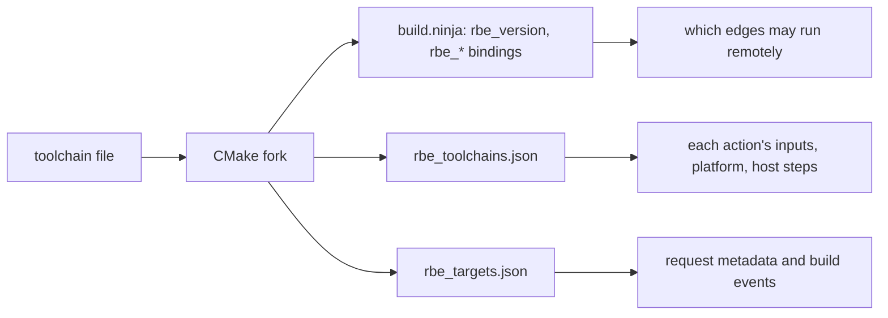

# Using ninja-rs with CMake

CMake's Ninja generators work with ninja-rs as they do with ninja: set it as the make program
and builds run locally (see [getting started](getting-started.md)). Remote execution and caching
need more: the build files must say which edges may run remotely, what each compiler needs on a
worker, and which workers can run it. Upstream CMake doesn't write that; a fork does, with
`-DCMAKE_NINJA_RBE=ON`.

This page covers the fork, the toolchain file, what CMake writes and what ninja-rs does with it,
configure-time builds, and a worked example with a toolchain known to work as it is.

## A minimal example

A toolchain file naming what the compiler needs remotely and where it runs:

```cmake
set(CMAKE_C_COMPILER /opt/llvm/bin/clang)
set(CMAKE_CXX_COMPILER /opt/llvm/bin/clang++)
# Its executables, runtime libraries and resource directory. Not sysroots
# or SDKs: ninja-rs sends the files each action uses from them.
set(CMAKE_C_COMPILER_REMOTE_INPUTS /opt/llvm/bin /opt/llvm/lib)
set(CMAKE_CXX_COMPILER_REMOTE_INPUTS /opt/llvm/bin /opt/llvm/lib)
set(CMAKE_REMOTE_PLATFORM "OSFamily=Linux;container-image=docker://ghcr.io/example/worker@sha256:...")
```

Configure with the fork, then build with ninja-rs:

```sh
cmake -G Ninja -S . -B build -DCMAKE_NINJA_RBE=ON \
  -DCMAKE_MAKE_PROGRAM=/path/to/ninja-rs -DCMAKE_TOOLCHAIN_FILE=toolchain.cmake
ninja-rs -C build --remote_executor=grpcs://remote.example.com \
  --remote_mnemonics=Compile,Archive,Link
```

## The CMake fork

The fork is the `ninja-rbe` branch of <https://gitlab.kitware.com/Orphis/cmake>. It isn't in
upstream CMake and isn't published yet. Build it as you would build CMake (with an existing
CMake, or its `bootstrap` script), and use its `cmake` to configure the projects you build with
ninja-rs. Its additions:

| Setting | Where | What it does |
|---|---|---|
| `CMAKE_NINJA_RBE` | Command line or preset (a cache variable) | Turns the annotations on, for the Ninja and Ninja Multi-Config generators. |
| `CMAKE_<LANG>_COMPILER_REMOTE_INPUTS` | Toolchain file | Files and directories the compiler needs on a worker. |
| `CMAKE_REMOTE_PLATFORM` | Toolchain file, or command line | REAPI platform properties of the workers that run the toolchain's actions (`KEY=VALUE;KEY=VALUE`). |
| `RBE_DELIVERABLE` | Target property | Whether the target's artifact is downloaded when not every output is (see below). |

Set `CMAKE_NINJA_RBE` on the command line or in a preset, not in `CMakeLists.txt`: it must be
true at the end of the top-level `CMakeLists.txt`, and some toolchain files read it as they
load, before `project()` (hermetic-llvm-cmake's does, below). The build files it writes stay
valid for ninja, which ignores the annotations.

## The toolchain file

### Remote inputs

`CMAKE_<LANG>_COMPILER_REMOTE_INPUTS` lists what the `<LANG>` compiler needs to run on a worker:
its executables, its runtime libraries, its resource directory. ninja-rs sends these whole, as
trees it hashes once and caches.

- **Don't list sysroots or SDKs.** ninja-rs sends what each action reads from them: the headers
  a compile includes (it scans them, see [include scanning](include-scanning.md)), the libraries
  a link pulls in. Listing a sysroot would send all of it with every action, and make every
  action's key change when any file in it changes.
- **An empty list** sends the compiler's executable alone. That's enough for a statically linked
  compiler whose headers the scan finds and whose linker the driver names (see the worked
  example).
- **Files the compiler reads that are neither listed nor found** (a configuration file next to
  it, a plugin) aren't sent, and aren't part of the action's key. List their directory.

The archiver, ranlib and a linker run directly (`CMAKE_AR`, `CMAKE_RANLIB`, `CMAKE_LINKER` and
their `CMAKE_<LANG>_COMPILER_*` variants) are declared too, with the same platform and no inputs:
their executable is sent. ninja-rs identifies a step's tool by the absolute path of its program,
resolved from the build directory or through `PATH` (case-insensitively on Windows): a command
running the same compiler through another path isn't the declared tool.

### Platform

`CMAKE_REMOTE_PLATFORM` gives the REAPI platform properties of the workers that can run the
toolchain's actions, such as `OSFamily=Linux` and `container-image=docker://...`. It is the only
place platform properties come from: ninja-rs has no command-line option for them, so the
toolchain fully describes where its actions run. Each declared tool gets them; a step whose tool
isn't declared gets those of another tool of the same command, or none. On most clusters an
action without platform properties finds no worker, or the wrong one.

Each entry is `KEY=VALUE`; CMake refuses a configure with an entry that isn't. The property names
are your service's: ask its documentation which ones select a worker pool or an image.

## What CMake writes

With `CMAKE_NINJA_RBE` on, the build files carry the generator-neutral RBE interface. The
contract, which any generator may write, is [the RBE interface](../rbe-interface.md); this is
what CMake puts in it.

The figure shows what ninja-rs takes from each file.



**At file scope**, in `build.ninja` (and each `build-<Config>.ninja` of Ninja Multi-Config):

```ninja
rbe_version = 1
rbe_toolchains = CMakeFiles/rbe_toolchains.json
rbe_targets = CMakeFiles/rbe_targets.json
```

**On each edge** that runs a command, some of these bindings:

| Binding | Meaning |
|---|---|
| `rbe_target` | The target that owns the edge. |
| `rbe_mnemonic` | The kind of action (see the table below). |
| `rbe_local = 1` | The edge must run on the host. |
| `rbe_artifact = 1` | The edge creates the target's artifact (an executable, a library). |
| `rbe_deliverable = 1` | The artifact is downloaded when not every output is. |
| `rbe_config` | The configuration (Ninja Multi-Config), set at the top of each configuration's file. |

The mnemonics (`<LANG>` is CMake's language name: `C`, `CXX`, `RC`...):

| Mnemonic | Edge | Runs |
|---|---|---|
| `<LANG>Compile` | Object compilation | Remotely by default |
| `<LANG>Link` | Executable, shared library or module library | Remotely with `--remote_mnemonics=...,Link` |
| `<LANG>Archive` | Static library | Remotely with `--remote_mnemonics=...,Archive` |
| `<LANG>Scan` | C++20 modules or Fortran dependency scanning | Locally with the default `--remote_mnemonics` |
| `<LANG>Dyndep` | Dyndep collation | Locally (`rbe_local = 1`) |
| `CustomCommand` | `add_custom_command`, `add_custom_target` | Locally (`rbe_local = 1`) |
| `CMakeRegenerate` | Regeneration of `build.ninja` | Locally |
| `CMakeHelper` | Other edges running `cmake` itself | Locally (`rbe_local = 1`) |

**`rbe_local = 1`** marks custom commands, the regeneration and CMake's other utilities, edges
running `PRE_LINK` or `POST_BUILD` commands, and compiles wrapped by a compiler launcher
(`<LANG>_COMPILER_LAUNCHER`, such as ccache) or a code check (`<LANG>_CLANG_TIDY`...). Remove
compiler launchers from a build you want to run remotely: their compiles always run locally.

**`CMakeFiles/rbe_toolchains.json`** declares one tool per enabled language (its compiler, the
inputs and the platform), the archiver, ranlib and linker it found, and `cmake` itself as a
`local` tool:

```json
{
  "version": 1,
  "toolchains": [
    {
      "language": "CXX",
      "tool": "/opt/llvm/bin/clang++",
      "inputs": ["/opt/llvm/bin", "/opt/llvm/lib"],
      "platform": { "OSFamily": "Linux", "container-image": "docker://..." }
    },
    {
      "tool": "/opt/llvm/bin/llvm-ar",
      "inputs": [],
      "platform": { "OSFamily": "Linux", "container-image": "docker://..." }
    },
    { "tool": "/usr/bin/cmake", "local": true }
  ]
}
```

A step running a `local` tool runs on the host, in the build directory, before or after the
remote action: CMake's archive command `cmake -E rm -f libfoo.a && ar qc libfoo.a a.o b.o`
deletes the old archive locally and creates the new one remotely. See
[remote execution](remote-execution.md#local-tools).

**`CMakeFiles/rbe_targets.json`** lists the targets (`name`, `kind` such as `executable` or
`static_library`, and a `label`: `//<source dir>:<name>` relative to the repository's root, or
`@<project>//<source dir>:<name>` for sources from elsewhere, such as FetchContent's) and the
configurations (each build type, with the target system, processor and compilers). Statements
that only exist for C++20 modules belong to an implicit `<target>@modules` target. ninja-rs
puts the labels and configuration ids in each action's request metadata and in
[build events](build-events.md).

**Deliverables.** By default, executables, shared libraries and module libraries are
deliverables, static libraries aren't. Set the `RBE_DELIVERABLE` target property to `OFF` on a
code generator only the build runs, or to `ON` on a static library the project ships. With
`--remote_download_minimal` (or `--remote_download_toplevel`, treated exactly like it today),
ninja-rs downloads the deliverables, what the command line names and what local commands read;
see [downloads](remote-execution.md#downloads).

**Precompiled headers** are left out in RBE mode: a precompiled header names the files it was
made of by absolute paths, which differ from one worker to the next. A project that sets
`CMAKE_DISABLE_PRECOMPILE_HEADERS` itself decides (`OFF` turns them back on).

**ExternalProject** passes `CMAKE_NINJA_RBE`, `CMAKE_MAKE_PROGRAM` and `CMAKE_REMOTE_PLATFORM` to
the external projects it configures with the same generator: they build with ninja-rs, in the
same mode. Their builds run inside the outer one and report under it (see
[nested builds](nested-builds.md)).

## What ninja-rs does with it

- **`rbe_version = 1`** turns the remote and cache options on for the build file. A build file
  without it builds locally, whatever the options say; one with another version too, with a
  warning.
- **The policy** runs an edge remotely when it isn't `rbe_local = 1`, isn't the regeneration or
  in the `console` pool, and its `rbe_mnemonic` ends with one of `--remote_mnemonics`
  (`Compile` by default). See [remote execution](remote-execution.md#which-edges-run-remotely).
- **The toolchains file** gives each step's inputs and platform, and which steps run on the host.
- **Paths.** CMake writes absolute paths: of the compiler, the sources, the include directories.
  ninja-rs maps each action's files into an input tree rooted at their deepest common ancestor
  (the *exec root*) and rewrites the command line relative to the build directory's place in it,
  so that two checkouts at different paths run the same actions. See [paths](../paths.md).

## Configure-time builds

CMake builds projects while it configures: its compiler checks, `try_compile()`,
`try_run()`, and ExternalProject or `execute_process()` builds. They run the make program, so
ninja-rs builds them.

- **Compiler checks and `try_compile()` run locally.** CMake doesn't pass `CMAKE_NINJA_RBE` to
  their projects unless the toolchain file sets it, so their build files have no `rbe_version`:
  ninja-rs builds them as ninja would, without connecting to the remote service.
- **Settings files apply to them.** Their build directories are under yours, so they read the
  same workspace `.ninjars` (see [settings](settings.md)). With `--bes_backend` there, each of
  them would be an invocation of its own. To report a configure as one invocation, run it
  through `-t exec`:

  ```sh
  ninja-rs --config=remote -t exec -- cmake -G Ninja -S . -B build -DCMAKE_NINJA_RBE=ON ...
  ```

  The builds the command runs take the options given here (and the settings files'), report
  under this invocation, and say once what they would each say (a Bazel disk cache, a
  certificate expiring soon). Those without annotations, such as the compiler checks, report
  nothing. See [nested builds](nested-builds.md).

## Toolchain known to work: hermetic-llvm-cmake

[hermetic-llvm-cmake](https://github.com/Orphis/hermetic-llvm-cmake) is a CMake toolchain file
that downloads an LLVM compiler, sysroots and runtime libraries, and builds reproducible outputs
for Linux, macOS, Windows and WebAssembly targets from any of those hosts. It works with
ninja-rs as it is, under one rule: **its toolchain cache goes inside the source tree.**

```sh
-DHERMETIC_CACHE_DIR=<source dir>/.hermetic-cpp
```

- **One root.** Every input of every action (sources, the compiler, the sysroot, the runtime
  libraries) is then under the source directory, which becomes the exec root. Two checkouts at
  different paths, on one machine or several, run the same actions and share their cache
  entries.
- **A real directory, not a symbolic link** to a shared cache. clang finds its linker next to
  its own resolved path, which must stay inside the tree; a link out of it would put the
  toolchain outside the exec root, in every action's key. A copy of an existing cache works
  (the toolchain downloads into an empty one).
- **No remote inputs to list.** Its toolchain file sets no `CMAKE_<LANG>_COMPILER_REMOTE_INPUTS`:
  on Linux the compiler is one statically linked executable, the scan finds the headers it
  includes, and the driver's dry run names the linker and its library directories, all in the
  in-tree cache. ninja-rs's NativeLink end-to-end test (`tests/nativelink/run.sh`) builds its
  sample this way, in two checkouts at different paths, with identical outputs.
- **The platform** goes on the command line or in a preset:
  `-DCMAKE_REMOTE_PLATFORM=OSFamily=Linux;container-image=...`.

Add `.hermetic-cpp/` to the project's `.gitignore`. Windows targets on the MSVC ABI need
Microsoft's licenses accepted (`HERMETIC_ACCEPT_MICROSOFT_EULA=1`), as the toolchain's README
explains.

## Worked example

A Linux host, a project in `~/src/app`, a REAPI service at `remote.example.com` that runs Linux
x86_64 actions in a container image, and a disk cache for this machine.

**1. Configure.** With the fork's `cmake`, hermetic-llvm-cmake as the toolchain, its cache in the
source tree, and ninja-rs as the make program:

```sh
git clone https://github.com/Orphis/hermetic-llvm-cmake.git ~/src/hermetic-llvm-cmake
cd ~/src/app
~/opt/cmake-rbe/bin/cmake -G Ninja -S . -B build \
  -DCMAKE_BUILD_TYPE=RelWithDebInfo \
  -DCMAKE_MAKE_PROGRAM=$HOME/bin/ninja-rs \
  -DCMAKE_TOOLCHAIN_FILE=$HOME/src/hermetic-llvm-cmake/toolchain.cmake \
  -DHERMETIC_TARGET=linux-x86_64 \
  -DHERMETIC_CACHE_DIR=$PWD/.hermetic-cpp \
  -DCMAKE_NINJA_RBE=ON \
  "-DCMAKE_REMOTE_PLATFORM=OSFamily=Linux;container-image=docker://ghcr.io/example/worker@sha256:..."
```

**2. Settings.** In `~/src/app/.ninjars`, shared with the project:

```text
# Every build.
build --remote_mnemonics=Compile,Archive,Link
build --remote_download_minimal
build --disk_cache=~/.cache/ninja-rs/disk

# ninja-rs --config=remote
build:remote --remote_executor=grpcs://remote.example.com
build:remote --remote_instance_name=default

# Credentials stay out of the repository.
try-import %workspace%/user.ninjars
```

and in `~/src/app/user.ninjars`, git-ignored, a token or a client certificate (see
[certificates](certificates.md)):

```text
build --remote_header=x-api-key=...
```

**3. Check the setup once, strictly.** `--remote_strict` makes every action the policy sends
remotely run there or fail with its reason, rather than run locally:

```sh
ninja-rs -C build --config=remote --remote_strict --remote_verbose
```

`--remote_verbose` prints a line per action (`ninja: executed remotely <digest> (<n> inputs,
executable app): app`); the end of the build says how many ran remotely
(`ninja: 42 remote actions (0 remote cache hits).`). A failure names the reason: see
[why an action runs locally](remote-execution.md#why-an-action-runs-locally).

**4. Build.** From then on:

```sh
ninja-rs -C build --config=remote
```

A second checkout at another path, configured the same way, finds every action in the remote
cache. To compare two checkouts that don't, give both `--execution_log_file=actions.jsonl` and
compare the files: each line is an action's key, command, environment, platform and inputs.

**Windows host.** The same steps work for Windows targets (clang-cl, MSVC ABI) with
`-DHERMETIC_TARGET=windows-x86_64` and `HERMETIC_ACCEPT_MICROSOFT_EULA=1`. Workers running
Windows are rare: `--remote_cache` alone or `--disk_cache` alone shares results without them
(see [caching](caching.md)). Keep the checkout's path short (see [platforms](platforms.md)).

## Common problems

- **Everything runs locally, silently.** The build file has no `rbe_version`: CMake wasn't the
  fork, or `CMAKE_NINJA_RBE` was off. `--remote_verbose` says
  `remote execution disabled: the manifest does not set rbe_version`.
- **Actions find no worker**, or queue forever: the platform properties don't match a worker
  pool. Check `CMakeFiles/rbe_toolchains.json`.
- **Compiles run locally**: a compiler launcher (ccache, sccache) or clang-tidy marks them
  `rbe_local`.
- **cl.exe compiles run locally** with `/Zi writes files the action can't return`: cl.exe's
  `/Zi` writes a PDB several compiles share. Embed debug information in the objects instead
  (`/Z7`: `-DCMAKE_MSVC_DEBUG_INFORMATION_FORMAT=Embedded`). clang-cl isn't concerned.
- **Two checkouts don't share actions.** Something names the checkout: a toolchain outside it
  (see the hermetic rule above), a `-D` value holding an absolute path (kept as written, see
  [paths](../paths.md)), a variable the compiler reads. Compare their execution logs.
- **Debug information differs between workers.** Compilers record their working directory,
  which is the worker's. Use `-ffile-compilation-dir=.` (or `-fdebug-compilation-dir=.`) and
  `-ffile-prefix-map`; hermetic-llvm-cmake does.
