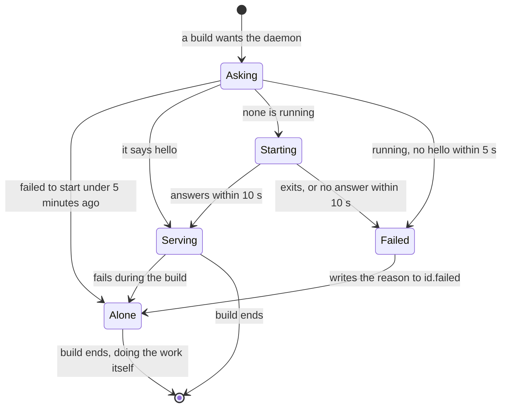

# The daemon

Each ninja-rs build prepares its remote and cached actions from scratch: it reads and
preprocesses the headers of every compile it prepares, probes compilers, checks the digests of
input files, and lists toolchain directories. The daemon keeps that work between builds. It
watches the files it comes from, so that the next build checks again only what changed. It is
meant for developers' machines, where the same tree is built again and again.

## Enabling it

```sh
ninja-rs -C build --daemon
```

Or for every build, in your environment or your [settings](settings.md):

```sh
export NINJA_RS_DAEMON=1
```

```text
# ~/.ninjars
build --daemon
```

`--nodaemon` turns it off for one build. The first build that wants the daemon starts it, in the
background; later builds use it. A build that can't reach it does the work itself, and says so
once.

The daemon serves builds that prepare actions: those whose manifest uses the RBE interface
(`rbe_version = 1`) with a remote service or a disk cache. Other builds don't use it.

## What it keeps

| What | Saves |
|---|---|
| The preprocessor's lexed files and directory listings | Reading and lexing every header of every compile again (see [include scanning](include-scanning.md)). |
| Compiler profiles, with their answers | Probing compilers again. |
| File digests | Hashing, or even checking, the inputs of every action again. |
| Toolchain input trees | Walking and hashing toolchain directories again. |

A build asks the daemon for a compile's scan, for the digests of an action's inputs, and for the
tree of a toolchain directory. The build still does everything else itself: loading the
manifest, deciding what is dirty, running and sending actions. So the daemon speeds up the
preparation of actions, not a build with nothing to do. It gains most on Windows, where file
system calls are expensive.

## What it watches

The daemon watches **roots**: the repository a file it checked is in (the nearest directory
with `.git`, `.hg`, `.jj`, `.sl` or `.svn`), and the toolchain directories it listed. An event
under a root drops what the daemon kept for that file or directory. Before each build, the
daemon makes sure it has seen every change made before the build started (it creates a file, a
*cookie*, in each root and waits for its event).

So a file is checked:

| Where it is | How often |
|---|---|
| In a watched root, on a file system that reports every change | Once, then again only when an event says it changed. |
| Outside every root (system headers, an SDK), or in a root that isn't watched | Once per build, as without the daemon. |
| In the build directory, or a directory a build edge writes to | Every time it is asked for: builds change these files as they run. |

Commands that run on your machine may write files they don't declare (a generator writing into
the source tree). The build tells the daemon when a command ran, and the next request waits for
the events of what it wrote.

## `-t daemon`

```sh
ninja-rs -t daemon            # same as status
ninja-rs -t daemon status     # what it keeps and watches
ninja-rs -t daemon start      # start it (even during the back-off below)
ninja-rs -t daemon stop       # stop it
ninja-rs -t daemon run        # run it in the foreground (for debugging)
```

`status` looks like this:

```text
ninja-rs daemon: pid 48211, ninja-rs 0.1.0+43f29d9bd1a2, up 1h12m
  37 builds, 52114 requests, 913 file events
  preprocessor: 6120 files and 1310 directory listings kept (6402 files lexed, 211873 reused)
  15532 file digests, 4 toolchain trees, 742 directories watched
  roots:
    /home/me/src/proj: watched
    /opt/llvm-23: watched
    /mnt/c/src/lib: not watched: /mnt/c/src/lib is on a file system (type 0x1021997) that may not report every change
  directories builds write to, checked every time (2):
    /home/me/src/proj/build
    /home/me/src/proj/build-release
  log: /run/user/1000/ninja-rs/3f9a1c2b7d4e5f60.log
```

A root's state is `starting`, `not in sync yet` (watched, but not trusted until the next build's
check), `watched`, or `not watched: WHY`.

The daemon exits after three hours without builds (`NINJA_RS_DAEMON_IDLE`, in seconds), when
stopped, or once the ninja-rs binary it comes from is rebuilt or removed.

## Where its files are

There is one daemon per user and per ninja-rs binary: a rebuilt or upgraded binary gets its own
(the old one exits once idle). Its files are in a directory only you can enter:

| System | Directory |
|---|---|
| Linux, macOS | `$XDG_RUNTIME_DIR/ninja-rs`, else `$TMPDIR/ninja-rs-<uid>` (`/tmp/ninja-rs-<uid>`) |
| Windows | `%LOCALAPPDATA%\ninja-rs\daemon` |

`NINJA_RS_DAEMON_DIR` sets another directory. In it, `<id>` names a binary's daemon:

| File | What |
|---|---|
| `<id>.lock` | Held by the running daemon: only one starts. |
| `<id>.log`, `<id>.log.1` | Its log, rotated at 1 MiB. Start-up failures and panics go there. |
| `<id>.failed` | Why it failed to start, and when (see below). |
| `<id>.sock` | Its socket (Unix). A path too long for a socket goes in `/tmp/ninja-rs-<uid>` instead. Windows uses a named pipe. |
| `<id>.cookies` | Cookies for roots without a repository directory (Linux). |
| `<id>.exe` | Windows: the copy of ninja-rs it runs, so that the binary can be rebuilt or upgraded meanwhile. |

Nested builds keep files there too: `flags-<pid>.json` (options holding tokens, see
[nested builds](nested-builds.md)) and `relay-<pid>` (their build events). Files of other
binaries' daemons that aren't running are removed.

Only your processes can talk to the daemon: on Unix the socket's directory is yours alone and
each end checks the other's user; on Windows the pipe admits only your user, and no remote
client.

## When it fails to start

This diagram shows how a build gets its daemon, and when it goes on without one:



- **The back-off.** A daemon that failed to start (it exited at once, or didn't answer within
  10 seconds), or one running that doesn't answer (a *mute* daemon: deadlocked, suspended), is
  noted in `<id>.failed`. For the next 5 minutes builds don't try again: each would wait for it.
  They build without it, and say why:

```text
ninja: warning: the daemon: it failed to start: it exited as it started (exit status: 1: listening at /run/user/1000/ninja-rs/3f9a1c2b7d4e5f60.sock: Permission denied (os error 13)) (42s ago); see /run/user/1000/ninja-rs/3f9a1c2b7d4e5f60.log (`ninja-rs -t daemon start` tries again); building without it
```

- **`-t daemon start`** clears the failure and tries again at once. `-t daemon status` shows the
  reason while it lasts.
- **A mute daemon** holds its lock, so another can't start. `status` and `stop` say
  `running, but it doesn't answer`, with the log's path, and exit with 1. Stop its process (the
  log's lines carry its pid in brackets), then start again.
- **A failure during a build** (the daemon crashed, or didn't answer in 120 seconds) makes the
  build do the rest of the work itself:

```text
ninja: warning: the daemon failed (no answer from the daemon in 120s): the build did its work itself
```

## Platforms and file systems

| System | Watching |
|---|---|
| Linux | inotify, a watch per directory, set up lazily. Only on local file systems: ext2, ext3, ext4, XFS, Btrfs, tmpfs, F2FS, ZFS, bcachefs, overlayfs, ReiserFS, JFS, NILFS. Not NFS, SMB, FUSE, nor WSL's view of Windows drives (`/mnt/c`): they report only this machine's changes, if any. |
| Windows | `ReadDirectoryChangesW`, one handle per root. Not on network drives. A root spelled with short (8.3) names isn't watched. |
| macOS and others | Nothing is watched. The daemon still keeps what builds learn, and checks it once per build: it saves lexing, probing and hashing, not checking. |

- A root that isn't watched is checked once per build, as without the daemon.
- **Out of inotify watches** (`fs.inotify.max_user_watches`), a root gives its watches back (an
  IDE needs them too) and is checked once per build for 10 minutes. Raise the limit if
  `status` shows roots not watched for that reason.
- **Paths through symbolic links or junctions** below a root aren't vouched for (events name the
  real paths); they are checked once per build. A root reached through a link (a symlinked home,
  a `subst` drive) is watched as spelled.
- **Hard links** made to files the daemon vouched for go unseen: package managers replace files
  rather than link to them.

## When to turn it off

- **One-shot builds** (CI, a container built once): nothing is reused, and a daemon is left
  running after the job until it is idle.
- **Network file systems** and other file systems it doesn't watch: no gain over a build
  without it, but for the lexing it keeps.
- **Case-sensitive directories on Windows or macOS** holding names that differ only in case:
  see the known limitations.
- **A result that looks stale**: stop the daemon (`-t daemon stop`), build again without it,
  and report the difference.

## Known limitations

- **Case-sensitive directories on case-insensitive systems.** On Windows (directories with
  case sensitivity turned on, WSL's `case=dir`) and on case-sensitive macOS volumes, two files
  whose names differ only in case (`Foo.h`, `foo.h`) get each other's digest. Turn the daemon
  off for such trees.
- **Short (8.3) file names on Windows.** A file asked for by its short name (`AVERYL~1.H`) can
  keep a stale digest across builds. Use long names in include paths.
- **Writes by host steps of remote actions** (a post-build copy around a remote link) and by
  local runs that lost a race aren't told to the daemon: on Windows, the next request may not
  see them yet.
- **A daemon that says hello but never answers a build** costs each build 120 seconds, with no
  back-off. Stop it (`-t daemon stop`, or its process).
- **A busy Windows daemon** whose pipe stays busy is reported as "failed to start: no answer in
  10s", which isn't the reason.
- **A daemon started with `-t daemon run`** during the back-off isn't used until the back-off
  ends. Use `-t daemon start`.
- **Cookies at a root's top on Windows.** Roots without a repository directory (a toolchain
  directory, a worktree whose `.git` is a file) get `.ninja-rs-cookie-*` files at their top for
  a moment, at each build and after local commands: they may flash in `git status` or globs.
- **A panic in an event thread** leaves the daemon without that root's events until the next
  check; on Linux each build then waits 2 seconds for the cookies. Restart the daemon.
