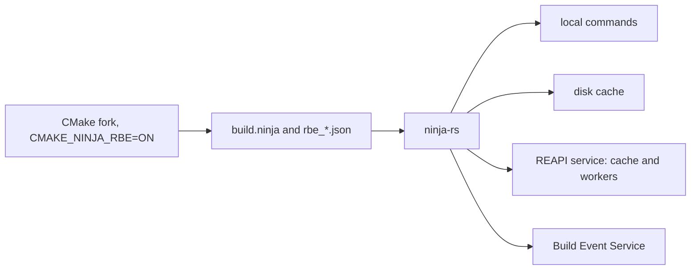

# Getting started

ninja-rs runs `build.ninja` files as ninja does. For build files that carry the RBE annotations
(`rbe_version = 1`, see [the RBE interface](../rbe-interface.md)), it can also send compiles,
links and archives to a remote execution service (the Remote Execution API, REAPI v2, which
Bazel uses), keep their results in a local disk cache or a remote cache, and report the build to
a Build Event Service. It is meant to replace ninja under CMake: a project builds with it
unchanged, locally, and with a CMake fork that writes the annotations, remotely.

This page covers what ninja-rs is and isn't, how to build it, how to use it in place of ninja,
and where it behaves differently from ninja. The last section is a tour of the other pages.

## What it is

A generator writes the build files; ninja-rs runs them. The figure shows where each part of a
build goes.



- **A ninja-compatible executor.** ninja-rs has its own port of ninja's manifest parser,
  dependency scan and build engine: the 1.13 manifest language, dyndep, pools, `restat`,
  validations, response files, depfiles, the deps log and GNU make's jobserver. A local build
  runs the same commands in the same order as ninja's.
- **A remote execution client.** For an annotated build file, each edge the policy allows runs
  as a REAPI action: ninja-rs finds the files it reads (it scans C and C++ includes itself),
  builds the input tree, asks the caches, executes it on a worker and downloads the outputs. See
  [remote execution](remote-execution.md).
- **A cache client.** A local disk cache and a remote cache work with or without remote
  execution: a cache miss then runs locally and its result is stored. See [caching](caching.md).
- **A build event reporter**, with Bazel's Build Event Protocol. See
  [build events](build-events.md).
- **A daemon**, opt-in, that keeps what builds learn (scanned headers, file digests, toolchain
  trees) between builds and watches the files they come from. See [the daemon](daemon.md).

## What it isn't

- **Not a generator.** CMake (or another generator) writes the build files; ninja-rs never
  changes them. It has no CMake-specific logic: which steps run on the host comes from the
  toolchains file the generator writes, not from rules about CMake's commands.
- **Not Bazel.** There are no BUILD files and no sandbox: the actions are the build file's
  edges, and local commands run as ninja runs them, with the files they find.
- **Not a remote execution service.** Remote execution and the remote cache need a REAPI
  service, such as EngFlow, BuildBuddy, NativeLink or Buildbarn. The disk cache works alone.
- **Only ninja for plain build files.** Without `rbe_version = 1` in the build file, the remote
  and cache options do nothing: every edge runs locally (`--remote_verbose` says so).
- **Not tested on macOS.** Linux, Windows and WSL are built and tested; see
  [platforms](platforms.md).

## Building ninja-rs

ninja-rs builds with Cargo or with Bazel. [Build notes](../build-notes.md) has the details
(versions, the Windows patches, cross builds).

### With Cargo

Cargo uses your Rust toolchain (1.89 or newer) and linker. From the top of a ninja-rs checkout:

```sh
cargo build --release -p ninja-rs
# The binary: target/release/ninja-rs (ninja-rs.exe on Windows)
```

Build a release binary: hashing toolchains and outputs is much slower in a debug build.

### With Bazel

The Bazel build (Bzlmod, Bazel 9.3.0 through bazelisk) uses a hermetic LLVM toolchain and its
own Rust, whatever the machine has:

```sh
bazelisk build -c opt //crates/ninja-rs
# The binary: bazel-bin/crates/ninja-rs/ninja-rs
```

- **Windows.** The Windows build targets the MSVC ABI, linked against the Microsoft VC runtime
  and Windows SDK, which Bazel downloads only once you accept their licenses: put these lines in
  a `user.bazelrc` at the top of the checkout (git ignores it):

  ```text
  common --repo_env=BAZEL_MSVC_RUNTIME_VISUAL_STUDIO_EULA=1
  common --repo_env=BAZEL_WINDOWS_SDK_EULA=1
  ```

- **Windows from Linux.** `bazelisk build --config=cross_windows_gnullvm //crates/ninja-rs`
  builds a Windows binary (GNU ABI, no Microsoft downloads).
- **The commit in the version.** `--config=stamp` puts the commit in `ninja-rs -v --version`;
  Cargo builds in a git checkout always do.

### Installing

The binary is all there is: copy it wherever you like. On Windows it declares long path support
in its manifest (see [platforms](platforms.md)).

```sh
ninja-rs -v --version
# 1.13.1
# ninja-rs 0.1.0+<commit>
```

The first line is the manifest language level ninja-rs implements, as ninja prints its version;
tools such as CMake read it. With `-v`, the second line is ninja-rs's own version and commit
(`.dirty` after it when the sources had changes).

## Using it in place of ninja

Tell CMake to use ninja-rs as its make program:

```sh
cmake -G Ninja -S . -B build -DCMAKE_MAKE_PROGRAM=/path/to/ninja-rs
cmake --build build      # runs ninja-rs
ninja-rs -C build        # or run it directly, with ninja's options
```

The Ninja Multi-Config generator works the same way. ninja-rs takes ninja's command line (`-C`,
`-f`, `-j`, `-k`, `-n`, `-v`, `--quiet`, `-d`, `-t`, `-w`, targets) and supports what CMake
relies on: the regeneration of `build.ninja`, `-t restat`, `-t recompact` and `-t wincodepage`.
Its own options are long ones, named as Bazel's where Bazel has them (see
[options](../reference/options.md)), and they can live in `.ninjars` settings files (see
[settings](settings.md)).

ninja and ninja-rs keep separate state files in the build directory, so they can share one.
The first ninja-rs build in a directory ninja built runs every command again: ninja-rs has no
record of them (`-d explain` says `command line not found in log`). From then on each keeps its
own records, and switching between them rebuilds what changed since that tool's last build.

## Differences from ninja

These are deliberate. A few unintended ones are listed under
[known limitations](troubleshooting.md#known-limitations).

- **State files.** The build log and the deps log are `.ninja_rs_log` and `.ninja_rs_deps`, in
  formats of ninja-rs's own (see [files](../reference/files.md)): ninja-rs never reads or
  writes ninja's `.ninja_log` and `.ninja_deps`. Command hashes are ninja 1.13's.
- **One build per build directory.** A build takes a lock (`.ninja_rs_lock`) on the logs of its
  build directory. A second build started there (from an IDE and a terminal at once) waits,
  saying `waiting for the build running in this directory (pid 1234, started 5 s ago) to
  finish...`, then finds the work done. Builds the first one runs itself (a generator calling
  `-t restat`, a custom command building another configuration) share its lock; see
  [nested builds](nested-builds.md).
- **Interruption.** As in ninja, an interrupt (SIGINT, SIGTERM or SIGHUP; Ctrl-C or Ctrl-Break
  on Windows) stops the build, and each command runs in a process group of its own (a job
  object on Windows), so only ninja-rs gets the terminal's signal and passes it on. Unlike ninja,
  ninja-rs also waits for the processes a command left behind, killing those still there 2 s
  after it exited. A second interrupt kills every command; a third makes ninja-rs exit at once.
  A build stopping on an error of its own (a depfile it can't parse) stops its running
  commands, where ninja waits for them. An interrupt before the build starts (loading the
  manifest, connecting, waiting for the lock) ends the invocation, with `128 + signal`.
- **Direct execution on POSIX.** A command without shell syntax (only letters, digits, spaces
  and `_-+=/.,:@%`, not starting with a variable assignment or a shell builtin) runs without
  `/bin/sh -c`, which saves a shell per command (ninja issue 2665). CMake's compile commands
  qualify. A program that can't start runs through the shell, for its message and exit status.
- **Failed commands, named again.** With many jobs, a `FAILED:` block scrolls away behind the
  output of the commands still running (ninja issue 2378). Before `build stopped`, ninja-rs
  names the failed commands again (`ninja: 2 commands failed:` and their outputs), unless the
  only one is the last thing printed.
- **Dyndep outputs met as sources** (ninja issues 2653 and 2743). When the dependency scan
  loads a dyndep file, edges it already visited may read the outputs the file declares and have
  taken them for sources. ninja builds those edges on the next run; ninja-rs scans them again.
  With C++20 modules, ninja may compile a consumer against an old BMI.
- **Stale discovered dependencies**, as in ninja's development branch (1.14): an edge the scan
  already found dirty doesn't load its depfile or deps log record into the graph, so stale
  headers can't order the build or form cycles.
- **ninja 1.14 features.** `--status FMT` (the status line from `$`-variables such as
  `$finished` and `$total`), `$^` (a newline in a binding), `--jobserver-pool` (or
  `enable_jobserver_pool = 1` in the build file), and `-t compdb` listing every input. ninja-rs
  still reports `1.13.1`: `$^` works without `ninja_required_version = 1.14`.
- **Status extras.** `NINJA_STATUS` takes `%R` (actions run remotely), `%H` (remote cache hits)
  and `%D` (disk cache hits); `--status` takes `$remote`, `$remote_cache_hits` and
  `$disk_cache_hits`.
- **Encoding.** `-t wincodepage` says `Build file encoding: UTF-8` on every system: ninja-rs
  reads build files as UTF-8 and gives commands and paths to Windows as UTF-16, whatever the
  code page. CMake on Windows asks, and otherwise writes build files in the ANSI code page.
- **Tools.** `-t exec` and `-t daemon` are ninja-rs's own (see [nested builds](nested-builds.md)
  and [the daemon](daemon.md)). `-l` is accepted and ignored. `-t browse`, `-t graph`,
  `-t msvc`, `-t multi-inputs` and `-t urtle` don't exist. See [tools](../reference/tools.md).

## Where to go next

| Page | What it covers |
|---|---|
| [CMake](cmake.md) | The CMake fork, the toolchain file, what CMake writes, a worked example. |
| [Remote execution](remote-execution.md) | The service, which edges run remotely and why not, fallback, jobs, retries, downloads. |
| [Caching](caching.md) | The disk cache, a remote cache alone, what the key covers, uploads of local results. |
| [Certificates](certificates.md) | TLS, client certificates, tokens, the certificate rules. |
| [Build events](build-events.md) | Reporting builds to a Build Event Service. |
| [Include scanning](include-scanning.md) | How compiles' inputs are found, and when a compile runs locally. |
| [Settings](settings.md) | `.ninjars` files: where they are, precedence, trust. |
| [The daemon](daemon.md) | Keeping caches between builds. |
| [Nested builds](nested-builds.md) | Builds run by a build's commands, `-t exec`, the lock. |
| [Platforms](platforms.md) | Windows, WSL, Linux and macOS specifics. |
| [Troubleshooting](troubleshooting.md) | Messages, summaries, exit codes, files to look at, known limitations. |
| [Options](../reference/options.md), [tools](../reference/tools.md), [environment](../reference/environment.md), [files](../reference/files.md) | The references. |
