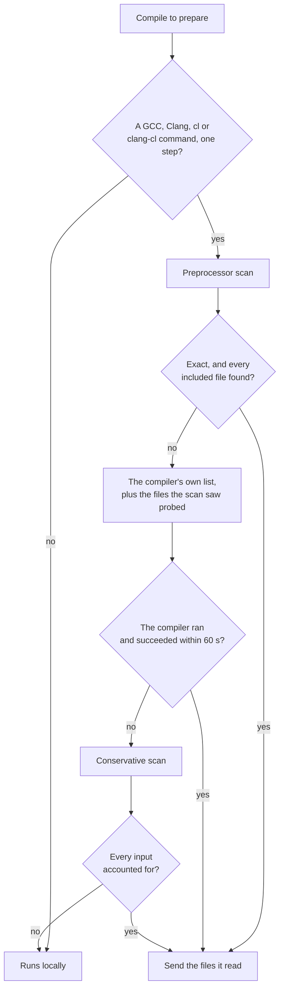

# Include scanning

Before ninja-rs sends a compile to remote execution, or looks it up in a cache, it must know
every file the compile reads: the source, and every header it includes. This page explains why,
how ninja-rs finds them, what you see when it can't find them exactly, and what that costs.

## Why ninja-rs scans includes

- **A remote worker sees only what is sent.** The action's input tree must hold every header
  the compiler opens. A header left out makes the remote compile fail; worse, a header the
  compile only probes (`__has_include`) changes the object without an error.
- **The cache key must cover every file read.** The key of an action is the digest of its
  command and of its inputs. A header missing from the inputs would let a cached object built
  against an older header be reused after the header changed.
- **ninja's own dependency information comes too late.** A depfile, or `/showIncludes` output,
  is written by the compile itself: the first build has none, and a changed source may include
  new headers. ninja-rs sends the headers recorded by earlier builds as well, but it can't rely
  on them alone.

So ninja-rs finds the headers before the compile runs. The headers of sysroots and SDKs are
found the same way and sent one by one; only the directories a toolchain file declares as
inputs (the compiler's own binaries and resource directory) are sent whole (see
[remote execution](remote-execution.md)).

The scan runs for compiles ninja-rs prepares: those sent remotely, looked up in a remote cache,
or looked up in the disk cache. A build without these doesn't scan.

## The scanners

`--remote_include_scanner` chooses how compiles' inputs are found:

| Value | How | When it can't tell |
|---|---|---|
| `preprocessor` (default) | ninja-rs's own preprocessor evaluates the directives exactly, as the compiler would, and skips everything else. GCC, Clang, `cl` and `clang-cl` commands. | The compiler's own list, then the conservative scanner. |
| `compiler` | Runs the compiler's preprocessor for each compile: `-E -MD` (GCC, Clang) or `/E /showIncludes` (`cl`, `clang-cl`). | The conservative scanner. |
| `clang-scan-deps` | Runs the `clang-scan-deps` next to the compiler (Clang). | The conservative scanner. |
| `conservative` | Follows every `#include` whatever the conditionals: a superset of what the compile reads. | The compile runs locally. |

The default suits nearly every project. The others exist for comparison and for the rare
compiler the preprocessor scanner doesn't handle.

## The default chain

The preprocessor scanner is exact for the compiles it understands: it reads the same files the
compiler reads, no more. When it can't be sure of that, ninja-rs asks the compiler, and only
when the compiler can't answer does it fall back to the conservative scanner. This chart shows
the chain for one compile:



- **Exact.** The scan evaluates `#if`, macros, `__has_include`, `__has_builtin` and the like,
  with what the compiler predefines and answers (its *profile*, probed by running the compiler
  with the command's flags). It is exact unless it meets something it doesn't model: an
  unsupported flag, a query the compiler can't answer, a construct of `cl`'s traditional
  preprocessor it can't reproduce faithfully. It also gives up when an `#include` isn't found:
  a lookup it got wrong could drop inputs.
- **The compiler's list.** ninja-rs runs the compiler's preprocessor on the command, without its
  outputs, and reads the files it lists. GCC and `cl` don't list the files `__has_include`,
  `__has_embed` or `#pragma GCC dependency` merely probe, so ninja-rs adds those the partial
  scan found. The compiler is stopped, with every process it started, after 60 seconds.
- **The conservative scanner** runs only when the compiler can't run on this machine, fails, or
  takes too long. It follows every `#include` in every conditional branch, through every search
  directory that holds a candidate, and sends what it finds. A computed include (`#include
  MACRO`) whose macro it can't resolve sends the files of the directories the include may name.
  It may send many more files than needed, which costs uploads and makes cache keys change when
  an unrelated header changes, but it must never miss one. When it can't account for every
  input, the compile runs locally instead.

## When a compile runs locally

A compile that can't be scanned runs on your machine, as ninja would run it:

- **Its compiler isn't recognized.** Compiles are recognized by the compiler's name: anything
  with `gcc`, `g++` or `clang` in it, `cc`, `c++`, `cl`, `clang-cl`, or `--driver-mode=cl`. A
  `*Compile` action with another tool (a resource compiler, a CUDA or Fortran compiler, a
  command of several steps) can't be sent: `unrecognized compiler '/usr/local/cuda/bin/nvcc'`.
- **The conservative scanner can't tell its inputs:** a computed include in a directory the
  build writes to (the header may not exist yet), a computed include of a macro the command
  line defines (other than as a header name), `..` after a symbolic link (which the compiler
  resolves elsewhere than a remote worker would), or more files than it can send even after
  narrowing.

These compiles are counted in the summary at the end of the build, by reason:

```text
ninja: 3 of 412 remote actions ran locally: 3 couldn't be sent (2: unrecognized compiler '/usr/local/cuda/bin/nvcc'; 1: computed #include in a directory the build writes to).
```

With `--remote_strict` they fail instead of running locally. See
[remote execution](remote-execution.md) for the other reasons an action runs locally.

## Warnings and the summary

When the preprocessor scan leaves a compile to the compiler, ninja-rs says why once per reason,
not once per compile:

```text
ninja: warning: Preprocessor include scanner: not exact (/src/proj/lib/config.h:12: a pragma from a macro in text); asking the compiler (other compiles for this reason too: --remote_verbose names them)
```

When the compiler can't answer either:

```text
ninja: warning: Compiler include scanner: C:\VS\bin\cl.exe failed: src\gen.cpp(3): fatal error C1083: ...; scanning conservatively (other compiles for this reason too: --remote_verbose names them)
```

At the end of the build, a summary counts the compiles each step took, with their most frequent
reasons:

```text
ninja: 7 compiles' includes were the compiler's, the preprocessor's scan being unable to tell (6: not exact (a pragma from a macro in text); 1: unsupported flag /clr). 1 compiles were scanned conservatively (1: C:\VS\bin\cl.exe failed).
```

- `--remote_verbose` names every compile and its reason.
- The fix depends on the reason. `an #include not found` usually means a generated header that
  wasn't built before the compile (see below). An unsupported flag, or a construct the scanner
  doesn't model, costs time but nothing else: the compiler's list is exact.

## MSVC

`cl` and `clang-cl` compiles are scanned like the others, with what is particular to them:

- **`/showIncludes`.** CMake adds it to `cl` commands so that ninja records their headers (`deps
  = msvc`). The scanner doesn't use it: it reads the source itself. When it asks the compiler, it
  runs `cl /E /showIncludes` separately, and reads the notes with the manifest's
  `msvc_deps_prefix` (`Note: including file:` in English; CMake sets it for a localized `cl`).
- **The preprocessor mode is decided as `cl` decides it.** The last of `/Zc:preprocessor` and
  `/Zc:preprocessor-` (or the older `/experimental:preprocessor[-]`) decides, in the order `cl`
  reads its flags: `CL`, the command line, then `_CL_`. Without either, C sources compiled with
  `/std:c11`, `/std:c17` or `/std:clatest` get the conforming preprocessor, and everything else
  the traditional one. ninja-rs asks `cl` itself which mode a command gets when it probes the
  compiler. `clang-cl` always preprocesses as the conforming preprocessor does.
- **The traditional preprocessor** is modelled closely enough for Boost and the MSVC STL. Where
  the model can't reproduce `cl` faithfully, the scan is meant to say so (not exact), and the
  compiler's list is used: correct, only slower.
- **`CL` and `_CL_`.** The flags in them count, as `cl` reads them. They may hold the
  preprocessor-mode and `/std:c*` flags. Flags the scan reads from the command line (`/I`, `/D`,
  `/U`, `/FI`, `/X`, `/T...`) in them make the preprocessor scan give up for those compiles
  (`CL has /DFOO`): put them on the command line instead.
- **`INCLUDE`** is `cl`'s list of built-in directories (unless `/X`). It, `EXTERNAL_INCLUDE`,
  `CL` and `_CL_` are part of a compiler profile: changing them probes the compiler again.
- **Unsupported flags** make the preprocessor scan give up: `/clr`, `/ZW`, header units
  (`/headerUnit`, `/exportHeader`, `/translateInclude`), `/AI`, `/FU`, `/source-charset:` other
  than UTF-8.

See [platforms](platforms.md) for the rest of what Windows builds need.

## Generated headers

- **A header must exist when its compile is prepared.** ninja-rs prepares a compile once the
  edges it depends on are built, so a generated header must be one of them: an input or an
  order-only dependency, as ninja needs for a correct first build anyway. CMake does this for
  headers listed as sources of a target, or made by custom commands the target depends on. A
  header that isn't there yet shows as `an #include not found`, and the compile goes down the
  chain.
- **Directories the build writes to are read again for every compile.** The build directory,
  and every directory a build edge writes to outside it (an in-source generator's), aren't
  cached between compiles: a header rewritten between two compiles is seen.
- **The conservative scanner** runs a compile locally when one of its computed includes points
  into a directory the build writes to: what it would send isn't known yet.

## Performance

- **The preprocessor scan** reads each header once per build process (once per change of the
  header with the [daemon](daemon.md)), and takes tens of milliseconds per compile for heavy
  C++ (Boost, the MSVC STL), less for ordinary code. In measurements it was tens of times
  faster than the compiler's own preprocessing, and it scales with threads.
- **Compiler profiles** are probed once per compiler and set of relevant flags: a few compiler
  runs, a fraction of a second. With a `--disk_cache` they are kept in its `cpp-deps/`
  directory, probed again after a day (to see what the key doesn't, such as a Clang
  configuration file's contents), and removed after 30 days unused. The daemon keeps them too.
- **The compiler's list** costs a full preprocess per compile, every time the compile is
  prepared: about a second per compile for heavy C++ under `cl`. Many compiles going this way
  for one reason are worth fixing.
- **The conservative scanner** sends more files than needed (often several times as many), and
  can be slow on computed includes, which make it walk directories (up to 5,000 files or 64 MB
  per compile before it narrows down, or runs the compile locally).

## Known limitations

These are known and being worked on. Most affect the fallbacks, not the default exact scan.

- **`cl`'s traditional preprocessor** is modelled from experiments with `cl`, whose
  traditional expansion has many quirks. On the unusual constructs the model can't follow
  exactly (parentheses coming from a macro argument, a macro name produced inside an argument
  and followed by more tokens, invalid `##` pastes and a few more), it gives up and the
  compiler's list is used: slower, still exact. No difference from `cl` is known on real code,
  and none was left on thousands of random macro programs compared with `cl`, but the model
  can't be proven complete. If a project still seems to scan wrong under `cl`,
  `--remote_include_scanner=compiler` sidesteps the model (it misses the files `__has_include`
  only probes: see below), and `/Zc:preprocessor` avoids the traditional preprocessor.
- **Computed includes under `cl`.** `#include` lines whose `<` comes from a macro, and
  `<...>` names inside macro arguments on an `#include` line, are formed differently from `cl`.
- **`.C` sources under `cl`.** `cl` compiles `X.C` as C; the scanner takes it as C++.
- **Files only probed, when the scan fails outright.** When the preprocessor scan fails before
  reading the sources (an unsupported flag, flags in `CL`, a profile that can't be probed), or
  with `--remote_include_scanner=compiler`, the compiler's list lacks the files `__has_include`
  only probes: such a file present on your machine but not sent changes the object silently.
- **A localized `cl` without `msvc_deps_prefix`** lists no headers to ninja-rs, which sends only
  the source: the remote compile fails and runs locally.
- **Windows with libc++ and `<windows.h>`** without `NOMINMAX`: these compiles are never exact,
  and each one asks the compiler. Define `NOMINMAX` where the code allows it.
- **The compiler's lists aren't cached:** a compile left to the compiler pays for it at every
  build that prepares it.
- **The conservative scanner can miss headers** reached through computed includes it can't
  place (a macro in the path defined elsewhere, `..` or absolute paths, a plain name found only
  through the search path, a macro with several definitions, macros defined in headers found
  later), on case-insensitive file systems off Windows (`#include <Foo.h>` for `foo.h`), and
  through dangling symbolic links to headers generated later. It ignores `#pragma
  include_alias`. With the default scanner it only runs when the compiler can't, which makes
  this rare.
- **Minimal downloads and remotely generated headers.** With `--remote_download_minimal`, a
  header made by a remote action isn't downloaded, and the scanners can't read it. Header
  generators run locally with the default `--remote_mnemonics=Compile`; keep them so, or use
  `--remote_download_outputs=all`.
