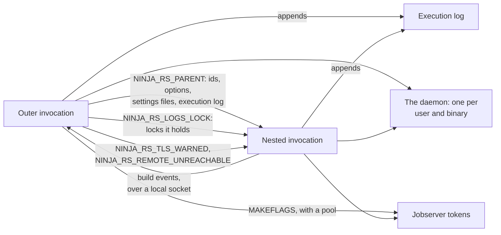

# Nested builds

Builds start builds. A custom command runs `cmake --build` on another build tree (LLVM builds its
native tools so), CMake's ExternalProject configures and builds other projects, and a CMake
regeneration runs `try_compile` projects and `ninja -t restat`. When the build program is
ninja-rs, these are ninja-rs invocations running inside a ninja-rs invocation. ninja-rs treats
them as parts of one invocation: they take the outer invocation's options, report under its
build events, append to its execution log, and share its build directory's logs safely.

## A minimal example

Nothing to set up: an inner `ninja-rs` started by a build's command finds the outer invocation
through the environment.

```sh
ninja-rs -C build --config=remote
```

The custom command that builds the native tools runs `cmake --build NATIVE`, which runs
`ninja-rs` there with the outer invocation's remote settings, so its compiles run remotely too,
and its events appear in the outer invocation's page.

To make a command that isn't a build the outermost invocation (a configure that builds external
projects, a script running several builds), run it under `-t exec`:

```sh
ninja-rs --config=remote -t exec -- cmake -G Ninja -S . -B build
```

The builds the command runs then take these options and report under this invocation. `-t exec`
exits with the command's exit code (127 when it can't start it). The `exec` lines of settings
files apply to it, and the `build` ones.

## When ninja-rs runs inside ninja-rs

| Case | What runs | Notes |
|---|---|---|
| A custom command running `cmake --build DIR` | A build in another build directory | Its own lock; the outer invocation's options and events. |
| ExternalProject, a superbuild | Configure and build of another project | ExternalProject passes `CMAKE_MAKE_PROGRAM`, so its builds run with ninja-rs. |
| CMake regeneration (`cmake` re-run by the build) | `try_compile` projects; `-t restat` and `-t recompact` on this build directory | A `try_compile` manifest without `rbe_version` builds locally and reports nothing; the tools append to the logs the outer build holds. |
| `-t exec -- COMMAND` | Whatever the command runs | `-t exec` is the outermost invocation. |

## What a nested build shares

The outer invocation passes what nested ones need in their environment. This diagram shows what
a nested build shares with the invocation running it:



- **Options.** A nested invocation takes the outer one's long options first, then its own
  command line, whose options win. Paths are absolute, as the nested build runs elsewhere. Not
  passed on: build event options, ids, the execution log option, the options choosing settings
  files, `--config`, `--announce_rc`, `--enable_platform_specific_config`, and those about the
  terminal (`--verbose`, `--quiet`, `--status`, `--jobserver-pool`). Short options (`-j`, `-k`)
  aren't passed on either. An option left out in the outer invocation for one it conflicts with
  isn't passed on: nested builds neither fail on the conflict nor warn again.
- **Settings files.** The outer invocation's options include those of its settings files, so a
  nested invocation doesn't read any: not even a `.ninjars` of its own tree. Its own `--config`s
  are expanded from the files the outer invocation read.
- **Tokens.** `--remote_header` values (often tokens) don't go into the environment every
  command sees. They go into a file only you can read (`flags-<pid>.json`, in the
  [daemon](daemon.md)'s directory), which the outer invocation removes when it ends.
- **Ids.** Nested invocations share the invocation id and the build request id: every remote
  request of every nested build carries the outer invocation's id.
- **Build events.** With `--bes_backend` or `--build_event_binary_file`, the outermost
  invocation listens on a local socket (a named pipe on Windows), and nested invocations send
  their events there instead of opening their own stream. The outer stream merges them, under a
  configuration named after their build directory (see [build events](build-events.md)). A
  nested build whose manifest doesn't use remote execution (a `try_compile`) reports nothing. A
  nested invocation waits (up to 10 seconds) for the outer one to merge its events before it
  exits, so they are in before the command running it ends.
- **Execution log.** Nested invocations append to the outer invocation's
  `--execution_log_file`.
- **Warnings said once.** A certificate expiring soon is warned about once per invocation tree
  (see [certificates](certificates.md)), a remote service found unreachable isn't tried again by
  nested builds (they build locally at once, under the same `--remote_local_fallback` rules),
  and a disk cache shared with Bazel is noted once.
- **The daemon** is one per user and ninja-rs binary: every build of the tree uses the same one,
  with `--daemon` passed on.

## The lock

ninja-rs locks a build directory's logs (`.ninja_rs_log`, `.ninja_rs_deps`) while a build
writes them, with an OS lock on `.ninja_rs_lock` (ninja has none). A second build started in the
same directory (an IDE's and a terminal's) waits, and then finds the work done:

```text
ninja: waiting for the build running in this directory (pid 48211, started 5 s ago) to finish...
```

A nested build in the same directory must not wait: the build holding the lock is waiting for
it. So the lock is inherited:

- **Each invocation passes on the locks it and those running it hold** (`NINJA_RS_LOGS_LOCK`,
  the lock files' identities). A nested build whose build directory's lock is among them uses
  that directory's logs without the lock, appending only: it doesn't rewrite them, and
  `-t recompact` does nothing there. CMake runs `-t restat` and `-t recompact` at each
  regeneration, from inside the build: they work this way.
- **In another build directory**, a nested build takes that directory's lock and passes it on
  too: a build of A whose command builds B, whose command builds A again, works.
- **When a wrapper scrubs the environment** between the build and its command, the nested build
  still recognizes the build holding the lock: the lock file names its holder (process id, start
  time and pid namespace), and the nested build looks for it among its own ancestors.
- **On a file system without locks** the build goes on with a warning:
  `can't lock the logs (...): a build running at once could undo this one's records`.

## Interruptions and a parent that dies

- **Ctrl-C** stops the outer build's commands, nested builds included: they stop their own
  commands, end their build events, and exit. The outer invocation waits for them, as for any
  command. A second Ctrl-C kills the commands.
- **`-t exec`** passes an interrupt on to its command (on Unix, when the terminal didn't send it
  to the command already). A second one kills the command.
- **When the outer invocation dies** without stopping its commands (killed with `SIGKILL`, or
  `TerminateProcess`), nested builds go on. Their events have nowhere to go (a warning:
  `sending build events to the invocation running this one failed`), and the file holding the
  tokens stays until another invocation removes it. See the known limitations for the lock.

## The jobserver

ninja-rs runs nested builds as commands: the outer `-j` counts each as one job, while the nested
build runs its own jobs. Without coordination, the machine runs more local jobs than either
`-j`.

- With `--jobserver-pool` (or `enable_jobserver_pool = 1` in the manifest), the outer invocation
  makes a GNU make jobserver pool of `-j` tokens, and passes it to its commands in `MAKEFLAGS`.
  A nested ninja-rs, `make` or `cargo` takes a token for each local job beyond its first, so the
  whole tree stays within the outer `-j`.
- A nested build given `-j` explicitly ignores the pool (as ninja does): `cmake --build DIR -j 8`
  passes `-j 8`.
- Remote actions don't take tokens: they don't use the machine's cores.

See [platforms](platforms.md) for the jobserver's protocols on each system.

## Environment variables

| Variable | Set by | Meaning |
|---|---|---|
| `NINJA_RS_PARENT` | The outer invocation | The ids, options, settings files, execution log and event socket of the invocation running this one. |
| `NINJA_RS_LOGS_LOCK` | Each invocation holding a lock | The locks the invocations running this one hold. |
| `NINJA_RS_TLS_WARNED` | An invocation that warned | The certificate files already warned about. |
| `NINJA_RS_REMOTE_UNREACHABLE` | An invocation that found a remote service unreachable | Its endpoints. |
| `MAKEFLAGS` | An invocation with a jobserver pool | The pool. |

These are inherited by every command, and their commands in turn. A shell or an IDE started from
a build inherits them too, and its builds become nested ones: unset `NINJA_RS_PARENT` there. See
the [environment reference](../reference/environment.md).

## Known limitations

- **A nested build outlives a killed parent.** A nested build sharing the parent's build
  directory keeps building after the parent is killed, but the lock it relied on is gone: a new
  build in that directory doesn't wait for it, and both may write the same outputs at once.
  After killing a build, wait for its commands to end (or kill them too) before building again.
- **Mixed versions.** An older ninja-rs's lock file doesn't say which process holds it: a nested
  build whose environment lost `NINJA_RS_LOGS_LOCK` then waits for it forever. Use one version
  of ninja-rs for the whole tree.
- **A nested invocation streaming its own events** (given its own `--bes_backend`) keeps the
  outer invocation's id unless it is given `--invocation_id`.
