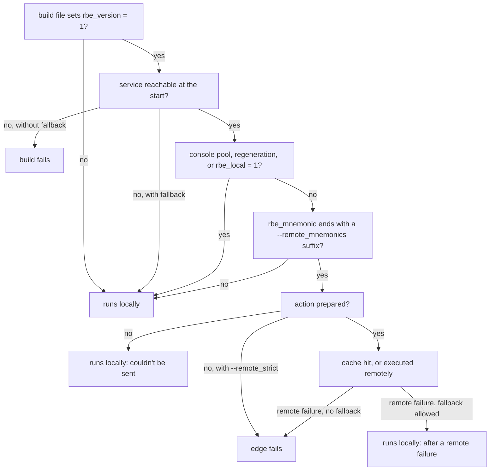

# Remote execution

With remote execution, the compiles, links and archives of a build run on a cluster's workers
instead of this machine, and their results are shared through the service's cache. ninja-rs
speaks the Remote Execution API (REAPI v2), as Bazel does, so it works with the services Bazel
uses: EngFlow, BuildBuddy, NativeLink, Buildbarn and others.

This page covers the service options, platforms, which edges run remotely and why one runs
locally instead, what happens when the service fails, jobs, retries, downloads, racing and the
execution log. Caching without remote execution is in [caching](caching.md); TLS and tokens are
in [certificates](certificates.md).

## A minimal setup

The build file must carry the RBE annotations (`rbe_version = 1`): with CMake, configure with
the fork and `-DCMAKE_NINJA_RBE=ON` (see [CMake](cmake.md)). Then:

```sh
ninja-rs -C build --remote_executor=grpcs://remote.example.com \
  --remote_instance_name=default --remote_mnemonics=Compile,Archive,Link
```

At the end, ninja-rs says how many actions ran remotely:

```text
ninja: 120 remote actions (37 remote cache hits).
```

The options usually live in a `.ninjars` file (see [settings](settings.md)), such as:

```text
build:remote --remote_executor=grpcs://remote.example.com
build:remote --remote_instance_name=default
build:remote --remote_mnemonics=Compile,Archive,Link
build:remote --remote_download_minimal
```

used with `ninja-rs --config=remote`.

## The service

| Option | Meaning |
|---|---|
| `--remote_executor=URL` | The REAPI service that executes actions, and whose cache is used. `grpcs://host:port` (or no scheme) connects with TLS, `grpc://host:port` without. |
| `--remote_cache=URL` | A cache alone, without execution (see [caching](caching.md)). Given with a different `--remote_executor`, it is left out with a warning: the executor's cache is used. |
| `--remote_instance_name=NAME` | The instance name the service expects. |
| `--remote_header=K=V` | A gRPC header sent with every call, such as a token (repeatable). Its values are hidden in build events and `--announce_rc`. |
| `--tls_*` | Certificates; see [certificates](certificates.md). |

An empty value unsets an option a settings file gave (`--remote_executor=`). The full list is
in [options](../reference/options.md).

When the build starts, ninja-rs asks the service for its capabilities. It needs SHA-256 digests
(`the remote cache does not support SHA-256` otherwise) and, with `--remote_executor`, execution
(`the remote instance does not support execution`). Both are errors before anything runs.

## Platforms

Platform properties (such as `OSFamily=Linux` and `container-image=docker://...`) choose the
workers an action runs on. They come from the toolchains file only, which CMake writes from
`CMAKE_REMOTE_PLATFORM` (see [CMake](cmake.md#platform)): there is no command-line option. Each
declared tool has its own; a step whose tool isn't declared gets the platform of another tool of
the same command, or none. Ask your service which properties it needs: an action without them
usually finds no worker.

## Which edges run remotely

The figure follows one edge of an annotated build file, with `--remote_executor` given. The
first two questions are asked once per build, the others for each edge.



### The build file

Without `rbe_version = 1` at file scope, every edge runs locally and the remote options do
nothing (`--remote_verbose` says `remote execution disabled: the manifest does not set
rbe_version`). Another version is a warning, and the build runs locally.

### The edge

An edge may run remotely unless it is in the `console` pool, regenerates the build file
(`generator = 1`), or has `rbe_local = 1`. Remote is the default: the generator opts edges out.
Of the others, those whose `rbe_mnemonic` ends with one of `--remote_mnemonics` (comma-separated
suffixes) run remotely. The default is `Compile`, which matches CMake's `CCompile`, `CXXCompile`
and the like. To send links and archives too:

```sh
--remote_mnemonics=Compile,Archive,Link
```

### Local tools

A command may chain several steps (`a && b`). A step whose program the toolchains file declares
`local` (CMake declares `cmake` itself) runs on the host, in the build directory; the others form
the remote action. Local steps may come before or after the remote ones, not between them. For
example, CMake's archive command

```text
: && /usr/bin/cmake -E rm -f libfoo.a && /opt/llvm/bin/llvm-ar qc libfoo.a a.o b.o && :
```

deletes the old archive on the host, then creates the new one remotely. Steps before the remote
action run once its result is fetched, and steps after it once its outputs are written. A
command made only of local steps runs locally.

### Commands that need a shell

The remote action runs its program directly, with no shell. So a command is split into steps
and arguments the way its shell would split it, and refused when it needs the shell for more:

- **Removed:** `cmd.exe /C "..."` around the command (Windows), and the shell no-ops CMake puts
  around steps (`:`, `true`, `cd .`, `cd /D .`).
- **Refused on POSIX:** pipes, redirections, `;`, `||`, variables, globs, backquotes, `cd`
  steps: `command needs a shell` or `command changes directory`.
- **Refused on Windows:** redirections and pipes outside quotes; under `cmd.exe /C`, its other
  syntax (`&`, `^`, parentheses) and its variables (`%NAME%`, when `NAME` is set here or is one
  of cmd's own, such as `%CD%`). A `%NAME%` that isn't set stays as written, as cmd.exe leaves it
  (a linker's `/pdbaltpath:%_PDB%`).
- **Several remote steps** run through `/bin/sh -c` on the worker, from a POSIX host. On a
  Windows host such a command runs locally (cmd.exe's quoting doesn't survive a worker's own),
  so prefer single-step commands there, such as `llvm-ar qc` (which writes the archive index)
  rather than `ar` then `ranlib`.

### Why an action runs locally

An edge the policy sends remotely may still run locally: its action couldn't be prepared, or
the service failed. Both are counted, and summed up at the end of the build, on one line:

```text
ninja: 12 of 340 remote actions ran locally: 10 couldn't be sent (8: command needs a shell;
2: unrecognized compiler '/usr/bin/python3'); 2 after remote failures (first: remote execution
failed: UNAVAILABLE: ...).
```

The summary lists the four most frequent reasons, with the details after `: ` left out.
`--remote_verbose` names each action and its whole reason (`ninja: app: running locally
(...)`). The common reasons for an action that couldn't be sent:

| Reason | What it means |
|---|---|
| `command needs a shell`, `command uses shell redirection`, `command uses cmd.exe's ...`, `command changes directory` | The command needs a shell (see above). |
| `the command only runs local tools`, `the command runs local tools between other steps` | Steps the toolchains file declares local (see above). |
| `the command runs N steps remotely` | Several remote steps, on a Windows host. |
| `cannot find program '...'` | The command's program isn't found from the build directory or through `PATH`. |
| `unrecognized compiler '...'` | A `*Compile` edge whose program isn't a GCC, Clang or cl-style compiler. |
| `... writes files the action can't return` | A compile flag writing files that can't be named as outputs: `-save-temps`, `-fdump-*`, cl.exe's `/Zi`, listings, `/P`. |
| `output ... is outside the build directory`, `... is outside the exec root` | A file outside the tree the action can have (with `--exec_root`, outside that directory). |
| `thin archive ... names its member ...` | A thin archive whose members are outside the build directory or absolute. |
| `a definition names the input ... by its absolute path` | A `-D` value naming an input by its absolute path, which a worker doesn't have. |
| `computed #include ...` | The conservative include scanner can't tell where a computed include is (see [include scanning](include-scanning.md)). |
| `input changed during the build: ...` | An input kept changing while it was uploaded (three times). |

Compiles whose includes the preprocessor scanner couldn't tell exactly still run remotely: their
inputs come from the compiler (`N compiles' includes were the compiler's, ...` in the summary).
See [include scanning](include-scanning.md).

## When the service fails

### At the start

ninja-rs connects when the build starts, within 20 s. A service is **unreachable** when there is
no connection (refused, no route, a name that doesn't resolve), nothing answers in time, the
connection breaks before anything answered (a load balancer restarting, a tunnel whose far end
is down), or the service says it can't serve (`UNAVAILABLE`, `RESOURCE_EXHAUSTED`) after the
retries. Then:

- with `--remote_local_fallback` (the default), a warning, and the whole build runs locally,
  with the disk cache if there is one:

  ```text
  ninja: warning: the remote service grpcs://remote.example.com is unreachable, building locally: ...
  ```

  The builds it runs (see [nested builds](nested-builds.md)) don't try the service again;
- with `--noremote_local_fallback` or `--remote_strict`, the build fails before running anything.

Any other error at the start fails the build, fallback or not: the service answered with an
error (a wrong instance name, a token refused: `PERMISSION_DENIED`, `UNAUTHENTICATED`), a
certificate was refused, or the settings can't connect. Such an error says
`remote execution: <CODE>: <message>`, with a hint for certificate errors.

### During the build

A **remote failure** is the service failing an action: an error after the retries, an execution
the service lost, a result that can't be used. A command failing on the worker isn't one: a
compile error fails the build as it would locally.

| | Couldn't be sent | Remote failure | Unreachable at the start | Certificate refused |
|---|---|---|---|---|
| Default (`--remote_local_fallback`) | Runs locally | Runs locally, within the limits below | Warning; the build runs locally | The action (or build) fails |
| `--noremote_local_fallback` | Runs locally | The action fails | The build fails | The action (or build) fails |
| `--remote_strict` | The action fails | The action fails | The build fails | The action (or build) fails |

- **Limits.** `--remote_max_fallbacks=N` allows N local runs after remote failures;
  `--remote_max_fallback_ratio=R` allows at most that share of the remote actions (from 20
  actions on). Past either, a remote failure fails its action, saying which limit
  (`ninja: not running it locally: ...`). They keep a broken service from quietly making every
  build local. Actions that couldn't be sent don't count: some setups have them by design.
- **Strict.** `--remote_strict` is for checking a setup: an action the policy sends remotely runs
  there or fails, with its reason (`ninja: the action can't run remotely (--remote_strict):
  ...`). Misses of `--remote_cache` alone still run locally: that is that mode, not a fallback.
- **Certificates.** A certificate refused, the server's or the client's, fails every remote
  action alike: never retried, never run locally (see [certificates](certificates.md)).

## Jobs and concurrency

| Option | Default | What it bounds |
|---|---|---|
| `-j N` | cores + 2 | Commands running on this machine. |
| `--remote_jobs=N` | 50 | Actions handled remotely at once, from preparing them to downloading their outputs. |
| `--remote_max_concurrency_per_connection=N` | 100 | Calls on one HTTP/2 connection, as the service allows them. |

- **Two kinds of slots.** With remote execution, an edge sent remotely takes a remote slot, a
  local edge a local one, so up to `-j + --remote_jobs` edges run at once. Edges waiting for a
  slot wait in the build's plan, in its priority order. Raise `--remote_jobs` to what the cluster
  takes for you; keep `-j` for this machine.
- **Fallbacks are local.** An action running locally after all (couldn't be sent, remote
  failure) waits for a local slot and counts as local from then on.
- **The jobserver.** Under GNU make's jobserver (or `--jobserver-pool`), local commands take its
  tokens; remote actions take none.
- **Connections.** Calls other than executions share one connection, at most 90% of
  `--remote_max_concurrency_per_connection` at once; executions get connections of their own,
  as many as needed at that rate. Set the option to what your service allows per connection if
  it allows fewer than 100 streams.
- **Without remote execution** (a cache alone), there is one kind of slot: see
  [caching](caching.md#jobs).

## Retries and timeouts

- **`--remote_retries=N`** (5): a call failing for a transient reason (`UNAVAILABLE`,
  `RESOURCE_EXHAUSTED`, `ABORTED`, `INTERNAL`, `UNKNOWN`, `CANCELLED`, `DEADLINE_EXCEEDED`,
  Bazel's list) is made again, after 100 ms doubling up to 5 s. HTTP errors from a proxy count as
  the statuses they stand for (502, 503, 504 and 429 as `UNAVAILABLE`). Until the service has
  answered anything, a call is made again only while it may help: a connection refused or a
  call unanswered isn't retried (each costs as much again).
- **`--remote_timeout=DURATION`** (60 s): how long a call may take, or a transfer go without
  progress. Until the service answered anything, the connect timeout (20 s) bounds a call.
- **Executions aren't bounded**, as in Bazel: an `Execute` stream that breaks is followed again
  (`WaitExecution`), and an execution the service lost runs again. The action's own time limit
  is the service's.
- Certificate refusals are never retried.

## Downloads

`--remote_download_outputs` decides which outputs of remote actions come to this machine:

| Value | Downloads |
|---|---|
| `all` (default; `--remote_download_all`) | Every output. |
| `minimal` (`--remote_download_minimal`) | Deliverables (`rbe_deliverable = 1`: executables and shared libraries by default), what the command line names (even up to date, through phony targets), depfiles, and what local commands read, just before they run. |
| `toplevel` (`--remote_download_toplevel`) | Exactly what `minimal` downloads: ninja-rs treats Bazel's name as `minimal` today. |

With `minimal` (or `toplevel`), the other outputs stay in the remote CAS. ninja-rs records them in
`.ninja_remote` in the build directory (path, digest, size, time) and treats them as present:
up-to-date checks work as if the files were there, remote actions read them by digest, and a
local command reading one gets it downloaded first. Objects and static libraries then stay
remote unless something local reads them, which saves most of the transfers of a cached build.

- **Evicted between builds.** Remote caches evict. At the start of each build, ninja-rs checks
  that the recorded outputs are still there; those gone are built again:
  `ninja: 7 outputs of remote actions are gone from the remote cache: building them again.`
- **Evicted during the build** (action rewinding). An action finding an input gone has it built
  again, then runs: `ninja: rewinding app: obj/a.o gone from the remote cache, building again`.
  An edge is rewound three times at most.
- **Without the service.** A build without it (none given, or unreachable) deletes
  `.ninja_remote`: the outputs it recorded are built again, locally.
- `-t clean` deletes the records of what it cleans.

## Racing

`--remote_racing` runs each action sent remotely on this machine too, and the first to finish
wins: useful when the service's queue is long and this machine is idle.

- The local run starts after `--remote_racing_delay` (250 ms, so that most cache hits don't
  start one), and only when a local slot is free: it never delays a local edge.
- Only one writes the outputs. A remote result claims them before it is written, which stops a
  local run still going (its whole process tree). A local run that finished first claims them,
  and the remote branch stops.
- The local run uses the remote action's command (relative paths, rewritten response files), so
  the winner doesn't change the outputs.
- Commands with steps on the host aren't raced. `--remote_racing` and `--remote_strict` exclude
  each other: one typed on the command line wins over one from a settings file, with a warning.
- At the end: `ninja: racing: 30 actions finished first locally, 90 remotely.`

## Seeing what happened

**`--remote_verbose`** prints, on standard error, a line per decision:

| Line | Meaning |
|---|---|
| `executed remotely <hash> (<n> inputs, <kind> <target>): <outputs>` | Executed on a worker. |
| `remote cache hit <hash> (...): <outputs>` | Found in the service's cache. |
| `disk cache hit <hash>: <outputs>` | Found in the disk cache. |
| `<outputs>: running locally (<reason>)` | Sent remotely, ran locally; the reason in full. |
| `remote cache entry <hash> ignored: ...` | A cached result that can't be used (an output missing from the CAS, a path it can't write): the action runs. |
| `input changed during the build: <path>; preparing the action again` | An input changed as it was uploaded. |
| `remote transfers: <n> MiB downloaded (<n> on the wire), <n> MiB uploaded (<n> on the wire).` | At the end: the bytes, and what compression made of them. |

**`--execution_log_file=FILE`** writes a JSON line per action prepared for the service or a
cache, with what makes its key:

```json
{"outputs":["obj/a.o"],"mnemonic":"CXXCompile","target":"//src:app","action":"<hash>/<size>",
 "arguments":["../../toolchain/bin/clang++","-c","../src/a.cpp","-o","obj/a.o"],
 "working_directory":"app/build","environment":{},"platform":{"OSFamily":"Linux"},
 "input_root":"<hash>/<size>","inputs":{"app/src/a.cpp":"<hash>/<size>"}}
```

(one line in the file). The file is replaced when an invocation starts; the builds it runs
append to it. Compare two files to find why two builds don't share actions: the first field
that differs for the same outputs is the cause.

The summaries at the end of a build are in [troubleshooting](troubleshooting.md#summaries).

## Common problems

- **Many actions `couldn't be sent`.** The summary's reasons say why. On Windows,
  `the command runs N steps remotely` comes from multi-step commands: make them single-step in
  the toolchain (as hermetic-llvm-cmake does for archives).
- **Actions queue forever, or fail at once.** Platform properties the service doesn't know or
  no worker matches. Check `CMakeFiles/rbe_toolchains.json`.
- **Links fail remotely, missing a library.** The library is outside the inputs ninja-rs found:
  see the link entries of [known limitations](troubleshooting.md#known-limitations). Keep links
  local meanwhile with `--remote_mnemonics=Compile,Archive`.
- **`remote execution: PERMISSION_DENIED`** or `UNAUTHENTICATED` at the start: the token or the
  instance name. `NOT_FOUND` or `INVALID_ARGUMENT`: often the instance name.
- **The build is slower than local.** A cold service uploads the toolchain once per machine (a
  few hundred MB); `--remote_verbose` prints the transfers. With `all` downloads, every object
  comes back: try `--remote_download_minimal`.

## Known limitations

These are tracked and may be fixed; [troubleshooting](troubleshooting.md#known-limitations) has
the full list.

- **Fallbacks wait counted as running.** Actions falling back to local runs free their remote
  slot, so more remote actions start and fall back too; they wait for local slots, counted as
  running, and the status line overstates what runs. Fix the reason for the fallbacks (the
  summary says it).
- **A draining server can look like a certificate refusal.** A server with client certificates
  that closes new connections as it shuts down (sending `GOAWAY`) may be judged to have refused
  the certificate: the build fails with `it refused the certificate`, even with fallback. A
  draining server without client certificates may fail the build with `transport error ...
  broken pipe` instead of falling back. Run the build again.
- **`--tls_authority_override`** changes the name the certificate is checked against, and the
  TLS server name, but not the HTTP/2 `:authority` header (Bazel sets both).
- **ASan links on Windows workers.** Objects built with cl's `/fsanitize=address` make the
  linker pull in the ASan runtime libraries, which ninja-rs doesn't send: the remote link fails
  (`LNK1104`). Link those targets locally (`--remote_mnemonics=Compile,Archive`).
