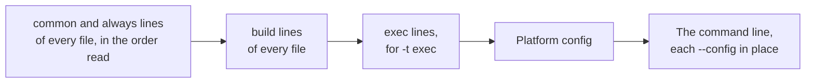

# Settings files

Options can live in `.ninjars` files, so that a project keeps its remote execution, cache and
build event settings in its repository, and `cmake --build`, an IDE or a plain `ninja-rs` builds
with them without typing them. The files have the format and features of Bazel's `.bazelrc`:
`COMMAND[:CONFIG] OPTIONS...` lines, `import` and `try-import`, `%workspace%`, `--config`,
`--announce_rc`, `--enable_platform_specific_config`.

## A minimal example

At the top of the repository, next to `.git`:

```text
# .ninjars: every build
build --disk_cache=~/.cache/ninja-rs/disk
build --remote_download_minimal

# ninja-rs --config=remote
build:remote --remote_executor=grpcs://remote.example.com
build:remote --bes_backend=grpcs://remote.example.com
build:remote --bes_results_url=https://remote.example.com/invocations/
build:remote --remote_mnemonics=Compile,Archive,Link --remote_jobs=200

# Personal settings (certificates, tokens), kept out of the repository.
try-import %workspace%/user.ninjars
```

Then, from any build directory under the repository:

```sh
ninja-rs -C build --config=remote
```

`--announce_rc` prints what each file gave, and how each `--config` expanded:

```text
ninja: reading rc options for 'build' from /src/proj/.ninjars:
  'build' options: --disk_cache=~/.cache/ninja-rs/disk --remote_download_minimal
ninja: found applicable config definition build:remote in file /src/proj/.ninjars: --remote_executor=grpcs://remote.example.com
ninja: found applicable config definition build:remote in file /src/proj/.ninjars: --bes_backend=grpcs://remote.example.com
...
```

## Where the files are

ninja-rs reads these files, in this order:

| Order | File | Turned off by |
|---|---|---|
| 1 | The system's: `/etc/ninjars` (`%ProgramData%\ninjars` on Windows). | `--nosystem_rc` |
| 2 | The workspace's: the first `.ninjars` found from the build directory up. | `--noworkspace_rc` |
| 3 | The user's: `~/.ninjars` (`%USERPROFILE%\.ninjars` on Windows). | `--nohome_rc` |
| 4 | The `--ninjars=FILE` files, in the order given. `--ninjars=/dev/null` (`NUL` on Windows) ends the list. | |

`--ignore_all_rc_files` reads none of them.

- **The build directory** is where ninja-rs builds: the current directory, or `-C DIR`.
- **The workspace file** is looked for in the build directory, then each directory above it. The
  search stops at a repository's root (a directory holding `.git`, `.hg`, `.jj`, `.sl` or
  `.svn`, whose own `.ninjars` is still read), before your home directory (whose `.ninjars` is
  the user's file), and before a file system's root. The directory holding the file is the
  workspace, `%workspace%`; without a workspace file, the build directory is.
- **A file found twice** (the workspace's is also the user's) is read once.
- **A missing file** is skipped, but for a `--ninjars=FILE`, which is an error.
- **Imports.** `import FILE` reads another file where it stands; `try-import FILE` does the same
  and skips a file that doesn't exist. Relative paths are relative to the importing file. An
  import loop is an error.

The options choosing the files (`--ninjars`, `--[no]system_rc`, `--[no]workspace_rc`,
`--[no]home_rc`, `--ignore_all_rc_files`), `-C` and `-t` only go on the command line: they are
read before any file. `--version`, `--help` and the listings (`-d list`, `-w list`, `-t list`)
are answered before any file is read, so a settings file can't change or break them (CMake runs
`--version` to find its generator).

## What goes in them

A line is `COMMAND[:CONFIG] OPTIONS...`. `#` at the start of a word comments out the rest of the
line, a line ending with `\` goes on with the next one, and words split as in a shell (quotes,
backslashes). `%workspace%` expands in imports and options.

The commands:

| Command | Applies to |
|---|---|
| `common`, `always` | Every invocation. `common` skips the options ninja-rs doesn't have (Bazel's), and with a note those whose values it can't take; `always` fails on them. |
| `build` | Builds and tools (`-t clean`, `-t targets`...). |
| `exec` | `-t exec`, which takes the `build` lines too. |
| `test`, `query`, `startup` and Bazel's other commands | Nothing: skipped, so that one file serves Bazel and ninja-rs. |

Another command is skipped with a warning (`unknown command 'bild', line skipped`).

- **Options** are those of the command line, long and short (`build -j 64 -k 0`), with Bazel's
  forms: booleans as `--name`, `--noname` or `--name=true|false|yes|no|1|0`; an empty value
  unsets an option (`--disk_cache=` turns off a cache another file sets); durations with a unit
  (`--bes_timeout=60s`).
- **Not allowed:** targets, `-C`, `-t`, `--version`, `--help`, and the options choosing files.
  An unknown option, or an invalid value, on a `build`, `exec` or `always` line is an error,
  which names the file and the line:

```text
ninja: fatal: /src/proj/.ninjars:3: unrecognized option '--remote_jobz'
```

- **Paths.** `~` expands in path options. A relative path is relative to where ninja-rs started,
  as on the command line, not to the file: use `%workspace%` or absolute paths.
- **Bazel's files.** A file whose name ends with `bazelrc` (`.bazelrc`, `user.bazelrc`), and
  what it imports, is read as leniently as `common` lines, whatever their command (its `build`
  lines still apply to builds only), and with Bazel's syntax: short options are
  Bazel's (`-c opt` is skipped), and a value after an option is the option's whatever it starts
  with (`--copt -fPIC`). So `import %workspace%/.bazelrc` takes its executor, cache and build
  event settings, and skips the rest. `--announce_rc` lists what was skipped, and the
  `--action_env` options taken from Bazel's files (they set variables in every remote action,
  and so change its key).

## Configs

`--config=NAME` adds the options of the lines named `COMMAND:NAME`, where it stands:

- On the command line, or in a file (configs nest; a cycle is an error).
- Their options come in place of `--config`: options after it win over them, options before it
  lose.
- Of a config's lines, `common:NAME` ones come first, then `build:NAME`, then `exec:NAME`.
- A config no file defines is an error: `config value 'remot' is not defined in any .ninjars
  file`. A config defined only for Bazel's commands (`test:ci`) is defined, and adds nothing.
- `--enable_platform_specific_config` adds the config named after the host's system (`linux`,
  `macos`, `windows`, `freebsd`, `openbsd`) when a file defines it, after the files' options and
  before the command line's.

## Precedence

Later options win over earlier ones, as on a command line. ninja-rs lays the options out in this
order, then reads them as one command line:



The files are read in the order of the table above (system, workspace, user, `--ninjars`), so
within one kind of line, the user's file wins over the workspace's. A `build` line wins over a
`common` line whatever file each is in, as in Bazel: a `common --disk_cache=` in `~/.ninjars`
doesn't override a `build --disk_cache=...` in the workspace's file; a `build` line there does.

Options that contradict each other are settled the same way, with one rule more: one typed on
the command line wins over one from a file, with a warning, and two typed ones are an error:

```text
ninja: warning: --remote_racing, from a settings file or the invocation running this one, is left out: --remote_strict, given here, forbids local runs
```

A build that ninja-rs runs inside a build takes the outer invocation's options first, then its
own command line (see [nested builds](nested-builds.md)). It doesn't read settings files again:
the outer invocation's options include them, and its own `--config`s are expanded from the
outer invocation's files.

## Private settings

Certificates, tokens and personal caches don't belong in the repository. Three places keep them
out of it:

- `~/.ninjars`, read for every build. It isn't trust-checked (it's yours).
- A file the workspace's file imports with `try-import` and your version control ignores:

```text
# .ninjars
try-import %workspace%/user.ninjars
```

```text
# user.ninjars (in .gitignore)
build --tls_client_certificate=~/.config/rbe/client.pem
build --tls_client_key=~/.config/rbe/client-key.pem
build --remote_header=x-api-key=YOUR_KEY
```

- `--ninjars=FILE` on the command line, or in a wrapper script.

The values of `--remote_header` and `--bes_header` show as `<redacted>` in `--announce_rc` and
in build events. See [certificates](certificates.md).

## Trust rules

A settings file decides where your sources go (the remote executor) and what runs. So the system's
and the workspace's files are skipped, with a warning, when someone other than you and the
administrators could have written them:

```text
ninja: warning: /tmp/.ninjars skipped: other users can write to /tmp: move the workspace out of it, or give the file with --ninjars=FILE
ninja: warning: /etc/ninjars skipped: other users can change it: make it yours and not writable by others (chmod go-w), or give it with --ninjars=FILE
```

**On Linux and macOS:**

- The file must be yours or root's, not writable by others, and not writable by its group
  unless the group is your own private group (named after you, with you alone in it, as Debian
  and Fedora make them).
- No directory from the build directory up to the workspace file may be writable by everyone
  (`/tmp`, a tree made with `chmod -R 777`). Past such a directory, ninja-rs only looks for a
  file to say why it skips it.

**On Windows:**

- The file, and the directories from the build directory up to it, must be owned by you,
  Administrators, SYSTEM or TrustedInstaller, and their permissions must let no one else write,
  add or delete files, or change permissions. A link and its target are both checked.
- Directories made outside your profile usually let Authenticated Users modify them, inherited
  from the drive's root (`C:\src`, `D:\work`): a `.ninjars` there is skipped until that entry
  goes. Keep the workspace under your profile, or remove the entry:

```powershell
icacls D:\work /inheritance:d
icacls D:\work /remove:g *S-1-5-11
```

- `%ProgramData%` lets anyone create files: its `ninjars` is read only when the check above
  passes.

**Under WSL, on a Windows drive** (`/mnt/c`, mounted without the `metadata` option): its files
show as yours and writable by everyone, whoever may change them on Windows. ninja-rs can't tell
who may, so it trusts only files in your profile on the drive Windows is on
(`/mnt/c/Users/<you>`), which Windows keeps yours. `<you>` is your WSL user name, or the last
part of `USERPROFILE` when `WSLENV` passes it; the drive is `SystemDrive`'s when `WSLENV`
passes it, else the drive of the Windows directory on `PATH`, else `C`. A workspace elsewhere on
a Windows drive is skipped:

```text
ninja: warning: /mnt/d/src/proj/.ninjars skipped: other users can write to /mnt/d/src/proj/build (a Windows drive, mounted without `metadata`: who may change its files can't be told, but in your profile on Windows' drive, C:\Users\<you>, which Windows keeps yours): keep the workspace there, or give the file with --ninjars=FILE
```

With the `metadata` mount option, files there keep Unix permissions, and the Linux rules apply.

Not checked: `~/.ninjars`, the `--ninjars` files (you chose them), and the files a trusted file
imports (its owner chose them: keep them as private).

## Environment variables

| Variable | Effect |
|---|---|
| `HOME` (`USERPROFILE`, then `HOME`, on Windows) | Where `~/.ninjars` is, and what `~` expands to. |
| `ProgramData` (Windows) | Where the system's file is. |
| `NINJA_RS_DAEMON=1` | Turns `--daemon` on by default; `--nodaemon` turns it off again. |
| `NINJA_STATUS` | The status line's format, as in ninja (`--status` overrides it). |
| `NINJA_RS_PARENT` | Set by ninja-rs for the commands it runs: a build started with it takes the outer invocation's options and doesn't read settings files. A shell or IDE started from a build inherits it: unset it there. |
| `SystemDrive`, `USERPROFILE`, `PATH` (WSL) | Decide which Windows profile is trusted (see above). |

`--action_env=NAME` takes `NAME`'s value from the environment. Every variable ninja-rs reads is
in the [environment reference](../reference/environment.md), and every option in the
[option reference](../reference/options.md).

## Common problems

- **A setting doesn't apply.** Run with `--announce_rc` to see which files were read, what each
  gave, and any warning about a file skipped.
- **A `common` line is overridden** by a `build` line in another file: see Precedence.
- **A path in a file points to the wrong place.** Relative paths are relative to where ninja-rs
  started: use `%workspace%`.
- **A workspace file is skipped** under `/tmp`, on a Windows drive outside your profile, or on a
  Windows drive under WSL: see the trust rules, or give the file with `--ninjars=FILE`.
- **A nested build ignores its own `.ninjars`.** Builds run by a build take the outer one's
  settings; give the inner build's options on its command line, or define a config the outer
  files hold.

## Known limitations

- `~` isn't expanded in `--ninjars=~/file`: write the path out, or let the shell expand it
  (`--ninjars ~/file`).
