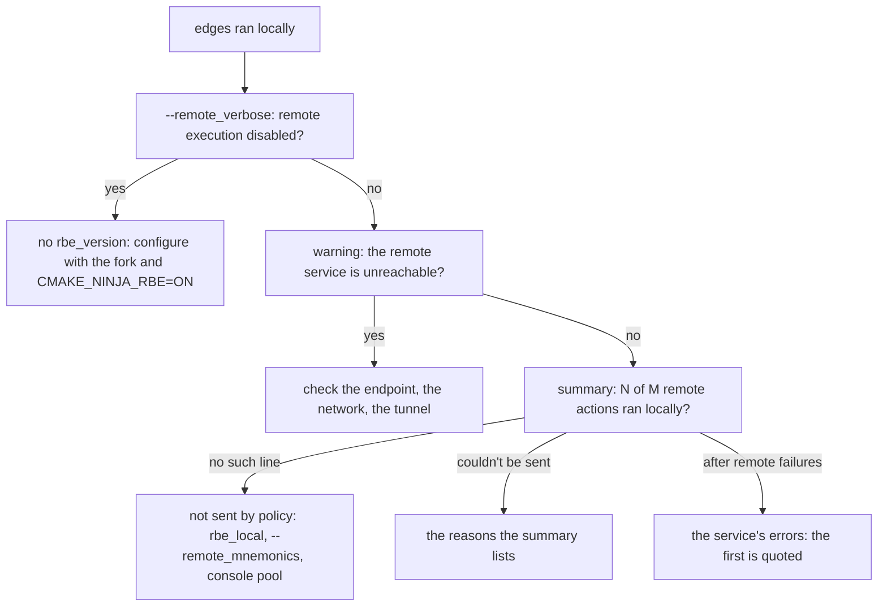

# Troubleshooting

This page lists what ninja-rs says and what it means, the debugging options, the exit codes, the
summaries at the end of a build, the files worth looking at, and the known limitations with
their workarounds.

ninja-rs prefixes its own lines with `ninja:`, as ninja does, so that IDEs and tools reading
ninja's output (`ninja: error:`, `ninja: warning:`, `FAILED:`) read them too. Status lines and
the summaries go to standard output; warnings, errors and the `--remote_verbose` lines to
standard error.

## Where to start

- **Something runs locally that should run remotely**: add `--remote_verbose`. It names each
  action that ran locally and why, and says when remote execution is off altogether.
- **Something rebuilds that shouldn't**: add `-d explain`, as with ninja.
- **Two builds don't share cache entries**: give both `--execution_log_file=FILE` and compare the
  files (see [caching](caching.md#what-the-key-covers)).
- **Something is slow**: `-d stats` prints counts and timings at exit; `--remote_verbose` prints
  the bytes transferred.

The figure is a first diagnosis for a build that ran locally when it shouldn't have.

## Messages and what they mean

### Remote execution and caches

| Message | Meaning, and what to do |
|---|---|
| `remote execution disabled: the manifest does not set rbe_version` | (`--remote_verbose`) The build file has no RBE annotations: everything runs locally. Configure with the CMake fork and `-DCMAKE_NINJA_RBE=ON` (see [CMake](cmake.md)). |
| `warning: remote execution disabled: the manifest uses RBE interface version N, this executor supports 1` | A generator newer than this ninja-rs. The build runs locally. |
| `warning: the remote service URL is unreachable, building locally: ...` | No connection, no answer, or a service saying it can't serve. The build runs locally, with the disk cache. See [when the service fails](remote-execution.md#when-the-service-fails). |
| `error: the remote service URL is unreachable (with --remote_local_fallback, the build would run locally): ...` | The same, with `--noremote_local_fallback` or `--remote_strict`. |
| `error: remote execution: CODE: message` | The service answered the first call with an error: `PERMISSION_DENIED` or `UNAUTHENTICATED` (a token), `NOT_FOUND` or `INVALID_ARGUMENT` (often the instance name). Or the toolchains file can't be read. |
| `the remote cache does not support SHA-256`, `the remote instance does not support execution` | The service can't serve this build: another instance, or `--remote_cache` instead of `--remote_executor`. |
| `warning: --remote_cache=X is left out: the cache of the executor (--remote_executor=Y) is used` | Both were given, naming different services. |
| `warning: --remote_racing, from a settings file or the invocation running this one, is left out: --remote_strict, given here, forbids local runs` | Conflicting options: the one typed on the command line wins. Both typed is an error. |
| `warning: the remote cache doesn't accept results from clients: local results aren't stored` | `--remote_cache` alone, on a service that doesn't take uploads. The build reads only. |
| `N outputs of remote actions are gone from the remote cache: building them again.` | With minimal downloads: outputs left remote were evicted since the last build. Expected after a while. |
| `rewinding OUT: IN gone from the remote cache, building again` | An input left remote was evicted during the build: its action runs again, then this one. |
| `the action can't run remotely (--remote_strict): REASON` | (In a failed action's output) The action couldn't be sent; see [why an action runs locally](remote-execution.md#why-an-action-runs-locally). |
| `remote execution failed: ...` and `not running it locally: ...` | A remote failure, past `--remote_max_fallbacks` or `--remote_max_fallback_ratio`. |
| `fetching inputs: ...` | A local command's inputs left in the remote CAS couldn't be downloaded. |
| `warning: local results aren't cached: NAME is set, which their actions can't have (--action_env=NAME gives it them)` | A variable a tool reads, which the action can't carry: local results aren't stored (see [caching](caching.md#storing-local-results)). |
| `warning: disk cache DIR disabled: ...` | The directory isn't usable as a disk cache (see [the "not ours" rule](caching.md#the-not-ours-rule)). The build goes on without it. |
| `warning: the disk cache can't store results: ...` | A write failed (a full disk, a read-only cache). Said once; hits still work. |
| `note: the disk cache DIR is Bazel's (no VERSION): ...` | A Bazel disk cache, used as it is (see [caching](caching.md#sharing-a-disk-cache)). |
| `warning: the remote service refused to splice blobs, which are uploaded whole: ...` | The service advertises splicing but refused it. Uploads still work. |
| `waiting for N uploads to the remote cache.` | Results of local runs still uploading as the build ends. Ctrl-C gives them up. |
| `interrupted: N local results not stored in the remote cache.` | Those uploads were given up; the build exits with 130. |
| `warning: Preprocessor include scanner: not exact (...); asking the compiler (...)` | Once per reason: the include scan couldn't be exact, the compiler lists the includes instead. See [include scanning](include-scanning.md). |
| `warning: Compiler include scanner: ...; scanning conservatively (...)` | The compiler couldn't list them either: the conservative scanner was used. |

### Certificates

Certificate errors fail the build: they are never retried and never run locally. See
[certificates](certificates.md) for the rules and the fixes.

| Message | Meaning |
|---|---|
| `error: the client certificate (--tls_client_certificate=FILE) expired on DATE` | Checked before connecting. Renew it. |
| `error: ... is not valid until DATE (is the clock right? it says DATE)` | A certificate from the future, or a wrong clock. |
| `warning: the client certificate (...) expires on DATE, in N days` | Less than 14 days left. Said once per invocation tree. |
| `... it refused the certificate` | The server closed the connection after asking for the client certificate: it refused it. The hint names what was sent. A draining server can cause it too (see [known limitations](#known-limitations)). |
| `... invalid peer certificate: UnknownIssuer`, with `the server's certificate isn't trusted: checked against ...` | The server's certificate doesn't chain to a CA ninja-rs trusts: `--tls_certificate`. |
| `--tls_client_certificate and --tls_client_key go together` | One was given without the other. |
| `... no PEM certificate in it (...)`, `... the private key is encrypted ...` | The file's format: the message gives the `openssl` command converting it. |

### Build events

Build event messages start with `build events:` or `build event upload`; a certificate refused
by the Build Event Service fails the build even when everything else succeeded. See
[build events](build-events.md).

### The daemon

| Message | Meaning, and what to do |
|---|---|
| `warning: the daemon: it doesn't answer (5s without a hello); see LOG` | A daemon runs but is stuck. Builds don't start another for 5 minutes. `ninja-rs -t daemon status` shows its pid: stop it (`-t daemon stop`, or kill it). |
| `warning: the daemon: it failed to start: it exited as it started (...); see LOG` | The daemon couldn't start; its log says why. |
| `warning: the daemon: it failed to start: no answer in 10s; see LOG` | It started but didn't answer in time. |
| `warning: the daemon: REASON; see LOG (ninja-rs -t daemon start tries again)` | A start failed less than 5 minutes ago: builds go without it meanwhile. `ninja-rs -t daemon start` tries at once. |
| `warning: the daemon: the daemon (pid N) speaks protocol X, not Y` | A daemon of another ninja-rs version holds the place. Stop it. |
| `warning: the daemon failed (...): the build did its work itself` | The daemon failed during the build. The build went on without it. |

In each case the build runs, without the daemon. See [the daemon](daemon.md).

### Locks and logs

| Message | Meaning |
|---|---|
| `waiting for the build running in this directory (pid N, started T ago) to finish...` | Another build holds the build directory's lock. Wait, or stop that build. |
| `warning: can't lock the logs (FILE: ...): a build running at once could undo this one's records` | The file system has no locks. Don't run two builds in that directory at once. |
| `warning: premature end of file; recovering` | The deps log ended with a record cut short (a crash, a kill, a full disk). The outputs it described build again. |
| `warning: deps log FILE: what was appended to it can't be read (...): rewritten` | Another process wrote to the deps log without taking turns, or a write was cut short: the build rewrote it from what it knows. |
| `warning: deps log FILE: ... not written to until the build holding its lock rewrites it (...)` | The same, seen by a nested build: its records wait. |
| `fatal: unknown placeholder '%x' in $NINJA_STATUS` | As in ninja. ninja-rs adds `%R`, `%H` and `%D`. |

## Debugging options

| Option | What it shows |
|---|---|
| `--remote_verbose` | Each remote decision: hits, executions, local runs and why, entries ignored, results not cached, transfers, evictions (see [remote execution](remote-execution.md#seeing-what-happened)). |
| `--execution_log_file=FILE` | Each action's key, command, environment, platform and inputs, as JSON lines. |
| `-d explain` | Why each edge is dirty (`ninja explain: ...`, on standard error). |
| `-d stats` | Counts and timings of the manifest load, the logs, the dependency scan, at exit. |
| `-d keepdepfile`, `-d keeprsp` | Keep depfiles and response files after use. |
| `-n` | Dry run: no command runs, and the remote service isn't contacted. |
| `--announce_rc` | The options each settings file gave (see [settings](settings.md)). |

## Exit codes

| Code | When |
|---|---|
| 0 | Success, or nothing to do. |
| 1 | An error: bad options, a manifest that doesn't load, a service unreachable without fallback, a build error of ninja-rs's own. Also `-h`, `-d list` and `-w list`, as in ninja; and a certificate refused by the Build Event Service, even after a successful build. |
| The last failed command's code | A failed build, as ninja 1.13: the exit code of the last command that failed (2 for many tools), or 1 when that code would read as success (0, or a multiple of 256 on POSIX). |
| 130 | Interrupted during the build: SIGINT, SIGTERM or SIGHUP, Ctrl-C or Ctrl-Break, whichever. Also an interrupt while the end of an otherwise successful build waits for its uploads, and a third interrupt, which exits at once. |
| 128 + signal | Interrupted before the build loop (loading the manifest, connecting, waiting for the lock): 130 for SIGINT, 143 for SIGTERM, 129 for SIGHUP. The invocation's build events end first (2 s at most). |
| 141 | A tool (`-t targets`, `-t commands`...) writing to a closed pipe, on POSIX, as ninja. |

A command that exits with 130 itself fails the build with code 130, which looks like an
interruption to the caller (see [known limitations](#known-limitations)).

## Summaries

A build ends with lines summing up what would otherwise go unnoticed. Each appears only when it
has something to say, in this order:

| Line | Meaning |
|---|---|
| `ninja: 2 commands failed:` with their outputs | Failed commands, named again before `build stopped` when other output followed them. |
| `ninja: build stopped: subcommand failed.` (or `interrupted by user.`) | As in ninja. |
| `ninja: waiting for N uploads to the remote cache.` | Results of local runs still uploading. |
| `ninja: N remote actions (M remote cache hits).` | Actions run remotely, and those found in the remote cache. |
| `ninja: racing: N actions finished first locally, M remotely.` | With `--remote_racing`. |
| `ninja: remote transfers: ...` | With `--remote_verbose`: bytes downloaded and uploaded, and on the wire. |
| `ninja: warning: the daemon failed (...): ...` | The daemon gave up during the build. |
| `ninja: N of M remote actions ran locally: ...` | Actions the policy sent remotely that ran locally: those that `couldn't be sent` (by reason) and those `after remote failures` (the first quoted). A warning when there were remote failures. See [remote execution](remote-execution.md#why-an-action-runs-locally). |
| `N compiles' includes were the compiler's, ...`, `N compiles were scanned conservatively (...)` | Compiles whose includes the preprocessor scanner couldn't tell exactly (see [include scanning](include-scanning.md)). Part of the line above when there is one. |
| `ninja: N local results were not cached: ...` | Results of local runs on a cache miss that weren't stored, by reason (see [caching](caching.md#the-summary-of-results-not-cached)). |
| `ninja: N disk cache hits.` | Actions restored from the disk cache. |
| `ninja: disk cache: evicted N entries (M MiB).` | With `--remote_verbose`, when eviction ran. |

## Files to look at

| File | What it tells |
|---|---|
| `build.ninja` | The edges' `rbe_local` and `rbe_mnemonic` bindings, and `rbe_version` at the top. |
| `CMakeFiles/rbe_toolchains.json` | The tools declared: their inputs, platform, which run locally. |
| `CMakeFiles/rbe_targets.json` | Targets, labels and configurations, for build events. |
| `.ninja_rs_log`, `.ninja_rs_deps` | ninja-rs's build log and deps log (`-t deps` reads the latter). |
| `.ninja_remote` | With minimal downloads: the outputs left in the remote CAS. Deleting it makes the next build run their actions again. |
| `.ninja_rs_digests` | Digests of files, kept between builds. Safe to delete (files are hashed again). |
| `.ninja_rs_lock` | The lock of the build directory's logs, naming its holder. |
| The execution log | `--execution_log_file`. |
| The daemon's log | `ninja-rs -t daemon status` prints its path: in `%LOCALAPPDATA%\ninja-rs\daemon` on Windows, `$XDG_RUNTIME_DIR/ninja-rs` (or `/tmp/ninja-rs-<uid>`) elsewhere, with the reason of a failed start next to it. |

The state files are in the build directory, or in `$builddir` when the build file sets it. The
full list, with their formats, is in [files](../reference/files.md); the environment variables
ninja-rs reads and sets are in [environment](../reference/environment.md).

## Known limitations

These are known problems a user can hit today, each with a workaround. They are tracked, and
this list shrinks as they are fixed.

### Builds

- **Cache lookups are bounded by `-j`** without remote execution (`--disk_cache` or
  `--remote_cache` alone): each lookup takes a local slot, so a fully cached build behind a
  remote cache with 15 ms of round trip took 8 s for 200 compiles at `-j2`, 1 s at `-j16`. Raise
  `-j` when most actions hit, or use `--remote_executor` if the service executes too.
- **Fallbacks pile up as "running".** Actions falling back to local runs free their remote slot,
  so more remote actions start and fall back too; they wait for local slots counted as running,
  and their times include the wait. Fix the cause of the fallbacks (the summary names it).
- **A command exiting with 130** is a failure with code 130 (`FAILED: [code=130]`), and the build
  exits with 130; ninja 1.13 takes it as an interruption. With `-k 0` the build goes on.
- **`-d explain` prints every explanation during the dependency scan**, including for edges a
  `restat` later skips, and a line about phony outputs such as `.FORCE`; ninja prints each as
  the edge starts. Read it as the list of what the scan found dirty.
- **`build a: phony || a`** is a dependency cycle error; ninja warns and builds.
- **`-t compdb`** writes one entry per input, as ninja's development branch does; ninja 1.13
  writes one per edge. `-t multi-inputs` and `-t browse` don't exist.
- **A nested build can outlive its parent.** When a build is killed hard (SIGKILL), a build it
  ran in the same directory (a custom command running ninja-rs) goes on, and a new build there
  doesn't wait for it: both may write the same outputs. Make sure the old build's processes are
  gone before starting a new one.
- **Ctrl-C as a large output is being stored** (hashed and copied into the disk cache after its
  command finished) can delete that finished output. The next build runs it again.
- **A compiler driver hanging in its dry run** (`-###`, run to analyse a link) hangs the build:
  that run has no time limit. Interrupt the build, and keep links local
  (`--remote_mnemonics=Compile,Archive`) while the driver misbehaves.

### Remote execution and caches

- **ASan links on Windows workers fail** (`LNK1104`): objects built with cl's
  `/fsanitize=address` make the linker add the ASan runtime libraries from `LIB`, which ninja-rs
  doesn't send, nor put in the key. Link those targets locally
  (`--remote_mnemonics=Compile,Archive`).
- **Libraries named by an object's directives** and found in the working directory or by an
  absolute path aren't sent with a remote MSVC link. Make them declared inputs of the link, or
  link locally.
- **`-march=native`** (and `-mcpu=native`, `-mtune=native`): the output depends on the CPU that
  ran the compile, which the key doesn't capture. Use an explicit CPU with a shared cache.
- **A toolchain updated in place during a build** can have new outputs stored under the old key.
  Don't update a toolchain while a build runs.
- **A toolchain file unreadable for a moment** (a sharing violation, too many open files) keeps
  the actions needing it local (or failing, with `--remote_strict`) for 5 s. Raise the open-file
  limit; on Windows, exclude the toolchain from on-access scanners.
- **Uploads given up in the background** (an output rewritten in place since it was hashed, such
  as by a signing step; a blob gone from the disk cache; a server error) are only reported with
  `--remote_verbose`, not in the summary.
- **Some reasons in the "not cached" summary are counted per file**: those that start with the
  file's path (`reading PATH: ...`, a depfile that can't be parsed).
- **Large local results take room twice** in the disk cache's `tmp/` while they upload, when the
  disk cache holds them as chunks.
- **With minimal downloads, a header produced by a remote action** isn't downloaded, and the
  scanners look at local files: a compile including it may run with the wrong inputs or fail
  remotely. Download all outputs for builds generating headers in remote actions.

### Include scanning

The default preprocessor scanner is exact on real projects, and takes the compiler's list when it
can't be. These are the cases where that can go wrong; see [include scanning](include-scanning.md).

- **The conservative scanner can miss headers behind computed includes** (`#include MACRO` whose
  path depends on macros defined elsewhere, or on command-line definitions, or on several
  definitions). A header only probed by `__has_include` then silently takes the other branch on
  the worker: a wrong object. Otherwise the remote compile fails. The conservative scanner only
  runs when the compiler can't list a compile's includes, or when chosen: keep the default
  `--remote_include_scanner=preprocessor`.
- **The conservative scanner** also ignores `#pragma include_alias`, misses header symlinks to
  files generated later, and looks up angled names built from macros literally: the remote
  compile fails.
- **cl without `/Zc:preprocessor`** (its traditional preprocessor): some macro constructs, which
  cl accepts without a warning, expand differently in ninja-rs's model, which may still claim to
  be exact. A fix is in progress: such constructs will be inexact, and the compiler's list used.
  Meanwhile, use `/Zc:preprocessor`, or `--remote_include_scanner=compiler` for code with heavy
  macro tricks.
- **When the preprocessor scan fails outright** (a flag it doesn't support, options in `CL`), the
  compiler's list is used without the files only `__has_include` probes, which compilers don't
  list: such a file isn't sent, and the remote compile takes the other branch. The same holds
  with `--remote_include_scanner=compiler`.
- **cl-style compilers printing `/showIncludes` notes in another language**, without CMake's
  `msvc_deps_prefix`: the compiler's list is read as empty, and the remote compile fails.
- **cl takes `X.C` as C**, the scanner as C++.
- **Windows with libc++ and `<windows.h>`** without `NOMINMAX`: every such compile is inexact,
  and runs the compiler's preprocessor each time it is prepared. Define `NOMINMAX`.
- **The compiler's failure reason** in a scanner warning may quote an include note naming a file
  called `error...`, rather than the error.

### Connections and certificates

- **A draining server can look like a certificate refusal.** A server with client certificates
  that closes connections as it shuts down may be judged to have refused the certificate: the
  build fails with `it refused the certificate`, even with fallback. Run the build again.
- **A draining server without client certificates** may fail the build with `transport error:
  ... broken pipe` instead of falling back. Run the build again.
- **The commonest mTLS mistake** (no client certificate, TLS 1.3) reads with an internal error
  dump after `it refused the certificate`. The hint line below it is the part to read.
- **`INTERNAL: h2 protocol error: ... not a result of an error`** means the server closed the
  connection (HTTP/2 `GOAWAY`), not an internal error.
- **`--tls_authority_override`** changes the name the server's certificate is checked against and
  the TLS server name, not the HTTP/2 `:authority` header (Bazel changes both).
- **The Build Event Service** is tried twice at the start: a load balancer restarting at that
  moment loses the invocation's events. A Build Event Service over TLS that never answers holds
  the start up to 5 s.

### The daemon

- **Case-sensitive directories** on case-insensitive systems (Windows' per-directory setting,
  WSL's `case=dir`, case-sensitive APFS volumes): `Foo.h` and `foo.h` can be taken for each other.
  Don't use `--daemon` there.
- **8.3 short names**: a file asked for by its short name under a watched directory can be stale.
- **A daemon whose event reader failed** makes each build wait 2 s (Linux) and trusts nothing
  until it exits; one failing on a header drops its caches at every build. Stop it
  (`ninja-rs -t daemon stop`) and report the log.
- **A daemon that answers its hello but no request** makes each build wait 120 s; on Windows, one
  that stopped accepting connections takes 12 s and is reported as `no answer in 10s`. Stop it,
  or kill it by the pid `-t daemon status` shows.
- **Under floods of file changes on Linux**, requests can stall for seconds.
- **On Windows, files written by host steps of remote actions** (a `POST_BUILD` copy) may be seen
  late by the next request of the same build.
- **A daemon started by hand** during the 5-minute back-off isn't used: start it with
  `ninja-rs -t daemon start`, which clears the back-off.
- **Cookie files.** On Windows, a watched directory that isn't a git checkout gets short-lived
  `.ninja-rs-cookie-*` files at its top: they may show in `git status` for a moment.

### Windows

- **MSVC links fail from deep build directories** when run locally (`LNK1181: cannot open input
  file 'kernel32.lib'`): `link.exe` isn't long-path aware. Use a shorter build directory path.
- **A command's working directory** must be shorter than 260 characters, as with ninja.

See also [platforms](platforms.md#known-limitations).
